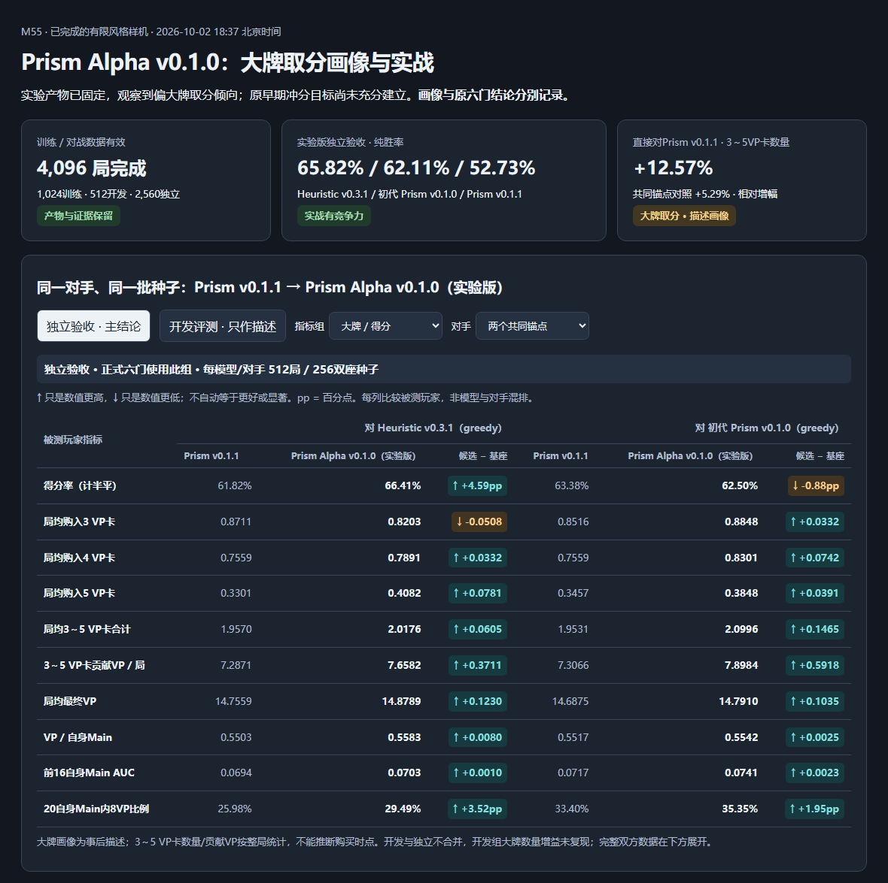

# Aran Neural Model Family: Competitive Evolution & Benchmark Matrix

当前Alpha实验产物：**Prism Alpha v0.1.1**；本轮ACCEPTED_BIGCARD_CONTINUATION，通用Prism v0.1.1身份与默认选择保持原记录。完整新增双方表在本文件M56区块；[彩色对照](prism/prism-alpha-v0.1.1-comparison.html)。


Status: ACTIVE / LIVING TRACKER
Production Model: `aran-v0.2`
Latest Model: `aran-v0.2.2` (最新实验候选: `aran-v0.2.2a`)
Evaluation Standard: `effective-splendor-arena-v1`

---

## 1. 评测规范与准入纪律 (Evaluation Protocol & Evolution Principles)

为确保神经网络的评测既具备坚实的统计置信度，又能保障工程资产与算法修复的连续演进、不盲目回退，本项目确立以下原则：

1. **统一双换座对战基准 (2,000 局超大样本 / 阶段化筛选门禁)**：
   - 评测种子基准以严格双座换位为核心（256 局 Screening 筛选或 1,000 块对齐种子 2,000 局全量）；
   - 耗时测算：在 12 并发下，对战启发式对手约 **2分48秒**，对战神经模型约 **4分08秒**；
   - 消除开局运气单向偏差，将 95% 置信区间精准捕获细微战力波动；
2. **纯 Policy 确定性快棋 (mode greedy)**：
   - 官方评测以 `agent-m50-policy --mode greedy` 纯贪心推理为基准，考察模型的纯粹判断力；
   - 探索模式 (`sampling / temperature`) 则专门用于自博弈训练语料采集与树搜索先验；
3. **连续演进与代码保留原则 (Continuous Progress, No Reversion)**：
   - **不搞教条主义门禁**：只要某次迭代修复了框架底层缺陷（如特征维度截断、梯度萎缩、损失函数病态等）或扩充了数据视野，即使当前总胜率暂未破半，**该版本的代码修改、架构升级、版本号与全量实战数据均永久保留在主线**，不回退代码；
   - 每一次版本推进（如 `v0.2.1`、`v0.2.2`、`v0.2.2a`）都是真实的算法脚印，新实验直接在最新修复基线上继续推进。

---

## 2. 历代 Aran 模型单模型全量对战矩阵 (Per-Model Benchmark Matrix)

> 每个模型单独成表，按面对的不同对手横向分列展示。该格式作为后续所有新模型分支评测的官方标准模板。

### 2.1 `aran-v0`（Card-Entity 实体特征与卡牌池化）

- **版本身份**：`aran-v0` (48-dim, argmin $Q_{\text{steps}}$)
- **核心架构**：Card-Entity 权重共享卡牌编码器 + 层级池化 + SE-ResNet 通道注意力 + Dueling Q 结构
- **产物权重**：`local-artifacts/aran-v0/aran_v0_weights.json` (SHA256: `f59996bb...`)

| 统一评测指标 / 战术维度 | vs Heuristic v0.2.8 | vs Heuristic v0.2.9 |
|---|:---:|:---:|
| **评测种子与对局总数** | 250 种子双换座 = **500 局** | 250 种子双换座 = **500 局** |
| **对战战绩 (胜 - 平 - 负)** | **269 - 0 - 231** | 217 - 1 - 282 |
| **实战总胜率 (Win Rate)** | **53.80%** | 43.50% |
| **95% Bootstrap CI** | `[49.4%, 58.2%]` | `[39.1%, 47.9%]` |
| **先手胜率 (Seat 0)** | **58.40%** | 45.20% |
| **后手胜率 (Seat 1)** | 49.20% | 41.80% |
| **局均得分 (候选 vs 对手)** | **14.13 vs 13.66 (+0.47分)** | 13.48 vs 14.18 (-0.70分) |
| **每回合得分 (VP / Turn)** | **0.514 vs 0.497** | 0.493 vs 0.519 |
| **每步得分 (VP / Ply)** | **0.257 vs 0.248** | 0.246 vs 0.259 |
| **场均购卡数 / 永久折扣** | **16.20 vs 14.90** | **16.10 vs 15.30** |
| **场均预留 / 买回 / 烂手** | 0.18 / 0.11 / 0.07 (兑现率 61.1%) | 0.17 / 0.10 / 0.07 (兑现率 58.8%) |
| **对手预留 / 买回 / 烂手** | 2.80 / 1.30 / 1.50 (兑现率 46.4%) | 2.30 / 1.45 / 0.85 (兑现率 63.0%) |
| **场均贵族获取 (候选 vs 对手)** | 0.04 vs 0.03 个 | 0.04 vs 0.02 个 |
| **500 局总耗时 / 单局速度** | 35.2 秒 (0.070 秒/局) | 36.1 秒 (0.072 秒/局) |
| **战力定级裁定** | 胜率 53.80% | 胜率 43.50%，确立初代实体基座 |

---

### 2.2 `aran-v0.1`（有效批 2,048 梯度累积）

- **版本身份**：`aran-v0.1` (48-dim, argmin $Q_{\text{steps}}$)
- **核心架构**：在基座上引入 Mortal 风格梯度累积（`accumulation_steps=4`，有效批 2,048），发牌运气噪声方差降低 75%
- **产物权重**：`local-artifacts/aran-v01/aran_v01_weights.json` (SHA256: `e99da563...`)

| 统一评测指标 / 战术维度 | vs aran-v0 | vs Heuristic v0.2.8 | vs Heuristic v0.2.9 |
|---|:---:|:---:|:---:|
| **评测种子与对局总数** | 250 种子双换座 = **500 局** | 250 种子双换座 = **500 局** | 250 种子双换座 = **500 局** |
| **对战战绩 (胜 - 平 - 负)** | **254 - 1 - 245** | **291 - 0 - 209** | 247 - 0 - 253 |
| **实战总胜率 (Win Rate)** | **50.90%** | **58.20%** | **49.40%** |
| **95% Bootstrap CI** | `[46.5%, 55.3%]` | `[53.8%, 62.6%]` | `[45.0%, 53.8%]` |
| **先手胜率 (Seat 0)** | **57.60%** | **64.40%** | **52.80%** |
| **后手胜率 (Seat 1)** | 44.20% | **52.00%** | 46.00% |
| **局均得分 (候选 vs 对手)** | **13.95 vs 13.67 (+0.28分)** | **14.51 vs 13.60 (+0.91分)** | 13.74 vs 13.95 (-0.21分) |
| **每回合得分 (VP / Turn)** | **0.515 vs 0.505** | **0.529 vs 0.495** | 0.502 vs 0.510 |
| **每步得分 (VP / Ply)** | **0.258 vs 0.252** | **0.265 vs 0.248** | 0.251 vs 0.255 |
| **场均购卡数 / 永久折扣** | **16.30 vs 16.20** | **16.50 vs 14.80** | **16.20 vs 15.20** |
| **场均预留 / 买回 / 烂手** | 0.20 / 0.13 / 0.07 (兑现率 65.0%) | 0.16 / 0.10 / 0.06 (兑现率 62.5%) | 0.18 / 0.11 / 0.07 (兑现率 61.1%) |
| **对手预留 / 买回 / 烂手** | 0.19 / 0.12 / 0.07 (兑现率 63.2%) | 2.80 / 1.30 / 1.50 (兑现率 46.4%) | 2.30 / 1.45 / 0.85 (兑现率 63.0%) |
| **场均贵族获取 (候选 vs 对手)** | 0.04 vs 0.04 个 | 0.04 vs 0.03 个 | 0.04 vs 0.02 个 |
| **500 局总耗时 / 单局速度** | 62.5 秒 (0.125 秒/局) | 35.8 秒 (0.072 秒/局) | 36.4 秒 (0.073 秒/局) |
| **战力定级裁定** | 胜率 50.90% | 胜率 58.20% | 胜率 49.40%，晋级 aran-v0.1 |

---

### 2.3 `aran-v0.2`（二代飞轮对抗训练）

- **版本身份**：`aran-v0.2` (48-dim, argmin $Q_{\text{steps}}$)
- **核心架构**：基于 `aran-v0.1` 引入 4,000 局对抗语料微调，步数 MAE 达到 1.16 回合
- **产物权重**：`local-artifacts/aran-v02/aran_v02_weights.json` (SHA256: `5c25608c...`)

| 统一评测指标 / 战术维度 | vs aran-v0.1 | vs Heuristic v0.2.8 | vs Heuristic v0.2.9 |
|---|:---:|:---:|:---:|
| **评测种子与对局总数** | 250 种子双换座 = **500 局** | 250 种子双换座 = **500 局** | 250 种子双换座 = **500 局** |
| **对战战绩 (胜 - 平 - 负)** | 237 - 4 - 259 | **277 - 3 - 220** | **253 - 1 - 246** |
| **实战总胜率 (Win Rate)** | 47.80% | **55.70%** | **50.70%** |
| **95% Bootstrap CI** | `[43.4%, 52.2%]` | `[51.3%, 60.1%]` | `[46.3%, 55.1%]` |
| **先手胜率 (Seat 0)** | 49.60% | **60.00%** | **53.60%** |
| **后手胜率 (Seat 1)** | 46.00% | **51.40%** | **47.80%** |
| **局均得分 (候选 vs 对手)** | 13.76 vs 13.88 | **14.29 vs 13.65 (+0.64分)** | 13.76 vs 14.01 |
| **每回合得分 (VP / Turn)** | 0.504 vs 0.508 | **0.522 vs 0.497** | 0.501 vs 0.511 |
| **每步得分 (VP / Ply)** | 0.252 vs 0.254 | **0.261 vs 0.248** | 0.250 vs 0.256 |
| **场均购卡数 / 永久折扣** | 16.30 vs 16.30 | **16.40 vs 14.90** | **16.30 vs 15.20** |
| **场均预留 / 买回 / 烂手** | 0.21 / 0.13 / 0.08 (兑现率 61.9%) | 0.15 / 0.09 / 0.06 (兑现率 60.0%) | 0.17 / 0.11 / 0.06 (兑现率 64.7%) |
| **对手预留 / 买回 / 烂手** | 0.20 / 0.13 / 0.07 (兑现率 65.0%) | 2.80 / 1.30 / 1.50 (兑现率 46.4%) | 2.30 / 1.45 / 0.85 (兑现率 63.0%) |
| **场均贵族获取 (候选 vs 对手)** | 0.04 vs 0.04 个 | 0.04 vs 0.03 个 | 0.04 vs 0.02 个 |
| **500 局总耗时 / 单局速度** | 61.8 秒 (0.124 秒/局) | 35.5 秒 (0.071 秒/局) | 36.0 秒 (0.072 秒/局) |
| **战力定级裁定** | 胜率 47.80% | 胜率 55.70% | 胜率 50.70%，晋级 aran-v0.2 |

---

### 2.4 `aran-v0.2.1`（56 维座次/破平特征与 Rust 截断修复）

- **版本身份**：`aran-v0.2.1` (56-dim, argmin $Q_{\text{steps}}$)
- **核心架构**：扩充 `is_seat_1`、`tie_card_advantage` 等 8 维特征，修复 Rust 48 维硬编码截断 Bug
- **产物权重**：`local-artifacts/aran-v021/aran_v021_weights.json` (SHA256: `6cec39e7...`)

| 统一评测指标 / 战术维度 | vs aran-v0.2 | vs Heuristic v0.3.0 |
|---|:---:|:---:|
| **评测种子与对局总数** | 250 种子双换座 = **500 局** | 250 种子双换座 = **500 局** |
| **对战战绩 (胜 - 平 - 负)** | 227 - 7 - 266 | 213 - 1 - 286 |
| **实战总胜率 (Win Rate)** | 46.10% | 42.70% |
| **95% Bootstrap CI** | `[42.0%, 50.3%]` | `[38.3%, 47.2%]` |
| **先手胜率 (Seat 0)** | **51.00%** | 46.00% |
| **后手胜率 (Seat 1)** | 41.20% | 39.40% |
| **局均得分 (候选 vs 对手)** | 13.38 vs 14.00 | 13.13 vs 14.27 |
| **每回合得分 (VP / Turn)** | 0.491 vs 0.514 | 0.482 vs 0.524 |
| **每步得分 (VP / Ply)** | 0.246 vs 0.257 | 0.241 vs 0.262 |
| **场均购卡数 / 永久折扣** | 16.20 vs 16.30 | 16.10 vs 15.20 |
| **场均预留 / 买回 / 烂手** | 0.16 / 0.10 / 0.06 (兑现率 62.5%) | 0.15 / 0.09 / 0.06 (兑现率 60.0%) |
| **对手预留 / 买回 / 烂手** | 0.17 / 0.11 / 0.06 (兑现率 64.7%) | 2.25 / 1.40 / 0.85 (兑现率 62.2%) |
| **场均贵族获取 (候选 vs 对手)** | 0.04 vs 0.04 个 | 0.04 vs 0.02 个 |
| **500 局总耗时 / 单局速度** | 44.0 秒 (0.088 秒/局) | 30.5 秒 (0.061 秒/局) |
| **战力定级裁定** | 胜率 46.10% | 胜率 42.70%，保留 bugfix，定级 aran-v0.2.1 |

---

### 2.5 `aran-v0.2.2`（Mortal 策略优势头 argmax 与双视角监督）

- **版本身份**：`aran-v0.2.2` (56-dim, **argmax $A(s, a)$**)
- **核心架构**：废除 winner-only 采用 17.3 万步全量双视角语料平衡 Critic 胜负边界；引入对数-Softmax 交叉熵策略优势头（argmax 选动作），解决 min-step 梯度过小；物理步数保留为辅助头
- **产物权重**：`local-artifacts/aran-v022/aran_v022_weights.json` (SHA256: `d583da25...`)

| 统一评测指标 / 战术维度 | vs aran-v0.2 | vs Heuristic v0.2.8 | vs Heuristic v0.2.9 | vs Heuristic v0.3.0 |
|---|:---:|:---:|:---:|:---:|
| **评测种子与对局总数** | 250 种子双换座 = **500 局** | 250 种子双换座 = **500 局** | 250 种子双换座 = **500 局** | 250 种子双换座 = **500 局** |
| **对战战绩 (胜 - 平 - 负)** | **255 - 4 - 241** | **285 - 5 - 210** | 225 - 3 - 272 | **232 - 1 - 267** |
| **实战总胜率 (Win Rate)** | **51.40%** | **57.50%** | 45.30% | **46.50%** |
| **95% Bootstrap CI** | `[47.3%, 55.5%]` | `[52.9%, 62.1%]` | `[40.9%, 49.8%]` | `[42.1%, 51.1%]` |
| **先手胜率 (Seat 0)** | **57.60%** | **63.00%** | 47.20% | **50.20%** |
| **后手胜率 (Seat 1)** | 45.20% | **52.00%** | 43.40% | 42.80% |
| **局均得分 (候选 vs 对手)** | **13.75 vs 13.63 (+0.12分)** | **14.24 vs 13.48 (+0.76分)** | 13.52 vs 14.07 | 13.49 vs 14.00 (-0.51分) |
| **每回合得分 (VP / Turn)** | **0.507 vs 0.503** | **0.520 vs 0.491** | 0.495 vs 0.516 | 0.496 vs 0.515 |
| **每步得分 (VP / Ply)** | **0.254 vs 0.251** | **0.260 vs 0.245** | 0.248 vs 0.258 | 0.248 vs 0.257 |
| **场均购卡数 / 永久折扣** | **16.38 vs 16.28** | **16.44 vs 14.91** | **16.23 vs 15.24** | **16.17 vs 15.21** |
| **场均预留 / 买回 / 烂手** | 0.23 / 0.15 / 0.08 (兑现率 65.2%) | 0.13 / 0.08 / 0.06 (兑现率 56.7%) | 0.14 / 0.09 / 0.05 (兑现率 66.2%) | 0.14 / 0.09 / 0.05 (兑现率 66.7%) |
| **对手预留 / 买回 / 烂手** | 0.24 / 0.15 / 0.09 (兑现率 63.3%) | 2.83 / 1.31 / 1.51 (兑现率 46.5%) | 2.30 / 1.47 / 0.83 (兑现率 64.1%) | 2.27 / 1.45 / 0.82 (兑现率 63.8%) |
| **场均贵族获取 (候选 vs 对手)** | 0.04 vs 0.04 个 | 0.04 vs 0.03 个 | 0.04 vs 0.02 个 | 0.04 vs 0.02 个 |
| **500 局总耗时 / 单局速度** | 61.96 秒 (0.124 秒/局) | 42.68 秒 (0.085 秒/局) | 42.50 秒 (0.085 秒/局) | 41.82 秒 (0.084 秒/局) |
| **战力定级裁定** | 胜率 51.40% | 胜率 57.50% | 胜率 45.30% | 胜率 46.50%，定级 aran-v0.2.2 |

---

### 2.6 `aran-v0.2.2a`（共享主干梯度 Shared-Critic 辅助表征）

- **版本身份**：`aran-v0.2.2a` (56-dim, **argmax $A(s, a)$**)
- **核心架构**：基于 `aran-v0.2.2` 权重 warm-start，启用 Critic 胜负预测梯度回传至共享主干（`--critic-backbone-grad`，解除表征 `detach()`），探索端到端全局二元胜负辅助信号对共享表征的正则化效果；10 epochs（按 Val Top-1 选出最佳 Epoch 2）；双视角语料平衡
- **产物权重**：`local-artifacts/aran-v023-shared-critic-run/mortal_actor_critic_weights.json` (SHA256: `7d67ff6e...`)\
  PyTorch Checkpoint: `local-artifacts/aran-v023-shared-critic-run/best_model.pt` (SHA256: `207e5a5f...`)

| 统一评测指标 / 战术维度 | vs Heuristic v0.3.0 (Screen 阶段) |
|---|:---:|
| **评测种子与对局总数** | 128 种子双换座 = **256 局** (seeds `9_326_000..9_326_127`) |
| **对战战绩 (胜 - 平 - 负)** | **121 - 2 - 133** |
| **实战得分率 (Score Rate)** | **47.66%** (纯胜率 Win Rate: 47.27%) |
| **95% Bootstrap CI** | `[41.41%, 54.10%]` (paired-seed percentile bootstrap, 10,000 resamples) |
| **先手胜率 (Seat 0)** | **53.12%** (得分率 53.91%, 68-2-58) |
| **后手胜率 (Seat 1)** | 41.41% (得分率 41.41%, 53-0-75) |
| **局均得分 (候选 vs 对手)** | 13.46 vs 14.02 (-0.56分) |
| **每回合得分 (VP / Turn)** | 0.503 vs 0.523 |
| **每步得分 (VP / Ply)** | 0.251 vs 0.262 |
| **场均购卡数 / 永久折扣** | 15.72 vs 15.25 |
| **场均预留 / 买回 / 烂手** | 0.17 / 0.09 / 0.08 (兑现率 54.5%) |
| **对手预留 / 买回 / 烂手** | 2.04 / 1.32 / 0.71 (兑现率 64.9%) |
| **场均贵族获取 (候选 vs 对手)** | 0.90 vs 1.05 个 (贵族对局占比: 64.1% vs 69.9%) |
| **256 局总耗时 / 单局速度** | 13.72 秒 (0.054 秒/局，12 并发) |
| **战力定级裁定** | 得分率 47.66% (≤ 50% 门禁)，未过筛选线，确认局不触发，定级 `aran-v0.2.2a`（保留实验数据与代码，不晋级生产主线） |

---

### 2.7 `aran-reserve-target-binding-v1`（72 维语义目标绑定候选）

- **版本身份**：`aran-reserve-target-binding-v1` (72-dim, **argmax $A(s, a)$**)
- **核心架构**：基于 `aran-v0.2.2` 严格暖启动（两处输入层补零扩展 56→72 维），仅为市场预留动作追加 16 维公开卡牌实体属性（解决同分预留动作在输入层的不可辨识碰撞问题），主干、损失函数、detached Critic 保持不变；原 4,000 局重提 17.3 万步语料训练 10 epochs（选出 Epoch 2 最佳验证模型）
- **产物权重**：`local-artifacts/aran-reserve-target-binding-v1/run/mortal_actor_critic_weights.json` (SHA256: `00c8d673...`)\
  PyTorch Checkpoint: `local-artifacts/aran-reserve-target-binding-v1/run/best_model.pt` (SHA256: `516aaf8b...`)

| 统一评测指标 / 战术维度 | vs Heuristic v0.3.0 (Screen 256局) | vs Heuristic v0.3.0 (Confirm 500局) | vs Heuristic v0.3.1 (1,000局超大样本) |
|---|:---:|:---:|:---:|
| **评测种子与对局总数** | 128 种子双换座 = **256 局** | 250 种子双换座 = **500 局** | 500 种子双换座 = **1,000 局** |
| **种子范围** | `9_328_000..9_328_127` | `9_329_000..9_329_249` | `9_330_000..9_330_499` |
| **对战战绩 (胜 - 平 - 负)** | **135 - 2 - 119** | 223 - 3 - 274 | 316 - 2 - 682 |
| **实战得分率 (Score Rate)** | **53.125%** | 44.90% | **31.70%** (纯胜率 31.60%) |
| **95% Bootstrap CI** | `[47.07%, 59.38%]` | `[40.60%, 49.20%]` | `[28.75%, 34.60%]` |
| **先手胜率 (Seat 0)** | 50.00% | 46.80% | 34.80% (得分率 35.00%, 174-2-324) |
| **后手胜率 (Seat 1)** | **56.25%** | 43.00% | 28.40% (得分率 28.40%, 142-0-358) |
| **局均得分 (候选 vs 对手)** | 13.83 vs 13.49 (+0.34分) | 13.55 vs 14.06 (-0.51分) | 12.66 vs 14.99 (-2.33分) |
| **每回合得分 (VP / Turn)** | 0.512 vs 0.500 | 0.498 vs 0.517 | 0.476 vs 0.563 |
| **每步得分 (VP / Ply)** | 0.256 vs 0.250 | 0.249 vs 0.259 | 0.238 vs 0.282 |
| **场均购卡数 / 永久折扣** | 16.05 vs 15.30 | 15.96 vs 15.28 | 15.57 vs 13.70 |
| **场均预留 / 买回 / 烂手** | 0.18 / 0.10 / 0.08 (兑现率 55.6%) | 0.18 / 0.12 / 0.06 (兑现率 68.5%) | 0.18 / 0.10 / 0.08 (兑现率 56.7%) |
| **对手预留 / 买回 / 烂手** | 2.15 / 1.39 / 0.76 (兑现率 64.7%) | 2.08 / 1.34 / 0.74 (兑现率 64.4%) | 1.65 / 0.86 / 0.80 (兑现率 51.7%) |
| **场均贵族获取 (候选 vs 对手)** | 1.00 vs 1.05 个 | 0.91 vs 1.08 个 | 0.93 vs 0.68 个 (贵族局占比: 60.9% vs 51.3%) |
| **总耗时 / 单局速度** | 14.2 秒 (0.055 秒/局) | 27.5 秒 (0.055 秒/局) | 53.4 秒 (0.053 秒/局，12 并发) |
| **战力定级裁定** | 短筛通过 (53.1%) | 确认未过线 (44.9%)，不晋级 | 面对 v0.3.1 究极大 Boss，胜率仅 31.70%，遭遇极强压制 |

---

### 2.8 【标准填报模板】后续新模型分支官方对比表规范

后续任何新增的候选模型（如 `aran-v0.2.3`、`aran-v0.3` 等），均按照以下标准结构建立独立子小节与表格：

```markdown
### 2.X `模型名称`（技术改动说明）
- **版本身份**：`model-id` (XX-dim, argmax/argmin)
- **核心架构**：[简述架构、输入特征与训练数据改动]
- **产物权重**：`local-artifacts/xxx/weights.json` (SHA256: `hash`)

| 统一评测指标 / 战术维度 | vs 对手 A | vs 对手 B | vs 对手 C |
|---|:---:|:---:|:---:|
| **评测种子与对局总数** | 1000 种子双换座 = **2,000 局** | 1000 种子双换座 = **2,000 局** | 1000 种子双换座 = **2,000 局** |
| **对战战绩 (胜 - 平 - 负)** | W - T - L | W - T - L | W - T - L |
| **实战总胜率 (Win Rate)** | XX.XX% | XX.XX% | XX.XX% |
| **95% Bootstrap CI** | `[lo%, hi%]` | `[lo%, hi%]` | `[lo%, hi%]` |
| **先手胜率 (Seat 0)** | XX.XX% | XX.XX% | XX.XX% |
| **后手胜率 (Seat 1)** | XX.XX% | XX.XX% | XX.XX% |
| **局均得分 (候选 vs 对手)** | XX.XX vs XX.XX | XX.XX vs XX.XX | XX.XX vs XX.XX |
| **每回合得分 (VP / Turn)** | X.XXX vs X.XXX | X.XXX vs X.XXX | X.XXX vs X.XXX |
| **每步得分 (VP / Ply)** | X.XXX vs X.XXX | X.XXX vs X.XXX | X.XXX vs X.XXX |
| **场均购卡数 / 永久折扣** | XX.XX vs XX.XX | XX.XX vs XX.XX | XX.XX vs XX.XX |
| **场均预留 / 买回 / 烂手** | X.XX / X.XX / X.XX | X.XX / X.XX / X.XX | X.XX / X.XX / X.XX |
| **对手预留 / 买回 / 烂手** | X.XX / X.XX / X.XX | X.XX / X.XX / X.XX | X.XX / X.XX / X.XX |
| **场均贵族获取 (候选 vs 对手)** | X.XX vs X.XX 个 | X.XX vs X.XX 个 | X.XX vs X.XX 个 |
| **2,000 局总耗时 / 单局速度** | XXX 秒 (X.XXX 秒/局) | XXX 秒 (X.XXX 秒/局) | XXX 秒 (X.XXX 秒/局) |
| **战力定级裁定** | 胜率 XX.XX%，[定级结论] | 胜率 XX.XX% | 胜率 XX.XX% |
```

---

## 3. 玩家视角全量统一战术特征指标 (Tactical Batch Metrics Matrix)

> 基于完整对局回放与 `s4_batch_metrics` / `unified-match-metrics-standard` 统一标准提取的玩家行为特征分布。

| 统一战术特征指标 | aran-v0.2 | aran-v0.2.2 | aran-v0.2.2a (vs v0.3.0) | aran-tb-v1 (vs v0.3.1) | Heuristic v0.3.0 | Heuristic v0.3.1 (究极Boss) | 机制差异与行为归因剖析 |
|---|:---:|:---:|:---:|:---:|:---:|:---:|---|
| **场均得分 (Prestige)** | 13.76 分 | 13.49 分 | 13.46 分 | 12.66 分 | 14.02 分 | **14.99 分** | v0.3.1 冲刺终局领先 2.33 分，绝杀率极高 |
| **每回合得分 (VP / Turn)** | 0.501 | 0.496 | 0.503 | 0.476 | 0.523 | **0.563** | v0.3.1 冲刺节奏高达 0.563，比神经模型快 0.087 VP/回合 |
| **场均购卡数 / 永久折扣** | 16.28 张 | **16.17 张** | 15.72 张 | 15.57 张 | 15.25 张 | **13.70 张** | v0.3.1 仅购 13.7 张卡即可终局，跳过冗余基础卡 |
| **0 VP 基础卡购买量** | ~10 张 | ~10 张 | 9.95 张 | 10.08 张 | 8.66 张 | **7.38 张** | 神经模型仍过量囤积 0VP 引擎卡，v0.3.1 则直奔高分 |
| **4+5 VP 大卡购买量** | ~0.4 张 | ~0.4 张 | 0.45 张 | 0.35 张 | 0.32 张 | **0.95 张** | v0.3.1 购入 4/5 分大卡是神经模型的 2.7 倍（0.95 vs 0.35） |
| **场均预留卡牌数 (Acquired)** | 0.24 张 | 0.14 张 | 0.17 张 | 0.18 张 | **2.04 张** | 1.65 张 | 启发式主动卡位与锁牌频次保持在神经模型的 9~11 倍 |
| **场均买回预留卡 (Bought)** | 0.15 张 | 0.09 张 | 0.09 张 | 0.10 张 | **1.32 张** | 0.86 张 | v0.3.1 买回 0.86 张，同时包含阻断性弃置卡位 |
| **场均终局滞留烂手卡 (Stranded)** | 0.09 张 | 0.05 张 | 0.08 张 | 0.08 张 | 0.71 张 | **0.80 张** | v0.3.1 滞留 0.80 张烂手，但卡位破坏收益远大于单卡损耗 |
| **预留兑现率 (Redemption %)** | 63.3% | **66.7%** | 54.5% | 56.7% | **64.9%** | 51.7% | 神经模型预留量依然极低 |
| **场均贵族获取偏好** | 0.04 个* | 0.04 个* | 0.90 个 | **0.93 个** | 1.05 个 | 0.68 个 | 神经模型仍偏向贵族路线，但 v0.3.1 靠大卡速攻使贵族失色 |

*注：早期 v0.2 / v0.2.2 统计表中场均贵族指标采用了不同的归一化切片；在 `aran-v0.2.2a` 面对 v0.3.0 的 256 局全量解析中，双方有贵族局占比分别为 64.06% 与 69.92%，场均贵族数为 0.90 vs 1.05。*

---

## 4. 架构演进与消融归因日志 (Evolution & Ablation Log)

```text
  [M49A FQI Min-Backup 失败反思: 消除离散动作假象]
                       ↓
  [Step 0: 引入 48 维语义动作 Consequences (encode_action_semantic_v1)]
                       ↓ (对 v0.2.9 胜率达到 45%)
  [Step 1: Mortal Dueling Q 结构 + Critic detach()]
                       ↓ (解耦大局进度 V_steps 与动作优势 A_steps)
  [Step 2: SE-ResNet 通道注意力机制 + Mish 平滑激活]
                       ↓ (动态关注缺口与关键贵族特征)
  [Step 3: Card-Entity 权重共享与置换不变性池化]
                       ↓ 
             === 确立 aran-v0 基座 === (53.8% vs v0.2.8)
                       ↓
  [Step 4: 有效批 2,048 梯度累积 (accumulation_steps=4)]
                       ↓ (方差降低 75%，吸收发牌运气噪声)
            === 晋级 aran-v0.1 === (58.2% vs v0.2.8, 49.4% vs v0.2.9)
                       ↓
  [Step 5: 第二代飞轮对抗语料微调]
                       ↓ 
            === 晋级 aran-v0.2 === (50.70% 对战 v0.2.9)
                       ↓
  [对手版本演进: Heuristic v0.3.0 引入贵族颜色绑定与落后预留惩罚]
                       ↓
  [Step 6: 扩充 56 维座次与破平卡牌优势特征 + 修复 Rust 48 维截断 Bug]
                       ↓
           === 定级 aran-v0.2.1 补丁 === (42.70% vs v0.3.0)
                       ↓
  [Step 7: Mortal 策略优势头 (argmax) + 17.3万步全量双视角监督]
                       ↓ (解决 min-step 梯度过小与单向胜者盲区)
           === 定级 aran-v0.2.2 补丁 === (51.40% vs v0.2，46.50% vs v0.3.0)
                       ↓
  [Step 8: 共享主干梯度 (Shared-Critic Backbone Grad, critic_backbone_grad=True)]
                       ↓ (探索端到端二元胜负辅助信号对共享表征的影响)
           === 实验定级 aran-v0.2.2a === (47.66% vs v0.3.0, 筛选未过门禁，主干保留 v0.2.2)
                       ↓
  [对手版本再次演进: Heuristic v0.3.1 引入双向节奏剪枝与大卡速推]
                       ↓
  [Step 9: 72 维语义目标绑定 (Reserve Target Binding, 56+16=72)]
                       ↓ (消除同分预留动作的输入表示碰撞，严格暖启动)
           === 实验候选 aran-reserve-target-binding-v1 ===
               (短筛 53.13% / 确认 44.90% vs v0.3.0; 31.70% vs v0.3.1 大 Boss)
```

---

## 5. 权威发布产物与身份链索引 (Artifact Provenance Chain)

| 模型代号 | 状态 | JSON 权重路径 | 权重 SHA-256 | PyTorch Checkpoint 路径 | 检查点 SHA-256 | 动作维度 | 决策流向 |
|---|:---:|---|---|---|---|:---:|:---:|
| **aran-v0** | 归档基座 | `local-artifacts/aran-v0/aran_v0_weights.json` | `f59996bb...` | `local-artifacts/aran-v0/best_model.pt` | `28fef8eb...` | 48-dim | argmin ($Q_{\text{steps}}$) |
| **aran-v0.1** | 归档晋级 | `local-artifacts/aran-v01/aran_v01_weights.json` | `e99da563...` | `local-artifacts/aran-v01/best_model.pt` | `f3bbf797...` | 48-dim | argmin ($Q_{\text{steps}}$) |
| **aran-v0.2** | 生产基准 | `local-artifacts/aran-v02/aran_v02_weights.json` | `5c25608c...` | `local-artifacts/aran-v02/best_model.pt` | `e4396495...` | 48-dim | argmin ($Q_{\text{steps}}$) |
| **aran-v0.2.1** | 修复补丁 | `local-artifacts/aran-v021/aran_v021_weights.json` | `6cec39e7...` | `local-artifacts/aran-v021/best_model.pt` | `83305249...` | 56-dim | argmin ($Q_{\text{steps}}$) |
| **aran-v0.2.2** | 对抗补丁 | `local-artifacts/aran-v022/aran_v022_weights.json` | `d583da25...` | `local-artifacts/aran-v022/best_model.pt` | `09620f1e...` | 56-dim | **argmax ($A(s, a)$)** |
| **aran-v0.2.2a** | 实验归档 | `local-artifacts/aran-v023-shared-critic-run/mortal_actor_critic_weights.json` | `7d67ff6e...` | `local-artifacts/aran-v023-shared-critic-run/best_model.pt` | `207e5a5f...` | 56-dim | **argmax ($A(s, a)$)** |
| **aran-reserve-target-binding-v1** | 实验归档 | `local-artifacts/aran-reserve-target-binding-v1/run/mortal_actor_critic_weights.json` | `00c8d673...` | `local-artifacts/aran-reserve-target-binding-v1/run/best_model.pt` | `516aaf8b...` | 72-dim | **argmax ($A(s, a)$)** |

---

## 6. 后续攻坚路线 (Next Steps)

当前生产基准保持 `aran-v0.2`，最新架构基线保持 `aran-v0.2.2`。
从 `aran-v0.2.2a` 的 256 局实战数据和消融表现可得出关键结论：

1. **二元胜负辅助梯度的局限性**：
   - 将无动作条件的全局二元胜负 Critic 梯度直接注入共享主干，虽然将 Critic 训练精度从 51.9% 提升至 55.3%（MAE 3.38 -> 3.12），但对 Policy 的 Top-1 泛化不仅没有增益（82.41% -> 82.24%），而且在实战得分率上为 47.66%（相比 v0.2.2 的 46.50% 虽有轻微变动，但在 95% CI 内无统计显著提升，未突破 50% 门禁）；
   - 这验证了理论假说：粗粒度的终局胜负梯度若无动作条件约束，容易冲淡主干中对于微观卡牌收益、代币配比等细腻局势特征的表达；
2. **后续重点方向**：
   - 不再盲目进行全主干 Critic 端到端反传；
   - 转向微观与战术关联层面的提升：例如动作条件下的目标绑定模块、卡位/预留卡压制特征、或对抗自博弈高质量语料扩充。

## 7. 目标绑定实验候选（非正式晋级版本）

### `aran-reserve-target-binding-v1` — 2026-09-29 / NOT PROMOTED

- **改动**：仅市场预留追加16维公开目标属性，56→72维；两处输入层补零，从v0.2.2暖启动。主干、损失、默认detached Critic不变；原4,000局重新提取，未扩语料。
- **训练**：一次10epoch，按既定全验证Top-1选epoch2；JSON SHA `00c8d673…`，PT SHA `516aaf8b…`。
- **评测身份**：同一候选权重、同一冻结Heuristic v0.3.0（SHA `82910a59…`），两段独立新seed；以下是研发筛选/确认，不是2,000局正式定级。

| 指标 | 256局短筛 | 500局独立确认 |
|---|---:|---:|
| 种子（每seed双换座） | 9328000–9328127 | 9329000–9329249 |
| 胜–平–负 | 135–2–119 | 223–3–274 |
| 得分率 `(W+0.5T)/N` | 53.125% | **44.90%** |
| 纯胜率 | 52.734375% | 44.60% |
| 95%配对置信区间 | 47.07%–59.38% | 40.60%–49.20% |
| 先手 / 后手得分率 | 50.00% / 56.25% | 46.80% / 43.00% |
| 均分（候选 / 对手） | 13.828 / 13.488 | 13.546 / 14.064 |
| 场均购卡 / 永久折扣（候选） | 16.047 | 15.956 |
| 场均预留 / 买回 / 未买回（候选） | 0.176 / 0.098 / 0.078 | 0.178 / 0.122 / 0.056 |
| 场均贵族（候选） | 1.004 | 0.910 |
| 裁定 | 触发确认 | **未过确认，不晋级** |

**结论边界**：目标输入可区分、严格迁移与跨语言推理已验证，但本候选的独立确认没有过50%门槛。不能将短筛单独当作增强证据，也不能将两段合并晋级；没有匹配父代续训对照，不能宣称目标绑定本身造成棋力提升或下降。保留实现和负结果，不改变生产默认，不重挑checkpoint或seed。

正式证据：[配置](../benchmarks/m50-aran-reserve-target-binding-v1.config.json)、[结果](../benchmarks/m50-aran-reserve-target-binding-v1.result.json)、[M50 §36](m50-competitive-replay-policy-value.md#36-市场预留目标绑定单候选--2026-09-28)。本地权重位于 `local-artifacts/aran-reserve-target-binding-v1/run/`；758局（含2局smoke）均完成并验证回放。

### 附：`aran-reserve-target-binding-v1` 对战 Heuristic v0.3.1 究极大 Boss（1,000 局极限压测）

为进一步探索当前神经模型在面对高强度、强针对性启发式算法时的极限表现，使用同一候选权重对战已冻结的 **Heuristic v0.3.1 候选**（`local-artifacts/s4-heuristic-v031-pilot/splendor-candidate.exe`），在全新的 500 块独立种子（`9_330_000..9_330_499`）上进行了 **1,000 局严格双座换位对战**：

| 指标 / 战术维度 | Aran-Target-Binding (72-dim) | Heuristic v0.3.1 (究极 Boss) | 差异 / 表现分析 |
|---|:---:|:---:|---|
| **对战战绩 (胜 - 平 - 负)** | **316 - 2 - 682** | 682 - 2 - 316 | Aran 得分率 **31.70%** (纯胜率 31.60%) |
| **95% Bootstrap CI** | `[28.75%, 34.60%]` | `[65.40%, 71.25%]` | 10,000 次成对重采样 |
| **先手胜率 (Seat 0)** | 34.80% (得分率 35.00%, 174-2-324) | **71.60%** | v0.3.1 执先胜率极具压迫性 |
| **后手胜率 (Seat 1)** | 28.40% (得分率 28.40%, 142-0-358) | **65.00%** | v0.3.1 执后仍取得 65% 绝对优势 |
| **局均得分 (Prestige)** | 12.66 分 | **14.99 分** | 落后 **-2.33 分** |
| **每回合得分 (VP / Turn)** | 0.476 | **0.563** | v0.3.1 展现出恐怖的冲线速度 |
| **场均购卡量** | 15.57 张 | **13.70 张** | v0.3.1 购卡少近 2 张即可达成终局 |
| **0 VP 基础卡购买** | 10.08 张 | **7.38 张** | Aran 过度投资底层发动机卡 |
| **4+5 VP 大卡购买** | 0.35 张 | **0.95 张** | v0.3.1 大卡购买量是 Aran 的 **2.7 倍** |
| **场均预留 / 买回 / 烂手** | 0.18 / 0.10 / 0.08 (兑现率 56.7%) | 1.65 / 0.86 / 0.80 (兑现率 51.7%) | v0.3.1 预留中大量用于卡位阻断与锁定胜局大卡 |
| **场均贵族获取偏好** | **0.93 个** (60.9% 局获贵族) | 0.68 个 (51.3% 局获贵族) | Aran 拿贵族更多但难挽败局：游戏被 v0.3.1 在 26 回合提前打崩 |
| **1,000 局总耗时** | 53.35 秒 (0.053 秒/局，12 并发) | - | 完整对局及指标提取位于 `local-artifacts/aran-target-binding-vs-v031-1000/` |

> **战略启示**：
> 1. **为什么 Aran 惨败？** 面对 v0.3.1，Aran 暴露出根本性的**战术代差**：Aran 仍然深陷“拿低级 0VP 引擎卡积累折扣 -> 凑贵族”的慢速经济体系（场均购入 10.08 张 0VP 卡，耗费过多步数），而 v0.3.1 引入了精准的大卡价值评估与时钟节奏剪枝，果断跳过冗余卡牌直接拼抢 4/5 分大卡（场均购入 0.95 张 4/5 分卡 vs Aran 的 0.35 张），以 0.563 VP/Turn 的恐怖节奏快速达到 15 分冲线，导致 Aran 的引擎尚未变现即告落败。
> 2. **印证前述战略判断**：仅仅“给预留动作加目标特征”无法改变整体策略的慢速倾向，更不能靠 Critic 间接领悟这种宏观大卡抢夺节奏。下一步研究必须从**动作比较监督 / 大卡价值时机重估**入手。

## 8. `aran-v031-teacher-v1`：固定72维的教师示范替换实验

**2026-09-29 / VERIFIED / NOT PROMOTED。** 这是独立实验候选，不是正式生产版本。

- 将旧2,000局Aran自对弈替换为2,000个独立seed的冻结v0.3.1自对弈，保留2,000局旧coev；总计4,000局，不使用既有千局压力赛训练。
- 从TB72父PT严格72→72暖启动；网络、loss、默认detached Critic和greedy推理不变。一轮10epoch，按预定规则选epoch4；JSON SHA `a6fbf9c8…`，PT SHA `fc0d4229…`。
- 教师v0.3.1用于生成训练数据；**本轮评测对手是冻结v0.3.0**，不把它写成对v0.3.1的新战绩。

| 指标 | 对 Heuristic v0.3.0 的短筛 |
|---|---:|
| 配对种子 / 局数 | 9334000–9334127 / 256局 |
| 胜–平–负 | 120–1–135 |
| 得分率 `(W+0.5T)/N` | **47.0703125%** |
| 纯胜率 | 46.875% |
| 95%配对CI | 41.015625%–53.3203125% |
| 先手 / 后手得分率 | 51.171875% / 42.96875% |
| 均分：候选 / 对手 | 13.609375 / 14.08203125 |
| 场均购卡：候选 | 15.4921875 |
| 场均预留 / 买回 / 未买回：候选 | 0.390625 / 0.296875 / 0.09375 |
| 场均贵族：候选 | 0.85546875 |
| 阶段裁定 | 未严格过50%；500局确认未启动，不晋级 |

**证据边界**：新教师数据、严格初始化及推理链路已验证，但本候选没有通过竞技筛选。没有匹配旧数据续训对照或同种子父代赛，不把历史44.90%和本次47.07%的差值称作已证实提升；不重选checkpoint、配比或种子。未追加v0.3.1压力赛，不改生产默认。

[配置](../benchmarks/m50-aran-v031-teacher-v1.config.json) / [正式结果](../benchmarks/m50-aran-v031-teacher-v1.result.json) / [M50 §38](m50-competitive-replay-policy-value.md#38-v031-教师示范替换单候选--2026-09-29)。本地权重与证据位于 `local-artifacts/aran-v031-teacher-v1/`；2,000局教师采集、258局评测（含2局smoke）均完成严格验证。


### 当前后续轮次：M55 冲分样机已授权启动

用户“okay 开始吧”已授权 [M55](m55-prism-rush-style-model.md)。以冻结 Prism v0.1.1 新建风格头/AdamW/RNG，四轮有限训练，固定最终c4，开发512局+独立2,560局，六门全部通过才登记 Prism Rush v0.1.0；无默认/共享池部署。先前 PROPOSED 方向为决策历史，当前进度与冻结合同见 M55。Prism v0.1.1 的详细对战数据和继承关系见 [完整版本报告](prism/prism-v0.1.1-evaluation-summary.md)。

<!-- M55 VERIFIED RESULTS BEGIN -->

## M55固定实验版本：Prism Alpha v0.1.0：固定身份与完整对战记录

**固定实验版本身份：Prism Alpha v0.1.0；与M55最终c4是同一份权重，没有追加训练。** 原开发名为“Prism Rush v0.1.0 候选”；Alpha是中性模型线名，不声称冲分或基建风格已经验收。原冲分六门判定 `NOT_ACCEPTED_RUSH_STYLE` 完整保留。

| 身份字段 | 固定记录 |
| --- | --- |
| 模型名称 / ID | Prism Alpha v0.1.0 / `prism-alpha-v0.1.0` |
| 身份登记状态 | `REGISTERED_EXPERIMENTAL_MODEL`；可明确引用的实验版本，不是Rush风格已通过 |
| 谱系 | Prism v0.1.1 → M55四轮PPO → M55最终c4 = Prism Alpha v0.1.0 |
| 固定权重 | `local-artifacts/prism/alpha-v0.1.0/weights.json` / `b5e68e008d5d462aff19c67b8eed063139a5c500a020a48031e8938b44618f0a` |
| 训练来源 | 1,024局、216新更新；原目标为前16自身Main得分曲线（冲分），不是基建专用奖励 |
| 身份登记 | `benchmarks/m55-prism-alpha-v0.1.0.model.json` |
| 原验收 / 后续动作 | 原3PASS/3FAIL保留；此次0新局/更新，未替换默认或部署共享池 |


## 大牌取分画像（描述性；2026-10-02更正）

**当前更贴切的工作画像是“大牌取分 / 偏大牌冲分”。** 我上一版建议转向基建锚定缺少数据依据；现先沿已观察到的大牌取分倾向继续迭代，基建分支后置。

**下面是Alpha直接对Prism v0.1.1的512局、256双座种子，比较同一场里的双方个人指标。** 大牌在这里明确指卡面3～5 VP；不是所有大牌类别均同幅上涨，也不能仅凭终局数量断定买牌时点。

| 双方个人指标 | Prism v0.1.1 | Prism Alpha v0.1.0 | Alpha相对变化（%不是pp） |
| --- | --- | --- | --- |
| 局均3 VP卡 | 0.8438 | **0.8750** | **↑ +3.70%** |
| 局均4 VP卡 | 0.5957 | **0.7168** | **↑ +20.33%** |
| 局均5 VP卡 | 0.2539 | **0.3145** | **↑ +23.85%** |
| 局均3～5 VP卡合计 | 1.6934 | **1.9062** | **↑ +12.57%** |
| 局均3～5 VP卡贡献VP | 6.1836 | **7.0645** | **↑ +14.25%** |
| VP / 自身Main | 0.5143 | **0.5304** | **↑ +3.13%** |


同一批共同对手的基座/Alpha对照，各模型1,024独立局：3～5VP卡合计 **1.9551 → 2.0586，↑5.29%**；5VP卡 **0.3379 → 0.3965，↑17.34%**。前者比直接对战的增幅温和；两个对手上的4/5VP卡均值均提高，3VP卡对Heuristic略降，不能写成全项大幅领先。

开发组每模型/对手128局，3～5VP卡合计对Heuristic由1.9766降至1.9453、对初代由2.1094降至2.0000；大牌数量增长未在这组小样本复现。画像主要依据更大的独立组与直接对战，属于事后描述，不作正式新门或已确认泛化的风格结论。

前16自身Main AUC只衡量早期得分；终局高VP购卡分布衡量整局取分结构，两者可以出现不同幅度。原早期AUC幅度未达目标，不抹掉观察到的大牌取分倾向；购卡总数也不能直接证明“中后期买得更早/结束更快”，购买时点与分段得分曲线尚未在本次新增画像中测量。

画像机读证据：`benchmarks/m55-prism-alpha-v0.1.0.style-profile.json`；原结果、身份和完整双方表保留。

## 下一版建议（PROPOSED；未启动）

**优先沿当前大牌取分模型线继续一次有限PPO；基建分支和其他风格后置。** 之前的基建锚定建议作为已更正历史保留于M55迭代日志和登记前快照，不是下一轮当前目标。

从Prism Alpha v0.1.0继承现有policy/value，先补大牌购入时点、卡牌贡献VP与分段得分速度画像，判断下一轮是否继续原冲分奖励或调整其覆盖窗口/效用；目标不是单纯多买大牌，而是更有效地把资源转成得分与胜局。仅奖励买牌数量可能买贵牌却不能取胜。

仍建议一名最终候选、4×256训练；总体棋力保留底线，选择贴合大牌取分的一个主风格目标，其他维度作画像。奖励如改变，style critic应按新效用初始化；若完全相同则按相同合同讨论续训。可接受代价、最低风格幅度、评测预算与新种子均在新采样前冻结。当前没有新训练/比赛进程，`Prism Alpha v0.1.1` 只是后续候选命名建议，尚无权重或结果。

| 方向 | 判断 |
| --- | --- |
| 当前大牌取分模型线继续PPO | 优先：保留已观察到的倾向，改善取分效率和实战表现 |
| 立即开基建或另一个风格 | 后置：先把当前方向的画像与验收目标说明白 |
| 重新从零训练基座 | 当前无此必要证据；本轮已经完成有效导出和对战闭环 |


## 命名与历史证据

下方旧评测的被测玩家名映射到Prism Alpha v0.1.0，数值/种子/阈值/原判全部沿用原M55证据。文件名中的`rush-v0.1.0`与JSON中的`rush`是冻结实验标识，保留原路径/SHA；它们不是另一份模型或再次训练。可切换彩色页使用当前名称；旧Rush页保留为历史。


**本轮产物已完成；竞技表现可用；预设冲分目标尚未充分建立。** 完成时间：2026-10-02 18:37:02（北京时间）。

| 先看什么 | 结论 |
| --- | --- |
| ✅ 训练与数据有效 | 1,024训练局、216新更新；512开发局与2,560独立验收局完成，总4,096局，0 retry |
| ✅ 实战有竞争力 | 独立验收纯胜率：对 Heuristic v0.3.1 **65.82%**、对初代 Prism v0.1.0 **62.11%**、直接对 Prism v0.1.1 **52.73%** |
| 🟡 冲分幅度尚未建立 | 前16自身Main AUC只提高 **0.00164**，原定最小幅度是 **0.015**；20Main内8VP比例有向上信号，增益未被置信下界确认 |
| 🟡 一个棋力容差未确认 | 对初代的得分率实际只比基座低 **0.88pp**；不代表已实测下降7.13pp |


冻结原判仍为 `NOT_ACCEPTED_RUSH_STYLE`：它回答“是否通过预先写定的全部冲分晋级门”，不代表训练失败或模型没有可用价值。权重和完整对战证据保留，未替换默认模型、未向共享池部署；本次只改解读与展示，不改原阈值、结果或标签。

## 先看同条件的变化

**以下是独立验收，每一模型/对手512局、256双座种子块。** 基座与候选对同一对手使用同一组种子/换座条件。每格只比较被测玩家“Prism v0.1.1 → Prism Alpha v0.1.0（实验版）”；对手数据在后方完整表中。

| 被测玩家指标：基座 → 候选；变化 | 对 Heuristic v0.3.1 | 对初代 Prism v0.1.0 |
| --- | --- | --- |
| 得分率（计半平） | 61.82% → 66.41%；**↑ +4.5898pp** | 63.38% → 62.50%；**↓ -0.8789pp** |
| 局均最终VP | 14.7559 → 14.8789；**↑ +0.1230** | 14.6875 → 14.7910；**↑ +0.1035** |
| VP / 自身Main | 0.5503 → 0.5583；**↑ +0.0080** | 0.5517 → 0.5542；**↑ +0.0025** |
| 前16自身Main AUC | 0.0694 → 0.0703；**↑ +0.0010** | 0.0717 → 0.0741；**↑ +0.0023** |
| 20自身Main内8VP比例 | 25.98% → 29.49%；**↑ +3.5156pp** | 33.40% → 35.35%；**↑ +1.9531pp** |
| 局均贵族 | 0.4922 → 0.4902；**↓ -0.0020** | 0.4395 → 0.4199；**↓ -0.0195** |
| 获得贵族的对局比例 | 38.87% → 41.02%；**↑ +2.1484pp** | 38.09% → 36.91%；**↓ -1.1719pp** |
| 预留买回 / 获取 | 40.47% → 38.41%；**↓ -2.0561pp** | 39.53% → 36.98%；**↓ -2.5434pp** |
| 终局未买回预留 | 1.2988 → 1.4219；**↑ +0.1230** | 1.2969 → 1.5176；**↑ +0.2207** |


两个共同锚点的合计得分率：**62.60% → 64.45%，↑1.86pp**。直接对基座512局：270胜 / 4平 / 238负，纯胜率52.73%，计半平得分率53.13%。普通95%得分率区间48.83%..57.32%，因此当前不能确认已强于基座。

**读表图例：↑/↓只是数值增减，不自动等于更好或统计显著。** `pp`=百分点。更多折扣、贵族或更少预留不天然更好；风格可以交换棋力、经济与节奏。🟢只用于原门确认通过，🟡区分幅度未达与证据不足。

彩色对照页：[可切换独立/开发与指标组的对照](prism/prism-alpha-v0.1.0-comparison.html)。下方图为独立数据首屏快照；完整Markdown数表保留在本文件后面。



## 六个门怎么设计，为什么有 FAIL

原设计是**4项棋力保护 + 2项风格目标**。棋力保护允许代价：三项相对基座的得分率差，下界允许到−5pp；直接对基座的得分率下界允许到45%。需要正向增益的是两项冲分目标。**从来不是六个数都必须为正。** 数值阈值是执行agent为这个样机选定的工程要求，不是用户亲自指定的偏好或棋力定律。

| 原门 / 作用 | 实测均值 | 要求：校正下界 | 实际校正下界 | 原结果的正确读法 |
| --- | --- | --- | --- | --- |
| 共同锚点合计 / 棋力容差 | +1.86个百分点 | ≥ -5.00个百分点 | -2.73个百分点 | 🟢 原门通过（原 PASS） |
| 对 Heuristic v0.3.1 / 棋力容差 | +4.59个百分点 | ≥ -5.00个百分点 | -2.05个百分点 | 🟢 原门通过（原 PASS） |
| 对初代 Prism v0.1.0 / 棋力容差 | -0.88个百分点 | ≥ -5.00个百分点 | -7.13个百分点 | 🟡 容差未确认（原 FAIL） |
| 直接对 Prism v0.1.1 / 棋力底线 | 53.12% | ≥ 45.00% | 47.95% | 🟢 原门通过（原 PASS） |
| 前16自身Main得分曲线 / 冲分幅度 | +0.00164 | > +0.01500 | -0.00109 | 🟡 风格幅度未达（原 FAIL） |
| 20自身Main内达到8VP / 第二风格目标 | +2.73个百分点 | > +2.00个百分点 | -1.27个百分点 | 🟡 增益未确认（原 FAIL） |


四项棋力门并不要求每个指标提高。对初代一项实测变化−0.88pp，但下界−7.13pp越过原设−5pp容差：含义是“这批样本没把下降风险压到预定容差以内”，**不是已证明模型明显退化**。直接对基座的53.13%及47.95%下界通过45%底线，也不要求它显著战胜基座。

AUC门的另一层含义：实测+0.001636、普通95%区间[−0.000598,+0.003894]，连普通区间上端也低于原目标+0.015。按15VP归一化还原，窗口内平均截顶VP只提高约**0.0245VP**，原目标相当于**0.225VP**。该主指标上的幅度很小，不能只归因于多重校正。

20Main内8VP比例：**29.69% → 32.42%，+2.73pp**；均值超过原+2pp目标，但普通95%增益区间[−0.59,+6.05]pp、校正下界−1.27pp，所以是“方向向上，增益未确认”。

所有门以256个环境seed块进行配对bootstrap；双座是同一块，不能把每局当成独立种子。20,000次重采样、六项单侧判断，用0.05/6≈0.8333%分位作下界；原表只有0..1数值和PASS/FAIL，缺少阈值、单位和失败类型，容易误读。

## 验收设计与产品意图的修正

用户明确：锚定风格可以接受某些维度稍差。原方案虽允许5pp代价，却又把每个锚点、两项风格指标都设为独立硬门；配合有限样本与六门校正，对首轮风格样机偏保守。计算与原判可复核，产品层面的六门全过要求值得重新设计。

后续方向 **PROPOSED**：把“训练/产物有效”“总体棋力底线”“风格目标”分别评估；用总体与直接基座对照保护实用强度，逐对手和经济细项作为画像/告警，除非产品目标确实要求每个对手都不退化。选择一个贴合所需风格的主指标，把其他行为指标作为诊断；提前定义可接受棋力损失与最低风格幅度，不要求全表变好。

本轮模型是已登记、值得保留的实验产物；冲分标签的充分证据仍缺。此新意图不把旧FAIL事后改成PASS，不自动发布为已验证Rush版本，也不追加训练/比赛。下一次训练或正式验收需要新的固定范围与未使用种子。

## 截图数据与训练对象说明

**用户截图来自开发评测：每模型/对手128局；六个门来自独立验收：每组512局。** 开发组可用来描述，但不能混入独立验收。比如截图中贵族均值上升，独立组候选贵族均值对两个锚点约变化−0.002/−0.020，说明该行为尚不稳定；不要只凭某一屏把它定为贵族或冲分风格。

Prism v0.1.1 来自trial-v2最终c8，其两批PPO并非只针对初代：trial-v1与trial-v2每批各2,048局，其中Heuristic v0.3.1与初代 Prism v0.1.0各1,024局。它们是训练锚点，所以这些胜率表明对该测试场的竞争力，不能扩写成全对手泛化结论。

## 统计原值（保留原冻结判定）

| 测量键 | 均值 | 普通95%区间 | 六门校正下界 | 冻结原门 |
| --- | --- | --- | --- | --- |
| strength_pool | 0.018555 | [-0.019531, 0.055664] | -0.027344 | PASS |
| strength/heuristic-v031 | 0.045898 | [-0.007812, 0.099609] | -0.020508 | PASS |
| strength/prism-v01 | -0.008789 | [-0.059570, 0.042969] | -0.071289 | FAIL |
| direct_base | 0.531250 | [0.488281, 0.573242] | 0.479492 | PASS |
| rush_auc | 0.001636 | [-0.000598, 0.003894] | -0.001091 | FAIL |
| vp8_by_main20 | 0.027344 | [-0.005859, 0.060547] | -0.012695 | FAIL |


## 独立验收：原始双方完整数据

每模型/锚点512局；整批墙钟 470.500s；本机4个BelowNormal进程，0 retry。

### 独立验收：原始双方完整数据

“模型”列是被测玩家；对手列注明动作模式。个人指标每格为“被测模型 / 对手”。节奏是该模型对阵该对手的整局指标。纯胜率=胜/局数，得分率=(胜+0.5平)/局数。

| 模型（T=1） | 对手 | 局数 / 双座种子数 | 胜 / 平 / 负 | 纯胜率 | 得分率 | 描述性配对95%区间 |
| --- | --- | --- | --- | --- | --- | --- |
| Prism v0.1.1 | Heuristic v0.3.1（greedy） | 512 / 256 | 314 / 5 / 193 | 61.3281% | 61.8164% | [57.5195%, 66.1133%] |
| Prism v0.1.1 | 初代 Prism v0.1.0（greedy） | 512 / 256 | 324 / 1 / 187 | 63.2812% | 63.3789% | [59.1797%, 67.5781%] |
| Prism Alpha v0.1.0（实验版） | Prism v0.1.1（T=1） | 512 / 256 | 270 / 4 / 238 | 52.7344% | 53.1250% | [48.9258%, 57.4219%] |
| Prism Alpha v0.1.0（实验版） | Heuristic v0.3.1（greedy） | 512 / 256 | 337 / 6 / 169 | 65.8203% | 66.4062% | [62.2070%, 70.5078%] |
| Prism Alpha v0.1.0（实验版） | 初代 Prism v0.1.0（greedy） | 512 / 256 | 318 / 4 / 190 | 62.1094% | 62.5000% | [58.2031%, 66.6992%] |


#### 双座明细

| 模型 | 对手 | 本模型座位 | 局数 | 胜 / 平 / 负 | 得分率 | 局均VP（模型 / 对手） |
| --- | --- | --- | --- | --- | --- | --- |
| Prism v0.1.1 | Heuristic v0.3.1（greedy） | 先手 P0 | 256 | 167 / 2 / 87 | 65.6250% | 14.859 / 13.402 |
| Prism v0.1.1 | Heuristic v0.3.1（greedy） | 后手 P1 | 256 | 147 / 3 / 106 | 58.0078% | 14.652 / 13.777 |
| Prism v0.1.1 | 初代 Prism v0.1.0（greedy） | 先手 P0 | 256 | 161 / 0 / 95 | 62.8906% | 14.707 / 13.199 |
| Prism v0.1.1 | 初代 Prism v0.1.0（greedy） | 后手 P1 | 256 | 163 / 1 / 92 | 63.8672% | 14.668 / 13.309 |
| Prism Alpha v0.1.0（实验版） | Prism v0.1.1（T=1） | 先手 P0 | 256 | 133 / 3 / 120 | 52.5391% | 14.020 / 13.781 |
| Prism Alpha v0.1.0（实验版） | Prism v0.1.1（T=1） | 后手 P1 | 256 | 137 / 1 / 118 | 53.7109% | 14.266 / 13.645 |
| Prism Alpha v0.1.0（实验版） | Heuristic v0.3.1（greedy） | 先手 P0 | 256 | 168 / 3 / 85 | 66.2109% | 14.859 / 13.148 |
| Prism Alpha v0.1.0（实验版） | Heuristic v0.3.1（greedy） | 后手 P1 | 256 | 169 / 3 / 84 | 66.6016% | 14.898 / 13.223 |
| Prism Alpha v0.1.0（实验版） | 初代 Prism v0.1.0（greedy） | 先手 P0 | 256 | 168 / 3 / 85 | 66.2109% | 14.848 / 13.055 |
| Prism Alpha v0.1.0（实验版） | 初代 Prism v0.1.0（greedy） | 后手 P1 | 256 | 150 / 1 / 105 | 58.7891% | 14.734 / 13.625 |


#### 对局节奏与风格

| 模型 / 对手 | 局均步数 | 决策轮：均值 / 最短 / 中位 / 最长 | 轮标准差 | Main轮均值 | 终局绝对分差 | 分差≤2 | Rush AUC | 20 Main内8VP |
| --- | --- | --- | --- | --- | --- | --- | --- | --- |
| Prism v0.1.1 / Heuristic v0.3.1（greedy） | 53.652 | 26.838 / 22 / 27.0 / 32 | 1.728 | 26.814 | 3.607 | 34.77% | 0.06938 | 25.9766% |
| Prism v0.1.1 / 初代 Prism v0.1.0（greedy） | 53.277 | 26.656 / 20 / 27.0 / 32 | 1.901 | 26.621 | 3.926 | 34.38% | 0.07174 | 33.3984% |
| Prism Alpha v0.1.0（实验版） / Prism v0.1.1（T=1） | 53.338 | 26.676 / 21 / 27.0 / 33 | 1.838 | 26.662 | 3.824 | 32.23% | 0.07087 | 27.3438% |
| Prism Alpha v0.1.0（实验版） / Heuristic v0.3.1（greedy） | 53.324 | 26.674 / 22 / 27.0 / 33 | 1.840 | 26.648 | 3.900 | 31.25% | 0.07034 | 29.4922% |
| Prism Alpha v0.1.0（实验版） / 初代 Prism v0.1.0（greedy） | 53.396 | 26.705 / 21 / 27.0 / 33 | 1.866 | 26.689 | 3.779 | 32.81% | 0.07406 | 35.3516% |


Rush AUC/20 Main列为被测玩家；短于16自身Main的AUC按终局分补足固定窗口。legacy决策轮=ceil(全动作步数/2)，含贵族选择；Main轮排除贵族选择。此表的总VP AUC24/20Main阈值与经济量均为诊断；正式三门是总体棋力、直接父模型和大牌专属AUC24，见原定三门表。

#### 双方得分、购卡、折扣、贵族与预留

| 个人指标：模型 / 对手 | Prism v0.1.1 对阵 Heuristic v0.3.1（greedy） | Prism v0.1.1 对阵 初代 Prism v0.1.0（greedy） | Prism Alpha v0.1.0（实验版） 对阵 Prism v0.1.1（T=1） | Prism Alpha v0.1.0（实验版） 对阵 Heuristic v0.3.1（greedy） | Prism Alpha v0.1.0（实验版） 对阵 初代 Prism v0.1.0（greedy） |
| --- | --- | --- | --- | --- | --- |
| 局均最终VP | 14.7559 / 13.5898 | 14.6875 / 13.2539 | 14.1426 / 13.7129 | 14.8789 / 13.1855 | 14.7910 / 13.3398 |
| VP / 自身决策（含贵族选择） | 0.5503 / 0.5064 | 0.5516 / 0.4974 | 0.5304 / 0.5141 | 0.5583 / 0.4943 | 0.5541 / 0.4996 |
| VP / 自身Main | 0.5503 / 0.5068 | 0.5517 / 0.4979 | 0.5304 / 0.5143 | 0.5583 / 0.4948 | 0.5542 / 0.4998 |
| VP / 全局步数 | 0.2750 / 0.2533 | 0.2757 / 0.2488 | 0.2652 / 0.2571 | 0.2790 / 0.2473 | 0.2770 / 0.2498 |
| 局均永久折扣 / 购卡 | 12.3789 / 13.3535 | 12.1035 / 13.1758 | 12.0352 / 12.2480 | 12.2480 / 13.1445 | 11.9043 / 13.3672 |
| 局均贵族数 | 0.4922 / 0.7031 | 0.4395 / 0.5762 | 0.4453 / 0.5352 | 0.4902 / 0.6484 | 0.4199 / 0.6387 |
| 局均预留获取 | 2.1816 / 2.3418 | 2.1445 / 1.8691 | 2.6465 / 2.5137 | 2.3086 / 2.2402 | 2.4082 / 1.9004 |
| 局均预留买回 | 0.8828 / 1.2539 | 0.8477 / 0.9980 | 1.0137 / 1.0566 | 0.8867 / 1.1562 | 0.8906 / 0.9902 |
| 终局未买回预留 | 1.2988 / 1.0879 | 1.2969 / 0.8711 | 1.6328 / 1.4570 | 1.4219 / 1.0840 | 1.5176 / 0.9102 |
| 获得贵族的对局比例 | 38.867% / 50.977% | 38.086% / 44.141% | 38.477% / 41.992% | 41.016% / 48.438% | 36.914% / 48.438% |
| 预留买回 / 获取 | 40.466% / 53.545% | 39.526% / 53.396% | 38.303% / 42.036% | 38.409% / 51.613% | 36.983% / 52.107% |
| 局均购入 0 VP卡 | 6.3516 / 7.5254 | 6.1094 / 7.2617 | 6.2500 / 6.4746 | 6.3594 / 7.3750 | 6.0059 / 7.4863 |
| 局均购入 1 VP卡 | 2.1484 / 2.5918 | 2.0195 / 2.6367 | 2.0156 / 2.2363 | 1.9922 / 2.5977 | 1.9648 / 2.5957 |
| 局均购入 2 VP卡 | 1.9219 / 1.7461 | 2.0215 / 1.7891 | 1.8633 / 1.8438 | 1.8789 / 1.7363 | 1.8340 / 1.8594 |
| 局均购入 3 VP卡 | 0.8711 / 0.7852 | 0.8516 / 0.8262 | 0.8750 / 0.8438 | 0.8203 / 0.7676 | 0.8848 / 0.7930 |
| 局均购入 4 VP卡 | 0.7559 / 0.4844 | 0.7559 / 0.4785 | 0.7168 / 0.5957 | 0.7891 / 0.4727 | 0.8301 / 0.4336 |
| 局均购入 5 VP卡 | 0.3301 / 0.2207 | 0.3457 / 0.1836 | 0.3145 / 0.2539 | 0.4082 / 0.1953 | 0.3848 / 0.1992 |
| 局均 白 折扣 | 2.4004 / 2.6465 | 2.3398 / 2.5684 | 2.4199 / 2.3496 | 2.3906 / 2.5918 | 2.3789 / 2.5781 |
| 局均 蓝 折扣 | 2.6289 / 2.5859 | 2.4551 / 2.7109 | 2.3906 / 2.5703 | 2.5938 / 2.5762 | 2.4336 / 2.7910 |
| 局均 绿 折扣 | 2.4551 / 2.7344 | 2.4414 / 2.7363 | 2.3457 / 2.4941 | 2.3809 / 2.7305 | 2.4004 / 2.7031 |
| 局均 红 折扣 | 2.4062 / 2.6367 | 2.4023 / 2.4863 | 2.3809 / 2.3711 | 2.3906 / 2.6211 | 2.3574 / 2.5430 |
| 局均 黑 折扣 | 2.4883 / 2.7500 | 2.4648 / 2.6738 | 2.4980 / 2.4629 | 2.4922 / 2.6250 | 2.3340 / 2.7520 |


#### 全部七类动作

| 个人指标：模型 / 对手 | Prism v0.1.1 对阵 Heuristic v0.3.1（greedy） | Prism v0.1.1 对阵 初代 Prism v0.1.0（greedy） | Prism Alpha v0.1.0（实验版） 对阵 Prism v0.1.1（T=1） | Prism Alpha v0.1.0（实验版） 对阵 Heuristic v0.3.1（greedy） | Prism Alpha v0.1.0（实验版） 对阵 初代 Prism v0.1.0（greedy） |
| --- | --- | --- | --- | --- | --- |
| 买市场 次数 | 5886 / 6195 | 5763 / 6235 | 5643 / 5730 | 5817 / 6138 | 5639 / 6337 |
| 买市场 占自身全部决策 | 42.870% / 45.087% | 42.269% / 45.698% | 41.332% / 41.960% | 42.631% / 44.944% | 41.257% / 46.354% |
| 买预留 次数 | 452 / 642 | 434 / 511 | 519 / 541 | 454 / 592 | 456 / 507 |
| 买预留 占自身全部决策 | 3.292% / 4.672% | 3.183% / 3.745% | 3.801% / 3.962% | 3.327% / 4.335% | 3.336% / 3.709% |
| 取宝石 次数 | 6274 / 5693 | 6335 / 5927 | 6134 / 6093 | 6191 / 5767 | 6337 / 5848 |
| 取宝石 占自身全部决策 | 45.696% / 41.434% | 46.465% / 43.440% | 44.928% / 44.618% | 45.372% / 42.227% | 46.364% / 42.777% |
| 预留市场 次数 | 1115 / 1196 | 1095 / 955 | 1355 / 1285 | 1181 / 1142 | 1232 / 972 |
| 预留市场 占自身全部决策 | 8.121% / 8.705% | 8.031% / 6.999% | 9.925% / 9.410% | 8.655% / 8.362% | 9.014% / 7.110% |
| 预留牌堆 次数 | 2 / 3 | 3 / 2 | 0 / 2 | 1 / 5 | 1 / 1 |
| 预留牌堆 占自身全部决策 | 0.015% / 0.022% | 0.022% / 0.015% | 0.000% / 0.015% | 0.007% / 0.037% | 0.007% / 0.007% |
| 选贵族 次数 | 1 / 11 | 4 / 14 | 2 / 5 | 1 / 13 | 3 / 6 |
| 选贵族 占自身全部决策 | 0.007% / 0.080% | 0.029% / 0.103% | 0.015% / 0.037% | 0.007% / 0.095% | 0.022% / 0.044% |
| 跳过 次数 | 0 / 0 | 0 / 0 | 0 / 0 | 0 / 0 | 0 / 0 |
| 跳过 占自身全部决策 | 0.000% / 0.000% | 0.000% / 0.000% | 0.000% / 0.000% | 0.000% / 0.000% | 0.000% / 0.000% |


#### 实测计时

| 模型 / 对手 | 进程耗时累计s | 单局均值s | 单局P95s | 决策 / 推理延迟 |
| --- | --- | --- | --- | --- |
| Prism v0.1.1 / Heuristic v0.3.1（greedy） | 195.896 | 0.3826 | 0.4685 | NOT_MEASURED / NOT_MEASURED |
| Prism v0.1.1 / 初代 Prism v0.1.0（greedy） | 234.088 | 0.4572 | 0.9220 | NOT_MEASURED / NOT_MEASURED |
| Prism Alpha v0.1.0（实验版） / Prism v0.1.1（T=1） | 221.691 | 0.4330 | 0.6100 | NOT_MEASURED / NOT_MEASURED |
| Prism Alpha v0.1.0（实验版） / Heuristic v0.3.1（greedy） | 201.273 | 0.3931 | 0.5630 | NOT_MEASURED / NOT_MEASURED |
| Prism Alpha v0.1.0（实验版） / 初代 Prism v0.1.0（greedy） | 237.222 | 0.4633 | 0.9220 | NOT_MEASURED / NOT_MEASURED |


单局时钟包括程序启动、比赛、验核和输出；累计单局秒数含并行重叠，不等于整批墙钟。未记录逐决策/推理延迟，不能填0或由单局时间推算。

## 开发评测：描述性完整数据

每模型/锚点128局；整批墙钟 125.172s；本机4个BelowNormal进程，0 retry。

开发组对照（不参与验收；↑/↓是描述性变化）：

| 被测玩家指标：基座 → 候选；变化 | 对 Heuristic v0.3.1 | 对初代 Prism v0.1.0 |
| --- | --- | --- |
| 得分率（计半平） | 57.42% → 67.58%；**↑ +10.1562pp** | 58.20% → 66.80%；**↑ +8.5938pp** |
| 局均最终VP | 14.7578 → 14.9297；**↑ +0.1719** | 14.6328 → 14.8750；**↑ +0.2422** |
| VP / 自身Main | 0.5488 → 0.5609；**↑ +0.0121** | 0.5507 → 0.5626；**↑ +0.0119** |
| 前16自身Main AUC | 0.0692 → 0.0720；**↑ +0.0028** | 0.0704 → 0.0723；**↑ +0.0020** |
| 20自身Main内8VP比例 | 24.22% → 30.47%；**↑ +6.2500pp** | 32.81% → 32.03%；**↓ -0.7812pp** |
| 局均贵族 | 0.4453 → 0.5156；**↑ +0.0703** | 0.3594 → 0.5391；**↑ +0.1797** |
| 获得贵族的对局比例 | 36.72% → 42.19%；**↑ +5.4688pp** | 33.59% → 42.19%；**↑ +8.5938pp** |
| 预留买回 / 获取 | 42.18% → 35.37%；**↓ -6.8027pp** | 36.15% → 36.88%；**↑ +0.7284pp** |
| 终局未买回预留 | 1.3281 → 1.4844；**↑ +0.1562** | 1.4766 → 1.4844；**↑ +0.0078** |


### 开发评测：描述性完整数据

“模型”列是被测玩家；对手列注明动作模式。个人指标每格为“被测模型 / 对手”。节奏是该模型对阵该对手的整局指标。纯胜率=胜/局数，得分率=(胜+0.5平)/局数。

| 模型（T=1） | 对手 | 局数 / 双座种子数 | 胜 / 平 / 负 | 纯胜率 | 得分率 | 描述性配对95%区间 |
| --- | --- | --- | --- | --- | --- | --- |
| Prism v0.1.1 | Heuristic v0.3.1（greedy） | 128 / 64 | 73 / 1 / 54 | 57.0312% | 57.4219% | [49.2188%, 65.6250%] |
| Prism v0.1.1 | 初代 Prism v0.1.0（greedy） | 128 / 64 | 74 / 1 / 53 | 57.8125% | 58.2031% | [49.6094%, 66.7969%] |
| Prism Alpha v0.1.0（实验版） | Heuristic v0.3.1（greedy） | 128 / 64 | 86 / 1 / 41 | 67.1875% | 67.5781% | [59.3750%, 75.3906%] |
| Prism Alpha v0.1.0（实验版） | 初代 Prism v0.1.0（greedy） | 128 / 64 | 85 / 1 / 42 | 66.4062% | 66.7969% | [58.5938%, 74.6094%] |


#### 双座明细

| 模型 | 对手 | 本模型座位 | 局数 | 胜 / 平 / 负 | 得分率 | 局均VP（模型 / 对手） |
| --- | --- | --- | --- | --- | --- | --- |
| Prism v0.1.1 | Heuristic v0.3.1（greedy） | 先手 P0 | 64 | 32 / 1 / 31 | 50.7812% | 14.547 / 14.125 |
| Prism v0.1.1 | Heuristic v0.3.1（greedy） | 后手 P1 | 64 | 41 / 0 / 23 | 64.0625% | 14.969 / 13.422 |
| Prism v0.1.1 | 初代 Prism v0.1.0（greedy） | 先手 P0 | 64 | 40 / 0 / 24 | 62.5000% | 14.844 / 13.250 |
| Prism v0.1.1 | 初代 Prism v0.1.0（greedy） | 后手 P1 | 64 | 34 / 1 / 29 | 53.9062% | 14.422 / 13.688 |
| Prism Alpha v0.1.0（实验版） | Heuristic v0.3.1（greedy） | 先手 P0 | 64 | 45 / 0 / 19 | 70.3125% | 14.812 / 13.047 |
| Prism Alpha v0.1.0（实验版） | Heuristic v0.3.1（greedy） | 后手 P1 | 64 | 41 / 1 / 22 | 64.8438% | 15.047 / 13.484 |
| Prism Alpha v0.1.0（实验版） | 初代 Prism v0.1.0（greedy） | 先手 P0 | 64 | 44 / 0 / 20 | 68.7500% | 14.938 / 13.016 |
| Prism Alpha v0.1.0（实验版） | 初代 Prism v0.1.0（greedy） | 后手 P1 | 64 | 41 / 1 / 22 | 64.8438% | 14.812 / 13.078 |


#### 对局节奏与风格

| 模型 / 对手 | 局均步数 | 决策轮：均值 / 最短 / 中位 / 最长 | 轮标准差 | Main轮均值 | 终局绝对分差 | 分差≤2 | Rush AUC | 20 Main内8VP |
| --- | --- | --- | --- | --- | --- | --- | --- | --- |
| Prism v0.1.1 / Heuristic v0.3.1（greedy） | 53.836 | 26.945 / 22 / 27.0 / 31 | 1.738 | 26.891 | 3.594 | 34.38% | 0.06921 | 24.2188% |
| Prism v0.1.1 / 初代 Prism v0.1.0（greedy） | 53.164 | 26.594 / 21 / 27.0 / 31 | 1.881 | 26.570 | 3.727 | 35.94% | 0.07038 | 32.8125% |
| Prism Alpha v0.1.0（实验版） / Heuristic v0.3.1（greedy） | 53.289 | 26.664 / 22 / 27.0 / 31 | 1.787 | 26.617 | 3.930 | 28.91% | 0.07201 | 30.4688% |
| Prism Alpha v0.1.0（实验版） / 初代 Prism v0.1.0（greedy） | 52.898 | 26.461 / 23 / 27.0 / 31 | 1.667 | 26.438 | 4.297 | 25.78% | 0.07233 | 32.0312% |


Rush AUC/20 Main列为被测玩家；短于16自身Main的AUC按终局分补足固定窗口。legacy决策轮=ceil(全动作步数/2)，含贵族选择；Main轮排除贵族选择。此表的总VP AUC24/20Main阈值与经济量均为诊断；正式三门是总体棋力、直接父模型和大牌专属AUC24，见原定三门表。

#### 双方得分、购卡、折扣、贵族与预留

| 个人指标：模型 / 对手 | Prism v0.1.1 对阵 Heuristic v0.3.1（greedy） | Prism v0.1.1 对阵 初代 Prism v0.1.0（greedy） | Prism Alpha v0.1.0（实验版） 对阵 Heuristic v0.3.1（greedy） | Prism Alpha v0.1.0（实验版） 对阵 初代 Prism v0.1.0（greedy） |
| --- | --- | --- | --- | --- |
| 局均最终VP | 14.7578 / 13.7734 | 14.6328 / 13.4688 | 14.9297 / 13.2656 | 14.8750 / 13.0469 |
| VP / 自身决策（含贵族选择） | 0.5486 / 0.5113 | 0.5507 / 0.5065 | 0.5602 / 0.4979 | 0.5626 / 0.4931 |
| VP / 自身Main | 0.5488 / 0.5122 | 0.5507 / 0.5069 | 0.5609 / 0.4984 | 0.5626 / 0.4935 |
| VP / 全局步数 | 0.2741 / 0.2558 | 0.2752 / 0.2533 | 0.2802 / 0.2489 | 0.2812 / 0.2466 |
| 局均永久折扣 / 购卡 | 12.3672 / 13.3750 | 12.1562 / 13.6328 | 12.1719 / 13.4141 | 12.1953 / 13.0156 |
| 局均贵族数 | 0.4453 / 0.7812 | 0.3594 / 0.7578 | 0.5156 / 0.6797 | 0.5391 / 0.5938 |
| 局均预留获取 | 2.2969 / 2.1250 | 2.3125 / 1.6484 | 2.2969 / 2.3203 | 2.3516 / 1.8203 |
| 局均预留买回 | 0.9688 / 1.0391 | 0.8359 / 0.8984 | 0.8125 / 1.1562 | 0.8672 / 0.8672 |
| 终局未买回预留 | 1.3281 / 1.0859 | 1.4766 / 0.7500 | 1.4844 / 1.1641 | 1.4844 / 0.9531 |
| 获得贵族的对局比例 | 36.719% / 50.781% | 33.594% / 53.906% | 42.188% / 46.094% | 42.188% / 42.969% |
| 预留买回 / 获取 | 42.177% / 48.897% | 36.149% / 54.502% | 35.374% / 49.832% | 36.877% / 47.639% |
| 局均购入 0 VP卡 | 6.2734 / 7.5000 | 6.1953 / 7.8906 | 6.1250 / 7.6094 | 6.2344 / 7.3438 |
| 局均购入 1 VP卡 | 2.1797 / 2.7969 | 2.1406 / 2.5078 | 2.0781 / 2.7578 | 2.1719 / 2.4766 |
| 局均购入 2 VP卡 | 1.9375 / 1.4844 | 1.7109 / 1.8594 | 2.0234 / 1.6250 | 1.7891 / 1.7422 |
| 局均购入 3 VP卡 | 0.8750 / 0.8516 | 0.8672 / 0.7344 | 0.8750 / 0.6641 | 0.8438 / 0.7422 |
| 局均购入 4 VP卡 | 0.7656 / 0.6016 | 0.8203 / 0.4375 | 0.7188 / 0.5625 | 0.8047 / 0.4766 |
| 局均购入 5 VP卡 | 0.3359 / 0.1406 | 0.4219 / 0.2031 | 0.3516 / 0.1953 | 0.3516 / 0.2344 |
| 局均 白 折扣 | 2.3828 / 2.5781 | 2.3828 / 2.7031 | 2.4219 / 2.6250 | 2.2734 / 2.6641 |
| 局均 蓝 折扣 | 2.5078 / 2.5000 | 2.4375 / 2.6250 | 2.4062 / 2.6016 | 2.4844 / 2.4609 |
| 局均 绿 折扣 | 2.5156 / 2.8203 | 2.6406 / 2.6953 | 2.2578 / 2.9844 | 2.5859 / 2.7031 |
| 局均 红 折扣 | 2.5938 / 2.6875 | 2.4766 / 2.7656 | 2.6250 / 2.6094 | 2.5859 / 2.6094 |
| 局均 黑 折扣 | 2.3672 / 2.7891 | 2.2188 / 2.8438 | 2.4609 / 2.5938 | 2.2656 / 2.5781 |


#### 全部七类动作

| 个人指标：模型 / 对手 | Prism v0.1.1 对阵 Heuristic v0.3.1（greedy） | Prism v0.1.1 对阵 初代 Prism v0.1.0（greedy） | Prism Alpha v0.1.0（实验版） 对阵 Heuristic v0.3.1（greedy） | Prism Alpha v0.1.0（实验版） 对阵 初代 Prism v0.1.0（greedy） |
| --- | --- | --- | --- | --- |
| 买市场 次数 | 1459 / 1579 | 1449 / 1630 | 1454 / 1569 | 1450 / 1555 |
| 买市场 占自身全部决策 | 42.376% / 45.795% | 42.605% / 47.885% | 42.627% / 46.012% | 42.849% / 45.911% |
| 买预留 次数 | 124 / 133 | 107 / 115 | 104 / 148 | 111 / 111 |
| 买预留 占自身全部决策 | 3.602% / 3.857% | 3.146% / 3.378% | 3.049% / 4.340% | 3.280% / 3.277% |
| 取宝石 次数 | 1565 / 1458 | 1549 / 1445 | 1555 / 1393 | 1522 / 1485 |
| 取宝石 占自身全部决策 | 45.455% / 42.285% | 45.545% / 42.450% | 45.588% / 40.850% | 44.976% / 43.844% |
| 预留市场 次数 | 294 / 271 | 296 / 211 | 294 / 294 | 301 / 231 |
| 预留市场 占自身全部决策 | 8.539% / 7.860% | 8.703% / 6.199% | 8.619% / 8.622% | 8.895% / 6.820% |
| 预留牌堆 次数 | 0 / 1 | 0 / 0 | 0 / 3 | 0 / 2 |
| 预留牌堆 占自身全部决策 | 0.000% / 0.029% | 0.000% / 0.000% | 0.000% / 0.088% | 0.000% / 0.059% |
| 选贵族 次数 | 1 / 6 | 0 / 3 | 4 / 3 | 0 / 3 |
| 选贵族 占自身全部决策 | 0.029% / 0.174% | 0.000% / 0.088% | 0.117% / 0.088% | 0.000% / 0.089% |
| 跳过 次数 | 0 / 0 | 0 / 0 | 0 / 0 | 0 / 0 |
| 跳过 占自身全部决策 | 0.000% / 0.000% | 0.000% / 0.000% | 0.000% / 0.000% | 0.000% / 0.000% |


#### 实测计时

| 模型 / 对手 | 进程耗时累计s | 单局均值s | 单局P95s | 决策 / 推理延迟 |
| --- | --- | --- | --- | --- |
| Prism v0.1.1 / Heuristic v0.3.1（greedy） | 31.830 | 0.2487 | 0.2660 | NOT_MEASURED / NOT_MEASURED |
| Prism v0.1.1 / 初代 Prism v0.1.0（greedy） | 38.397 | 0.3000 | 0.3436 | NOT_MEASURED / NOT_MEASURED |
| Prism Alpha v0.1.0（实验版） / Heuristic v0.3.1（greedy） | 33.216 | 0.2595 | 0.2817 | NOT_MEASURED / NOT_MEASURED |
| Prism Alpha v0.1.0（实验版） / 初代 Prism v0.1.0（greedy） | 37.691 | 0.2945 | 0.3280 | NOT_MEASURED / NOT_MEASURED |


单局时钟包括程序启动、比赛、验核和输出；累计单局秒数含并行重叠，不等于整批墙钟。未记录逐决策/推理延迟，不能填0或由单局时间推算。

## 证据与边界

| 证据 | 路径 / SHA256 |
| --- | --- |
| 冻结原结果 | `benchmarks/m55-prism-rush-v0.1.0.result.json` / `9093d26aa1b8a31fd3874b4b79f046bf098755587a49f0eea345e03649bcac57` |
| 冻结原试验合同 | `benchmarks/m55-prism-rush-v0.1.0.config.json` / `8ab3c1557d104f4164121a92d2c8489a4bf8b27d20a389a83b48fa892b86abff` |
| 冻结c4 | `local-artifacts/prism/rush-v0.1.0/campaign/cycle-4-export/weights.json` / `b5e68e008d5d462aff19c67b8eed063139a5c500a020a48031e8938b44618f0a` |
| 冻结基座 | `local-artifacts/prism/v0.1.1/weights.json` / `a2301f0878f9c342a61b83fd45412f72ba95acfca895dafbe7ceca0360f34a85` |
| 解释与展示索引 | `benchmarks/m55-prism-rush-v0.1.0.interpretation.json` |
| 可读生成器 | `scripts/prism_rush_readability.py`（只读取既有数据，不启动比赛） |


开发9490000..9490063、独立9500000..9500255，动作seed55020001；规则重演/逐局hash/握手/完整双座grid验核来自原完成回执与source-ledger。全部3,072开发/验收回放已重验；训练1,024局由固定Arena完成。逐对手描述性95%bootstrap RNG54049999；正式六门RNG55029999，所有原值和原判不变。

时钟包含进程启动/比赛/输出等，并行单局累计不等于整批墙钟。逐决策/推理延迟NOT_MEASURED。无独立reviewer结论、默认替换、共享池/Elo写入或Git发布。本次改读法0新局、0更新；原文与原收口回执作为历史保留。


<!-- M55 VERIFIED RESULTS END -->


<!-- M56 VERIFIED RESULTS BEGIN -->

## M56 Prism Alpha v0.1.1

本轮结论：**ACCEPTED_BIGCARD_CONTINUATION**。四轮训练完成；最终c4固定为Prism Alpha v0.1.1实验产物。三项保留底线均通过。

父模型是Prism Alpha v0.1.0（M55最终c4）；Prism v0.1.1是更早的通用模型，本轮作为额外固定对手。Prism Alpha v0.1.1是从Alpha父权重继续四轮所得，命名登记不等于默认模型替换。

本轮可读结论：**大牌取分风格增强，整体棋力保持，尚未证明胜过Alpha父模型。** 三个共同对手的匹配样本中，前24次自身主行动的大牌累计分数曲线面积从0.075194升至0.080653，相对提高**7.26%**；预设配对检验的三门校正下界仍大于0。这是大牌兑现指标的增强证据，不是终局VP或胜率提高同样百分比。总体得分率与直接对父模型的增强均未获得统计确认。

## 独立战绩摘要：Prism Alpha v0.1.1（T=1，被测玩家）

| 对手 / 动作模式 | 局数 / 双座seed块 | 纯胜率 | 含半平得分率 |
| --- | --- | --- | --- |
| Heuristic v0.3.1（greedy） | 512 / 256 | 66.99% | 67.38% |
| 初代 Prism v0.1.0（greedy） | 512 / 256 | 66.60% | 67.09% |
| Prism v0.1.1（T=1） | 512 / 256 | 55.66% | 56.25% |
| 父模型 Prism Alpha v0.1.0（T=1） | 1024 / 512 | 49.12% | 49.76% |

此处便于速读；完整胜/平/负、配对区间、双方个人指标和物理双座表在后文。直接父模型组是同1,024局的双方；共同对手组各模型512局。

## 一眼看变化：相同新种子、相同对手、父模型→新产物

| 同种子共同对手 | 被测模型个人指标 | 父模型 Prism Alpha v0.1.0 | Prism Alpha v0.1.1 | 变化 |
| --- | --- | --- | --- | --- |
| Heuristic v0.3.1（greedy） | 半平得分率 | 66.2109% | 67.3828% | **↑ +1.17个百分点** |
| Heuristic v0.3.1（greedy） | 大牌印刷VP AUC24 | 0.0732 | 0.0808 | **↑ +0.0076** |
| Heuristic v0.3.1（greedy） | 终局大牌印刷VP | 7.5723 | 7.9043 | **↑ +0.3320** |
| Heuristic v0.3.1（greedy） | 购入4VP牌 / 局 | 0.7949 | 0.8613 | **↑ +0.0664** |
| Heuristic v0.3.1（greedy） | 购入5VP牌 / 局 | 0.3828 | 0.4102 | **↑ +0.0273** |
| Heuristic v0.3.1（greedy） | VP / 自身Main | 0.5558 | 0.5581 | **↑ +0.0023** |
| 初代 Prism v0.1.0（greedy） | 半平得分率 | 63.3789% | 67.0898% | **↑ +3.71个百分点** |
| 初代 Prism v0.1.0（greedy） | 大牌印刷VP AUC24 | 0.0771 | 0.0836 | **↑ +0.0064** |
| 初代 Prism v0.1.0（greedy） | 终局大牌印刷VP | 7.7539 | 7.8809 | **↑ +0.1270** |
| 初代 Prism v0.1.0（greedy） | 购入4VP牌 / 局 | 0.8242 | 0.8457 | **↑ +0.0215** |
| 初代 Prism v0.1.0（greedy） | 购入5VP牌 / 局 | 0.3594 | 0.3887 | **↑ +0.0293** |
| 初代 Prism v0.1.0（greedy） | VP / 自身Main | 0.5480 | 0.5515 | **↑ +0.0035** |
| Prism v0.1.1（T=1） | 半平得分率 | 56.5430% | 56.2500% | **↓ -0.29个百分点** |
| Prism v0.1.1（T=1） | 大牌印刷VP AUC24 | 0.0752 | 0.0775 | **↑ +0.0023** |
| Prism v0.1.1（T=1） | 终局大牌印刷VP | 7.2500 | 7.3730 | **↑ +0.1230** |
| Prism v0.1.1（T=1） | 购入4VP牌 / 局 | 0.8086 | 0.7812 | **↓ -0.0273** |
| Prism v0.1.1（T=1） | 购入5VP牌 / 局 | 0.2910 | 0.3164 | **↑ +0.0254** |
| Prism v0.1.1（T=1） | VP / 自身Main | 0.5364 | 0.5391 | **↑ +0.0027** |


箭头只表示数值变化；大牌数更多未必单独更好。共同对手各512局/模型，直接父模型对战另有1,024局，不能混成一张胜率。

## 原定三门及本次结果

| 验收项 | 采样前阈值 | 估计值 | 普通配对95%区间 | 三门校正单侧下界 | 结论 |
| --- | --- | --- | --- | --- | --- |
| strength_pool | 相对父模型总体得分率 Δ下界 ≥ −5个百分点 | 0.015299 | [-0.011393, 0.042643] | -0.013672 | **PASS** |
| direct_parent | 直接对父模型得分率下界 ≥45% | 0.497559 | [0.467773, 0.527832] | 0.465332 | **PASS** |
| bigcard_auc24 | 大牌印刷VP AUC24 Δ下界 ≥−0.015 | 0.005460 | [0.002260, 0.008704] | 0.001988 | **PASS** |


三项是容许代价的保留门，不要求所有数据上涨。20,000次双座seed块bootstrap，RNG56029999，family α=0.05，单侧下界分位0.05/3；共同锚点按256个匹配seed块，直接父模型按512块。各对手、早期总VP、预留/折扣等为诊断，不额外否决。本轮一次分析，无挑种子、加局、挑中间检查点。

## 训练与实测时间

| 项目 | 实测/合同 |
| --- | --- |
| 训练 | 4×256 = 1024局；216次新优化更新；27377次训练决策 |
| 奖励代理 | 前24自身Main的公开总VP归一化AUC；β0.3；新style head、AdamW和RNG；策略/胜负value权重从父模型继承 |
| 训练监督进程墙钟s | 10728.297 |
| 开发整批墙钟s | 294.516 |
| 独立验收整批墙钟s | 1427.109 |
| 设备/负载 | 本机CPU；训练2线程；评测4个BelowNormal工作进程。此为当前负载观测 |
| 决策 / 推理时延 | NOT_MEASURED / NOT_MEASURED |


训练总VP代理含贵族，能鼓励兑现分数；大牌专属AUC由完整回放另测。窗口16→24是本轮预设改变，并非从新结果挑出。保留不等于机制已证实。总计5,504物理局，0重试；其中训练1,024、开发384、独立验收4,096。

## 完整开发对战数据

### 开发对照：32双座种子 / 每模型每对手64局，仅描述

“模型”列是被测玩家；对手列注明动作模式。个人指标每格为“被测模型 / 对手”。节奏是该模型对阵该对手的整局指标。纯胜率=胜/局数，得分率=(胜+0.5平)/局数。

| 模型（T=1） | 对手 | 局数 / 双座种子数 | 胜 / 平 / 负 | 纯胜率 | 得分率 | 描述性配对95%区间 |
| --- | --- | --- | --- | --- | --- | --- |
| Prism Alpha v0.1.0 | Heuristic v0.3.1（greedy） | 64 / 32 | 44 / 1 / 19 | 68.7500% | 69.5312% | [57.8125%, 80.4688%] |
| Prism Alpha v0.1.0 | Prism v0.1.1（T=1） | 64 / 32 | 34 / 1 / 29 | 53.1250% | 53.9062% | [40.6250%, 66.4062%] |
| Prism Alpha v0.1.0 | 初代 Prism v0.1.0（greedy） | 64 / 32 | 43 / 0 / 21 | 67.1875% | 67.1875% | [56.2500%, 78.1250%] |
| Prism Alpha v0.1.1 | Heuristic v0.3.1（greedy） | 64 / 32 | 39 / 1 / 24 | 60.9375% | 61.7188% | [50.7812%, 71.8750%] |
| Prism Alpha v0.1.1 | Prism v0.1.1（T=1） | 64 / 32 | 30 / 0 / 34 | 46.8750% | 46.8750% | [34.3750%, 59.3750%] |
| Prism Alpha v0.1.1 | 初代 Prism v0.1.0（greedy） | 64 / 32 | 46 / 0 / 18 | 71.8750% | 71.8750% | [60.9375%, 82.8125%] |


#### 双座明细

| 模型 | 对手 | 本模型座位 | 局数 | 胜 / 平 / 负 | 得分率 | 局均VP（模型 / 对手） |
| --- | --- | --- | --- | --- | --- | --- |
| Prism Alpha v0.1.0 | Heuristic v0.3.1（greedy） | 先手 P0 | 32 | 22 / 1 / 9 | 70.3125% | 14.312 / 13.219 |
| Prism Alpha v0.1.0 | Heuristic v0.3.1（greedy） | 后手 P1 | 32 | 22 / 0 / 10 | 68.7500% | 15.250 / 13.219 |
| Prism Alpha v0.1.0 | Prism v0.1.1（T=1） | 先手 P0 | 32 | 15 / 0 / 17 | 46.8750% | 13.094 / 14.281 |
| Prism Alpha v0.1.0 | Prism v0.1.1（T=1） | 后手 P1 | 32 | 19 / 1 / 12 | 60.9375% | 14.750 / 13.094 |
| Prism Alpha v0.1.0 | 初代 Prism v0.1.0（greedy） | 先手 P0 | 32 | 23 / 0 / 9 | 71.8750% | 14.812 / 13.469 |
| Prism Alpha v0.1.0 | 初代 Prism v0.1.0（greedy） | 后手 P1 | 32 | 20 / 0 / 12 | 62.5000% | 14.062 / 12.750 |
| Prism Alpha v0.1.1 | Heuristic v0.3.1（greedy） | 先手 P0 | 32 | 17 / 0 / 15 | 53.1250% | 14.188 / 13.562 |
| Prism Alpha v0.1.1 | Heuristic v0.3.1（greedy） | 后手 P1 | 32 | 22 / 1 / 9 | 70.3125% | 15.156 / 12.344 |
| Prism Alpha v0.1.1 | Prism v0.1.1（T=1） | 先手 P0 | 32 | 17 / 0 / 15 | 53.1250% | 13.281 / 14.438 |
| Prism Alpha v0.1.1 | Prism v0.1.1（T=1） | 后手 P1 | 32 | 13 / 0 / 19 | 40.6250% | 14.188 / 14.312 |
| Prism Alpha v0.1.1 | 初代 Prism v0.1.0（greedy） | 先手 P0 | 32 | 22 / 0 / 10 | 68.7500% | 14.906 / 12.719 |
| Prism Alpha v0.1.1 | 初代 Prism v0.1.0（greedy） | 后手 P1 | 32 | 24 / 0 / 8 | 75.0000% | 14.938 / 12.219 |


#### 对局节奏与风格

| 模型 / 对手 | 局均步数 | 决策轮：均值 / 最短 / 中位 / 最长 | 轮标准差 | Main轮均值 | 终局绝对分差 | 分差≤2 | 总VP AUC24 | 20 Main内8VP |
| --- | --- | --- | --- | --- | --- | --- | --- | --- |
| Prism Alpha v0.1.0 / Heuristic v0.3.1（greedy） | 53.078 | 26.547 / 22 / 26.5 / 31 | 1.499 | 26.531 | 4.031 | 32.81% | 0.21050 | 26.5625% |
| Prism Alpha v0.1.0 / Prism v0.1.1（T=1） | 52.688 | 26.344 / 23 / 26.0 / 32 | 1.930 | 26.344 | 4.297 | 26.56% | 0.19635 | 18.7500% |
| Prism Alpha v0.1.0 / 初代 Prism v0.1.0（greedy） | 52.938 | 26.469 / 22 / 26.0 / 31 | 1.895 | 26.469 | 3.797 | 32.81% | 0.20408 | 28.1250% |
| Prism Alpha v0.1.1 / Heuristic v0.3.1（greedy） | 53.094 | 26.547 / 23 / 26.0 / 31 | 1.740 | 26.547 | 4.500 | 23.44% | 0.21280 | 34.3750% |
| Prism Alpha v0.1.1 / Prism v0.1.1（T=1） | 53.312 | 26.656 / 23 / 27.0 / 30 | 1.553 | 26.656 | 3.734 | 37.50% | 0.19744 | 26.5625% |
| Prism Alpha v0.1.1 / 初代 Prism v0.1.0（greedy） | 52.688 | 26.344 / 20 / 26.0 / 30 | 1.796 | 26.344 | 4.328 | 32.81% | 0.21211 | 37.5000% |


总VP AUC24/20 Main列为被测玩家；短于24自身Main的AUC按终局分补足固定窗口。legacy决策轮=ceil(全动作步数/2)，含贵族选择；Main轮排除贵族选择。此表的总VP AUC24/20Main阈值与经济量均为诊断；正式三门是总体棋力、直接父模型和大牌专属AUC24，见原定三门表。

#### 双方得分、购卡、折扣、贵族与预留

| 个人指标：模型 / 对手 | Prism Alpha v0.1.0 对阵 Heuristic v0.3.1（greedy） | Prism Alpha v0.1.0 对阵 Prism v0.1.1（T=1） | Prism Alpha v0.1.0 对阵 初代 Prism v0.1.0（greedy） | Prism Alpha v0.1.1 对阵 Heuristic v0.3.1（greedy） | Prism Alpha v0.1.1 对阵 Prism v0.1.1（T=1） | Prism Alpha v0.1.1 对阵 初代 Prism v0.1.0（greedy） |
| --- | --- | --- | --- | --- | --- | --- |
| 局均最终VP | 14.7812 / 13.2188 | 13.9219 / 13.6875 | 14.4375 / 13.1094 | 14.6719 / 12.9531 | 13.7344 / 14.3750 | 14.9219 / 12.4688 |
| VP / 自身决策（含贵族选择） | 0.5571 / 0.4979 | 0.5285 / 0.5196 | 0.5455 / 0.4953 | 0.5527 / 0.4879 | 0.5152 / 0.5393 | 0.5664 / 0.4733 |
| VP / 自身Main | 0.5571 / 0.4982 | 0.5285 / 0.5196 | 0.5455 / 0.4953 | 0.5527 / 0.4879 | 0.5152 / 0.5393 | 0.5664 / 0.4733 |
| VP / 全局步数 | 0.2785 / 0.2490 | 0.2642 / 0.2598 | 0.2727 / 0.2476 | 0.2763 / 0.2440 | 0.2576 / 0.2696 | 0.2832 / 0.2367 |
| 局均永久折扣 / 购卡 | 12.4375 / 13.6094 | 12.0625 / 12.4375 | 11.7812 / 13.2969 | 12.0156 / 13.2031 | 12.0781 / 12.4375 | 11.8594 / 12.9375 |
| 局均贵族数 | 0.5469 / 0.7344 | 0.5156 / 0.6094 | 0.5000 / 0.6094 | 0.4688 / 0.6406 | 0.5156 / 0.5625 | 0.5312 / 0.5156 |
| 局均预留获取 | 2.1250 / 2.0469 | 2.5312 / 2.2812 | 2.5625 / 1.9219 | 2.1719 / 2.2656 | 2.5938 / 2.3594 | 2.3125 / 2.0312 |
| 局均预留买回 | 0.8438 / 0.9844 | 0.8438 / 0.8281 | 0.9062 / 0.9219 | 0.7344 / 1.1094 | 0.8438 / 0.9375 | 0.8594 / 1.0000 |
| 终局未买回预留 | 1.2812 / 1.0625 | 1.6875 / 1.4531 | 1.6562 / 1.0000 | 1.4375 / 1.1562 | 1.7500 / 1.4219 | 1.4531 / 1.0312 |
| 获得贵族的对局比例 | 46.875% / 54.688% | 42.188% / 51.562% | 37.500% / 40.625% | 31.250% / 53.125% | 40.625% / 43.750% | 42.188% / 39.062% |
| 预留买回 / 获取 | 39.706% / 48.092% | 33.333% / 36.301% | 35.366% / 47.967% | 33.813% / 48.966% | 32.530% / 39.735% | 37.162% / 49.231% |
| 局均购入 0 VP卡 | 6.3594 / 7.7344 | 6.4844 / 6.7500 | 6.2969 / 7.1875 | 6.0469 / 7.5469 | 6.4531 / 6.3281 | 6.1562 / 7.1250 |
| 局均购入 1 VP卡 | 2.3125 / 2.8281 | 2.2188 / 2.3906 | 1.8125 / 3.0000 | 2.2188 / 2.6406 | 2.1094 / 2.5156 | 1.9375 / 2.7344 |
| 局均购入 2 VP卡 | 1.9062 / 1.7344 | 1.4531 / 1.6719 | 1.5625 / 1.7812 | 1.7656 / 1.5938 | 1.7031 / 1.8438 | 1.7344 / 1.7031 |
| 局均购入 3 VP卡 | 0.7812 / 0.6875 | 0.7188 / 0.7344 | 0.8281 / 0.7031 | 0.8281 / 0.6719 | 0.8594 / 0.8281 | 0.7344 / 0.8125 |
| 局均购入 4 VP卡 | 0.7188 / 0.4688 | 0.8438 / 0.5312 | 0.8906 / 0.5156 | 0.7500 / 0.5625 | 0.6719 / 0.6094 | 0.7656 / 0.4688 |
| 局均购入 5 VP卡 | 0.3594 / 0.1562 | 0.3438 / 0.3594 | 0.3906 / 0.1094 | 0.4062 / 0.1875 | 0.2812 / 0.3125 | 0.5312 / 0.0938 |
| 局均 白 折扣 | 2.3594 / 2.3125 | 2.3125 / 2.2500 | 2.0625 / 2.3438 | 2.3125 / 2.3281 | 2.1250 / 2.2812 | 2.0938 / 2.5469 |
| 局均 蓝 折扣 | 2.7344 / 2.6094 | 2.5469 / 2.4062 | 2.2969 / 2.8125 | 2.3906 / 2.7969 | 2.5000 / 2.6719 | 2.3906 / 2.7031 |
| 局均 绿 折扣 | 2.4062 / 2.9531 | 2.3594 / 2.4062 | 2.4531 / 2.7031 | 2.2969 / 2.9062 | 2.3281 / 2.5469 | 2.5781 / 2.5000 |
| 局均 红 折扣 | 2.4688 / 2.9375 | 2.3750 / 2.7969 | 2.5625 / 2.7500 | 2.5156 / 2.5469 | 2.5781 / 2.5312 | 2.2969 / 2.5938 |
| 局均 黑 折扣 | 2.4688 / 2.7969 | 2.4688 / 2.5781 | 2.4062 / 2.6875 | 2.5000 / 2.6250 | 2.5469 / 2.4062 | 2.5000 / 2.5938 |


#### 全部七类动作

| 个人指标：模型 / 对手 | Prism Alpha v0.1.0 对阵 Heuristic v0.3.1（greedy） | Prism Alpha v0.1.0 对阵 Prism v0.1.1（T=1） | Prism Alpha v0.1.0 对阵 初代 Prism v0.1.0（greedy） | Prism Alpha v0.1.1 对阵 Heuristic v0.3.1（greedy） | Prism Alpha v0.1.1 对阵 Prism v0.1.1（T=1） | Prism Alpha v0.1.1 对阵 初代 Prism v0.1.0（greedy） |
| --- | --- | --- | --- | --- | --- | --- |
| 买市场 次数 | 742 / 808 | 718 / 743 | 696 / 792 | 722 / 774 | 719 / 736 | 704 / 764 |
| 买市场 占自身全部决策 | 43.698% / 47.557% | 42.586% / 44.069% | 41.086% / 46.753% | 42.496% / 45.556% | 42.145% / 43.142% | 41.756% / 45.314% |
| 买预留 次数 | 54 / 63 | 54 / 53 | 58 / 59 | 47 / 71 | 54 / 60 | 55 / 64 |
| 买预留 占自身全部决策 | 3.180% / 3.708% | 3.203% / 3.144% | 3.424% / 3.483% | 2.766% / 4.179% | 3.165% / 3.517% | 3.262% / 3.796% |
| 取宝石 次数 | 766 / 696 | 752 / 744 | 776 / 720 | 791 / 709 | 767 / 759 | 779 / 728 |
| 取宝石 占自身全部决策 | 45.112% / 40.965% | 44.603% / 44.128% | 45.809% / 42.503% | 46.557% / 41.730% | 44.959% / 44.490% | 46.204% / 43.179% |
| 预留市场 次数 | 136 / 128 | 162 / 146 | 164 / 123 | 139 / 144 | 166 / 151 | 148 / 130 |
| 预留市场 占自身全部决策 | 8.009% / 7.534% | 9.609% / 8.660% | 9.681% / 7.261% | 8.181% / 8.476% | 9.730% / 8.851% | 8.778% / 7.711% |
| 预留牌堆 次数 | 0 / 3 | 0 / 0 | 0 / 0 | 0 / 1 | 0 / 0 | 0 / 0 |
| 预留牌堆 占自身全部决策 | 0.000% / 0.177% | 0.000% / 0.000% | 0.000% / 0.000% | 0.000% / 0.059% | 0.000% / 0.000% | 0.000% / 0.000% |
| 选贵族 次数 | 0 / 1 | 0 / 0 | 0 / 0 | 0 / 0 | 0 / 0 | 0 / 0 |
| 选贵族 占自身全部决策 | 0.000% / 0.059% | 0.000% / 0.000% | 0.000% / 0.000% | 0.000% / 0.000% | 0.000% / 0.000% | 0.000% / 0.000% |
| 跳过 次数 | 0 / 0 | 0 / 0 | 0 / 0 | 0 / 0 | 0 / 0 | 0 / 0 |
| 跳过 占自身全部决策 | 0.000% / 0.000% | 0.000% / 0.000% | 0.000% / 0.000% | 0.000% / 0.000% | 0.000% / 0.000% | 0.000% / 0.000% |


#### 实测计时

| 模型 / 对手 | 进程耗时累计s | 单局均值s | 单局P95s | 决策 / 推理延迟 |
| --- | --- | --- | --- | --- |
| Prism Alpha v0.1.0 / Heuristic v0.3.1（greedy） | 21.939 | 0.3428 | 0.4976 | NOT_MEASURED / NOT_MEASURED |
| Prism Alpha v0.1.0 / Prism v0.1.1（T=1） | 26.016 | 0.4065 | 0.5780 | NOT_MEASURED / NOT_MEASURED |
| Prism Alpha v0.1.0 / 初代 Prism v0.1.0（greedy） | 24.746 | 0.3867 | 0.4978 | NOT_MEASURED / NOT_MEASURED |
| Prism Alpha v0.1.1 / Heuristic v0.3.1（greedy） | 22.766 | 0.3557 | 0.4197 | NOT_MEASURED / NOT_MEASURED |
| Prism Alpha v0.1.1 / Prism v0.1.1（T=1） | 22.832 | 0.3568 | 0.4037 | NOT_MEASURED / NOT_MEASURED |
| Prism Alpha v0.1.1 / 初代 Prism v0.1.0（greedy） | 21.794 | 0.3405 | 0.3750 | NOT_MEASURED / NOT_MEASURED |


单局时钟包括程序启动、比赛、验核和输出；累计单局秒数含并行重叠，不等于整批墙钟。未记录逐决策/推理延迟，不能填0或由单局时间推算。

### 大牌购入时点与分段得分（双方个人指标）

| 个人指标：模型 / 对手 | Prism Alpha v0.1.0 对阵 Heuristic v0.3.1（greedy） | Prism Alpha v0.1.0 对阵 Prism v0.1.1（T=1） | Prism Alpha v0.1.0 对阵 初代 Prism v0.1.0（greedy） | Prism Alpha v0.1.1 对阵 Heuristic v0.3.1（greedy） | Prism Alpha v0.1.1 对阵 Prism v0.1.1（T=1） | Prism Alpha v0.1.1 对阵 初代 Prism v0.1.0（greedy） |
| --- | --- | --- | --- | --- | --- | --- |
| 24 Main 总VP AUC（训练效用） | 0.2105 / 0.1716 | 0.1964 / 0.1919 | 0.2041 / 0.1808 | 0.2128 / 0.1745 | 0.1974 / 0.1991 | 0.2121 / 0.1809 |
| 24 Main 大牌印刷VP AUC（风格底线） | 0.0735 / 0.0537 | 0.0760 / 0.0711 | 0.0966 / 0.0491 | 0.0786 / 0.0564 | 0.0776 / 0.0659 | 0.0924 / 0.0577 |
| 终局3～5VP牌印刷分合计 | 7.0156 / 4.7188 | 7.2500 / 6.1250 | 8.0000 / 4.7188 | 7.5156 / 5.2031 | 6.6719 / 6.4844 | 7.9219 / 4.7812 |
| 前24自身Main购入3～5VP牌数 | 1.2969 / 0.9531 | 1.4375 / 1.2031 | 1.5469 / 0.9531 | 1.3438 / 0.9375 | 1.3438 / 1.1562 | 1.5156 / 0.9062 |
| 首张3～5VP牌 自身Main（仅买到的局） | 19.0000 / 19.8929 | 19.3594 / 19.4237 | 17.4915 / 20.2830 | 18.6230 / 19.5088 | 19.0484 / 19.8387 | 18.0806 / 18.9444 |
| 首张3～5VP牌 覆盖局数 / 总局数（双方） | 61/64 ; 56/64 | 64/64 ; 59/64 | 59/64 ; 53/64 | 61/64 ; 57/64 | 62/64 ; 62/64 | 62/64 ; 54/64 |
| 首张4～5VP牌 自身Main（仅买到的局） | 20.5600 / 20.5882 | 20.2830 / 20.3696 | 20.2500 / 21.0882 | 20.1923 / 21.0000 | 19.9556 / 21.0000 | 20.1228 / 19.2333 |
| 首张4～5VP牌 覆盖局数 / 总局数（双方） | 50/64 ; 34/64 | 53/64 ; 46/64 | 52/64 ; 34/64 | 52/64 ; 38/64 | 45/64 ; 43/64 | 57/64 ; 30/64 |
| 自身Main 8 后局均总VP | 0.7031 / 0.4062 | 0.5938 / 0.5938 | 0.6562 / 0.4844 | 0.6719 / 0.4062 | 0.5000 / 0.6406 | 0.6094 / 0.4219 |
| 自身Main 8 后局均大牌印刷VP | 0.0469 / 0.0938 | 0.0000 / 0.0000 | 0.0938 / 0.0625 | 0.0469 / 0.0469 | 0.0000 / 0.0000 | 0.0938 / 0.0625 |
| 自身Main 8 实际达到局数（双方） | 64 / 64 | 64 / 64 | 64 / 64 | 64 / 64 | 64 / 64 | 64 / 64 |
| 自身Main 12 后局均总VP | 1.6406 / 1.5156 | 1.8438 / 1.2656 | 1.8438 / 1.6094 | 1.9844 / 1.6250 | 1.7188 / 1.6094 | 1.7656 / 1.5938 |
| 自身Main 12 后局均大牌印刷VP | 0.1406 / 0.3906 | 0.3750 / 0.0469 | 0.5156 / 0.2188 | 0.4219 / 0.3594 | 0.3438 / 0.0469 | 0.3594 / 0.4219 |
| 自身Main 12 实际达到局数（双方） | 64 / 64 | 64 / 64 | 64 / 64 | 64 / 64 | 64 / 64 | 64 / 64 |
| 自身Main 16 后局均总VP | 3.5469 / 2.7188 | 3.3906 / 2.9531 | 3.3594 / 2.9219 | 3.7031 / 3.0156 | 3.3281 / 3.2031 | 3.5156 / 3.0781 |
| 自身Main 16 后局均大牌印刷VP | 1.0312 / 0.6094 | 1.0156 / 0.8281 | 1.3125 / 0.5781 | 1.1094 / 0.8906 | 0.9844 / 0.8125 | 1.1719 / 0.8594 |
| 自身Main 16 实际达到局数（双方） | 64 / 64 | 64 / 64 | 64 / 64 | 64 / 64 | 64 / 64 | 64 / 64 |
| 自身Main 20 后局均总VP | 6.5781 / 5.2656 | 5.9375 / 6.2969 | 6.5312 / 5.4375 | 6.6094 / 5.4531 | 6.2656 / 6.0625 | 6.8281 / 5.5469 |
| 自身Main 20 后局均大牌印刷VP | 2.6562 / 1.7500 | 2.5312 / 2.6719 | 3.5312 / 1.5469 | 2.7500 / 1.9688 | 2.8594 / 2.2344 | 3.3281 / 1.8906 |
| 自身Main 20 实际达到局数（双方） | 64 / 64 | 64 / 64 | 64 / 64 | 64 / 64 | 64 / 64 | 64 / 64 |
| 自身Main 24 后局均总VP | 11.1250 / 9.2031 | 10.5156 / 10.3594 | 10.5312 / 9.7969 | 10.8906 / 8.9844 | 10.0156 / 10.1875 | 11.0781 / 9.1875 |
| 自身Main 24 后局均大牌印刷VP | 4.9219 / 3.4531 | 5.5469 / 4.5625 | 5.7969 / 3.4219 | 5.1406 / 3.4062 | 4.9375 / 4.3281 | 5.9375 / 3.2188 |
| 自身Main 24 实际达到局数（双方） | 63 / 63 | 61 / 61 | 61 / 61 | 61 / 61 | 62 / 62 | 61 / 61 |


每格为模型 / 对手。自身Main含购卡/取宝石/预留/跳过，不含贵族选择；贵族分计入前一个Main。短局在后续固定检查点用其终局分补足，并列实际达到该Main的局数。大牌仅含购入3～5VP卡的印刷VP，排除贵族；AUC按15VP截断、固定24分母。首牌时点只对买到的局取均值，必须连同覆盖率解读，不能单凭均值认定更快。

## 完整独立对战数据

### 独立验收：共同对手256双座种子 / 每组512局；直接父模型512种子 / 1,024局

“模型”列是被测玩家；对手列注明动作模式。个人指标每格为“被测模型 / 对手”。节奏是该模型对阵该对手的整局指标。纯胜率=胜/局数，得分率=(胜+0.5平)/局数。

| 模型（T=1） | 对手 | 局数 / 双座种子数 | 胜 / 平 / 负 | 纯胜率 | 得分率 | 描述性配对95%区间 |
| --- | --- | --- | --- | --- | --- | --- |
| Prism Alpha v0.1.0 | Heuristic v0.3.1（greedy） | 512 / 256 | 338 / 2 / 172 | 66.0156% | 66.2109% | [62.3047%, 70.0195%] |
| Prism Alpha v0.1.0 | Prism v0.1.1（T=1） | 512 / 256 | 287 / 5 / 220 | 56.0547% | 56.5430% | [52.3438%, 60.7422%] |
| Prism Alpha v0.1.0 | 初代 Prism v0.1.0（greedy） | 512 / 256 | 324 / 1 / 187 | 63.2812% | 63.3789% | [59.4727%, 67.1875%] |
| Prism Alpha v0.1.1 | Prism Alpha v0.1.0（T=1） | 1024 / 512 | 503 / 13 / 508 | 49.1211% | 49.7559% | [46.7285%, 52.7344%] |
| Prism Alpha v0.1.1 | Heuristic v0.3.1（greedy） | 512 / 256 | 343 / 4 / 165 | 66.9922% | 67.3828% | [63.4766%, 71.2891%] |
| Prism Alpha v0.1.1 | Prism v0.1.1（T=1） | 512 / 256 | 285 / 6 / 221 | 55.6641% | 56.2500% | [51.8555%, 60.6445%] |
| Prism Alpha v0.1.1 | 初代 Prism v0.1.0（greedy） | 512 / 256 | 341 / 5 / 166 | 66.6016% | 67.0898% | [62.9883%, 71.1914%] |


#### 双座明细

| 模型 | 对手 | 本模型座位 | 局数 | 胜 / 平 / 负 | 得分率 | 局均VP（模型 / 对手） |
| --- | --- | --- | --- | --- | --- | --- |
| Prism Alpha v0.1.0 | Heuristic v0.3.1（greedy） | 先手 P0 | 256 | 177 / 1 / 78 | 69.3359% | 14.930 / 13.254 |
| Prism Alpha v0.1.0 | Heuristic v0.3.1（greedy） | 后手 P1 | 256 | 161 / 1 / 94 | 63.0859% | 14.793 / 13.367 |
| Prism Alpha v0.1.0 | Prism v0.1.1（T=1） | 先手 P0 | 256 | 145 / 3 / 108 | 57.2266% | 14.488 / 13.848 |
| Prism Alpha v0.1.0 | Prism v0.1.1（T=1） | 后手 P1 | 256 | 142 / 2 / 112 | 55.8594% | 14.543 / 13.719 |
| Prism Alpha v0.1.0 | 初代 Prism v0.1.0（greedy） | 先手 P0 | 256 | 167 / 1 / 88 | 65.4297% | 14.895 / 13.520 |
| Prism Alpha v0.1.0 | 初代 Prism v0.1.0（greedy） | 后手 P1 | 256 | 157 / 0 / 99 | 61.3281% | 14.609 / 13.441 |
| Prism Alpha v0.1.1 | Prism Alpha v0.1.0（T=1） | 先手 P0 | 512 | 266 / 7 / 239 | 52.6367% | 14.248 / 14.107 |
| Prism Alpha v0.1.1 | Prism Alpha v0.1.0（T=1） | 后手 P1 | 512 | 237 / 6 / 269 | 46.8750% | 14.053 / 14.277 |
| Prism Alpha v0.1.1 | Heuristic v0.3.1（greedy） | 先手 P0 | 256 | 181 / 2 / 73 | 71.0938% | 15.016 / 13.176 |
| Prism Alpha v0.1.1 | Heuristic v0.3.1（greedy） | 后手 P1 | 256 | 162 / 2 / 92 | 63.6719% | 14.926 / 13.488 |
| Prism Alpha v0.1.1 | Prism v0.1.1（T=1） | 先手 P0 | 256 | 146 / 3 / 107 | 57.6172% | 14.523 / 13.699 |
| Prism Alpha v0.1.1 | Prism v0.1.1（T=1） | 后手 P1 | 256 | 139 / 3 / 114 | 54.8828% | 14.547 / 13.773 |
| Prism Alpha v0.1.1 | 初代 Prism v0.1.0（greedy） | 先手 P0 | 256 | 165 / 3 / 88 | 65.0391% | 14.621 / 13.371 |
| Prism Alpha v0.1.1 | 初代 Prism v0.1.0（greedy） | 后手 P1 | 256 | 176 / 2 / 78 | 69.1406% | 14.918 / 13.141 |


#### 对局节奏与风格

| 模型 / 对手 | 局均步数 | 决策轮：均值 / 最短 / 中位 / 最长 | 轮标准差 | Main轮均值 | 终局绝对分差 | 分差≤2 | 总VP AUC24 | 20 Main内8VP |
| --- | --- | --- | --- | --- | --- | --- | --- | --- |
| Prism Alpha v0.1.0 / Heuristic v0.3.1（greedy） | 53.498 | 26.762 / 21 / 27.0 / 32 | 1.799 | 26.736 | 3.859 | 30.66% | 0.19923 | 26.3672% |
| Prism Alpha v0.1.0 / Prism v0.1.1（T=1） | 54.141 | 27.078 / 21 / 27.0 / 32 | 1.763 | 27.062 | 3.674 | 34.57% | 0.19733 | 27.5391% |
| Prism Alpha v0.1.0 / 初代 Prism v0.1.0（greedy） | 53.852 | 26.932 / 21 / 27.0 / 32 | 1.847 | 26.918 | 3.744 | 36.13% | 0.20304 | 26.5625% |
| Prism Alpha v0.1.1 / Prism Alpha v0.1.0（T=1） | 54.300 | 27.158 / 21 / 27.0 / 33 | 1.921 | 27.142 | 3.509 | 37.21% | 0.19128 | 24.4141% |
| Prism Alpha v0.1.1 / Heuristic v0.3.1（greedy） | 53.658 | 26.836 / 21 / 27.0 / 33 | 1.788 | 26.822 | 3.736 | 35.55% | 0.20196 | 28.3203% |
| Prism Alpha v0.1.1 / Prism v0.1.1（T=1） | 53.936 | 26.971 / 20 / 27.0 / 32 | 1.790 | 26.963 | 3.775 | 34.57% | 0.20161 | 26.5625% |
| Prism Alpha v0.1.1 / 初代 Prism v0.1.0（greedy） | 53.578 | 26.797 / 19 / 27.0 / 32 | 1.850 | 26.781 | 3.916 | 35.35% | 0.20467 | 28.1250% |


总VP AUC24/20 Main列为被测玩家；短于24自身Main的AUC按终局分补足固定窗口。legacy决策轮=ceil(全动作步数/2)，含贵族选择；Main轮排除贵族选择。此表的总VP AUC24/20Main阈值与经济量均为诊断；正式三门是总体棋力、直接父模型和大牌专属AUC24，见原定三门表。

#### 双方得分、购卡、折扣、贵族与预留

| 个人指标：模型 / 对手 | Prism Alpha v0.1.0 对阵 Heuristic v0.3.1（greedy） | Prism Alpha v0.1.0 对阵 Prism v0.1.1（T=1） | Prism Alpha v0.1.0 对阵 初代 Prism v0.1.0（greedy） | Prism Alpha v0.1.1 对阵 Prism Alpha v0.1.0（T=1） | Prism Alpha v0.1.1 对阵 Heuristic v0.3.1（greedy） | Prism Alpha v0.1.1 对阵 Prism v0.1.1（T=1） | Prism Alpha v0.1.1 对阵 初代 Prism v0.1.0（greedy） |
| --- | --- | --- | --- | --- | --- | --- | --- |
| 局均最终VP | 14.8613 / 13.3105 | 14.5156 / 13.7832 | 14.7520 / 13.4805 | 14.1504 / 14.1924 | 14.9707 / 13.3320 | 14.5352 / 13.7363 | 14.7695 / 13.2559 |
| VP / 自身决策（含贵族选择） | 0.5557 / 0.4975 | 0.5363 / 0.5091 | 0.5479 / 0.5006 | 0.5212 / 0.5228 | 0.5581 / 0.4968 | 0.5390 / 0.5093 | 0.5514 / 0.4948 |
| VP / 自身Main | 0.5558 / 0.4978 | 0.5364 / 0.5093 | 0.5480 / 0.5008 | 0.5214 / 0.5229 | 0.5581 / 0.4971 | 0.5391 / 0.5095 | 0.5515 / 0.4950 |
| VP / 全局步数 | 0.2778 / 0.2488 | 0.2681 / 0.2546 | 0.2739 / 0.2503 | 0.2606 / 0.2614 | 0.2790 / 0.2485 | 0.2695 / 0.2547 | 0.2757 / 0.2474 |
| 局均永久折扣 / 购卡 | 12.3164 / 13.2031 | 12.1426 / 12.2910 | 12.0098 / 13.4863 | 12.2480 / 12.4141 | 12.2324 / 13.2773 | 12.0703 / 12.2344 | 11.9141 / 13.3066 |
| 局均贵族数 | 0.5000 / 0.6699 | 0.4844 / 0.4551 | 0.4180 / 0.6797 | 0.5098 / 0.5342 | 0.4473 / 0.6855 | 0.5059 / 0.4980 | 0.4648 / 0.6367 |
| 局均预留获取 | 2.2480 / 2.3789 | 2.8262 / 2.7441 | 2.4492 / 1.8730 | 2.9355 / 2.7305 | 2.4023 / 2.3496 | 2.8242 / 2.7520 | 2.6309 / 1.9297 |
| 局均预留买回 | 0.8457 / 1.2207 | 1.0840 / 1.1543 | 0.9922 / 1.0020 | 1.1689 / 1.0488 | 0.8867 / 1.2246 | 1.1504 / 1.0918 | 1.0449 / 0.9688 |
| 终局未买回预留 | 1.4023 / 1.1582 | 1.7422 / 1.5898 | 1.4570 / 0.8711 | 1.7666 / 1.6816 | 1.5156 / 1.1250 | 1.6738 / 1.6602 | 1.5859 / 0.9609 |
| 获得贵族的对局比例 | 41.602% / 50.586% | 39.453% / 35.938% | 34.375% / 49.805% | 40.234% / 42.773% | 39.062% / 50.391% | 41.406% / 41.016% | 38.672% / 46.484% |
| 预留买回 / 获取 | 37.619% / 51.314% | 38.355% / 42.064% | 40.510% / 53.493% | 39.820% / 38.412% | 36.911% / 52.120% | 40.733% / 39.674% | 39.718% / 50.202% |
| 局均购入 0 VP卡 | 6.4238 / 7.3555 | 6.2227 / 6.4746 | 6.1055 / 7.5645 | 6.4424 / 6.5713 | 6.3320 / 7.4980 | 6.2461 / 6.4492 | 6.1523 / 7.4277 |
| 局均购入 1 VP卡 | 1.9883 / 2.6367 | 2.1211 / 2.1836 | 1.9238 / 2.6582 | 2.1455 / 2.1348 | 1.9277 / 2.6152 | 2.0312 / 2.2422 | 1.8574 / 2.6523 |
| 局均购入 2 VP卡 | 1.9004 / 1.7676 | 1.8457 / 1.8613 | 1.9102 / 1.8281 | 1.8115 / 1.8936 | 1.8984 / 1.6992 | 1.8066 / 1.8496 | 1.8184 / 1.8008 |
| 局均购入 3 VP卡 | 0.8262 / 0.8105 | 0.8535 / 0.8477 | 0.8867 / 0.7852 | 0.8604 / 0.8682 | 0.8027 / 0.7852 | 0.8887 / 0.7441 | 0.8516 / 0.7949 |
| 局均购入 4 VP卡 | 0.7949 / 0.4668 | 0.8086 / 0.6504 | 0.8242 / 0.4805 | 0.6699 / 0.6680 | 0.8613 / 0.4922 | 0.7812 / 0.6777 | 0.8457 / 0.4473 |
| 局均购入 5 VP卡 | 0.3828 / 0.1660 | 0.2910 / 0.2734 | 0.3594 / 0.1699 | 0.3184 / 0.2783 | 0.4102 / 0.1875 | 0.3164 / 0.2715 | 0.3887 / 0.1836 |
| 局均 白 折扣 | 2.5391 / 2.6074 | 2.5176 / 2.4043 | 2.3672 / 2.7363 | 2.4922 / 2.5469 | 2.4980 / 2.7324 | 2.4199 / 2.5059 | 2.3789 / 2.7422 |
| 局均 蓝 折扣 | 2.5586 / 2.6426 | 2.3633 / 2.5586 | 2.3711 / 2.7793 | 2.4092 / 2.4824 | 2.4121 / 2.6445 | 2.3730 / 2.5625 | 2.3438 / 2.7578 |
| 局均 绿 折扣 | 2.3457 / 2.7051 | 2.3574 / 2.4609 | 2.2930 / 2.6836 | 2.4863 / 2.3604 | 2.3359 / 2.6816 | 2.4453 / 2.3359 | 2.3672 / 2.6348 |
| 局均 红 折扣 | 2.3926 / 2.5645 | 2.4492 / 2.3828 | 2.4844 / 2.5391 | 2.3574 / 2.4951 | 2.3711 / 2.5996 | 2.3594 / 2.3926 | 2.3496 / 2.5059 |
| 局均 黑 折扣 | 2.4805 / 2.6836 | 2.4551 / 2.4844 | 2.4941 / 2.7480 | 2.5029 / 2.5293 | 2.6152 / 2.6191 | 2.4727 / 2.4375 | 2.4746 / 2.6660 |


#### 全部七类动作

| 个人指标：模型 / 对手 | Prism Alpha v0.1.0 对阵 Heuristic v0.3.1（greedy） | Prism Alpha v0.1.0 对阵 Prism v0.1.1（T=1） | Prism Alpha v0.1.0 对阵 初代 Prism v0.1.0（greedy） | Prism Alpha v0.1.1 对阵 Prism Alpha v0.1.0（T=1） | Prism Alpha v0.1.1 对阵 Heuristic v0.3.1（greedy） | Prism Alpha v0.1.1 对阵 Prism v0.1.1（T=1） | Prism Alpha v0.1.1 对阵 初代 Prism v0.1.0（greedy） |
| --- | --- | --- | --- | --- | --- | --- | --- |
| 买市场 次数 | 5873 / 6135 | 5662 / 5702 | 5641 / 6392 | 11345 / 11638 | 5809 / 6171 | 5591 / 5705 | 5565 / 6317 |
| 买市场 占自身全部决策 | 42.894% / 44.784% | 40.854% / 41.137% | 40.921% / 46.363% | 40.805% / 41.863% | 42.296% / 44.916% | 40.497% / 41.314% | 40.576% / 46.052% |
| 买预留 次数 | 433 / 625 | 555 / 591 | 508 / 513 | 1197 / 1074 | 454 / 627 | 589 / 559 | 535 / 496 |
| 买预留 占自身全部决策 | 3.162% / 4.562% | 4.005% / 4.264% | 3.685% / 3.721% | 4.305% / 3.863% | 3.306% / 4.564% | 4.266% / 4.048% | 3.901% / 3.616% |
| 取宝石 次数 | 6232 / 5711 | 6192 / 6158 | 6379 / 5918 | 12245 / 12285 | 6240 / 5732 | 6179 / 6132 | 6265 / 5911 |
| 取宝石 占自身全部决策 | 45.516% / 41.689% | 44.679% / 44.427% | 46.275% / 42.924% | 44.042% / 44.191% | 45.435% / 41.721% | 44.756% / 44.406% | 45.680% / 43.093% |
| 预留市场 次数 | 1151 / 1212 | 1446 / 1405 | 1254 / 958 | 3005 / 2794 | 1228 / 1198 | 1444 / 1408 | 1345 / 986 |
| 预留市场 占自身全部决策 | 8.406% / 8.847% | 10.434% / 10.136% | 9.097% / 6.949% | 10.808% / 10.050% | 8.941% / 8.720% | 10.459% / 10.196% | 9.807% / 7.188% |
| 预留牌堆 次数 | 0 / 6 | 1 / 0 | 0 / 1 | 1 / 2 | 2 / 5 | 2 / 1 | 2 / 2 |
| 预留牌堆 占自身全部决策 | 0.000% / 0.044% | 0.007% / 0.000% | 0.000% / 0.007% | 0.004% / 0.007% | 0.015% / 0.036% | 0.014% / 0.007% | 0.015% / 0.015% |
| 选贵族 次数 | 3 / 10 | 3 / 5 | 3 / 5 | 10 / 7 | 1 / 6 | 1 / 4 | 3 / 5 |
| 选贵族 占自身全部决策 | 0.022% / 0.073% | 0.022% / 0.036% | 0.022% / 0.036% | 0.036% / 0.025% | 0.007% / 0.044% | 0.007% / 0.029% | 0.022% / 0.036% |
| 跳过 次数 | 0 / 0 | 0 / 0 | 0 / 0 | 0 / 0 | 0 / 0 | 0 / 0 | 0 / 0 |
| 跳过 占自身全部决策 | 0.000% / 0.000% | 0.000% / 0.000% | 0.000% / 0.000% | 0.000% / 0.000% | 0.000% / 0.000% | 0.000% / 0.000% | 0.000% / 0.000% |


#### 实测计时

| 模型 / 对手 | 进程耗时累计s | 单局均值s | 单局P95s | 决策 / 推理延迟 |
| --- | --- | --- | --- | --- |
| Prism Alpha v0.1.0 / Heuristic v0.3.1（greedy） | 261.415 | 0.5106 | 0.7030 | NOT_MEASURED / NOT_MEASURED |
| Prism Alpha v0.1.0 / Prism v0.1.1（T=1） | 311.390 | 0.6082 | 0.8900 | NOT_MEASURED / NOT_MEASURED |
| Prism Alpha v0.1.0 / 初代 Prism v0.1.0（greedy） | 365.131 | 0.7131 | 1.1287 | NOT_MEASURED / NOT_MEASURED |
| Prism Alpha v0.1.1 / Prism Alpha v0.1.0（T=1） | 688.231 | 0.6721 | 0.9840 | NOT_MEASURED / NOT_MEASURED |
| Prism Alpha v0.1.1 / Heuristic v0.3.1（greedy） | 317.593 | 0.6203 | 0.8817 | NOT_MEASURED / NOT_MEASURED |
| Prism Alpha v0.1.1 / Prism v0.1.1（T=1） | 366.174 | 0.7152 | 1.3093 | NOT_MEASURED / NOT_MEASURED |
| Prism Alpha v0.1.1 / 初代 Prism v0.1.0（greedy） | 470.619 | 0.9192 | 2.2593 | NOT_MEASURED / NOT_MEASURED |


单局时钟包括程序启动、比赛、验核和输出；累计单局秒数含并行重叠，不等于整批墙钟。未记录逐决策/推理延迟，不能填0或由单局时间推算。

### 大牌购入时点与分段得分（双方个人指标）

| 个人指标：模型 / 对手 | Prism Alpha v0.1.0 对阵 Heuristic v0.3.1（greedy） | Prism Alpha v0.1.0 对阵 Prism v0.1.1（T=1） | Prism Alpha v0.1.0 对阵 初代 Prism v0.1.0（greedy） | Prism Alpha v0.1.1 对阵 Prism Alpha v0.1.0（T=1） | Prism Alpha v0.1.1 对阵 Heuristic v0.3.1（greedy） | Prism Alpha v0.1.1 对阵 Prism v0.1.1（T=1） | Prism Alpha v0.1.1 对阵 初代 Prism v0.1.0（greedy） |
| --- | --- | --- | --- | --- | --- | --- | --- |
| 24 Main 总VP AUC（训练效用） | 0.1992 / 0.1769 | 0.1973 / 0.1855 | 0.2030 / 0.1736 | 0.1913 / 0.1871 | 0.2020 / 0.1766 | 0.2016 / 0.1858 | 0.2047 / 0.1717 |
| 24 Main 大牌印刷VP AUC（风格底线） | 0.0732 / 0.0552 | 0.0752 / 0.0650 | 0.0771 / 0.0526 | 0.0713 / 0.0654 | 0.0808 / 0.0567 | 0.0775 / 0.0628 | 0.0836 / 0.0509 |
| 终局3～5VP牌印刷分合计 | 7.5723 / 5.1289 | 7.2500 / 6.5117 | 7.7539 / 5.1270 | 6.8525 / 6.6680 | 7.9043 / 5.2617 | 7.3730 / 6.3008 | 7.8809 / 5.0918 |
| 前24自身Main购入3～5VP牌数 | 1.3613 / 1.0312 | 1.3301 / 1.1562 | 1.3730 / 0.9590 | 1.2207 / 1.1875 | 1.4121 / 1.0000 | 1.3633 / 1.1230 | 1.4355 / 0.9746 |
| 首张3～5VP牌 自身Main（仅买到的局） | 19.2733 / 19.6256 | 18.8024 / 19.3277 | 18.9197 / 20.0296 | 19.1692 / 19.5396 | 18.8279 / 19.5415 | 18.6714 / 19.5325 | 18.5402 / 20.0350 |
| 首张3～5VP牌 覆盖局数 / 总局数（双方） | 494/512 ; 438/512 | 491/512 ; 476/512 | 498/512 ; 439/512 | 975/1024 ; 960/1024 | 494/512 ; 434/512 | 490/512 ; 477/512 | 498/512 ; 429/512 |
| 首张4～5VP牌 自身Main（仅买到的局） | 21.0344 / 20.7368 | 20.5051 / 20.7853 | 20.5572 / 20.8242 | 20.7944 / 21.2865 | 20.5704 / 20.8763 | 20.6272 / 21.0227 | 20.2908 / 21.3630 |
| 首张4～5VP牌 覆盖局数 / 总局数（双方） | 407/512 ; 266/512 | 394/512 ; 340/512 | 411/512 ; 273/512 | 749/1024 ; 726/1024 | 433/512 ; 283/512 | 397/512 ; 352/512 | 423/512 ; 270/512 |
| 自身Main 8 后局均总VP | 0.5664 / 0.5332 | 0.5820 / 0.5410 | 0.6055 / 0.4980 | 0.5488 / 0.5186 | 0.5527 / 0.5352 | 0.6406 / 0.5273 | 0.6094 / 0.4492 |
| 自身Main 8 后局均大牌印刷VP | 0.0312 / 0.0176 | 0.0234 / 0.0176 | 0.0293 / 0.0195 | 0.0273 / 0.0312 | 0.0273 / 0.0352 | 0.0527 / 0.0059 | 0.0254 / 0.0117 |
| 自身Main 8 实际达到局数（双方） | 512 / 512 | 512 / 512 | 512 / 512 | 1024 / 1024 | 512 / 512 | 512 / 512 | 512 / 512 |
| 自身Main 12 后局均总VP | 1.5801 / 1.4883 | 1.6094 / 1.4531 | 1.7461 / 1.4141 | 1.5312 / 1.5039 | 1.5742 / 1.4648 | 1.6562 / 1.5430 | 1.7305 / 1.3418 |
| 自身Main 12 后局均大牌印刷VP | 0.2051 / 0.2148 | 0.2715 / 0.1875 | 0.3262 / 0.1738 | 0.2607 / 0.2041 | 0.2363 / 0.2070 | 0.3105 / 0.2285 | 0.3203 / 0.1230 |
| 自身Main 12 实际达到局数（双方） | 512 / 512 | 512 / 512 | 512 / 512 | 1024 / 1024 | 512 / 512 | 512 / 512 | 512 / 512 |
| 自身Main 16 后局均总VP | 3.1973 / 2.9160 | 3.2891 / 3.1191 | 3.4414 / 2.7891 | 3.2080 / 3.1045 | 3.3691 / 2.8848 | 3.4023 / 3.0918 | 3.4609 / 2.8477 |
| 自身Main 16 后局均大牌印刷VP | 0.8105 / 0.7344 | 0.9746 / 0.8672 | 0.9902 / 0.6035 | 0.9277 / 0.7871 | 1.0703 / 0.6680 | 1.0039 / 0.7988 | 1.1133 / 0.6367 |
| 自身Main 16 实际达到局数（双方） | 512 / 512 | 512 / 512 | 512 / 512 | 1024 / 1024 | 512 / 512 | 512 / 512 | 512 / 512 |
| 自身Main 20 后局均总VP | 6.2285 / 5.4434 | 6.2227 / 5.8711 | 6.2832 / 5.4336 | 5.9951 / 5.8262 | 6.4336 / 5.5156 | 6.1875 / 5.8047 | 6.3516 / 5.4121 |
| 自身Main 20 后局均大牌印刷VP | 2.5000 / 1.9180 | 2.6758 / 2.3086 | 2.6367 / 1.9023 | 2.5000 / 2.2441 | 2.8477 / 2.1191 | 2.6172 / 2.1777 | 2.8613 / 1.8359 |
| 自身Main 20 实际达到局数（双方） | 512 / 512 | 512 / 512 | 512 / 512 | 1024 / 1024 | 512 / 512 | 512 / 512 | 511 / 511 |
| 自身Main 24 后局均总VP | 10.6738 / 9.4707 | 10.2578 / 9.5879 | 10.4863 / 9.2910 | 9.8457 / 9.8311 | 10.6875 / 9.1660 | 10.3750 / 9.5879 | 10.5195 / 9.3789 |
| 自身Main 24 后局均大牌印刷VP | 5.1289 / 3.6426 | 4.9375 / 4.2422 | 5.1953 / 3.4629 | 4.5420 / 4.3750 | 5.3516 / 3.5820 | 5.0410 / 4.1543 | 5.4297 / 3.4883 |
| 自身Main 24 实际达到局数（双方） | 498 / 498 | 503 / 503 | 494 / 494 | 990 / 990 | 494 / 494 | 503 / 503 | 494 / 494 |


每格为模型 / 对手。自身Main含购卡/取宝石/预留/跳过，不含贵族选择；贵族分计入前一个Main。短局在后续固定检查点用其终局分补足，并列实际达到该Main的局数。大牌仅含购入3～5VP卡的印刷VP，排除贵族；AUC按15VP截断、固定24分母。首牌时点只对买到的局取均值，必须连同覆盖率解读，不能单凭均值认定更快。

## 来源与身份

| 证据 | 路径 / SHA256 |
| --- | --- |
| 采样前冻结合同 | `benchmarks\m56-prism-alpha-v0.1.1.config.json` / `81579f01aae5f0d74871bf61ef4a7827b8ba23f50a897a7a5d5d071f9769eda7` |
| 真实Arena训练合同 | `benchmarks\m56-prism-alpha-v0.1.1.train.json` / `4c4afd6cd1b84ae12af3277d35c02d3a7c3b80caaef84f877e6a6536c56a013d` |
| 固定父模型 | `local-artifacts/prism/alpha-v0.1.0/weights.json` / `b5e68e008d5d462aff19c67b8eed063139a5c500a020a48031e8938b44618f0a` |
| 最终c4策略 | `local-artifacts/prism/alpha-v0.1.1/campaign/cycle-4-export/weights.json` / `d57ebe2407b5d061ae890f3d2586924754e0d2d8e502e1f3f32d12c1fc9af4ff` |
| 结果 | `benchmarks\m56-prism-alpha-v0.1.1.result.json` / `3e0059c627feace99eaaeb9ea5380b591ef1e5927569d33ce4e3be981ec5c37c` |
| 冻结源/引擎/规则/运行身份 | `benchmarks/m56-prism-alpha-v0.1.1.evaluate.json` 与 `local-artifacts/prism/alpha-v0.1.1/controller-contract.json` |
| 逐局回放、握手、配置和hash | `local-artifacts/prism/alpha-v0.1.1/{development,acceptance}/source-ledger.json`、plan/configs/runs |
| Rust/Python导出一致 | 68个固定边界输入，32张量；atol/rtol均1e-4，PASS |


训练环境种子9510000..9510511；开发9515000..9515031；独立共同锚点9520000..9520255，直接父模型9520000..9520511。独立seed prefix共享用于匹配布局，未用于训练。训练动作seed56010001，评测候选/T=1对手动作seed56020001；greedy锚点沿用其冻结命令seed。逐对手得分率区间为描述性配对95%区间，RNG54049999；正式三门采用上述M56分位。

## 限制与下一步

结果只覆盖三个固定锚点及直接父模型，单一训练seed与最终检查点。没有独立人工review、跨架构/跨机器棋力确认或普适风格机制结论。M55原六门与原NOT_ACCEPTED_RUSH_STYLE不变。新产物保留固定实验身份；未改默认模型、共享池或Git远端。

本有限轮到此停止。下一步建议仍沿大牌取分方向：先profile目录扫描及外层监督开销，降低每轮实验成本；再以Prism Alpha v0.1.1为起点设计一次有限PPO，优先把更强对手加入预设训练配比，争取棋力增益并保留大牌兑现优势。训练对手配比应是一个主要变化，暂不加大风格奖励或另开基建/其他风格。上述为PROPOSED；性能实现、新训练、种子与预算尚未执行。


计时负载补充：4是评测worker池上限。开发32个seed块被排成1个384局shard，实际只用1个worker；独立验收24个shard使用最多4个并发worker。整批墙钟均按真实运行回执列出，不由并行累计单局时间推算。未记录全机CPU占用率或逐决策/推理延迟。训练CPU回执计数范围是受监督worker job，外层Python监督器CPU另计；外层高CPU与目录每0.1s扫描的观察见`outer-supervisor-observation.json`及M56，尚无因果profiling结论。


源码工作区口径补充：收口首次严格比较构建后305文件快照时FAIL；现时303份一致，人机审阅入口`crates/splendor-cli/src/human_play_command.rs`和测试`crates/splendor-cli/tests/studio_registry.rs`在运行期间变化（不属于M56冻结输入）。本轮76项冻结输入、实际比赛程序、离线回放指标程序与权重hash均一致，因此本轮竞技结果仍绑定原冻结运行身份；不能声称当前整仓源码未变，也没有对当前Studio界面/审阅入口重新编译或验收。本轮固定身份是权重与模型登记记录；界面是否正确加载Prism Alpha v0.1.1尚未验证。失败检查与漂移证据保留在`local-artifacts/prism/alpha-v0.1.1/{closeout-audit-attempt-1,post-build-source-drift}.json`；没有回退这两份外部改动、重跑比赛或重算原验收。


<!-- M56 VERIFIED RESULTS END -->
