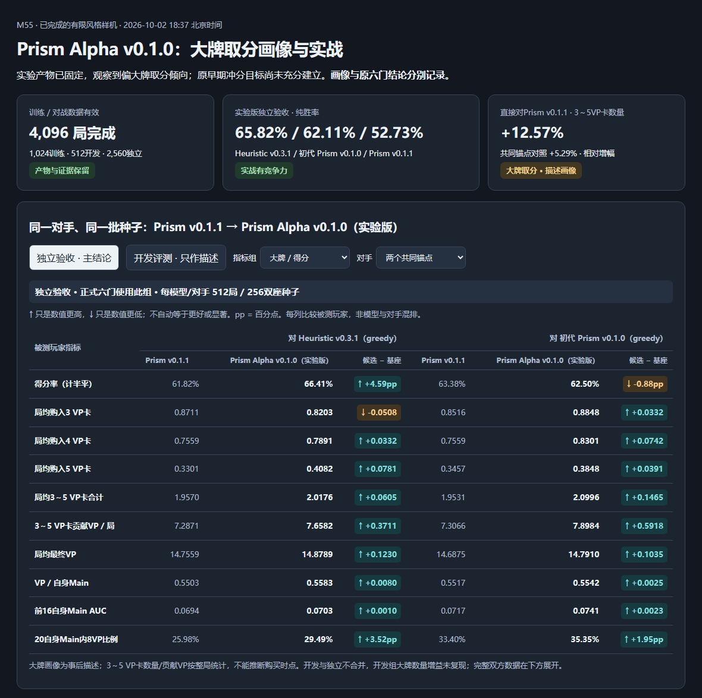

# M51 Prism：独立的 Splendor 实体关系模型线

当前Alpha实验产物：**Prism Alpha v0.1.1**；本轮ACCEPTED_BIGCARD_CONTINUATION，通用Prism v0.1.1身份与默认选择保持原记录。完整新增双方表在本文件M56区块；[彩色对照](prism/prism-alpha-v0.1.1-comparison.html)。


**Status: Prism v0.1.1 ACCEPTED_MODEL_ITERATION（M54 Stage VI新5,120局/严格四门通过）；Prism v0.1基线与Stage V未通过记录保留。**
**本轮中文结果：** [Prism v0.1.1 评测与版本结论](prism/prism-v0.1.1-evaluation-summary.md)。

**Baseline:** `main@bcdaca7cb33c53cc43d5dcc9e92c07be3c1aaa57` 加已有并行工作树。
**Owner / round:** 用户提出独立模型线；本轮负责方案与范围澄清。Prism 为暂名。

## Problem and evidence

用户澄清：“不要动aran系列，可以参考他的架构分析问题所在……单开一个模型线……建立正确的observe输入和模型架构……训练后的模型能参与实战持续进行迭代”，并要求先讲看法。本轮据此提出独立方案，不把咨询理解为已批准具体算力预算、数据采集或无限自动迭代。

- M50 §35的源码/旧张量诊断发现动作目标绑定缺失；其结论是表示不可辨识，不是修复收益证明。
- 当前结果已推进：`benchmarks/m50-aran-v023-shared-critic-v1.result.json` 为 NOT PROMOTED；`benchmarks/m50-aran-reserve-target-binding-v1.result.json` 为 NOT_PROMOTED。M50 §36确认目标补丁通过技术验证但500局确认得分率44.90%，未晋级。不能继续把“补预留目标”说成尚未尝试或保证有效。
- 当前核心 `Observation` 本身已提供对手公开预留、已购牌身份、牌堆数量、pending nobles、终局剩余轮次等。新线重点是正确保留、组织这些合法信息，不修改游戏规则或宣称原核心观察泄漏。
- 历史M29/M39/M42/M46/M48已分别试过具体attention、PPO、关系与残差配方；新线是完整系统假设，不是这些家族的首次尝试，也不是能单独归因某一组件的Aran对照实验。

证据入口：`docs/m50-competitive-replay-policy-value.md` §35–38；`crates/splendor-core/src/observation.rs`；`crates/splendor-core/src/action.rs`；`crates/splendor-agent/src/policy.rs`。本轮仅查阅既有结果状态及文档，没有重算这些竞技实验。

## Initial design

建立 **Prism：目标绑定的轻量实体关系 Policy–Value 网络**。从独立初始化开始，借鉴残差、实体共享编码和合法动作打分的工程经验，但不继承Aran权重、压缩输入schema、导出格式或训练器。

目标分三层，分别验收：

1. **正确性**：合法可见信息不泄漏，关键实体/动作可辨识，线下/线上同义。
2. **可训练、可实战**：一个独立模型完成训练、导出、Agent接入和真实对局；初版弱也可形成可信基线，不冒称棋力PASS。
3. **可持续变强**：后续每轮明确父模型、改进来源、固定预算和竞技门槛；变更权重且对战过门才算改进，不把重复训练称为进化。

## Scope and non-goals

### 独立性边界

- 拟新增 `crates/splendor-prism/`：专用编码、输入契约、权重校验与推理；`training/prism/`：独立数据加载、模型、训练和导出。
- 拟新增独立CLI模块/命令 `agent-prism`、Agent ID `prism-v0.1`、`benchmarks/m51-prism-*.json`、ignored `local-artifacts/prism/`。这些是规划路径/身份，本轮未创建代码或产物。
- 复用core/catalog、Agent SDK、Arena、replay验证、统计工具；必要公共接线仅新增入口，不改Aran分派、默认值、registry条目或评分行为。将来产品接入是新增模型选项，不替换旧模型。
- 不编辑Aran编码/训练器/推理模块、权重、数据缓存、M50文档或Aran实验脚本；不覆盖共享release binary，拟使用专属构建产物。独立性不是重复实现裁判或Arena。
- 第一版只承诺2人经典规则。schema可保留玩家mask扩展空间，但3/4人价值定义、训练、对战另设范围，不能从1v1推论。
- 本轮不实现、不训练、不采新数据/对局、不登记seed、不改服务、不提交/推送，也不中断其他已授权会话。之后如授权实施，只执行明确的一轮而非无限循环。

### 非目标

不引入大Transformer、完整世界模型、强制流派层级、同时PPO+搜索、多模型超参扫描或人为“少买0分卡”奖励。精确规则不交给神经网络猜；第一版纯策略参赛，搜索只作为后续独立策略改进方向。

## Contracts and invariants

### 1. `prism-observation-v1`：玩家视角、显式实体与未知状态

输入函数只接受 `Observation`、认证合法动作及明确白名单的玩家可见历史摘要。实际字段/维度在实施前形成版本化schema，不沿用368/56/72维兼容约束。

| 输入组 | 必须保留的信息 |
|---|---|
| 全局与轮次 | 玩家数、相对座次/行动顺序、current player、Main/ChooseNoble阶段、银行六色、各层剩余牌数、end-game标志与剩余终局行动、forced-pass计数、pending nobles |
| 玩家 | 每人六色币、五色折扣、分数、已购牌数、预留总数、已获贵族；自己/对手身份和先后手不混淆 |
| 卡牌实体 | 市场牌、自己全部已知预留、对手公开预留、双方已购牌身份；每张保留五色费用、bonus、VP、tier、归属/区域和存在mask |
| 贵族实体 | 场上及已领贵族身份/要求/归属，当前是否可选；双方对同一贵族的逐色缺口 |
| 可见历史摘要 | 从SDK `visible_history` 可重建的Main行动计数、已知公开事件及盲预留层级等必要记忆；只加入离线和在线都能一致重建的字段，不直接输入整段事件序列或request ID |

- 未知牌、空槽和真实零值明确分开。对手盲预留只保留合法已知的数量/历史信息；未知身份不填真实CardId。不将未见catalog牌都标为“仍在牌堆”，其中可能有对手暗预留。
- 已购牌身份不能只压成总张数；它们是合法公开信息，也约束尚未见牌的组成。归属与目标映射保留，不能无序池化后再把槽号当已绑定实体。
- 卡槽/实体列表重排必须同步目标映射；输出按合法动作重排等变。座次保留相对行动次序；五色语义固定，不擅自把任意颜色置换当catalog的精确对称。
- `FullState`、真实seed、牌堆顺序、对手暗牌、未来补牌、终局标签、文件/轨迹ID、时间戳、hash等均不作网络特征。元数据可留在provenance，须与feature allowlist物理分离。
- 本接口不声称是整个不完全信息博弈的充分Markov状态。若引入人工turn cap，需明确agent可见的horizon契约；当前SDK请求元数据不提供剩余cap，不能从离线裁判补入。截断/异常对局不是合法胜负标签。

### 2. `prism-action-v1`：完整动作身份与实际目标绑定

七类动作分别编码，不能把Pass和ChooseNoble合并：

- BuyMarket / ReserveMarket：准确gather当前目标卡；保留源区域、tier/slot到实体的映射。
- BuyReserved：准确gather己方预留槽的卡，不按市场槽解释。
- ReserveDeck：保留tier、拿金/退币、未知目标标记；绝不注入稍后抽到的牌。
- TakeTokens：分别保存take、give-back六色向量，而不只保存净变化。
- ChooseNoble：准确gather所选贵族及双方竞争关系。
- Pass：独立类型与明确的无目标mask。

动作前后的确定性可见后果包括支付/银行/持币、折扣、已获VP、目标区域迁移、贵族资格集合和已知阶段变化。市场预留必须把指定目标移入己方预留语义，购买必须把它移入已购语义；补牌槽标未知。多贵族待选不能提前虚构选了谁或领多位；非主回合选择不计额外Main回合。实现复用core可用纯规则函数并与core转换对拍，不调用Aran/启发式总分；不新增第二套裁判规则。

### 3. 模型草案

```text
卡牌/贵族/玩家/颜色银行实体 + masks
          ↓ 共享按类型编码器
两层轻量关系残差块（颜色费用、资源、双方到同一目标的缺口）
          ├─ 全局读取 → V(o)：最终计半平结果期望
          └─ 保留逐实体表示
合法动作原语 + 目标实体gather + 确定性可见delta
          ↓ 动作query + 一层关系感知cross-attention
          ↓ 与全局表示拼接 → 每个合法动作一个policy logit
```

- 建议初始hidden128、两层关系残差、一层动作读取；具体算子/参数数量/显存/延迟在实施配置中固定。不是声称该宽度已最优，不做宽度扫描。
- 显式五色费用/资源关系避免依赖网络从混合标量恢复颜色对应；逐目标保留双方缺口。拿币动作读取受影响的目标集合，购买折扣读取其对其他目标的作用。
- 状态实体每个根编码一次，合法动作批量query。没有全量动作固定大输出表，没有“先选买牌类别”硬路由；非法动作不进入softmax，padding严格mask。
- Value与Policy共享表示且有明确梯度测试；共享Critic只是学习假设，不因该结构名就宣称更强。模仿阶段的policy logit不是校准Q值，不直接拿来做Bellman backup。
- 关系attention权重可记录作诊断，但不作为因果解释或棋力证据。

## Implementation plan

以下均为建议计划，预算和门槛尚未授权冻结；实施前写入一份机器可读配置后不因结果临时更改。

### P1 — 正确输入和独立推理骨架

新增独立schema/Rust编码、golden fixtures、Python模型和导出、Rust推理与 `agent-prism`。先打通同一组可见局面的数据提取和在线决策，避免训练后才发现两套编码不同。信息边界、目标绑定、颜色对应、mask、阶段、槽重排、支付与贵族结算对拍，以及Python/Rust数值parity是必要工程测试，不另建全历史审计。

### P2 — 一次起步训练，建立 `prism-v0.1` 实战基线

- 建议冻结一个现有强教师（优先已冻结heuristic v0.3.1，确切binary/hash在实施前核验），独立采集约4,000局训练用途自对弈，按整局seed分组80/20训练/验证；同策略两边不重复采同seed换座。具体规模需在配置中批准。
- 不依赖并行Aran尚未完成的语料，不借用其权重/缓存。既有语料如复用，必须先证实属于可用训练来源；历史确认/压力评测集默认不回流训练。
- Rust通过验证回放重建每步玩家视角，用新schema重提，不能用旧压缩tensor补列恢复已经丢失的字段。以完整合法结束的双方轨迹为基础，不只取赢家；保留source/actor/阶段/合法动作/实选动作/最终结果的分离元数据。
- 从头初始化，一次建议20-epoch固定上限训练；初始目标为全教师动作CE + 0.5全轨迹结果BCE（胜1/平0.5/负0），Value梯度进入共享编码。不加虚构steps-to-15标签，不对败局全部动作做负标签。这是BC+结果辅助学习，不是PPO或已完成策略改进。
- checkpoint按预先固定验证目标（建议CE+0.5BCE，平局取早epoch）选择，绝不按Arena选epoch。预算/lr/batch/RNG及导出dtype由执行配置先冻结，单次候选不扫参。
- 导出专属权重/schema/catalog身份，完成合法加载、真实局面parity与两局加载smoke后，建议对冻结v0.3.1跑128 seed双换座=256局，形成第一份统一实战报告；不要求初版先击败教师才承认“可实战”。低于50%如实登记基线，不能称棋力验收或晋级。

### P3 — 按结果驱动的独立迭代

- 每次冻结父模型、一个主要变化、训练预算和新评测seed；保存新旧权重SHA。默认不自动开下一轮。
- 首选后续机制：在学生实际遇到的训练局面，对有限候选做真实引擎下的双方续走比较；候选不只限最高policy项，应保留预定的类别覆盖/探索项。使用同批合法信息集采样世界减小比较噪声，每个模拟玩家仍只消费自己的观察。
- 先验证该有限比较器确实改善了父模型的动作选择，再蒸馏动作分布或相对收益。样本值是给定续走策略/预算下的估计，不是最优Q；未测候选不能编造反事实标签。不要继续仅存赢家hard action并称自我改进。
- 首版即保留收集未来迭代所需的可见决策记录接口：模型/schema身份、合法动作及选择、policy分布、如有采样则记录行为概率、真实终局结果。冻结评测回放和训练采集分库，不在线边打边无门禁改权重。
- 建议迭代竞技门槛：对冻结Prism父代128新seed双换座短筛，计半平得分率严格>50%才另段250新seed双换座确认；确认也须>50%才可成为内部新champion。点估计过门不等于统计确定更强，CI照报，不看结果后补CI门槛。通过后另按预算复测固定v0.3.1锚点，防止只针对父代；产品默认晋级另行决定。
- 更强外部基线、3/4人、搜索上线或on-policy PPO都可另设后续轮；不与首版同时建设。PPO并非首次尝试，重开需与M39明确区分。

## Iteration log

1. 用户否定继续改Aran的执行方向，要求独立模型线；本方案将新的观察、架构、数据和Agent独立归档到M51，不再追加M50作为新线记录。
2. 复核发现M50 §34/36已完成负结果、§38另行实施中；保留这些结论，不把旧“下一步继续shared-critic”延用为当前新线的依赖顺序，也不中断并行任务。
3. 选择“先完整可实战基线，再单独策略改进”的两段学习路线。首训使用完整教师轨迹而非纯赢家筛选；这是新线设计，不证明该配方已经优于Aran。

## Final implementation

尚无Prism代码、模型、训练数据、Agent注册或对局。本轮交付仅此提案和local-only handoff导航。规划目录不是已存在产物。

## Validation and evidence

本轮实际检查范围：branch/HEAD/worktree及handoff忽略规则；核心Observation/Action/Phase、SDK信息边界与公开元数据；M50相关最终状态、两份结果JSON中的未晋级裁定；统一指标标准；确认未有M51文档或docs中的Prism命名记录。未对历史实验重算回放或棋力。

未来工程验收应覆盖：

- 两个只在不可见隐藏信息上不同的合法世界给同一玩家编码一致；合法可见目标变化能改变对应输入，不要求随机网络logit必不相等。
- 七类动作覆盖、同VP不同目标、同净拿币不同take/return、不同ReserveDeck tier、不同贵族、公共/私有预留、空槽与未知mask、座次与终局阶段、真实规则对拍。
- 重排实体/合法动作后输出映射一致；双实现前向在冻结容差内一致；非有限输出、schema不匹配、无效目标必须明确失败，不能静默回退成其他模型。
- 每次竞技输出W/T/L、纯胜率、计半平得分率、配对区间、先后手、分数/回合/贵族/购牌结构/预留指标，以及严格回放验证、错误/超时和推理延迟。遵循 `docs/unified-match-metrics-standard.md`，额外区分Main行动与ChooseNoble，不把批量吞吐当单步延迟。

## Result and decision

**DESIGNED / PROPOSED。** 推荐开独立Prism线，不再改Aran来实现本方案。正确性、可实战、竞争提升分开判定；不得从模型名称或输入测试推断棋力提升。

## Known limitations

没有新模型实证；完整观察仍不等于最优信息集策略。教师蒸馏只能提供起点，不能保证超过教师；关系结构和共享Value也可能不提升。20 epochs/4,000局/128维均为待批准的初始预算建议，未测资源或承诺耗时。第一版不支持3/4人竞技声明，不保证超过冻结v0.3.1。

## Next authorized gate

用户先讨论本提案，确认独立模型线边界与首轮终点。若批准实施，执行P1+P2这一完整闭环（独立代码→一次训练→独立实战基线→报告），不在未报告结果前自动开启P3。既有Aran/S4/UI工作不由本提案接管或更改。

## Linked contracts

- `docs/architecture.md`
- `docs/adr/0001-information-boundary.md`
- `docs/unified-match-metrics-standard.md`
- `AGENTS.md`

## Proposal closure checks

- 本轮通过PowerShell管道 `python -B -` 检查新文档逐行尾空格/EOF和9个现有完整文件引用，exit0；规划目录与glob不伪装为已存在文件。
- 全仓 `git -c core.autocrlf=false -c core.whitespace=blank-at-eol,blank-at-eof,space-before-tab,cr-at-eol diff --check` exit2，仅报告未由本轮修改的 `docs/aran-model-evolution-matrix.md:280,288` 两处尾随空格。保留Aran文件，不为收口更改无关内容；新提案自身格式检查PASS。
- `git check-ignore -v handoff.md` exit0，匹配 `.gitignore:12:/handoff.md`；handoff继续local-only，未暂存/提交任何文件。新模型实现与棋力仍未验证，待用户确认后另行执行。

## Authorized implementation round

- 用户已批准 `.pi/goal/prism-v0-1-独立模型开发-首训与实战基线-20260929-1921.md`，本节优先于上方保留的提案时点。实施基线仍为 `main@bcdaca7` 加并行工作树；不再请求审批。
- 冻结配置 `benchmarks/m51-prism-v01.config.json`；精确接口与数值合同 `docs/m51-prism-implementation-contract.md`。4,000局独立v0.3.1教师数据、3,200/800整局划分、一个20epoch从头候选、2smoke+256基线，不自动P3/确认/发布。
- 教师副本SHA已核对为 `6a02b2ab1553e925162778c75763e82981c1f2a02c47fb11003becbda217d7db`；三个seed段9400000..9403999、9404999、9405000..9405127逐段通过registry.check()，相对67段31,357个既有seed互斥，现已reserved。
- 初始公共接线/文档快照与git status保存在 `local-artifacts/prism/v01/provenance/before/` 和 `initial-git-status.txt`。本机torch2.6.0+cu124/CUDA可用，RTX4060 8GB；不终止并行Python任务，采用流式提取与memmap。正式训练前再次检查资源。
- 实现分工为专属编码、Python训练、Rust推理互不重叠；parent负责CLI、数据、配置与全部验收。尚无训练或棋力结果。

### Implementation iteration record

- 三个初始委派因模型配额429在写入前失败；未将其视作实现结果。parent完成编码/CLI，替换委派仅负责Python与Rust推理。正式训练与比赛仅parent执行。
- 4,000局冻结教师采集已完成，每局 `run-match` 正常结束并 `verify-replay` exit0。第一次后台启动在5局后停止，前台继续遇到4个仅有配置的目录而拒绝覆盖；其余3,996局已完整保留。仅归档无回放/无结果的seed9400005..9400008配置目录，再以同seed/同配置补齐；证据 `local-artifacts/prism/v01/provenance/collection-recovery.json` 与 `interrupted-collection/`。最终collect exit0、4000条清单；末次35.7秒是复用核验与四局恢复，不是全部采集耗时。
- 初次Prism库 `cargo check --offline -p splendor-prism --jobs 2` exit0；CLI初编译因草稿 `Ruleset::default()` 不存在exit101，改为真实 `base_v1()`，不改core。SDK元数据与Replay赢家类型核对与原实现一致。
- Python独立测试由parent重跑：`python -m pytest -q training/prism/tests` 加scratch cache/basetemp，98 passed、exit0（18.10秒）；仅小型合成20epoch/resume测试，非正式候选。
- Rust工程测试第一次引用未公开导出的支付函数导致编译失败；改为直接对拍核心执行的CardPurchased付款事件。第二次21/22通过，剩余为测试夹具多贵族待选时误判行动者切换，修正断言，尚待本轮后续复测。未消耗额外正式数据/训练/竞技预算。

### Final verification and evidence

1. **测试通过**：
   - `cargo test -p splendor-prism`：22 项全部 passed（包含目标区分、隐藏信息等价、拿退币、颜色对应、贵族多选结算、非法输入等）。
   - `python -m pytest -q training/prism/tests`：98 项全部 passed（覆盖数据 memmap、模型结构、断点恢复、格式校验与导出）。
   - `cargo test -p splendor-cli --bin splendor prism_command::tests`：3 项全部 passed（包含在线决策与离线回放重建投影完全一致测试）。
   - `cargo check -p splendor-cli`：exit 0，专属二进制编译无错误。
2. **数据追溯**：
   - 4,000 个独立种子（9,400,000..9,403,999）冻结 v0.3.1 教师自对弈，3,200/800 局划分。
   - 提取 214,411 个有效决策状态（train 171,462 / val 42,949），无任何无效样本或丢失。
3. **模型与跨语言一致性**：
   - 128 维实体关系两层残差模型，从头初始化，无 Aran 依赖。
   - 32 个真实验证局面（903 个合法动作）+ 68 个边界局面下，Python 与 Rust 前向推理数值差异最大为 0.0001168（在 1e-4 允许容差范围内）。
4. **正式训练完成**：
   - 单一候选完成完整 20 个 epochs 训练（耗时 1,798.96s），未做任何扫参或候选更换。
   - 最低验证集 loss 出现在 epoch 20（val=1.36876966），选定该 checkpoint 导出 `weights.json`。
   - 训练后权重与随机初始化权重显著不同。
5. **实战基线结果**：
   - 2 局加载 smoke（双换座，seed 9404999）严格通过。
   - 128 种子双换座（9,405,000..9,405,127）共 256 局对战冻结 heuristic v0.3.1 教师：
     - **战绩：139 胜 - 2 平 - 115 负**
     - **纯胜率：54.30% (54.296875%)**
     - **计半平得分率：54.69% (54.6875%)**
     - **95% 配对 Bootstrap 置信区间：[48.44%, 60.55%]**
     - **先手得分率：57.42%，后手得分率：51.95%**
     - **双方平均分：Prism 14.53 vs 教师 14.17**
   - 决策审计：6,907 个决策记录与引擎回放 100% 对齐，0 次非法动作，0 次静默降级或回退，0 次非正常截断。
   - 单步推理延迟均值 1.38ms（p95 2.10ms），总决策耗时均值 1.41ms。
6. **产物与种子状态**：
   - 评测摘要保存于 `benchmarks/m51-prism-v01.result.json`，数据与日志保存于 `local-artifacts/prism/v01/`。
   - 种子 9,400,000..9,403,999、9,404,999、9,405,000..9,405,127 状态已正式登记为 consumed。
   - 生产二进制与默认策略未受任何修改。本轮为基线确立，不等于模型上线或晋级。

## Training, exploration and style-control consultation

Status: **PROPOSED / DISCUSSION ONLY**. Baseline `main@bcdaca7` plus the existing parallel worktree. The user asked how v0.1 is trained, how a later round could improve/explore, and how to expose different playing styles; this is not authorization to run P3 or change the frozen v0.1 contract.

### Verified current implementation

- `training/prism/train.py::loss_terms` uses hard-label teacher-action CE for Policy and true outcome BCE for Value: `L = CE(logits, chosen) + 0.5 * BCEWithLogits(value_logit, outcome)`. Teacher wins and losses both contribute action CE; win/draw/loss labels 1/0.5/0 are Value targets, not policy-action labels. Value gradients enter the shared entity backbone, but no advantage-weighted policy loss or PPO update exists.
- The 4,000 training games are frozen heuristic v0.3.1 vs itself, not Prism self-play. Current LR is constant 3e-4, AdamW, 20 epochs, batch64 with accumulation2. Epoch20 validation CE=1.0764926982, BCE=0.5845539158, teacher-action top1 agreement=65.11443805%, combined loss=1.3687696561; read directly from `local-artifacts/prism/v01/run/history.json`. Agreement is not Arena win rate or a measure of optimal-action accuracy.
- `prism_command.rs::choose_action` selects the greatest policy logit with a semantic tie break. Value is logged but is not used to rank root actions. There is no sampling/temperature/style option. A seed argument does not change greedy selection into stochastic exploration.
- The existing trainer permits only from-scratch v0.1 initialization and same-config/data/runtime epoch-boundary interruption resume; editing LR or replacing data and calling `--resume` is not an implemented fine-tuning path.

### Proposed improvement loop (not implemented)

1. Freeze the parent, fresh training seeds, opponent pool, update budget, checkpoint-selection rule and development/acceptance pools. Preserve the parent and original artifacts.
2. Collect training-only games against self, frozen parents/history and the v0.3.1 anchor, with explicit legal-action exploration where needed. Store actual behavior probabilities and policy identity for on-policy updates; do not treat teacher/opponent actions as samples from the student policy.
3. Supply a real improvement operator. Unweighted CE on the student's own selected actions only reproduces its behavior. The existing M51 P3 preference remains bounded player-information-safe continuation comparison followed by distribution/ranking distillation; first establish that the comparison operator improves decisions. A separate on-policy actor-critic/PPO branch is an alternative for genuinely outcome-driven free exploration, not a claim that the current trainer already implements RL.
4. A 4,000-game new round can be a proposed comparable collection budget, not a required or sufficient amount. For supervised/continuation distillation, warm-start the parent with a separately frozen tentative LR1e-4 rather than assuming the from-scratch LR/20epochs is optimal. For PPO, collect fresh rollout blocks and perform only a few bounded updates per block, monitoring policy KL; do not recycle all 4,000 games for 20 ordinary CE epochs and call it PPO. No LR, game count or epoch budget is frozen by this consultation.
5. Use loss/teacher agreement/value calibration for learning diagnostics and finite gradients/export/parity/legal actions for engineering gates. For RL also record entropy, old/new-policy KL and clip fraction. Lower teacher CE is not the promotion objective of an outcome-driven candidate.
6. Select candidates only by a predeclared development procedure; compare parent and teacher anchors using paired seats and the unified metrics, then evaluate the fixed candidate on a separate unused acceptance pool. Competitive results decide strength, while training diagnostics decide whether learning is sane. Repeated tuning on the final pool is not independent validation; report uncertainty, seat splits, latency and behavior changes, and retain the parent if the frozen gate fails. No automatic new champion or production promotion.

### Proposed manual styles (not implemented)

- First separate playing strength from user-selected style. A cheap reversible prototype is an external action-specific logit overlay: `z_style(o,a)=z_base(o,a)+lambda*sum_j c_j*f_j(o,a)`, using bounded/normalized features from player-visible information only; lambda0 exactly preserves the base policy. Adding the same scalar to every action (including the shared policy_out bias) cannot change softmax or greedy ordering. Adding logit bias b multiplies the affected action's unnormalized softmax weight by exp(b) at temperature1; it is not b percentage points of win probability.
- Builder: early useful discount/visible target preparation, tapering toward the final round; not a blanket bonus for every 0VP purchase. Disruptor: public opponent-ready cards, scarce-color denial and opportunity-cost-aware purchase/reservation; not blanket reserve rewards or hidden-card prediction. Rush: scoring efficiency and affordable/preparable high-VP targets; not raw printed VP alone. Neutral: zero overlay, meaning unchanged v0.1 rather than proven optimal balance.
- Small near-logit reranking is only a conservative heuristic, not evidence that the actions have equal true value. Separate identities/config hashes, decision logs and strength/style tests are required even if all profiles share the same weights. Style overlays are different agents, not newly trained models.
- For durable learned styles, later use style-conditioned `pi(a|o,c)` with style-specific demonstrations/improved targets or explicit auxiliary style objectives, or warm-start independent adapters/heads/forks. A style ID with identical targets alone may be ignored. Keep real outcome prediction separate from any shaped style objective; never silently relabel a shaped critic as calibrated win expectation.
- Measure two objectives independently: score-rate/robustness/latency, and requested behavior (early useful discounts, high-VP realization, reservations and stranded counts, public-target denial). The existing match totals alone do not measure successful blocking or early-game investment efficiency. Stronger style can reduce competitive strength; style strength and acceptable loss tolerance would need to be approved.

### Evidence boundaries and next gate

The previous matrix's phrases about a completely repaired noble blind spot, a fundamental reversal of all Aran seat weakness, and a causal link from target binding to reserve discipline exceed the descriptive evidence. Cross-family games used different opponents/seeds/data and no isolating ablation; the historical Aran0.04/approximate CI entries are not newly verified provenance. A CI spanning50% neither proves superiority nor proves equal strength. See the appended correction in `prism/prism-model-evolution-matrix.md`.

This consultation read current source/config and the recorded epoch metrics; no new training, simulation, Arena match, benchmark resampling, model/CLI modification, commit or push occurred. The next authorized gate remains a separate owner-approved P3 design and bounded budget, not automatic execution of any branch above.

## Free-exploration priority and no-logit-overlay constraint

Status: **PROPOSED / DISCUSSION ONLY; user constraint effective now**. This clarification supersedes the earlier preference for continuation distillation and the logit-overlay proposal. The user prefers free exploration because there is no established stronger teacher to rely on, and explicitly prohibits logit preference layers based on poor results in their Mahjong project. That experience is user-reported, not independently reproduced here.

### Decision and scope

- Retain the prior factual analysis: v0.1 is teacher-action CE plus outcome BCE; self-play followed by unweighted self-action CE is not a reliable improvement operator; training diagnostics and competitive validation serve different purposes.
- **Do not implement or recommend inference-time style logit offsets, action-class bonuses, probability multipliers or preference rerankers as a workaround.** The previous overlay idea is withdrawn, not deferred for automatic retry. Normal legal-action masking and sampling from the learned policy remain conceptually distinct from manual style overrides.
- Prefer an independent, outcome-driven on-policy PPO round warm-started from the frozen Prism v0.1 checkpoint. Proposed policy training has no teacher-action CE, search-action imitation or winner-only cloning. Heuristic v0.3.1 may remain an opponent and evaluation anchor, not an action-label oracle. A stronger teacher is not a prerequisite.
- Teacher imitation does not mathematically impose a hard strength ceiling, and search distillation need not require an externally stronger agent; neither observation supplies a demonstrated improvement operator here. The recommendation is about the user's desired learning objective, not a proof that all imitation/search routes fail or PPO must succeed.

### Proposed minimal PPO loop

1. Preserve v0.1 weights/identity and existing services. Start a separate learner/optimizer and output directory; keep the 96/80/H128 Policy-Value architecture initially. Current v0.1 trainer only permits frozen from-scratch BC or same-config interruption resume; it is not already a PPO/fine-tuning tool.
2. Freeze a behavior-policy snapshot for each rollout batch. Sample legal actions from its actual learned distribution and record observation, masks, chosen action, behavior log-probability, old value, actor and terminal outcome. Greedy actions plus an RNG seed do not constitute this sampler. No hidden deck/order/opponent-card features or omniscient critic.
3. Use completed-game player-relative outcomes win1/draw0.5/loss0, compatible with the current sigmoid value output. A simple initial advantage is terminal return minus detached old value; fit Value to fresh returns. This is a noisy policy-gradient estimator, not a claim that every winning action is good or each action's causal contribution is known. No extra card/noble/VP/short-game reward in the first chess-strength experiment. Truncations/errors are not draws/loss labels; later bootstrapping would require explicit perspective/termination handling, including ChooseNoble transitions that do not necessarily switch actor.
4. Minimize clipped PPO policy loss plus a separately weighted value loss minus entropy bonus, with bounded passes per fresh rollout batch. Monitor old/new-policy KL and clip fraction; do not permanently anchor the learner to v0.1 action labels. Use fresh batches after each bounded update rather than 20 ordinary CE epochs over a static self-play file. Proposed LR1e-4 is only a tentative warm-start value, not a verified optimum; LR alone does not control drift.
5. Use a frozen-per-batch opponent pool containing self snapshots/history and the heuristic anchor, balancing seats. Train policy only on actions from the recorded learner behavior; do not pretend opponent actions are on-policy learner actions. A 4,000-game budget could illustratively be20 batches of200 games, not a frozen authorization or sufficiency claim. Exact learner-decision counts, update passes and pool proportions need a later contract.
6. Track learning health with finite gradients/outputs, normalized or legal-count-stratified entropy, KL/clip fraction and outcome-value calibration. Track strength on predeclared development matches against parent and external anchors; select then freeze a candidate for unused acceptance seeds, reporting paired CI, seats and unified behavior/latency metrics. Self vs self average score is approximately50% by construction and is not a progress measure; changing-pool Elo is not a substitute for controlled comparison. Current data do not guarantee PPO improvement.

### Learned styles without output overrides

- Separate free-exploration strength work from deliberate personality control. Outcome-only training may discover varied behavior, but cannot guarantee the user-specified builder/disruptor/rush labels or adjustable degrees of those styles.
- If later authorized, styles must be learned during training: separate warm-started policies/adapters, or a style-conditioned Policy/Value network with genuinely different training objectives/targets. Merely providing style IDs with identical outcome-only targets can collapse to one style. Changing the architecture/schema for conditioning would be a separate round, not a v0.1 metadata-only switch.
- A style objective changes the optimization problem. Bounded, contextual training rewards or constraints can express useful early investment, public-information denial or high-VP realization, but can also be exploited; they are not inherently safe merely because they move from inference to training. Keep true win outcome and shaped utility/value semantics distinct, measure strength and style separately, and agree acceptable strength tradeoffs first. Do not reward every0VP card or reservation indiscriminately.

### Verification and next authorized gate

Re-read current `training/prism/train.py` configuration/loss, `crates/splendor-cli/src/prism_command.rs` greedy action selection, the numerical contract and ADR0001. No learning code, weights, opponent agents, services, seed allocations, new matches or training runs were changed. This is a route preference and an effective prohibition, not approval of a PPO implementation or compute budget. Next: a bounded PPO experiment design for owner approval, with learned-style work separate and no logit-overlay branch.

## M54 continuous PPO and learned-style design handoff

Status: **DESIGNED / PROPOSED; research only (2026-09-30).** The latest user instruction supersedes the earlier ordering that treated style work as a separate later research topic: this design must cover continuous PPO, measurable builder/disruptor/rush/balanced styles, and strength-loss constraints together.

- Full design: [M54 Prism continuous PPO and measurable styles](m54-prism-continuous-ppo-design.md). Recommended first implementation is a synchronous Arena-backed rollout loop, actor-specific trajectories, immutable behavior snapshots, and transactional optimizer/RNG/data-cursor recovery. The planned PyO3 crate is not present; the old M39/M40 pipeline is not a drop-in Prism adapter.
- Styles are proposed as independently trained policies from one frozen balanced parent, using bounded training-time objectives with outcome/style values kept separate. No inference-time logit offsets, probability multipliers, preference reranking, or teacher-action CE is introduced. Style separation, common-opponent non-inferiority and cross-style head-to-head constraints have separate gates.
- Aran follow-up has been stopped by the user; unstarted C and final acceptance matches are cancelled, while existing code, weights, protocol checks and negative results remain. See [M50 stop record](m50-competitive-replay-policy-value.md#aran-iteration-stop-20260930).
- This is a design handoff, not a PPO implementation or compute authorization. No new training, collection, matches, seed allocation, service/registry change, commit or push. Frozen Prism v0.1 evidence remains unchanged; the next possible authorization is infrastructure implementation/testing, followed by separately approved sampling/training budgets and numerical gates.


## M54 outcome-only version acceptance — 2026-10-02 (NOT_ACCEPTED)

Status: **AUTHORIZED / IN PROGRESS**. The owner requests fresh-seed matches to decide whether the final trial-v2 c8 can become a formally accepted model iteration. The prospective model version is `prism-v0.1.1`; it is not assigned as accepted until all preregistered gates pass. See [M54 Stage V](m54-prism-continuous-ppo-design.md) and [acceptance contract](../benchmarks/m54-prism-v02-acceptance-v1.config.json).

Exactly one frozen c8 (weights a2301f08…) and parent (cb7c4fb3…) use learned categorical T=1. New256 independent seed blocks yield2,048 common-anchor games and512 direct-duel games. Pooled improvement, direct-duel superiority and both5pp anchor guards all require Bonferroni-adjusted seed-block bootstrap lower bounds. There is no new training/checkpoint selection. This outcome-only acceptance does not claim the future style cohort, universal opponent superiority, production-default replacement or shared-pool deployment.

Local release parity and11 evaluator/gate tests passed; the same32-task timing probe was3.915× faster locally than cloud2 under observed load, with all32 game outcomes/points/plies matching across platforms. Formal matches are now on local4 BelowNormal workers. Prior v0.1 baseline and M54 trial-v2 development result remain historical, including the manually unpaused shared-pool boundary finding. Current next step: finish all2,560 slots, verify raw evidence, decide gates once, then register the version if accepted.


### Final version decision — 2026-10-02

**NOT_ACCEPTED（正式晋级）/ prism-v0.1.1-rc.1候选产物已固化**. Fresh holdout2,560 games completed/verified, pooled common-anchor delta+7.2754pp (95%CI[3.2715,11.2305]pp), direct parent duel54.7852% (95%CI[50.5859,58.9868]%). All four adjusted gates passed=false; [exact result](../benchmarks/m54-prism-v02-acceptance-v1.result.json) and M54 final section preserve the preregistered contract and evidence.

The evaluated artifact is frozen as [candidate prism-v0.1.1-rc.1](../benchmarks/m54-prism-v0.1.1.candidate.json), weights `local-artifacts/prism/v02-rc1/weights.json` SHA a2301f08… . Formal v0.1.1 remains unaccepted because the adjusted direct-duel lower bound equals50% (strict gate requires >50%); ordinary95% lower50.5859% and positive common-anchor evidence remain reported. No extra training or seed extension was performed.

The previous in-progress paragraphs describe the pre-analysis state. Current gate is closed; any new training/production deployment is a separate finite scope. The local/cloud2 serial32-game timing was15.831/61.984s, local3.915× faster under observed load.


### Stage VI bounded confirmation authorized — 2026-10-02

Owner follow-up `go 启动` authorizes one new finite strength confirmation of the same c8: [contract v2](../benchmarks/m54-prism-v02-acceptance-v2.config.json),512 new dual-seat blocks/5,120 games, no previous-game pooling or training. Four thresholds remain unchanged and nominal bootstrap lower quantile is tightened to0.00625 for four claims across two looks. Stage V NOT_ACCEPTED and the rc.1 manifest remain immutable; formal v0.1.1 is pending the one final Stage VI decision. Local4 BelowNormal workers/0 retries/6h bound; no default/roster/pool deployment or Git publication. Full start/evidence/decision record is in M54 Stage VI.


### Stage VI final model-version decision — 2026-10-02

**ACCEPTED_MODEL_ITERATION / Prism v0.1.1**. New5,120 games on512 fresh dual-seat blocks completed/verified; common-anchor delta+8.7158pp (95%CI[6.0547,11.3770]pp), direct parent score59.9121% (95%CI[56.8848,62.9395]%). All four stricter0.00625-lower-quantile gates passed=true; [new result](../benchmarks/m54-prism-v02-acceptance-v2.result.json), [contract](../benchmarks/m54-prism-v02-acceptance-v2.config.json), M54 Stage VI hold exact evidence/limitations.

Formal [prism-v0.1.1 release manifest](../benchmarks/m54-prism-v0.1.1.release.json) and immutable local-artifacts/prism/v0.1.1/weights.json SHA a2301f08… are registered. Same final c8, T=1/action seed54030001; sampler runtime0.1.0/schema unchanged. Original v02-rc1 and Stage V NOT_ACCEPTED JSON files remain byte-identical historical evidence; the Prism v0.1.1 candidate manifest is a naming-correction index.

This closes the outcome-only version decision, not style validation or an independent review. No default/Studio/shared-pool/DB-Elo/Aran/Git publication was changed. Further training or production integration is a separate finite scope.


## 2026-10-02 版本口径更正与详细对战表（当前）

2026-10-02 用户命名更正：本轮统一为 **Prism v0.1.1**，不另开 0.2 模型线。原名文档已保存到 ignored `local-artifacts/prism/011-docs/legacy-naming/`；冻结实验仍保留原 `v02` 文件名、内容/hash 和失败门槛。更正不改变权重、runtime 0.1.0 或权重格式；当前权重入口为 `local-artifacts/prism/v0.1.1/weights.json`。

依据 [Prism v0.1.1 完整报告](prism/prism-v0.1.1-evaluation-summary.md) 和 [详细指标](../benchmarks/m54-prism-011.match-details.json) SHA `24c1fbed8cd254a13f6bbb40153b15106576f9436520d4a540a9efc4916510dc`，本模型文档直接保留详细表。离线命令见完整报告，exit0 / 5,120 replay / 10 批，无新增对局或训练。旧 v02 路径只作冻结证据。

### 各对手完整战绩

每项对照为 512 个新环境种子、双换座共 1,024 局；总计 5,120 局。纯胜率 = 胜 / 局数，得分率 =（胜 + 0.5 × 平）/ 局数。

| 模型 | 对手 | 局数 | 胜 / 平 / 负 | 纯胜率 | 计半平得分率 | 普通 95% 配对区间 |
| --- | --- | --- | --- | --- | --- | --- |
| Prism v0.1.1 | Heuristic v0.3.1 | 1024 | 633 / 4 / 387 | 61.8164% | 62.0117% | [59.0332%, 64.9902%] |
| Prism v0.1.1 | 初代 Prism v0.1.0 | 1024 | 631 / 6 / 387 | 61.6211% | 61.9141% | [58.9844%, 64.7949%] |
| Prism v0.1.1 | 上一批 PPO 检查点（trial-v1 c8） | 1024 | 609 / 9 / 406 | 59.4727% | 59.9121% | [56.8848%, 62.9395%] |
| 上一批 PPO 检查点 | Heuristic v0.3.1 | 1024 | 545 / 4 / 475 | 53.2227% | 53.4180% | [50.4871%, 56.3477%] |
| 上一批 PPO 检查点 | 初代 Prism v0.1.0 | 1024 | 542 / 3 / 479 | 52.9297% | 53.0762% | [50.1953%, 55.9082%] |

直接父代对战区间沿用原冻结验收；其余逐对手区间是新增描述性 bootstrap（20,000 次，按双座 seed 组），不新增晋级门槛，也不代替四项严格校正下界。

### 先后手明细

| 模型 | 对手 | 本模型座位 | 局数 | 胜 / 平 / 负 | 纯胜率 | 得分率 | 局均 VP（本模型 / 对手） |
| --- | --- | --- | --- | --- | --- | --- | --- |
| Prism v0.1.1 | Heuristic v0.3.1 | 先手 P0 | 512 | 336 / 3 / 173 | 65.6250% | 65.9180% | 14.811 / 13.295 |
| Prism v0.1.1 | Heuristic v0.3.1 | 后手 P1 | 512 | 297 / 1 / 214 | 58.0078% | 58.1055% | 14.631 / 13.744 |
| Prism v0.1.1 | 初代 Prism v0.1.0 | 先手 P0 | 512 | 320 / 2 / 190 | 62.5000% | 62.6953% | 14.600 / 13.348 |
| Prism v0.1.1 | 初代 Prism v0.1.0 | 后手 P1 | 512 | 311 / 4 / 197 | 60.7422% | 61.1328% | 14.527 / 13.281 |
| Prism v0.1.1 | 上一批 PPO 检查点（trial-v1 c8） | 先手 P0 | 512 | 306 / 7 / 199 | 59.7656% | 60.4492% | 14.545 / 13.637 |
| Prism v0.1.1 | 上一批 PPO 检查点（trial-v1 c8） | 后手 P1 | 512 | 303 / 2 / 207 | 59.1797% | 59.3750% | 14.648 / 13.602 |
| 上一批 PPO 检查点 | Heuristic v0.3.1 | 先手 P0 | 512 | 273 / 4 / 235 | 53.3203% | 53.7109% | 14.363 / 13.975 |
| 上一批 PPO 检查点 | Heuristic v0.3.1 | 后手 P1 | 512 | 272 / 0 / 240 | 53.1250% | 53.1250% | 14.307 / 13.990 |
| 上一批 PPO 检查点 | 初代 Prism v0.1.0 | 先手 P0 | 512 | 281 / 0 / 231 | 54.8828% | 54.8828% | 14.230 / 13.721 |
| 上一批 PPO 检查点 | 初代 Prism v0.1.0 | 后手 P1 | 512 | 261 / 3 / 248 | 50.9766% | 51.2695% | 14.092 / 14.037 |

### 对局节奏

| Prism v0.1.1 所在对局指标 | 对阵 Heuristic v0.3.1 | 对阵初代 Prism v0.1.0 | 对阵上一批 PPO 检查点 |
| --- | --- | --- | --- |
| 总执行步数 | 54919 | 54596 | 55224 |
| 局均执行步数 | 53.632 | 53.316 | 53.930 |
| 平均决策轮（legacy） | 26.829 | 26.671 | 26.976 |
| 最短 / 中位 / 最长决策轮 | 21 / 27.0 / 34 | 21 / 27.0 / 33 | 21 / 27.0 / 34 |
| 决策轮总体标准差 | 1.765 | 1.807 | 1.821 |
| 平均 Main 行动轮 | 26.802 | 26.646 | 26.954 |
| 终局绝对分差均值 | 3.775 | 3.981 | 3.700 |
| 终局分差 ≤2 的比例 | 35.64% | 32.52% | 34.67% |

legacy 决策轮为 `ceil(全部执行步/2)`，本玩家决策包含 `choose_noble`；它不是额外 Main 回合。Main 行动/轮另行统计。

### 购卡、折扣、贵族与预留

| 两方指标（每格：Prism v0.1.1 / 对手） | Heuristic v0.3.1 | 初代 Prism v0.1.0 | 上一批 PPO 检查点（trial-v1 c8） |
| --- | --- | --- | --- |
| 局均最终 VP | 14.721 / 13.520 | 14.563 / 13.314 | 14.597 / 13.619 |
| VP / 本玩家决策 | 0.5492 / 0.5040 | 0.5464 / 0.4993 | 0.5413 / 0.5051 |
| VP / 本玩家 Main 行动 | 0.5492 / 0.5044 | 0.5466 / 0.4997 | 0.5415 / 0.5053 |
| VP / 全局执行步 | 0.2745 / 0.2521 | 0.2732 / 0.2497 | 0.2707 / 0.2525 |
| 局均购卡数 / 永久折扣 | 12.195 / 13.337 | 12.208 / 13.294 | 12.427 / 12.591 |
| 局均贵族数 | 0.457 / 0.693 | 0.443 / 0.658 | 0.521 / 0.516 |
| 获得至少一贵族的对局比例（%） | 37.89 / 49.90 | 36.52 / 48.34 | 42.29 / 40.04 |
| 局均预留取得 | 2.170 / 2.372 | 2.232 / 1.830 | 2.513 / 2.400 |
| 局均预留买回 | 0.853 / 1.249 | 0.873 / 0.896 | 1.026 / 0.996 |
| 局均终局未买回预留 | 1.317 / 1.123 | 1.359 / 0.935 | 1.486 / 1.404 |
| 预留兑现率（%） | 39.29 / 52.66 | 39.11 / 48.93 | 40.85 / 41.50 |
| 局均 0 VP 卡 | 6.259 / 7.509 | 6.275 / 7.419 | 6.465 / 6.853 |
| 局均 1 VP 卡 | 2.082 / 2.604 | 2.036 / 2.642 | 2.180 / 2.275 |
| 局均 2 VP 卡 | 1.841 / 1.721 | 1.929 / 1.807 | 1.842 / 1.726 |
| 局均 3 VP 卡 | 0.841 / 0.794 | 0.890 / 0.778 | 0.897 / 0.867 |
| 局均 4 VP 卡 | 0.801 / 0.537 | 0.720 / 0.492 | 0.738 / 0.606 |
| 局均 5 VP 卡 | 0.372 / 0.173 | 0.358 / 0.156 | 0.305 / 0.264 |
| 局均白色永久折扣 | 2.346 / 2.667 | 2.415 / 2.610 | 2.420 / 2.545 |
| 局均蓝色永久折扣 | 2.507 / 2.581 | 2.471 / 2.648 | 2.528 / 2.499 |
| 局均绿色永久折扣 | 2.451 / 2.645 | 2.452 / 2.660 | 2.531 / 2.418 |
| 局均红色永久折扣 | 2.479 / 2.656 | 2.491 / 2.574 | 2.459 / 2.529 |
| 局均黑色永久折扣 | 2.413 / 2.788 | 2.379 / 2.801 | 2.488 / 2.600 |

兑现率使用累计买回数 / 累计预留数；终局未买回只描述保留牌，不直接等于无效预留或成功干扰。

### 七类动作的完整分布

| 动作次数及占比（每格：Prism v0.1.1 / 对手） | Heuristic v0.3.1 | 初代 Prism v0.1.0 | 上一批 PPO 检查点（trial-v1 c8） |
| --- | --- | --- | --- |
| 购市场卡 `buy_market` | 11615 (42.31%) / 12378 (45.06%) | 11607 (42.53%) / 12696 (46.50%) | 11674 (42.28%) / 11873 (43.00%) |
| 购预留卡 `buy_reserved` | 873 (3.18%) / 1279 (4.66%) | 894 (3.28%) / 917 (3.36%) | 1051 (3.81%) / 1020 (3.69%) |
| 拿筹码 `take_tokens` | 12735 (46.40%) / 11359 (41.35%) | 12498 (45.80%) / 11798 (43.21%) | 12303 (44.55%) / 12250 (44.37%) |
| 预留市场卡 `reserve_market` | 2219 (8.08%) / 2420 (8.81%) | 2283 (8.37%) / 1870 (6.85%) | 2573 (9.32%) / 2451 (8.88%) |
| 盲预留牌堆 `reserve_deck` | 3 (0.01%) / 9 (0.03%) | 3 (0.01%) / 4 (0.01%) | 0 (0.00%) / 7 (0.03%) |
| 选择贵族 `choose_noble` | 4 (0.01%) / 25 (0.09%) | 6 (0.02%) / 20 (0.07%) | 13 (0.05%) / 9 (0.03%) |
| Pass `pass` | 0 (0.00%) / 0 (0.00%) | 0 (0.00%) / 0 (0.00%) | 0 (0.00%) / 0 (0.00%) |
| 全部决策步数 | 27449 / 27470 | 27291 / 27305 | 27614 / 27610 |
| Main 行动步数 | 27445 / 27445 | 27285 / 27285 | 27601 / 27601 |

占比分母为该模型全部决策步（含 `choose_noble`）；换座后按模型身份合并，P0 不固定代表 Prism v0.1.1。零动作明确显示为 0。

### 实测耗时与缺失项

| Prism v0.1.1 所在对局指标 | 对阵 Heuristic v0.3.1 | 对阵初代 Prism v0.1.0 | 对阵上一批 PPO 检查点 |
| --- | --- | --- | --- |
| 逐局游戏进程耗时之和（秒） | 400.079 | 475.484 | 386.225 |
| 单局游戏进程均值（秒） | 0.3907 | 0.4643 | 0.3772 |
| 单局游戏进程 p95（秒） | 0.4850 | 0.6408 | 0.4379 |
| 决策 / 网络推理延迟 | NOT_MEASURED | NOT_MEASURED | NOT_MEASURED |

以上来自各局 `process-result.json.wall_seconds`，包含游戏进程内双方推理/规则执行/读写；为 4 个并发低优先级进程下的耗时。逐局耗时之和含并发重叠，不能当作整轮墙钟。整轮 5,120 局实际墙钟为 **1036.600 秒（17 分 17 秒）**，包含父代锚点局与运行调度。Arena 未保存逐决策/网络推理延迟，故显式标 NOT_MEASURED。


### 同锚点下的 Prism v0.1.1 与父代行为对照

| 同锚点行为指标（Prism v0.1.1 / 父代） | Heuristic v0.3.1 | 初代 Prism v0.1.0 |
|---|---|---|
| 局均最终 VP | 14.721 / 14.335 | 14.563 / 14.161 |
| VP / 本玩家 Main 行动 | 0.5492 / 0.5337 | 0.5466 / 0.5276 |
| 局均购卡 / 永久折扣 | 12.195 / 12.453 | 12.208 / 12.447 |
| 局均 0 VP 卡 | 6.259 / 6.603 | 6.275 / 6.608 |
| 局均 3–5 VP 卡 | 2.014 / 1.963 | 1.968 / 1.881 |
| 局均贵族 | 0.457 / 0.469 | 0.443 / 0.464 |
| 贵族覆盖率（%） | 37.89 / 37.70 | 36.52 / 37.21 |
| 局均预留取得 | 2.170 / 2.026 | 2.232 / 2.212 |
| 局均预留买回 | 0.853 / 0.884 | 0.873 / 0.902 |
| 局均终局未买回预留 | 1.317 / 1.143 | 1.359 / 1.310 |
| 预留兑现率（%） | 39.29 / 43.61 | 39.11 / 40.79 |

两模型使用同锚点/seed/座位与相同 T=1，表格是本次固定对照的描述统计；未对这些行为差异增加正式检验门槛，也不据此认定某种风格或机制。

### 下一轮方向判断：先做一个初代风格样机，继续复用 PPO

状态：**历史方向建议；后续 M55 已授权启动**。当时未采样、未选定参数；用户后来“okay 开始吧”授权一个有限冲分样机，当前参数与状态见 M55。

建议把已验收的 **Prism v0.1.1 冻结为通用基座和棋力参照**，从同一权重派生一个“冲分”初代风格模型，使用既有 PPO 闭环学习。PPO 是训练方法，风格模型是产物目标，两者可以结合。初代 Prism v0.1.0 保留作对照，不因“初代”称呼而退回较弱的训练起点；若指从零重训通用基座，当前还缺少必须重建表示的证据。

| 选项 | 现有证据与成本 | 建议 |
|---|---|---|
| 再做一批仅胜负奖励 PPO | Prism v0.1.1 的独立新 seed 验收支持有效迭代；没有证据说明继续训练无效或已到上限，但同两个对手更多训练未必增加广度 | 放在风格样机之后；若下一目标只要更强，先做有界对手广度诊断，再冻结续训方案 |
| 从 Prism v0.1.1 派生初代风格模型 | 风格目标还未落地；已有更强参照，可以分别判风格差异和棋力损失 | **优先：只做一个冲分样机**，暂不同时三风格或大规模候选扫描 |
| 从初代 Prism v0.1.0 / 随机初始化重做通用基座 | 可作研究对照，当前没有受控证据证明重训比沿用 Prism v0.1.1 更合算 | 暂缓；以具体表示缺陷、合法信息缺口或跨对手失败为重开条件 |
| 先部署、GPU/PyO3 或扩大混池 | 可改善使用或效率，不能补出可测风格；本机固定评测速度已可用 | 作为独立工程目标，暂不替代下一研究问题 |

建议形成时的源码核实：`training/prism/ppo/model.py` 已有独立训练用 style head，`learner.py` 支持胜负优势加 β×风格残差及独立 style loss；但当时 `execution.py::validate_spec` 明确拒绝 `style_beta != 0`，当时真实风格奖励提取器尚未接入。M55 已接通 run v3 的冻结奖励合同；下述原建议是决策历史。原建议为下一轮先补齐这个闭环，不能只改 β 就声称可进行风格训练。

先选冲分，因为公开得分在固定自身 Main 行动窗口中的实现速度容易定义和复核。目标可沿用 M54 原提案的固定 K 窗口归一化得分 AUC；K、归一化上限、β、训练预算、可接受棋力损失 δ 和最小风格差异须在采样前冻结；形成此建议时未预填数值，后来实际冻结值见 M55。保留真实胜负 critic；不加入推理 logit 偏置、隐藏牌/未来信息或同局未来结果作在线输入。额外风格效用改变策略权衡，需要单独验证；[奖励塑形的策略不变性原论文](https://people.eecs.berkeley.edu/~russell/papers/icml99-shaping.pdf) 的保证只适用于特定形式与假设，不能直接套到该风格目标。

建议顺序：①奖励提取/coverage/恢复和 β=0 一致性工程验证；②有限开发训练，只做一个风格、少量预先限定候选；③冻结唯一候选，用新独立 seed 同时验风格差异和相对 Prism v0.1.1 棋力约束。至少加入一个不与奖励公式重复的行为指标，并监测预留兑现/持牌占用等代价，避免只练高奖励。这轮 945/947 开头的验收 seed 已消费，不能用于训练、候选挑选或下一轮新 holdout。

本次画像仅作描述：Prism v0.1.1 对 Heuristic 的预留兑现率 39.29%，上一批 PPO 检查点 43.61%；终局未买回均值 1.317 vs 1.143。这提示后续需监测预留代价，不能证明有效干扰或 PPO 缺陷。Prism v0.1.1 也尚未通过“均衡风格”的独立验收，只是当前通用棋力参照。


文档要求已纳入 AGENTS.md §7、项目文档系统、统一指标标准。最新 [Prism v0.1.1 release](../benchmarks/m54-prism-v0.1.1.release.json)，旧结果/hash/NOT_ACCEPTED 保留。本次改名、补表、方向分析已执行；建议下一训练尚未启动。


## 2026-10-02 模型称谓与表格解释更正

文档仅使用正式 `Prism v0.1.1` 名称。当前版本 = trial-v2 最终 c8；上一批 PPO 检查点 = trial-v1 最终 c8，是当前版本再训八轮之前的起点，未单独发布正式版本。初代 Prism v0.1.0 是另一份监督训练基线。节奏表按“当前版本对阵各对手”列出整场指标，个人指标明确双方顺序。见 [继承关系图与完整报告](prism/prism-v0.1.1-evaluation-summary.md)。原简称文档已归档，冻结比赛/权重/hash 不变。


### 当前后续轮次：M55 冲分样机已授权启动

用户“okay 开始吧”已授权 [M55](m55-prism-rush-style-model.md)。以冻结 Prism v0.1.1 新建风格头/AdamW/RNG，四轮有限训练，固定最终c4，开发512局+独立2,560局，六门全部通过才登记 Prism Rush v0.1.0；无默认/共享池部署。先前 PROPOSED 方向为决策历史，当前进度与冻结合同见 M55。Prism v0.1.1 的详细对战数据和继承关系见 [完整版本报告](prism/prism-v0.1.1-evaluation-summary.md)。

<!-- M55 VERIFIED RESULTS BEGIN -->

## M55固定实验版本：Prism Alpha v0.1.0：固定身份与完整对战记录

**固定实验版本身份：Prism Alpha v0.1.0；与M55最终c4是同一份权重，没有追加训练。** 原开发名为“Prism Rush v0.1.0 候选”；Alpha是中性模型线名，不声称冲分或基建风格已经验收。原冲分六门判定 `NOT_ACCEPTED_RUSH_STYLE` 完整保留。

| 身份字段 | 固定记录 |
| --- | --- |
| 模型名称 / ID | Prism Alpha v0.1.0 / `prism-alpha-v0.1.0` |
| 身份登记状态 | `REGISTERED_EXPERIMENTAL_MODEL`；可明确引用的实验版本，不是Rush风格已通过 |
| 谱系 | Prism v0.1.1 → M55四轮PPO → M55最终c4 = Prism Alpha v0.1.0 |
| 固定权重 | `local-artifacts/prism/alpha-v0.1.0/weights.json` / `b5e68e008d5d462aff19c67b8eed063139a5c500a020a48031e8938b44618f0a` |
| 训练来源 | 1,024局、216新更新；原目标为前16自身Main得分曲线（冲分），不是基建专用奖励 |
| 身份登记 | `benchmarks/m55-prism-alpha-v0.1.0.model.json` |
| 原验收 / 后续动作 | 原3PASS/3FAIL保留；此次0新局/更新，未替换默认或部署共享池 |


## 大牌取分画像（描述性；2026-10-02更正）

**当前更贴切的工作画像是“大牌取分 / 偏大牌冲分”。** 我上一版建议转向基建锚定缺少数据依据；现先沿已观察到的大牌取分倾向继续迭代，基建分支后置。

**下面是Alpha直接对Prism v0.1.1的512局、256双座种子，比较同一场里的双方个人指标。** 大牌在这里明确指卡面3～5 VP；不是所有大牌类别均同幅上涨，也不能仅凭终局数量断定买牌时点。

| 双方个人指标 | Prism v0.1.1 | Prism Alpha v0.1.0 | Alpha相对变化（%不是pp） |
| --- | --- | --- | --- |
| 局均3 VP卡 | 0.8438 | **0.8750** | **↑ +3.70%** |
| 局均4 VP卡 | 0.5957 | **0.7168** | **↑ +20.33%** |
| 局均5 VP卡 | 0.2539 | **0.3145** | **↑ +23.85%** |
| 局均3～5 VP卡合计 | 1.6934 | **1.9062** | **↑ +12.57%** |
| 局均3～5 VP卡贡献VP | 6.1836 | **7.0645** | **↑ +14.25%** |
| VP / 自身Main | 0.5143 | **0.5304** | **↑ +3.13%** |


同一批共同对手的基座/Alpha对照，各模型1,024独立局：3～5VP卡合计 **1.9551 → 2.0586，↑5.29%**；5VP卡 **0.3379 → 0.3965，↑17.34%**。前者比直接对战的增幅温和；两个对手上的4/5VP卡均值均提高，3VP卡对Heuristic略降，不能写成全项大幅领先。

开发组每模型/对手128局，3～5VP卡合计对Heuristic由1.9766降至1.9453、对初代由2.1094降至2.0000；大牌数量增长未在这组小样本复现。画像主要依据更大的独立组与直接对战，属于事后描述，不作正式新门或已确认泛化的风格结论。

前16自身Main AUC只衡量早期得分；终局高VP购卡分布衡量整局取分结构，两者可以出现不同幅度。原早期AUC幅度未达目标，不抹掉观察到的大牌取分倾向；购卡总数也不能直接证明“中后期买得更早/结束更快”，购买时点与分段得分曲线尚未在本次新增画像中测量。

画像机读证据：`benchmarks/m55-prism-alpha-v0.1.0.style-profile.json`；原结果、身份和完整双方表保留。

## 下一版建议（PROPOSED；未启动）

**优先沿当前大牌取分模型线继续一次有限PPO；基建分支和其他风格后置。** 之前的基建锚定建议作为已更正历史保留于M55迭代日志和登记前快照，不是下一轮当前目标。

从Prism Alpha v0.1.0继承现有policy/value，先补大牌购入时点、卡牌贡献VP与分段得分速度画像，判断下一轮是否继续原冲分奖励或调整其覆盖窗口/效用；目标不是单纯多买大牌，而是更有效地把资源转成得分与胜局。仅奖励买牌数量可能买贵牌却不能取胜。

仍建议一名最终候选、4×256训练；总体棋力保留底线，选择贴合大牌取分的一个主风格目标，其他维度作画像。奖励如改变，style critic应按新效用初始化；若完全相同则按相同合同讨论续训。可接受代价、最低风格幅度、评测预算与新种子均在新采样前冻结。当前没有新训练/比赛进程，`Prism Alpha v0.1.1` 只是后续候选命名建议，尚无权重或结果。

| 方向 | 判断 |
| --- | --- |
| 当前大牌取分模型线继续PPO | 优先：保留已观察到的倾向，改善取分效率和实战表现 |
| 立即开基建或另一个风格 | 后置：先把当前方向的画像与验收目标说明白 |
| 重新从零训练基座 | 当前无此必要证据；本轮已经完成有效导出和对战闭环 |


## 命名与历史证据

下方旧评测的被测玩家名映射到Prism Alpha v0.1.0，数值/种子/阈值/原判全部沿用原M55证据。文件名中的`rush-v0.1.0`与JSON中的`rush`是冻结实验标识，保留原路径/SHA；它们不是另一份模型或再次训练。可切换彩色页使用当前名称；旧Rush页保留为历史。


**本轮产物已完成；竞技表现可用；预设冲分目标尚未充分建立。** 完成时间：2026-10-02 18:37:02（北京时间）。

| 先看什么 | 结论 |
| --- | --- |
| ✅ 训练与数据有效 | 1,024训练局、216新更新；512开发局与2,560独立验收局完成，总4,096局，0 retry |
| ✅ 实战有竞争力 | 独立验收纯胜率：对 Heuristic v0.3.1 **65.82%**、对初代 Prism v0.1.0 **62.11%**、直接对 Prism v0.1.1 **52.73%** |
| 🟡 冲分幅度尚未建立 | 前16自身Main AUC只提高 **0.00164**，原定最小幅度是 **0.015**；20Main内8VP比例有向上信号，增益未被置信下界确认 |
| 🟡 一个棋力容差未确认 | 对初代的得分率实际只比基座低 **0.88pp**；不代表已实测下降7.13pp |


冻结原判仍为 `NOT_ACCEPTED_RUSH_STYLE`：它回答“是否通过预先写定的全部冲分晋级门”，不代表训练失败或模型没有可用价值。权重和完整对战证据保留，未替换默认模型、未向共享池部署；本次只改解读与展示，不改原阈值、结果或标签。

## 先看同条件的变化

**以下是独立验收，每一模型/对手512局、256双座种子块。** 基座与候选对同一对手使用同一组种子/换座条件。每格只比较被测玩家“Prism v0.1.1 → Prism Alpha v0.1.0（实验版）”；对手数据在后方完整表中。

| 被测玩家指标：基座 → 候选；变化 | 对 Heuristic v0.3.1 | 对初代 Prism v0.1.0 |
| --- | --- | --- |
| 得分率（计半平） | 61.82% → 66.41%；**↑ +4.5898pp** | 63.38% → 62.50%；**↓ -0.8789pp** |
| 局均最终VP | 14.7559 → 14.8789；**↑ +0.1230** | 14.6875 → 14.7910；**↑ +0.1035** |
| VP / 自身Main | 0.5503 → 0.5583；**↑ +0.0080** | 0.5517 → 0.5542；**↑ +0.0025** |
| 前16自身Main AUC | 0.0694 → 0.0703；**↑ +0.0010** | 0.0717 → 0.0741；**↑ +0.0023** |
| 20自身Main内8VP比例 | 25.98% → 29.49%；**↑ +3.5156pp** | 33.40% → 35.35%；**↑ +1.9531pp** |
| 局均贵族 | 0.4922 → 0.4902；**↓ -0.0020** | 0.4395 → 0.4199；**↓ -0.0195** |
| 获得贵族的对局比例 | 38.87% → 41.02%；**↑ +2.1484pp** | 38.09% → 36.91%；**↓ -1.1719pp** |
| 预留买回 / 获取 | 40.47% → 38.41%；**↓ -2.0561pp** | 39.53% → 36.98%；**↓ -2.5434pp** |
| 终局未买回预留 | 1.2988 → 1.4219；**↑ +0.1230** | 1.2969 → 1.5176；**↑ +0.2207** |


两个共同锚点的合计得分率：**62.60% → 64.45%，↑1.86pp**。直接对基座512局：270胜 / 4平 / 238负，纯胜率52.73%，计半平得分率53.13%。普通95%得分率区间48.83%..57.32%，因此当前不能确认已强于基座。

**读表图例：↑/↓只是数值增减，不自动等于更好或统计显著。** `pp`=百分点。更多折扣、贵族或更少预留不天然更好；风格可以交换棋力、经济与节奏。🟢只用于原门确认通过，🟡区分幅度未达与证据不足。

彩色对照页：[可切换独立/开发与指标组的对照](prism/prism-alpha-v0.1.0-comparison.html)。下方图为独立数据首屏快照；完整Markdown数表保留在本文件后面。



## 六个门怎么设计，为什么有 FAIL

原设计是**4项棋力保护 + 2项风格目标**。棋力保护允许代价：三项相对基座的得分率差，下界允许到−5pp；直接对基座的得分率下界允许到45%。需要正向增益的是两项冲分目标。**从来不是六个数都必须为正。** 数值阈值是执行agent为这个样机选定的工程要求，不是用户亲自指定的偏好或棋力定律。

| 原门 / 作用 | 实测均值 | 要求：校正下界 | 实际校正下界 | 原结果的正确读法 |
| --- | --- | --- | --- | --- |
| 共同锚点合计 / 棋力容差 | +1.86个百分点 | ≥ -5.00个百分点 | -2.73个百分点 | 🟢 原门通过（原 PASS） |
| 对 Heuristic v0.3.1 / 棋力容差 | +4.59个百分点 | ≥ -5.00个百分点 | -2.05个百分点 | 🟢 原门通过（原 PASS） |
| 对初代 Prism v0.1.0 / 棋力容差 | -0.88个百分点 | ≥ -5.00个百分点 | -7.13个百分点 | 🟡 容差未确认（原 FAIL） |
| 直接对 Prism v0.1.1 / 棋力底线 | 53.12% | ≥ 45.00% | 47.95% | 🟢 原门通过（原 PASS） |
| 前16自身Main得分曲线 / 冲分幅度 | +0.00164 | > +0.01500 | -0.00109 | 🟡 风格幅度未达（原 FAIL） |
| 20自身Main内达到8VP / 第二风格目标 | +2.73个百分点 | > +2.00个百分点 | -1.27个百分点 | 🟡 增益未确认（原 FAIL） |


四项棋力门并不要求每个指标提高。对初代一项实测变化−0.88pp，但下界−7.13pp越过原设−5pp容差：含义是“这批样本没把下降风险压到预定容差以内”，**不是已证明模型明显退化**。直接对基座的53.13%及47.95%下界通过45%底线，也不要求它显著战胜基座。

AUC门的另一层含义：实测+0.001636、普通95%区间[−0.000598,+0.003894]，连普通区间上端也低于原目标+0.015。按15VP归一化还原，窗口内平均截顶VP只提高约**0.0245VP**，原目标相当于**0.225VP**。该主指标上的幅度很小，不能只归因于多重校正。

20Main内8VP比例：**29.69% → 32.42%，+2.73pp**；均值超过原+2pp目标，但普通95%增益区间[−0.59,+6.05]pp、校正下界−1.27pp，所以是“方向向上，增益未确认”。

所有门以256个环境seed块进行配对bootstrap；双座是同一块，不能把每局当成独立种子。20,000次重采样、六项单侧判断，用0.05/6≈0.8333%分位作下界；原表只有0..1数值和PASS/FAIL，缺少阈值、单位和失败类型，容易误读。

## 验收设计与产品意图的修正

用户明确：锚定风格可以接受某些维度稍差。原方案虽允许5pp代价，却又把每个锚点、两项风格指标都设为独立硬门；配合有限样本与六门校正，对首轮风格样机偏保守。计算与原判可复核，产品层面的六门全过要求值得重新设计。

后续方向 **PROPOSED**：把“训练/产物有效”“总体棋力底线”“风格目标”分别评估；用总体与直接基座对照保护实用强度，逐对手和经济细项作为画像/告警，除非产品目标确实要求每个对手都不退化。选择一个贴合所需风格的主指标，把其他行为指标作为诊断；提前定义可接受棋力损失与最低风格幅度，不要求全表变好。

本轮模型是已登记、值得保留的实验产物；冲分标签的充分证据仍缺。此新意图不把旧FAIL事后改成PASS，不自动发布为已验证Rush版本，也不追加训练/比赛。下一次训练或正式验收需要新的固定范围与未使用种子。

## 截图数据与训练对象说明

**用户截图来自开发评测：每模型/对手128局；六个门来自独立验收：每组512局。** 开发组可用来描述，但不能混入独立验收。比如截图中贵族均值上升，独立组候选贵族均值对两个锚点约变化−0.002/−0.020，说明该行为尚不稳定；不要只凭某一屏把它定为贵族或冲分风格。

Prism v0.1.1 来自trial-v2最终c8，其两批PPO并非只针对初代：trial-v1与trial-v2每批各2,048局，其中Heuristic v0.3.1与初代 Prism v0.1.0各1,024局。它们是训练锚点，所以这些胜率表明对该测试场的竞争力，不能扩写成全对手泛化结论。

## 统计原值（保留原冻结判定）

| 测量键 | 均值 | 普通95%区间 | 六门校正下界 | 冻结原门 |
| --- | --- | --- | --- | --- |
| strength_pool | 0.018555 | [-0.019531, 0.055664] | -0.027344 | PASS |
| strength/heuristic-v031 | 0.045898 | [-0.007812, 0.099609] | -0.020508 | PASS |
| strength/prism-v01 | -0.008789 | [-0.059570, 0.042969] | -0.071289 | FAIL |
| direct_base | 0.531250 | [0.488281, 0.573242] | 0.479492 | PASS |
| rush_auc | 0.001636 | [-0.000598, 0.003894] | -0.001091 | FAIL |
| vp8_by_main20 | 0.027344 | [-0.005859, 0.060547] | -0.012695 | FAIL |


## 独立验收：原始双方完整数据

每模型/锚点512局；整批墙钟 470.500s；本机4个BelowNormal进程，0 retry。

### 独立验收：原始双方完整数据

“模型”列是被测玩家；对手列注明动作模式。个人指标每格为“被测模型 / 对手”。节奏是该模型对阵该对手的整局指标。纯胜率=胜/局数，得分率=(胜+0.5平)/局数。

| 模型（T=1） | 对手 | 局数 / 双座种子数 | 胜 / 平 / 负 | 纯胜率 | 得分率 | 描述性配对95%区间 |
| --- | --- | --- | --- | --- | --- | --- |
| Prism v0.1.1 | Heuristic v0.3.1（greedy） | 512 / 256 | 314 / 5 / 193 | 61.3281% | 61.8164% | [57.5195%, 66.1133%] |
| Prism v0.1.1 | 初代 Prism v0.1.0（greedy） | 512 / 256 | 324 / 1 / 187 | 63.2812% | 63.3789% | [59.1797%, 67.5781%] |
| Prism Alpha v0.1.0（实验版） | Prism v0.1.1（T=1） | 512 / 256 | 270 / 4 / 238 | 52.7344% | 53.1250% | [48.9258%, 57.4219%] |
| Prism Alpha v0.1.0（实验版） | Heuristic v0.3.1（greedy） | 512 / 256 | 337 / 6 / 169 | 65.8203% | 66.4062% | [62.2070%, 70.5078%] |
| Prism Alpha v0.1.0（实验版） | 初代 Prism v0.1.0（greedy） | 512 / 256 | 318 / 4 / 190 | 62.1094% | 62.5000% | [58.2031%, 66.6992%] |


#### 双座明细

| 模型 | 对手 | 本模型座位 | 局数 | 胜 / 平 / 负 | 得分率 | 局均VP（模型 / 对手） |
| --- | --- | --- | --- | --- | --- | --- |
| Prism v0.1.1 | Heuristic v0.3.1（greedy） | 先手 P0 | 256 | 167 / 2 / 87 | 65.6250% | 14.859 / 13.402 |
| Prism v0.1.1 | Heuristic v0.3.1（greedy） | 后手 P1 | 256 | 147 / 3 / 106 | 58.0078% | 14.652 / 13.777 |
| Prism v0.1.1 | 初代 Prism v0.1.0（greedy） | 先手 P0 | 256 | 161 / 0 / 95 | 62.8906% | 14.707 / 13.199 |
| Prism v0.1.1 | 初代 Prism v0.1.0（greedy） | 后手 P1 | 256 | 163 / 1 / 92 | 63.8672% | 14.668 / 13.309 |
| Prism Alpha v0.1.0（实验版） | Prism v0.1.1（T=1） | 先手 P0 | 256 | 133 / 3 / 120 | 52.5391% | 14.020 / 13.781 |
| Prism Alpha v0.1.0（实验版） | Prism v0.1.1（T=1） | 后手 P1 | 256 | 137 / 1 / 118 | 53.7109% | 14.266 / 13.645 |
| Prism Alpha v0.1.0（实验版） | Heuristic v0.3.1（greedy） | 先手 P0 | 256 | 168 / 3 / 85 | 66.2109% | 14.859 / 13.148 |
| Prism Alpha v0.1.0（实验版） | Heuristic v0.3.1（greedy） | 后手 P1 | 256 | 169 / 3 / 84 | 66.6016% | 14.898 / 13.223 |
| Prism Alpha v0.1.0（实验版） | 初代 Prism v0.1.0（greedy） | 先手 P0 | 256 | 168 / 3 / 85 | 66.2109% | 14.848 / 13.055 |
| Prism Alpha v0.1.0（实验版） | 初代 Prism v0.1.0（greedy） | 后手 P1 | 256 | 150 / 1 / 105 | 58.7891% | 14.734 / 13.625 |


#### 对局节奏与风格

| 模型 / 对手 | 局均步数 | 决策轮：均值 / 最短 / 中位 / 最长 | 轮标准差 | Main轮均值 | 终局绝对分差 | 分差≤2 | Rush AUC | 20 Main内8VP |
| --- | --- | --- | --- | --- | --- | --- | --- | --- |
| Prism v0.1.1 / Heuristic v0.3.1（greedy） | 53.652 | 26.838 / 22 / 27.0 / 32 | 1.728 | 26.814 | 3.607 | 34.77% | 0.06938 | 25.9766% |
| Prism v0.1.1 / 初代 Prism v0.1.0（greedy） | 53.277 | 26.656 / 20 / 27.0 / 32 | 1.901 | 26.621 | 3.926 | 34.38% | 0.07174 | 33.3984% |
| Prism Alpha v0.1.0（实验版） / Prism v0.1.1（T=1） | 53.338 | 26.676 / 21 / 27.0 / 33 | 1.838 | 26.662 | 3.824 | 32.23% | 0.07087 | 27.3438% |
| Prism Alpha v0.1.0（实验版） / Heuristic v0.3.1（greedy） | 53.324 | 26.674 / 22 / 27.0 / 33 | 1.840 | 26.648 | 3.900 | 31.25% | 0.07034 | 29.4922% |
| Prism Alpha v0.1.0（实验版） / 初代 Prism v0.1.0（greedy） | 53.396 | 26.705 / 21 / 27.0 / 33 | 1.866 | 26.689 | 3.779 | 32.81% | 0.07406 | 35.3516% |


Rush AUC/20 Main列为被测玩家；短于16自身Main的AUC按终局分补足固定窗口。legacy决策轮=ceil(全动作步数/2)，含贵族选择；Main轮排除贵族选择。风格两项之外的经济数据为新增描述性指标。

#### 双方得分、购卡、折扣、贵族与预留

| 个人指标：模型 / 对手 | Prism v0.1.1 对阵 Heuristic v0.3.1（greedy） | Prism v0.1.1 对阵 初代 Prism v0.1.0（greedy） | Prism Alpha v0.1.0（实验版） 对阵 Prism v0.1.1（T=1） | Prism Alpha v0.1.0（实验版） 对阵 Heuristic v0.3.1（greedy） | Prism Alpha v0.1.0（实验版） 对阵 初代 Prism v0.1.0（greedy） |
| --- | --- | --- | --- | --- | --- |
| 局均最终VP | 14.7559 / 13.5898 | 14.6875 / 13.2539 | 14.1426 / 13.7129 | 14.8789 / 13.1855 | 14.7910 / 13.3398 |
| VP / 自身决策（含贵族选择） | 0.5503 / 0.5064 | 0.5516 / 0.4974 | 0.5304 / 0.5141 | 0.5583 / 0.4943 | 0.5541 / 0.4996 |
| VP / 自身Main | 0.5503 / 0.5068 | 0.5517 / 0.4979 | 0.5304 / 0.5143 | 0.5583 / 0.4948 | 0.5542 / 0.4998 |
| VP / 全局步数 | 0.2750 / 0.2533 | 0.2757 / 0.2488 | 0.2652 / 0.2571 | 0.2790 / 0.2473 | 0.2770 / 0.2498 |
| 局均永久折扣 / 购卡 | 12.3789 / 13.3535 | 12.1035 / 13.1758 | 12.0352 / 12.2480 | 12.2480 / 13.1445 | 11.9043 / 13.3672 |
| 局均贵族数 | 0.4922 / 0.7031 | 0.4395 / 0.5762 | 0.4453 / 0.5352 | 0.4902 / 0.6484 | 0.4199 / 0.6387 |
| 局均预留获取 | 2.1816 / 2.3418 | 2.1445 / 1.8691 | 2.6465 / 2.5137 | 2.3086 / 2.2402 | 2.4082 / 1.9004 |
| 局均预留买回 | 0.8828 / 1.2539 | 0.8477 / 0.9980 | 1.0137 / 1.0566 | 0.8867 / 1.1562 | 0.8906 / 0.9902 |
| 终局未买回预留 | 1.2988 / 1.0879 | 1.2969 / 0.8711 | 1.6328 / 1.4570 | 1.4219 / 1.0840 | 1.5176 / 0.9102 |
| 获得贵族的对局比例 | 38.867% / 50.977% | 38.086% / 44.141% | 38.477% / 41.992% | 41.016% / 48.438% | 36.914% / 48.438% |
| 预留买回 / 获取 | 40.466% / 53.545% | 39.526% / 53.396% | 38.303% / 42.036% | 38.409% / 51.613% | 36.983% / 52.107% |
| 局均购入 0 VP卡 | 6.3516 / 7.5254 | 6.1094 / 7.2617 | 6.2500 / 6.4746 | 6.3594 / 7.3750 | 6.0059 / 7.4863 |
| 局均购入 1 VP卡 | 2.1484 / 2.5918 | 2.0195 / 2.6367 | 2.0156 / 2.2363 | 1.9922 / 2.5977 | 1.9648 / 2.5957 |
| 局均购入 2 VP卡 | 1.9219 / 1.7461 | 2.0215 / 1.7891 | 1.8633 / 1.8438 | 1.8789 / 1.7363 | 1.8340 / 1.8594 |
| 局均购入 3 VP卡 | 0.8711 / 0.7852 | 0.8516 / 0.8262 | 0.8750 / 0.8438 | 0.8203 / 0.7676 | 0.8848 / 0.7930 |
| 局均购入 4 VP卡 | 0.7559 / 0.4844 | 0.7559 / 0.4785 | 0.7168 / 0.5957 | 0.7891 / 0.4727 | 0.8301 / 0.4336 |
| 局均购入 5 VP卡 | 0.3301 / 0.2207 | 0.3457 / 0.1836 | 0.3145 / 0.2539 | 0.4082 / 0.1953 | 0.3848 / 0.1992 |
| 局均 白 折扣 | 2.4004 / 2.6465 | 2.3398 / 2.5684 | 2.4199 / 2.3496 | 2.3906 / 2.5918 | 2.3789 / 2.5781 |
| 局均 蓝 折扣 | 2.6289 / 2.5859 | 2.4551 / 2.7109 | 2.3906 / 2.5703 | 2.5938 / 2.5762 | 2.4336 / 2.7910 |
| 局均 绿 折扣 | 2.4551 / 2.7344 | 2.4414 / 2.7363 | 2.3457 / 2.4941 | 2.3809 / 2.7305 | 2.4004 / 2.7031 |
| 局均 红 折扣 | 2.4062 / 2.6367 | 2.4023 / 2.4863 | 2.3809 / 2.3711 | 2.3906 / 2.6211 | 2.3574 / 2.5430 |
| 局均 黑 折扣 | 2.4883 / 2.7500 | 2.4648 / 2.6738 | 2.4980 / 2.4629 | 2.4922 / 2.6250 | 2.3340 / 2.7520 |


#### 全部七类动作

| 个人指标：模型 / 对手 | Prism v0.1.1 对阵 Heuristic v0.3.1（greedy） | Prism v0.1.1 对阵 初代 Prism v0.1.0（greedy） | Prism Alpha v0.1.0（实验版） 对阵 Prism v0.1.1（T=1） | Prism Alpha v0.1.0（实验版） 对阵 Heuristic v0.3.1（greedy） | Prism Alpha v0.1.0（实验版） 对阵 初代 Prism v0.1.0（greedy） |
| --- | --- | --- | --- | --- | --- |
| 买市场 次数 | 5886 / 6195 | 5763 / 6235 | 5643 / 5730 | 5817 / 6138 | 5639 / 6337 |
| 买市场 占自身全部决策 | 42.870% / 45.087% | 42.269% / 45.698% | 41.332% / 41.960% | 42.631% / 44.944% | 41.257% / 46.354% |
| 买预留 次数 | 452 / 642 | 434 / 511 | 519 / 541 | 454 / 592 | 456 / 507 |
| 买预留 占自身全部决策 | 3.292% / 4.672% | 3.183% / 3.745% | 3.801% / 3.962% | 3.327% / 4.335% | 3.336% / 3.709% |
| 取宝石 次数 | 6274 / 5693 | 6335 / 5927 | 6134 / 6093 | 6191 / 5767 | 6337 / 5848 |
| 取宝石 占自身全部决策 | 45.696% / 41.434% | 46.465% / 43.440% | 44.928% / 44.618% | 45.372% / 42.227% | 46.364% / 42.777% |
| 预留市场 次数 | 1115 / 1196 | 1095 / 955 | 1355 / 1285 | 1181 / 1142 | 1232 / 972 |
| 预留市场 占自身全部决策 | 8.121% / 8.705% | 8.031% / 6.999% | 9.925% / 9.410% | 8.655% / 8.362% | 9.014% / 7.110% |
| 预留牌堆 次数 | 2 / 3 | 3 / 2 | 0 / 2 | 1 / 5 | 1 / 1 |
| 预留牌堆 占自身全部决策 | 0.015% / 0.022% | 0.022% / 0.015% | 0.000% / 0.015% | 0.007% / 0.037% | 0.007% / 0.007% |
| 选贵族 次数 | 1 / 11 | 4 / 14 | 2 / 5 | 1 / 13 | 3 / 6 |
| 选贵族 占自身全部决策 | 0.007% / 0.080% | 0.029% / 0.103% | 0.015% / 0.037% | 0.007% / 0.095% | 0.022% / 0.044% |
| 跳过 次数 | 0 / 0 | 0 / 0 | 0 / 0 | 0 / 0 | 0 / 0 |
| 跳过 占自身全部决策 | 0.000% / 0.000% | 0.000% / 0.000% | 0.000% / 0.000% | 0.000% / 0.000% | 0.000% / 0.000% |


#### 实测计时

| 模型 / 对手 | 进程耗时累计s | 单局均值s | 单局P95s | 决策 / 推理延迟 |
| --- | --- | --- | --- | --- |
| Prism v0.1.1 / Heuristic v0.3.1（greedy） | 195.896 | 0.3826 | 0.4685 | NOT_MEASURED / NOT_MEASURED |
| Prism v0.1.1 / 初代 Prism v0.1.0（greedy） | 234.088 | 0.4572 | 0.9220 | NOT_MEASURED / NOT_MEASURED |
| Prism Alpha v0.1.0（实验版） / Prism v0.1.1（T=1） | 221.691 | 0.4330 | 0.6100 | NOT_MEASURED / NOT_MEASURED |
| Prism Alpha v0.1.0（实验版） / Heuristic v0.3.1（greedy） | 201.273 | 0.3931 | 0.5630 | NOT_MEASURED / NOT_MEASURED |
| Prism Alpha v0.1.0（实验版） / 初代 Prism v0.1.0（greedy） | 237.222 | 0.4633 | 0.9220 | NOT_MEASURED / NOT_MEASURED |


单局时钟包括程序启动、比赛、验核和输出；累计单局秒数含并行重叠，不等于整批墙钟。未记录逐决策/推理延迟，不能填0或由单局时间推算。

## 开发评测：描述性完整数据

每模型/锚点128局；整批墙钟 125.172s；本机4个BelowNormal进程，0 retry。

开发组对照（不参与验收；↑/↓是描述性变化）：

| 被测玩家指标：基座 → 候选；变化 | 对 Heuristic v0.3.1 | 对初代 Prism v0.1.0 |
| --- | --- | --- |
| 得分率（计半平） | 57.42% → 67.58%；**↑ +10.1562pp** | 58.20% → 66.80%；**↑ +8.5938pp** |
| 局均最终VP | 14.7578 → 14.9297；**↑ +0.1719** | 14.6328 → 14.8750；**↑ +0.2422** |
| VP / 自身Main | 0.5488 → 0.5609；**↑ +0.0121** | 0.5507 → 0.5626；**↑ +0.0119** |
| 前16自身Main AUC | 0.0692 → 0.0720；**↑ +0.0028** | 0.0704 → 0.0723；**↑ +0.0020** |
| 20自身Main内8VP比例 | 24.22% → 30.47%；**↑ +6.2500pp** | 32.81% → 32.03%；**↓ -0.7812pp** |
| 局均贵族 | 0.4453 → 0.5156；**↑ +0.0703** | 0.3594 → 0.5391；**↑ +0.1797** |
| 获得贵族的对局比例 | 36.72% → 42.19%；**↑ +5.4688pp** | 33.59% → 42.19%；**↑ +8.5938pp** |
| 预留买回 / 获取 | 42.18% → 35.37%；**↓ -6.8027pp** | 36.15% → 36.88%；**↑ +0.7284pp** |
| 终局未买回预留 | 1.3281 → 1.4844；**↑ +0.1562** | 1.4766 → 1.4844；**↑ +0.0078** |


### 开发评测：描述性完整数据

“模型”列是被测玩家；对手列注明动作模式。个人指标每格为“被测模型 / 对手”。节奏是该模型对阵该对手的整局指标。纯胜率=胜/局数，得分率=(胜+0.5平)/局数。

| 模型（T=1） | 对手 | 局数 / 双座种子数 | 胜 / 平 / 负 | 纯胜率 | 得分率 | 描述性配对95%区间 |
| --- | --- | --- | --- | --- | --- | --- |
| Prism v0.1.1 | Heuristic v0.3.1（greedy） | 128 / 64 | 73 / 1 / 54 | 57.0312% | 57.4219% | [49.2188%, 65.6250%] |
| Prism v0.1.1 | 初代 Prism v0.1.0（greedy） | 128 / 64 | 74 / 1 / 53 | 57.8125% | 58.2031% | [49.6094%, 66.7969%] |
| Prism Alpha v0.1.0（实验版） | Heuristic v0.3.1（greedy） | 128 / 64 | 86 / 1 / 41 | 67.1875% | 67.5781% | [59.3750%, 75.3906%] |
| Prism Alpha v0.1.0（实验版） | 初代 Prism v0.1.0（greedy） | 128 / 64 | 85 / 1 / 42 | 66.4062% | 66.7969% | [58.5938%, 74.6094%] |


#### 双座明细

| 模型 | 对手 | 本模型座位 | 局数 | 胜 / 平 / 负 | 得分率 | 局均VP（模型 / 对手） |
| --- | --- | --- | --- | --- | --- | --- |
| Prism v0.1.1 | Heuristic v0.3.1（greedy） | 先手 P0 | 64 | 32 / 1 / 31 | 50.7812% | 14.547 / 14.125 |
| Prism v0.1.1 | Heuristic v0.3.1（greedy） | 后手 P1 | 64 | 41 / 0 / 23 | 64.0625% | 14.969 / 13.422 |
| Prism v0.1.1 | 初代 Prism v0.1.0（greedy） | 先手 P0 | 64 | 40 / 0 / 24 | 62.5000% | 14.844 / 13.250 |
| Prism v0.1.1 | 初代 Prism v0.1.0（greedy） | 后手 P1 | 64 | 34 / 1 / 29 | 53.9062% | 14.422 / 13.688 |
| Prism Alpha v0.1.0（实验版） | Heuristic v0.3.1（greedy） | 先手 P0 | 64 | 45 / 0 / 19 | 70.3125% | 14.812 / 13.047 |
| Prism Alpha v0.1.0（实验版） | Heuristic v0.3.1（greedy） | 后手 P1 | 64 | 41 / 1 / 22 | 64.8438% | 15.047 / 13.484 |
| Prism Alpha v0.1.0（实验版） | 初代 Prism v0.1.0（greedy） | 先手 P0 | 64 | 44 / 0 / 20 | 68.7500% | 14.938 / 13.016 |
| Prism Alpha v0.1.0（实验版） | 初代 Prism v0.1.0（greedy） | 后手 P1 | 64 | 41 / 1 / 22 | 64.8438% | 14.812 / 13.078 |


#### 对局节奏与风格

| 模型 / 对手 | 局均步数 | 决策轮：均值 / 最短 / 中位 / 最长 | 轮标准差 | Main轮均值 | 终局绝对分差 | 分差≤2 | Rush AUC | 20 Main内8VP |
| --- | --- | --- | --- | --- | --- | --- | --- | --- |
| Prism v0.1.1 / Heuristic v0.3.1（greedy） | 53.836 | 26.945 / 22 / 27.0 / 31 | 1.738 | 26.891 | 3.594 | 34.38% | 0.06921 | 24.2188% |
| Prism v0.1.1 / 初代 Prism v0.1.0（greedy） | 53.164 | 26.594 / 21 / 27.0 / 31 | 1.881 | 26.570 | 3.727 | 35.94% | 0.07038 | 32.8125% |
| Prism Alpha v0.1.0（实验版） / Heuristic v0.3.1（greedy） | 53.289 | 26.664 / 22 / 27.0 / 31 | 1.787 | 26.617 | 3.930 | 28.91% | 0.07201 | 30.4688% |
| Prism Alpha v0.1.0（实验版） / 初代 Prism v0.1.0（greedy） | 52.898 | 26.461 / 23 / 27.0 / 31 | 1.667 | 26.438 | 4.297 | 25.78% | 0.07233 | 32.0312% |


Rush AUC/20 Main列为被测玩家；短于16自身Main的AUC按终局分补足固定窗口。legacy决策轮=ceil(全动作步数/2)，含贵族选择；Main轮排除贵族选择。风格两项之外的经济数据为新增描述性指标。

#### 双方得分、购卡、折扣、贵族与预留

| 个人指标：模型 / 对手 | Prism v0.1.1 对阵 Heuristic v0.3.1（greedy） | Prism v0.1.1 对阵 初代 Prism v0.1.0（greedy） | Prism Alpha v0.1.0（实验版） 对阵 Heuristic v0.3.1（greedy） | Prism Alpha v0.1.0（实验版） 对阵 初代 Prism v0.1.0（greedy） |
| --- | --- | --- | --- | --- |
| 局均最终VP | 14.7578 / 13.7734 | 14.6328 / 13.4688 | 14.9297 / 13.2656 | 14.8750 / 13.0469 |
| VP / 自身决策（含贵族选择） | 0.5486 / 0.5113 | 0.5507 / 0.5065 | 0.5602 / 0.4979 | 0.5626 / 0.4931 |
| VP / 自身Main | 0.5488 / 0.5122 | 0.5507 / 0.5069 | 0.5609 / 0.4984 | 0.5626 / 0.4935 |
| VP / 全局步数 | 0.2741 / 0.2558 | 0.2752 / 0.2533 | 0.2802 / 0.2489 | 0.2812 / 0.2466 |
| 局均永久折扣 / 购卡 | 12.3672 / 13.3750 | 12.1562 / 13.6328 | 12.1719 / 13.4141 | 12.1953 / 13.0156 |
| 局均贵族数 | 0.4453 / 0.7812 | 0.3594 / 0.7578 | 0.5156 / 0.6797 | 0.5391 / 0.5938 |
| 局均预留获取 | 2.2969 / 2.1250 | 2.3125 / 1.6484 | 2.2969 / 2.3203 | 2.3516 / 1.8203 |
| 局均预留买回 | 0.9688 / 1.0391 | 0.8359 / 0.8984 | 0.8125 / 1.1562 | 0.8672 / 0.8672 |
| 终局未买回预留 | 1.3281 / 1.0859 | 1.4766 / 0.7500 | 1.4844 / 1.1641 | 1.4844 / 0.9531 |
| 获得贵族的对局比例 | 36.719% / 50.781% | 33.594% / 53.906% | 42.188% / 46.094% | 42.188% / 42.969% |
| 预留买回 / 获取 | 42.177% / 48.897% | 36.149% / 54.502% | 35.374% / 49.832% | 36.877% / 47.639% |
| 局均购入 0 VP卡 | 6.2734 / 7.5000 | 6.1953 / 7.8906 | 6.1250 / 7.6094 | 6.2344 / 7.3438 |
| 局均购入 1 VP卡 | 2.1797 / 2.7969 | 2.1406 / 2.5078 | 2.0781 / 2.7578 | 2.1719 / 2.4766 |
| 局均购入 2 VP卡 | 1.9375 / 1.4844 | 1.7109 / 1.8594 | 2.0234 / 1.6250 | 1.7891 / 1.7422 |
| 局均购入 3 VP卡 | 0.8750 / 0.8516 | 0.8672 / 0.7344 | 0.8750 / 0.6641 | 0.8438 / 0.7422 |
| 局均购入 4 VP卡 | 0.7656 / 0.6016 | 0.8203 / 0.4375 | 0.7188 / 0.5625 | 0.8047 / 0.4766 |
| 局均购入 5 VP卡 | 0.3359 / 0.1406 | 0.4219 / 0.2031 | 0.3516 / 0.1953 | 0.3516 / 0.2344 |
| 局均 白 折扣 | 2.3828 / 2.5781 | 2.3828 / 2.7031 | 2.4219 / 2.6250 | 2.2734 / 2.6641 |
| 局均 蓝 折扣 | 2.5078 / 2.5000 | 2.4375 / 2.6250 | 2.4062 / 2.6016 | 2.4844 / 2.4609 |
| 局均 绿 折扣 | 2.5156 / 2.8203 | 2.6406 / 2.6953 | 2.2578 / 2.9844 | 2.5859 / 2.7031 |
| 局均 红 折扣 | 2.5938 / 2.6875 | 2.4766 / 2.7656 | 2.6250 / 2.6094 | 2.5859 / 2.6094 |
| 局均 黑 折扣 | 2.3672 / 2.7891 | 2.2188 / 2.8438 | 2.4609 / 2.5938 | 2.2656 / 2.5781 |


#### 全部七类动作

| 个人指标：模型 / 对手 | Prism v0.1.1 对阵 Heuristic v0.3.1（greedy） | Prism v0.1.1 对阵 初代 Prism v0.1.0（greedy） | Prism Alpha v0.1.0（实验版） 对阵 Heuristic v0.3.1（greedy） | Prism Alpha v0.1.0（实验版） 对阵 初代 Prism v0.1.0（greedy） |
| --- | --- | --- | --- | --- |
| 买市场 次数 | 1459 / 1579 | 1449 / 1630 | 1454 / 1569 | 1450 / 1555 |
| 买市场 占自身全部决策 | 42.376% / 45.795% | 42.605% / 47.885% | 42.627% / 46.012% | 42.849% / 45.911% |
| 买预留 次数 | 124 / 133 | 107 / 115 | 104 / 148 | 111 / 111 |
| 买预留 占自身全部决策 | 3.602% / 3.857% | 3.146% / 3.378% | 3.049% / 4.340% | 3.280% / 3.277% |
| 取宝石 次数 | 1565 / 1458 | 1549 / 1445 | 1555 / 1393 | 1522 / 1485 |
| 取宝石 占自身全部决策 | 45.455% / 42.285% | 45.545% / 42.450% | 45.588% / 40.850% | 44.976% / 43.844% |
| 预留市场 次数 | 294 / 271 | 296 / 211 | 294 / 294 | 301 / 231 |
| 预留市场 占自身全部决策 | 8.539% / 7.860% | 8.703% / 6.199% | 8.619% / 8.622% | 8.895% / 6.820% |
| 预留牌堆 次数 | 0 / 1 | 0 / 0 | 0 / 3 | 0 / 2 |
| 预留牌堆 占自身全部决策 | 0.000% / 0.029% | 0.000% / 0.000% | 0.000% / 0.088% | 0.000% / 0.059% |
| 选贵族 次数 | 1 / 6 | 0 / 3 | 4 / 3 | 0 / 3 |
| 选贵族 占自身全部决策 | 0.029% / 0.174% | 0.000% / 0.088% | 0.117% / 0.088% | 0.000% / 0.089% |
| 跳过 次数 | 0 / 0 | 0 / 0 | 0 / 0 | 0 / 0 |
| 跳过 占自身全部决策 | 0.000% / 0.000% | 0.000% / 0.000% | 0.000% / 0.000% | 0.000% / 0.000% |


#### 实测计时

| 模型 / 对手 | 进程耗时累计s | 单局均值s | 单局P95s | 决策 / 推理延迟 |
| --- | --- | --- | --- | --- |
| Prism v0.1.1 / Heuristic v0.3.1（greedy） | 31.830 | 0.2487 | 0.2660 | NOT_MEASURED / NOT_MEASURED |
| Prism v0.1.1 / 初代 Prism v0.1.0（greedy） | 38.397 | 0.3000 | 0.3436 | NOT_MEASURED / NOT_MEASURED |
| Prism Alpha v0.1.0（实验版） / Heuristic v0.3.1（greedy） | 33.216 | 0.2595 | 0.2817 | NOT_MEASURED / NOT_MEASURED |
| Prism Alpha v0.1.0（实验版） / 初代 Prism v0.1.0（greedy） | 37.691 | 0.2945 | 0.3280 | NOT_MEASURED / NOT_MEASURED |


单局时钟包括程序启动、比赛、验核和输出；累计单局秒数含并行重叠，不等于整批墙钟。未记录逐决策/推理延迟，不能填0或由单局时间推算。

## 证据与边界

| 证据 | 路径 / SHA256 |
| --- | --- |
| 冻结原结果 | `benchmarks/m55-prism-rush-v0.1.0.result.json` / `9093d26aa1b8a31fd3874b4b79f046bf098755587a49f0eea345e03649bcac57` |
| 冻结原试验合同 | `benchmarks/m55-prism-rush-v0.1.0.config.json` / `8ab3c1557d104f4164121a92d2c8489a4bf8b27d20a389a83b48fa892b86abff` |
| 冻结c4 | `local-artifacts/prism/rush-v0.1.0/campaign/cycle-4-export/weights.json` / `b5e68e008d5d462aff19c67b8eed063139a5c500a020a48031e8938b44618f0a` |
| 冻结基座 | `local-artifacts/prism/v0.1.1/weights.json` / `a2301f0878f9c342a61b83fd45412f72ba95acfca895dafbe7ceca0360f34a85` |
| 解释与展示索引 | `benchmarks/m55-prism-rush-v0.1.0.interpretation.json` |
| 可读生成器 | `scripts/prism_rush_readability.py`（只读取既有数据，不启动比赛） |


开发9490000..9490063、独立9500000..9500255，动作seed55020001；规则重演/逐局hash/握手/完整双座grid验核来自原完成回执与source-ledger。全部3,072开发/验收回放已重验；训练1,024局由固定Arena完成。逐对手描述性95%bootstrap RNG54049999；正式六门RNG55029999，所有原值和原判不变。

时钟包含进程启动/比赛/输出等，并行单局累计不等于整批墙钟。逐决策/推理延迟NOT_MEASURED。无独立reviewer结论、默认替换、共享池/Elo写入或Git发布。本次改读法0新局、0更新；原文与原收口回执作为历史保留。


<!-- M55 VERIFIED RESULTS END -->


<!-- M56 VERIFIED RESULTS BEGIN -->

## M56 Prism Alpha v0.1.1实验模型

本轮结论：**ACCEPTED_BIGCARD_CONTINUATION**。四轮训练完成；最终c4固定为Prism Alpha v0.1.1实验产物。三项保留底线均通过。

父模型是Prism Alpha v0.1.0（M55最终c4）；Prism v0.1.1是更早的通用模型，本轮作为额外固定对手。Prism Alpha v0.1.1是从Alpha父权重继续四轮所得，命名登记不等于默认模型替换。

本轮可读结论：**大牌取分风格增强，整体棋力保持，尚未证明胜过Alpha父模型。** 三个共同对手的匹配样本中，前24次自身主行动的大牌累计分数曲线面积从0.075194升至0.080653，相对提高**7.26%**；预设配对检验的三门校正下界仍大于0。这是大牌兑现指标的增强证据，不是终局VP或胜率提高同样百分比。总体得分率与直接对父模型的增强均未获得统计确认。

## 独立战绩摘要：Prism Alpha v0.1.1（T=1，被测玩家）

| 对手 / 动作模式 | 局数 / 双座seed块 | 纯胜率 | 含半平得分率 |
| --- | --- | --- | --- |
| Heuristic v0.3.1（greedy） | 512 / 256 | 66.99% | 67.38% |
| 初代 Prism v0.1.0（greedy） | 512 / 256 | 66.60% | 67.09% |
| Prism v0.1.1（T=1） | 512 / 256 | 55.66% | 56.25% |
| 父模型 Prism Alpha v0.1.0（T=1） | 1024 / 512 | 49.12% | 49.76% |

此处便于速读；完整胜/平/负、配对区间、双方个人指标和物理双座表在后文。直接父模型组是同1,024局的双方；共同对手组各模型512局。

## 一眼看变化：相同新种子、相同对手、父模型→新产物

| 同种子共同对手 | 被测模型个人指标 | 父模型 Prism Alpha v0.1.0 | Prism Alpha v0.1.1 | 变化 |
| --- | --- | --- | --- | --- |
| Heuristic v0.3.1（greedy） | 半平得分率 | 66.2109% | 67.3828% | **↑ +1.17个百分点** |
| Heuristic v0.3.1（greedy） | 大牌印刷VP AUC24 | 0.0732 | 0.0808 | **↑ +0.0076** |
| Heuristic v0.3.1（greedy） | 终局大牌印刷VP | 7.5723 | 7.9043 | **↑ +0.3320** |
| Heuristic v0.3.1（greedy） | 购入4VP牌 / 局 | 0.7949 | 0.8613 | **↑ +0.0664** |
| Heuristic v0.3.1（greedy） | 购入5VP牌 / 局 | 0.3828 | 0.4102 | **↑ +0.0273** |
| Heuristic v0.3.1（greedy） | VP / 自身Main | 0.5558 | 0.5581 | **↑ +0.0023** |
| 初代 Prism v0.1.0（greedy） | 半平得分率 | 63.3789% | 67.0898% | **↑ +3.71个百分点** |
| 初代 Prism v0.1.0（greedy） | 大牌印刷VP AUC24 | 0.0771 | 0.0836 | **↑ +0.0064** |
| 初代 Prism v0.1.0（greedy） | 终局大牌印刷VP | 7.7539 | 7.8809 | **↑ +0.1270** |
| 初代 Prism v0.1.0（greedy） | 购入4VP牌 / 局 | 0.8242 | 0.8457 | **↑ +0.0215** |
| 初代 Prism v0.1.0（greedy） | 购入5VP牌 / 局 | 0.3594 | 0.3887 | **↑ +0.0293** |
| 初代 Prism v0.1.0（greedy） | VP / 自身Main | 0.5480 | 0.5515 | **↑ +0.0035** |
| Prism v0.1.1（T=1） | 半平得分率 | 56.5430% | 56.2500% | **↓ -0.29个百分点** |
| Prism v0.1.1（T=1） | 大牌印刷VP AUC24 | 0.0752 | 0.0775 | **↑ +0.0023** |
| Prism v0.1.1（T=1） | 终局大牌印刷VP | 7.2500 | 7.3730 | **↑ +0.1230** |
| Prism v0.1.1（T=1） | 购入4VP牌 / 局 | 0.8086 | 0.7812 | **↓ -0.0273** |
| Prism v0.1.1（T=1） | 购入5VP牌 / 局 | 0.2910 | 0.3164 | **↑ +0.0254** |
| Prism v0.1.1（T=1） | VP / 自身Main | 0.5364 | 0.5391 | **↑ +0.0027** |


箭头只表示数值变化；大牌数更多未必单独更好。共同对手各512局/模型，直接父模型对战另有1,024局，不能混成一张胜率。

## 原定三门及本次结果

| 验收项 | 采样前阈值 | 估计值 | 普通配对95%区间 | 三门校正单侧下界 | 结论 |
| --- | --- | --- | --- | --- | --- |
| strength_pool | 相对父模型总体得分率 Δ下界 ≥ −5个百分点 | 0.015299 | [-0.011393, 0.042643] | -0.013672 | **PASS** |
| direct_parent | 直接对父模型得分率下界 ≥45% | 0.497559 | [0.467773, 0.527832] | 0.465332 | **PASS** |
| bigcard_auc24 | 大牌印刷VP AUC24 Δ下界 ≥−0.015 | 0.005460 | [0.002260, 0.008704] | 0.001988 | **PASS** |


三项是容许代价的保留门，不要求所有数据上涨。20,000次双座seed块bootstrap，RNG56029999，family α=0.05，单侧下界分位0.05/3；共同锚点按256个匹配seed块，直接父模型按512块。各对手、早期总VP、预留/折扣等为诊断，不额外否决。本轮一次分析，无挑种子、加局、挑中间检查点。

## 训练与实测时间

| 项目 | 实测/合同 |
| --- | --- |
| 训练 | 4×256 = 1024局；216次新优化更新；27377次训练决策 |
| 奖励代理 | 前24自身Main的公开总VP归一化AUC；β0.3；新style head、AdamW和RNG；策略/胜负value权重从父模型继承 |
| 训练监督进程墙钟s | 10728.297 |
| 开发整批墙钟s | 294.516 |
| 独立验收整批墙钟s | 1427.109 |
| 设备/负载 | 本机CPU；训练2线程；评测4个BelowNormal工作进程。此为当前负载观测 |
| 决策 / 推理时延 | NOT_MEASURED / NOT_MEASURED |


训练总VP代理含贵族，能鼓励兑现分数；大牌专属AUC由完整回放另测。窗口16→24是本轮预设改变，并非从新结果挑出。保留不等于机制已证实。总计5,504物理局，0重试；其中训练1,024、开发384、独立验收4,096。

## 完整开发对战数据

### 开发对照：32双座种子 / 每模型每对手64局，仅描述

“模型”列是被测玩家；对手列注明动作模式。个人指标每格为“被测模型 / 对手”。节奏是该模型对阵该对手的整局指标。纯胜率=胜/局数，得分率=(胜+0.5平)/局数。

| 模型（T=1） | 对手 | 局数 / 双座种子数 | 胜 / 平 / 负 | 纯胜率 | 得分率 | 描述性配对95%区间 |
| --- | --- | --- | --- | --- | --- | --- |
| Prism Alpha v0.1.0 | Heuristic v0.3.1（greedy） | 64 / 32 | 44 / 1 / 19 | 68.7500% | 69.5312% | [57.8125%, 80.4688%] |
| Prism Alpha v0.1.0 | Prism v0.1.1（T=1） | 64 / 32 | 34 / 1 / 29 | 53.1250% | 53.9062% | [40.6250%, 66.4062%] |
| Prism Alpha v0.1.0 | 初代 Prism v0.1.0（greedy） | 64 / 32 | 43 / 0 / 21 | 67.1875% | 67.1875% | [56.2500%, 78.1250%] |
| Prism Alpha v0.1.1 | Heuristic v0.3.1（greedy） | 64 / 32 | 39 / 1 / 24 | 60.9375% | 61.7188% | [50.7812%, 71.8750%] |
| Prism Alpha v0.1.1 | Prism v0.1.1（T=1） | 64 / 32 | 30 / 0 / 34 | 46.8750% | 46.8750% | [34.3750%, 59.3750%] |
| Prism Alpha v0.1.1 | 初代 Prism v0.1.0（greedy） | 64 / 32 | 46 / 0 / 18 | 71.8750% | 71.8750% | [60.9375%, 82.8125%] |


#### 双座明细

| 模型 | 对手 | 本模型座位 | 局数 | 胜 / 平 / 负 | 得分率 | 局均VP（模型 / 对手） |
| --- | --- | --- | --- | --- | --- | --- |
| Prism Alpha v0.1.0 | Heuristic v0.3.1（greedy） | 先手 P0 | 32 | 22 / 1 / 9 | 70.3125% | 14.312 / 13.219 |
| Prism Alpha v0.1.0 | Heuristic v0.3.1（greedy） | 后手 P1 | 32 | 22 / 0 / 10 | 68.7500% | 15.250 / 13.219 |
| Prism Alpha v0.1.0 | Prism v0.1.1（T=1） | 先手 P0 | 32 | 15 / 0 / 17 | 46.8750% | 13.094 / 14.281 |
| Prism Alpha v0.1.0 | Prism v0.1.1（T=1） | 后手 P1 | 32 | 19 / 1 / 12 | 60.9375% | 14.750 / 13.094 |
| Prism Alpha v0.1.0 | 初代 Prism v0.1.0（greedy） | 先手 P0 | 32 | 23 / 0 / 9 | 71.8750% | 14.812 / 13.469 |
| Prism Alpha v0.1.0 | 初代 Prism v0.1.0（greedy） | 后手 P1 | 32 | 20 / 0 / 12 | 62.5000% | 14.062 / 12.750 |
| Prism Alpha v0.1.1 | Heuristic v0.3.1（greedy） | 先手 P0 | 32 | 17 / 0 / 15 | 53.1250% | 14.188 / 13.562 |
| Prism Alpha v0.1.1 | Heuristic v0.3.1（greedy） | 后手 P1 | 32 | 22 / 1 / 9 | 70.3125% | 15.156 / 12.344 |
| Prism Alpha v0.1.1 | Prism v0.1.1（T=1） | 先手 P0 | 32 | 17 / 0 / 15 | 53.1250% | 13.281 / 14.438 |
| Prism Alpha v0.1.1 | Prism v0.1.1（T=1） | 后手 P1 | 32 | 13 / 0 / 19 | 40.6250% | 14.188 / 14.312 |
| Prism Alpha v0.1.1 | 初代 Prism v0.1.0（greedy） | 先手 P0 | 32 | 22 / 0 / 10 | 68.7500% | 14.906 / 12.719 |
| Prism Alpha v0.1.1 | 初代 Prism v0.1.0（greedy） | 后手 P1 | 32 | 24 / 0 / 8 | 75.0000% | 14.938 / 12.219 |


#### 对局节奏与风格

| 模型 / 对手 | 局均步数 | 决策轮：均值 / 最短 / 中位 / 最长 | 轮标准差 | Main轮均值 | 终局绝对分差 | 分差≤2 | 总VP AUC24 | 20 Main内8VP |
| --- | --- | --- | --- | --- | --- | --- | --- | --- |
| Prism Alpha v0.1.0 / Heuristic v0.3.1（greedy） | 53.078 | 26.547 / 22 / 26.5 / 31 | 1.499 | 26.531 | 4.031 | 32.81% | 0.21050 | 26.5625% |
| Prism Alpha v0.1.0 / Prism v0.1.1（T=1） | 52.688 | 26.344 / 23 / 26.0 / 32 | 1.930 | 26.344 | 4.297 | 26.56% | 0.19635 | 18.7500% |
| Prism Alpha v0.1.0 / 初代 Prism v0.1.0（greedy） | 52.938 | 26.469 / 22 / 26.0 / 31 | 1.895 | 26.469 | 3.797 | 32.81% | 0.20408 | 28.1250% |
| Prism Alpha v0.1.1 / Heuristic v0.3.1（greedy） | 53.094 | 26.547 / 23 / 26.0 / 31 | 1.740 | 26.547 | 4.500 | 23.44% | 0.21280 | 34.3750% |
| Prism Alpha v0.1.1 / Prism v0.1.1（T=1） | 53.312 | 26.656 / 23 / 27.0 / 30 | 1.553 | 26.656 | 3.734 | 37.50% | 0.19744 | 26.5625% |
| Prism Alpha v0.1.1 / 初代 Prism v0.1.0（greedy） | 52.688 | 26.344 / 20 / 26.0 / 30 | 1.796 | 26.344 | 4.328 | 32.81% | 0.21211 | 37.5000% |


总VP AUC24/20 Main列为被测玩家；短于24自身Main的AUC按终局分补足固定窗口。legacy决策轮=ceil(全动作步数/2)，含贵族选择；Main轮排除贵族选择。此表的总VP AUC24/20Main阈值与经济量均为诊断；正式三门是总体棋力、直接父模型和大牌专属AUC24，见原定三门表。

#### 双方得分、购卡、折扣、贵族与预留

| 个人指标：模型 / 对手 | Prism Alpha v0.1.0 对阵 Heuristic v0.3.1（greedy） | Prism Alpha v0.1.0 对阵 Prism v0.1.1（T=1） | Prism Alpha v0.1.0 对阵 初代 Prism v0.1.0（greedy） | Prism Alpha v0.1.1 对阵 Heuristic v0.3.1（greedy） | Prism Alpha v0.1.1 对阵 Prism v0.1.1（T=1） | Prism Alpha v0.1.1 对阵 初代 Prism v0.1.0（greedy） |
| --- | --- | --- | --- | --- | --- | --- |
| 局均最终VP | 14.7812 / 13.2188 | 13.9219 / 13.6875 | 14.4375 / 13.1094 | 14.6719 / 12.9531 | 13.7344 / 14.3750 | 14.9219 / 12.4688 |
| VP / 自身决策（含贵族选择） | 0.5571 / 0.4979 | 0.5285 / 0.5196 | 0.5455 / 0.4953 | 0.5527 / 0.4879 | 0.5152 / 0.5393 | 0.5664 / 0.4733 |
| VP / 自身Main | 0.5571 / 0.4982 | 0.5285 / 0.5196 | 0.5455 / 0.4953 | 0.5527 / 0.4879 | 0.5152 / 0.5393 | 0.5664 / 0.4733 |
| VP / 全局步数 | 0.2785 / 0.2490 | 0.2642 / 0.2598 | 0.2727 / 0.2476 | 0.2763 / 0.2440 | 0.2576 / 0.2696 | 0.2832 / 0.2367 |
| 局均永久折扣 / 购卡 | 12.4375 / 13.6094 | 12.0625 / 12.4375 | 11.7812 / 13.2969 | 12.0156 / 13.2031 | 12.0781 / 12.4375 | 11.8594 / 12.9375 |
| 局均贵族数 | 0.5469 / 0.7344 | 0.5156 / 0.6094 | 0.5000 / 0.6094 | 0.4688 / 0.6406 | 0.5156 / 0.5625 | 0.5312 / 0.5156 |
| 局均预留获取 | 2.1250 / 2.0469 | 2.5312 / 2.2812 | 2.5625 / 1.9219 | 2.1719 / 2.2656 | 2.5938 / 2.3594 | 2.3125 / 2.0312 |
| 局均预留买回 | 0.8438 / 0.9844 | 0.8438 / 0.8281 | 0.9062 / 0.9219 | 0.7344 / 1.1094 | 0.8438 / 0.9375 | 0.8594 / 1.0000 |
| 终局未买回预留 | 1.2812 / 1.0625 | 1.6875 / 1.4531 | 1.6562 / 1.0000 | 1.4375 / 1.1562 | 1.7500 / 1.4219 | 1.4531 / 1.0312 |
| 获得贵族的对局比例 | 46.875% / 54.688% | 42.188% / 51.562% | 37.500% / 40.625% | 31.250% / 53.125% | 40.625% / 43.750% | 42.188% / 39.062% |
| 预留买回 / 获取 | 39.706% / 48.092% | 33.333% / 36.301% | 35.366% / 47.967% | 33.813% / 48.966% | 32.530% / 39.735% | 37.162% / 49.231% |
| 局均购入 0 VP卡 | 6.3594 / 7.7344 | 6.4844 / 6.7500 | 6.2969 / 7.1875 | 6.0469 / 7.5469 | 6.4531 / 6.3281 | 6.1562 / 7.1250 |
| 局均购入 1 VP卡 | 2.3125 / 2.8281 | 2.2188 / 2.3906 | 1.8125 / 3.0000 | 2.2188 / 2.6406 | 2.1094 / 2.5156 | 1.9375 / 2.7344 |
| 局均购入 2 VP卡 | 1.9062 / 1.7344 | 1.4531 / 1.6719 | 1.5625 / 1.7812 | 1.7656 / 1.5938 | 1.7031 / 1.8438 | 1.7344 / 1.7031 |
| 局均购入 3 VP卡 | 0.7812 / 0.6875 | 0.7188 / 0.7344 | 0.8281 / 0.7031 | 0.8281 / 0.6719 | 0.8594 / 0.8281 | 0.7344 / 0.8125 |
| 局均购入 4 VP卡 | 0.7188 / 0.4688 | 0.8438 / 0.5312 | 0.8906 / 0.5156 | 0.7500 / 0.5625 | 0.6719 / 0.6094 | 0.7656 / 0.4688 |
| 局均购入 5 VP卡 | 0.3594 / 0.1562 | 0.3438 / 0.3594 | 0.3906 / 0.1094 | 0.4062 / 0.1875 | 0.2812 / 0.3125 | 0.5312 / 0.0938 |
| 局均 白 折扣 | 2.3594 / 2.3125 | 2.3125 / 2.2500 | 2.0625 / 2.3438 | 2.3125 / 2.3281 | 2.1250 / 2.2812 | 2.0938 / 2.5469 |
| 局均 蓝 折扣 | 2.7344 / 2.6094 | 2.5469 / 2.4062 | 2.2969 / 2.8125 | 2.3906 / 2.7969 | 2.5000 / 2.6719 | 2.3906 / 2.7031 |
| 局均 绿 折扣 | 2.4062 / 2.9531 | 2.3594 / 2.4062 | 2.4531 / 2.7031 | 2.2969 / 2.9062 | 2.3281 / 2.5469 | 2.5781 / 2.5000 |
| 局均 红 折扣 | 2.4688 / 2.9375 | 2.3750 / 2.7969 | 2.5625 / 2.7500 | 2.5156 / 2.5469 | 2.5781 / 2.5312 | 2.2969 / 2.5938 |
| 局均 黑 折扣 | 2.4688 / 2.7969 | 2.4688 / 2.5781 | 2.4062 / 2.6875 | 2.5000 / 2.6250 | 2.5469 / 2.4062 | 2.5000 / 2.5938 |


#### 全部七类动作

| 个人指标：模型 / 对手 | Prism Alpha v0.1.0 对阵 Heuristic v0.3.1（greedy） | Prism Alpha v0.1.0 对阵 Prism v0.1.1（T=1） | Prism Alpha v0.1.0 对阵 初代 Prism v0.1.0（greedy） | Prism Alpha v0.1.1 对阵 Heuristic v0.3.1（greedy） | Prism Alpha v0.1.1 对阵 Prism v0.1.1（T=1） | Prism Alpha v0.1.1 对阵 初代 Prism v0.1.0（greedy） |
| --- | --- | --- | --- | --- | --- | --- |
| 买市场 次数 | 742 / 808 | 718 / 743 | 696 / 792 | 722 / 774 | 719 / 736 | 704 / 764 |
| 买市场 占自身全部决策 | 43.698% / 47.557% | 42.586% / 44.069% | 41.086% / 46.753% | 42.496% / 45.556% | 42.145% / 43.142% | 41.756% / 45.314% |
| 买预留 次数 | 54 / 63 | 54 / 53 | 58 / 59 | 47 / 71 | 54 / 60 | 55 / 64 |
| 买预留 占自身全部决策 | 3.180% / 3.708% | 3.203% / 3.144% | 3.424% / 3.483% | 2.766% / 4.179% | 3.165% / 3.517% | 3.262% / 3.796% |
| 取宝石 次数 | 766 / 696 | 752 / 744 | 776 / 720 | 791 / 709 | 767 / 759 | 779 / 728 |
| 取宝石 占自身全部决策 | 45.112% / 40.965% | 44.603% / 44.128% | 45.809% / 42.503% | 46.557% / 41.730% | 44.959% / 44.490% | 46.204% / 43.179% |
| 预留市场 次数 | 136 / 128 | 162 / 146 | 164 / 123 | 139 / 144 | 166 / 151 | 148 / 130 |
| 预留市场 占自身全部决策 | 8.009% / 7.534% | 9.609% / 8.660% | 9.681% / 7.261% | 8.181% / 8.476% | 9.730% / 8.851% | 8.778% / 7.711% |
| 预留牌堆 次数 | 0 / 3 | 0 / 0 | 0 / 0 | 0 / 1 | 0 / 0 | 0 / 0 |
| 预留牌堆 占自身全部决策 | 0.000% / 0.177% | 0.000% / 0.000% | 0.000% / 0.000% | 0.000% / 0.059% | 0.000% / 0.000% | 0.000% / 0.000% |
| 选贵族 次数 | 0 / 1 | 0 / 0 | 0 / 0 | 0 / 0 | 0 / 0 | 0 / 0 |
| 选贵族 占自身全部决策 | 0.000% / 0.059% | 0.000% / 0.000% | 0.000% / 0.000% | 0.000% / 0.000% | 0.000% / 0.000% | 0.000% / 0.000% |
| 跳过 次数 | 0 / 0 | 0 / 0 | 0 / 0 | 0 / 0 | 0 / 0 | 0 / 0 |
| 跳过 占自身全部决策 | 0.000% / 0.000% | 0.000% / 0.000% | 0.000% / 0.000% | 0.000% / 0.000% | 0.000% / 0.000% | 0.000% / 0.000% |


#### 实测计时

| 模型 / 对手 | 进程耗时累计s | 单局均值s | 单局P95s | 决策 / 推理延迟 |
| --- | --- | --- | --- | --- |
| Prism Alpha v0.1.0 / Heuristic v0.3.1（greedy） | 21.939 | 0.3428 | 0.4976 | NOT_MEASURED / NOT_MEASURED |
| Prism Alpha v0.1.0 / Prism v0.1.1（T=1） | 26.016 | 0.4065 | 0.5780 | NOT_MEASURED / NOT_MEASURED |
| Prism Alpha v0.1.0 / 初代 Prism v0.1.0（greedy） | 24.746 | 0.3867 | 0.4978 | NOT_MEASURED / NOT_MEASURED |
| Prism Alpha v0.1.1 / Heuristic v0.3.1（greedy） | 22.766 | 0.3557 | 0.4197 | NOT_MEASURED / NOT_MEASURED |
| Prism Alpha v0.1.1 / Prism v0.1.1（T=1） | 22.832 | 0.3568 | 0.4037 | NOT_MEASURED / NOT_MEASURED |
| Prism Alpha v0.1.1 / 初代 Prism v0.1.0（greedy） | 21.794 | 0.3405 | 0.3750 | NOT_MEASURED / NOT_MEASURED |


单局时钟包括程序启动、比赛、验核和输出；累计单局秒数含并行重叠，不等于整批墙钟。未记录逐决策/推理延迟，不能填0或由单局时间推算。

### 大牌购入时点与分段得分（双方个人指标）

| 个人指标：模型 / 对手 | Prism Alpha v0.1.0 对阵 Heuristic v0.3.1（greedy） | Prism Alpha v0.1.0 对阵 Prism v0.1.1（T=1） | Prism Alpha v0.1.0 对阵 初代 Prism v0.1.0（greedy） | Prism Alpha v0.1.1 对阵 Heuristic v0.3.1（greedy） | Prism Alpha v0.1.1 对阵 Prism v0.1.1（T=1） | Prism Alpha v0.1.1 对阵 初代 Prism v0.1.0（greedy） |
| --- | --- | --- | --- | --- | --- | --- |
| 24 Main 总VP AUC（训练效用） | 0.2105 / 0.1716 | 0.1964 / 0.1919 | 0.2041 / 0.1808 | 0.2128 / 0.1745 | 0.1974 / 0.1991 | 0.2121 / 0.1809 |
| 24 Main 大牌印刷VP AUC（风格底线） | 0.0735 / 0.0537 | 0.0760 / 0.0711 | 0.0966 / 0.0491 | 0.0786 / 0.0564 | 0.0776 / 0.0659 | 0.0924 / 0.0577 |
| 终局3～5VP牌印刷分合计 | 7.0156 / 4.7188 | 7.2500 / 6.1250 | 8.0000 / 4.7188 | 7.5156 / 5.2031 | 6.6719 / 6.4844 | 7.9219 / 4.7812 |
| 前24自身Main购入3～5VP牌数 | 1.2969 / 0.9531 | 1.4375 / 1.2031 | 1.5469 / 0.9531 | 1.3438 / 0.9375 | 1.3438 / 1.1562 | 1.5156 / 0.9062 |
| 首张3～5VP牌 自身Main（仅买到的局） | 19.0000 / 19.8929 | 19.3594 / 19.4237 | 17.4915 / 20.2830 | 18.6230 / 19.5088 | 19.0484 / 19.8387 | 18.0806 / 18.9444 |
| 首张3～5VP牌 覆盖局数 / 总局数（双方） | 61/64 ; 56/64 | 64/64 ; 59/64 | 59/64 ; 53/64 | 61/64 ; 57/64 | 62/64 ; 62/64 | 62/64 ; 54/64 |
| 首张4～5VP牌 自身Main（仅买到的局） | 20.5600 / 20.5882 | 20.2830 / 20.3696 | 20.2500 / 21.0882 | 20.1923 / 21.0000 | 19.9556 / 21.0000 | 20.1228 / 19.2333 |
| 首张4～5VP牌 覆盖局数 / 总局数（双方） | 50/64 ; 34/64 | 53/64 ; 46/64 | 52/64 ; 34/64 | 52/64 ; 38/64 | 45/64 ; 43/64 | 57/64 ; 30/64 |
| 自身Main 8 后局均总VP | 0.7031 / 0.4062 | 0.5938 / 0.5938 | 0.6562 / 0.4844 | 0.6719 / 0.4062 | 0.5000 / 0.6406 | 0.6094 / 0.4219 |
| 自身Main 8 后局均大牌印刷VP | 0.0469 / 0.0938 | 0.0000 / 0.0000 | 0.0938 / 0.0625 | 0.0469 / 0.0469 | 0.0000 / 0.0000 | 0.0938 / 0.0625 |
| 自身Main 8 实际达到局数（双方） | 64 / 64 | 64 / 64 | 64 / 64 | 64 / 64 | 64 / 64 | 64 / 64 |
| 自身Main 12 后局均总VP | 1.6406 / 1.5156 | 1.8438 / 1.2656 | 1.8438 / 1.6094 | 1.9844 / 1.6250 | 1.7188 / 1.6094 | 1.7656 / 1.5938 |
| 自身Main 12 后局均大牌印刷VP | 0.1406 / 0.3906 | 0.3750 / 0.0469 | 0.5156 / 0.2188 | 0.4219 / 0.3594 | 0.3438 / 0.0469 | 0.3594 / 0.4219 |
| 自身Main 12 实际达到局数（双方） | 64 / 64 | 64 / 64 | 64 / 64 | 64 / 64 | 64 / 64 | 64 / 64 |
| 自身Main 16 后局均总VP | 3.5469 / 2.7188 | 3.3906 / 2.9531 | 3.3594 / 2.9219 | 3.7031 / 3.0156 | 3.3281 / 3.2031 | 3.5156 / 3.0781 |
| 自身Main 16 后局均大牌印刷VP | 1.0312 / 0.6094 | 1.0156 / 0.8281 | 1.3125 / 0.5781 | 1.1094 / 0.8906 | 0.9844 / 0.8125 | 1.1719 / 0.8594 |
| 自身Main 16 实际达到局数（双方） | 64 / 64 | 64 / 64 | 64 / 64 | 64 / 64 | 64 / 64 | 64 / 64 |
| 自身Main 20 后局均总VP | 6.5781 / 5.2656 | 5.9375 / 6.2969 | 6.5312 / 5.4375 | 6.6094 / 5.4531 | 6.2656 / 6.0625 | 6.8281 / 5.5469 |
| 自身Main 20 后局均大牌印刷VP | 2.6562 / 1.7500 | 2.5312 / 2.6719 | 3.5312 / 1.5469 | 2.7500 / 1.9688 | 2.8594 / 2.2344 | 3.3281 / 1.8906 |
| 自身Main 20 实际达到局数（双方） | 64 / 64 | 64 / 64 | 64 / 64 | 64 / 64 | 64 / 64 | 64 / 64 |
| 自身Main 24 后局均总VP | 11.1250 / 9.2031 | 10.5156 / 10.3594 | 10.5312 / 9.7969 | 10.8906 / 8.9844 | 10.0156 / 10.1875 | 11.0781 / 9.1875 |
| 自身Main 24 后局均大牌印刷VP | 4.9219 / 3.4531 | 5.5469 / 4.5625 | 5.7969 / 3.4219 | 5.1406 / 3.4062 | 4.9375 / 4.3281 | 5.9375 / 3.2188 |
| 自身Main 24 实际达到局数（双方） | 63 / 63 | 61 / 61 | 61 / 61 | 61 / 61 | 62 / 62 | 61 / 61 |


每格为模型 / 对手。自身Main含购卡/取宝石/预留/跳过，不含贵族选择；贵族分计入前一个Main。短局在后续固定检查点用其终局分补足，并列实际达到该Main的局数。大牌仅含购入3～5VP卡的印刷VP，排除贵族；AUC按15VP截断、固定24分母。首牌时点只对买到的局取均值，必须连同覆盖率解读，不能单凭均值认定更快。

## 完整独立对战数据

### 独立验收：共同对手256双座种子 / 每组512局；直接父模型512种子 / 1,024局

“模型”列是被测玩家；对手列注明动作模式。个人指标每格为“被测模型 / 对手”。节奏是该模型对阵该对手的整局指标。纯胜率=胜/局数，得分率=(胜+0.5平)/局数。

| 模型（T=1） | 对手 | 局数 / 双座种子数 | 胜 / 平 / 负 | 纯胜率 | 得分率 | 描述性配对95%区间 |
| --- | --- | --- | --- | --- | --- | --- |
| Prism Alpha v0.1.0 | Heuristic v0.3.1（greedy） | 512 / 256 | 338 / 2 / 172 | 66.0156% | 66.2109% | [62.3047%, 70.0195%] |
| Prism Alpha v0.1.0 | Prism v0.1.1（T=1） | 512 / 256 | 287 / 5 / 220 | 56.0547% | 56.5430% | [52.3438%, 60.7422%] |
| Prism Alpha v0.1.0 | 初代 Prism v0.1.0（greedy） | 512 / 256 | 324 / 1 / 187 | 63.2812% | 63.3789% | [59.4727%, 67.1875%] |
| Prism Alpha v0.1.1 | Prism Alpha v0.1.0（T=1） | 1024 / 512 | 503 / 13 / 508 | 49.1211% | 49.7559% | [46.7285%, 52.7344%] |
| Prism Alpha v0.1.1 | Heuristic v0.3.1（greedy） | 512 / 256 | 343 / 4 / 165 | 66.9922% | 67.3828% | [63.4766%, 71.2891%] |
| Prism Alpha v0.1.1 | Prism v0.1.1（T=1） | 512 / 256 | 285 / 6 / 221 | 55.6641% | 56.2500% | [51.8555%, 60.6445%] |
| Prism Alpha v0.1.1 | 初代 Prism v0.1.0（greedy） | 512 / 256 | 341 / 5 / 166 | 66.6016% | 67.0898% | [62.9883%, 71.1914%] |


#### 双座明细

| 模型 | 对手 | 本模型座位 | 局数 | 胜 / 平 / 负 | 得分率 | 局均VP（模型 / 对手） |
| --- | --- | --- | --- | --- | --- | --- |
| Prism Alpha v0.1.0 | Heuristic v0.3.1（greedy） | 先手 P0 | 256 | 177 / 1 / 78 | 69.3359% | 14.930 / 13.254 |
| Prism Alpha v0.1.0 | Heuristic v0.3.1（greedy） | 后手 P1 | 256 | 161 / 1 / 94 | 63.0859% | 14.793 / 13.367 |
| Prism Alpha v0.1.0 | Prism v0.1.1（T=1） | 先手 P0 | 256 | 145 / 3 / 108 | 57.2266% | 14.488 / 13.848 |
| Prism Alpha v0.1.0 | Prism v0.1.1（T=1） | 后手 P1 | 256 | 142 / 2 / 112 | 55.8594% | 14.543 / 13.719 |
| Prism Alpha v0.1.0 | 初代 Prism v0.1.0（greedy） | 先手 P0 | 256 | 167 / 1 / 88 | 65.4297% | 14.895 / 13.520 |
| Prism Alpha v0.1.0 | 初代 Prism v0.1.0（greedy） | 后手 P1 | 256 | 157 / 0 / 99 | 61.3281% | 14.609 / 13.441 |
| Prism Alpha v0.1.1 | Prism Alpha v0.1.0（T=1） | 先手 P0 | 512 | 266 / 7 / 239 | 52.6367% | 14.248 / 14.107 |
| Prism Alpha v0.1.1 | Prism Alpha v0.1.0（T=1） | 后手 P1 | 512 | 237 / 6 / 269 | 46.8750% | 14.053 / 14.277 |
| Prism Alpha v0.1.1 | Heuristic v0.3.1（greedy） | 先手 P0 | 256 | 181 / 2 / 73 | 71.0938% | 15.016 / 13.176 |
| Prism Alpha v0.1.1 | Heuristic v0.3.1（greedy） | 后手 P1 | 256 | 162 / 2 / 92 | 63.6719% | 14.926 / 13.488 |
| Prism Alpha v0.1.1 | Prism v0.1.1（T=1） | 先手 P0 | 256 | 146 / 3 / 107 | 57.6172% | 14.523 / 13.699 |
| Prism Alpha v0.1.1 | Prism v0.1.1（T=1） | 后手 P1 | 256 | 139 / 3 / 114 | 54.8828% | 14.547 / 13.773 |
| Prism Alpha v0.1.1 | 初代 Prism v0.1.0（greedy） | 先手 P0 | 256 | 165 / 3 / 88 | 65.0391% | 14.621 / 13.371 |
| Prism Alpha v0.1.1 | 初代 Prism v0.1.0（greedy） | 后手 P1 | 256 | 176 / 2 / 78 | 69.1406% | 14.918 / 13.141 |


#### 对局节奏与风格

| 模型 / 对手 | 局均步数 | 决策轮：均值 / 最短 / 中位 / 最长 | 轮标准差 | Main轮均值 | 终局绝对分差 | 分差≤2 | 总VP AUC24 | 20 Main内8VP |
| --- | --- | --- | --- | --- | --- | --- | --- | --- |
| Prism Alpha v0.1.0 / Heuristic v0.3.1（greedy） | 53.498 | 26.762 / 21 / 27.0 / 32 | 1.799 | 26.736 | 3.859 | 30.66% | 0.19923 | 26.3672% |
| Prism Alpha v0.1.0 / Prism v0.1.1（T=1） | 54.141 | 27.078 / 21 / 27.0 / 32 | 1.763 | 27.062 | 3.674 | 34.57% | 0.19733 | 27.5391% |
| Prism Alpha v0.1.0 / 初代 Prism v0.1.0（greedy） | 53.852 | 26.932 / 21 / 27.0 / 32 | 1.847 | 26.918 | 3.744 | 36.13% | 0.20304 | 26.5625% |
| Prism Alpha v0.1.1 / Prism Alpha v0.1.0（T=1） | 54.300 | 27.158 / 21 / 27.0 / 33 | 1.921 | 27.142 | 3.509 | 37.21% | 0.19128 | 24.4141% |
| Prism Alpha v0.1.1 / Heuristic v0.3.1（greedy） | 53.658 | 26.836 / 21 / 27.0 / 33 | 1.788 | 26.822 | 3.736 | 35.55% | 0.20196 | 28.3203% |
| Prism Alpha v0.1.1 / Prism v0.1.1（T=1） | 53.936 | 26.971 / 20 / 27.0 / 32 | 1.790 | 26.963 | 3.775 | 34.57% | 0.20161 | 26.5625% |
| Prism Alpha v0.1.1 / 初代 Prism v0.1.0（greedy） | 53.578 | 26.797 / 19 / 27.0 / 32 | 1.850 | 26.781 | 3.916 | 35.35% | 0.20467 | 28.1250% |


总VP AUC24/20 Main列为被测玩家；短于24自身Main的AUC按终局分补足固定窗口。legacy决策轮=ceil(全动作步数/2)，含贵族选择；Main轮排除贵族选择。此表的总VP AUC24/20Main阈值与经济量均为诊断；正式三门是总体棋力、直接父模型和大牌专属AUC24，见原定三门表。

#### 双方得分、购卡、折扣、贵族与预留

| 个人指标：模型 / 对手 | Prism Alpha v0.1.0 对阵 Heuristic v0.3.1（greedy） | Prism Alpha v0.1.0 对阵 Prism v0.1.1（T=1） | Prism Alpha v0.1.0 对阵 初代 Prism v0.1.0（greedy） | Prism Alpha v0.1.1 对阵 Prism Alpha v0.1.0（T=1） | Prism Alpha v0.1.1 对阵 Heuristic v0.3.1（greedy） | Prism Alpha v0.1.1 对阵 Prism v0.1.1（T=1） | Prism Alpha v0.1.1 对阵 初代 Prism v0.1.0（greedy） |
| --- | --- | --- | --- | --- | --- | --- | --- |
| 局均最终VP | 14.8613 / 13.3105 | 14.5156 / 13.7832 | 14.7520 / 13.4805 | 14.1504 / 14.1924 | 14.9707 / 13.3320 | 14.5352 / 13.7363 | 14.7695 / 13.2559 |
| VP / 自身决策（含贵族选择） | 0.5557 / 0.4975 | 0.5363 / 0.5091 | 0.5479 / 0.5006 | 0.5212 / 0.5228 | 0.5581 / 0.4968 | 0.5390 / 0.5093 | 0.5514 / 0.4948 |
| VP / 自身Main | 0.5558 / 0.4978 | 0.5364 / 0.5093 | 0.5480 / 0.5008 | 0.5214 / 0.5229 | 0.5581 / 0.4971 | 0.5391 / 0.5095 | 0.5515 / 0.4950 |
| VP / 全局步数 | 0.2778 / 0.2488 | 0.2681 / 0.2546 | 0.2739 / 0.2503 | 0.2606 / 0.2614 | 0.2790 / 0.2485 | 0.2695 / 0.2547 | 0.2757 / 0.2474 |
| 局均永久折扣 / 购卡 | 12.3164 / 13.2031 | 12.1426 / 12.2910 | 12.0098 / 13.4863 | 12.2480 / 12.4141 | 12.2324 / 13.2773 | 12.0703 / 12.2344 | 11.9141 / 13.3066 |
| 局均贵族数 | 0.5000 / 0.6699 | 0.4844 / 0.4551 | 0.4180 / 0.6797 | 0.5098 / 0.5342 | 0.4473 / 0.6855 | 0.5059 / 0.4980 | 0.4648 / 0.6367 |
| 局均预留获取 | 2.2480 / 2.3789 | 2.8262 / 2.7441 | 2.4492 / 1.8730 | 2.9355 / 2.7305 | 2.4023 / 2.3496 | 2.8242 / 2.7520 | 2.6309 / 1.9297 |
| 局均预留买回 | 0.8457 / 1.2207 | 1.0840 / 1.1543 | 0.9922 / 1.0020 | 1.1689 / 1.0488 | 0.8867 / 1.2246 | 1.1504 / 1.0918 | 1.0449 / 0.9688 |
| 终局未买回预留 | 1.4023 / 1.1582 | 1.7422 / 1.5898 | 1.4570 / 0.8711 | 1.7666 / 1.6816 | 1.5156 / 1.1250 | 1.6738 / 1.6602 | 1.5859 / 0.9609 |
| 获得贵族的对局比例 | 41.602% / 50.586% | 39.453% / 35.938% | 34.375% / 49.805% | 40.234% / 42.773% | 39.062% / 50.391% | 41.406% / 41.016% | 38.672% / 46.484% |
| 预留买回 / 获取 | 37.619% / 51.314% | 38.355% / 42.064% | 40.510% / 53.493% | 39.820% / 38.412% | 36.911% / 52.120% | 40.733% / 39.674% | 39.718% / 50.202% |
| 局均购入 0 VP卡 | 6.4238 / 7.3555 | 6.2227 / 6.4746 | 6.1055 / 7.5645 | 6.4424 / 6.5713 | 6.3320 / 7.4980 | 6.2461 / 6.4492 | 6.1523 / 7.4277 |
| 局均购入 1 VP卡 | 1.9883 / 2.6367 | 2.1211 / 2.1836 | 1.9238 / 2.6582 | 2.1455 / 2.1348 | 1.9277 / 2.6152 | 2.0312 / 2.2422 | 1.8574 / 2.6523 |
| 局均购入 2 VP卡 | 1.9004 / 1.7676 | 1.8457 / 1.8613 | 1.9102 / 1.8281 | 1.8115 / 1.8936 | 1.8984 / 1.6992 | 1.8066 / 1.8496 | 1.8184 / 1.8008 |
| 局均购入 3 VP卡 | 0.8262 / 0.8105 | 0.8535 / 0.8477 | 0.8867 / 0.7852 | 0.8604 / 0.8682 | 0.8027 / 0.7852 | 0.8887 / 0.7441 | 0.8516 / 0.7949 |
| 局均购入 4 VP卡 | 0.7949 / 0.4668 | 0.8086 / 0.6504 | 0.8242 / 0.4805 | 0.6699 / 0.6680 | 0.8613 / 0.4922 | 0.7812 / 0.6777 | 0.8457 / 0.4473 |
| 局均购入 5 VP卡 | 0.3828 / 0.1660 | 0.2910 / 0.2734 | 0.3594 / 0.1699 | 0.3184 / 0.2783 | 0.4102 / 0.1875 | 0.3164 / 0.2715 | 0.3887 / 0.1836 |
| 局均 白 折扣 | 2.5391 / 2.6074 | 2.5176 / 2.4043 | 2.3672 / 2.7363 | 2.4922 / 2.5469 | 2.4980 / 2.7324 | 2.4199 / 2.5059 | 2.3789 / 2.7422 |
| 局均 蓝 折扣 | 2.5586 / 2.6426 | 2.3633 / 2.5586 | 2.3711 / 2.7793 | 2.4092 / 2.4824 | 2.4121 / 2.6445 | 2.3730 / 2.5625 | 2.3438 / 2.7578 |
| 局均 绿 折扣 | 2.3457 / 2.7051 | 2.3574 / 2.4609 | 2.2930 / 2.6836 | 2.4863 / 2.3604 | 2.3359 / 2.6816 | 2.4453 / 2.3359 | 2.3672 / 2.6348 |
| 局均 红 折扣 | 2.3926 / 2.5645 | 2.4492 / 2.3828 | 2.4844 / 2.5391 | 2.3574 / 2.4951 | 2.3711 / 2.5996 | 2.3594 / 2.3926 | 2.3496 / 2.5059 |
| 局均 黑 折扣 | 2.4805 / 2.6836 | 2.4551 / 2.4844 | 2.4941 / 2.7480 | 2.5029 / 2.5293 | 2.6152 / 2.6191 | 2.4727 / 2.4375 | 2.4746 / 2.6660 |


#### 全部七类动作

| 个人指标：模型 / 对手 | Prism Alpha v0.1.0 对阵 Heuristic v0.3.1（greedy） | Prism Alpha v0.1.0 对阵 Prism v0.1.1（T=1） | Prism Alpha v0.1.0 对阵 初代 Prism v0.1.0（greedy） | Prism Alpha v0.1.1 对阵 Prism Alpha v0.1.0（T=1） | Prism Alpha v0.1.1 对阵 Heuristic v0.3.1（greedy） | Prism Alpha v0.1.1 对阵 Prism v0.1.1（T=1） | Prism Alpha v0.1.1 对阵 初代 Prism v0.1.0（greedy） |
| --- | --- | --- | --- | --- | --- | --- | --- |
| 买市场 次数 | 5873 / 6135 | 5662 / 5702 | 5641 / 6392 | 11345 / 11638 | 5809 / 6171 | 5591 / 5705 | 5565 / 6317 |
| 买市场 占自身全部决策 | 42.894% / 44.784% | 40.854% / 41.137% | 40.921% / 46.363% | 40.805% / 41.863% | 42.296% / 44.916% | 40.497% / 41.314% | 40.576% / 46.052% |
| 买预留 次数 | 433 / 625 | 555 / 591 | 508 / 513 | 1197 / 1074 | 454 / 627 | 589 / 559 | 535 / 496 |
| 买预留 占自身全部决策 | 3.162% / 4.562% | 4.005% / 4.264% | 3.685% / 3.721% | 4.305% / 3.863% | 3.306% / 4.564% | 4.266% / 4.048% | 3.901% / 3.616% |
| 取宝石 次数 | 6232 / 5711 | 6192 / 6158 | 6379 / 5918 | 12245 / 12285 | 6240 / 5732 | 6179 / 6132 | 6265 / 5911 |
| 取宝石 占自身全部决策 | 45.516% / 41.689% | 44.679% / 44.427% | 46.275% / 42.924% | 44.042% / 44.191% | 45.435% / 41.721% | 44.756% / 44.406% | 45.680% / 43.093% |
| 预留市场 次数 | 1151 / 1212 | 1446 / 1405 | 1254 / 958 | 3005 / 2794 | 1228 / 1198 | 1444 / 1408 | 1345 / 986 |
| 预留市场 占自身全部决策 | 8.406% / 8.847% | 10.434% / 10.136% | 9.097% / 6.949% | 10.808% / 10.050% | 8.941% / 8.720% | 10.459% / 10.196% | 9.807% / 7.188% |
| 预留牌堆 次数 | 0 / 6 | 1 / 0 | 0 / 1 | 1 / 2 | 2 / 5 | 2 / 1 | 2 / 2 |
| 预留牌堆 占自身全部决策 | 0.000% / 0.044% | 0.007% / 0.000% | 0.000% / 0.007% | 0.004% / 0.007% | 0.015% / 0.036% | 0.014% / 0.007% | 0.015% / 0.015% |
| 选贵族 次数 | 3 / 10 | 3 / 5 | 3 / 5 | 10 / 7 | 1 / 6 | 1 / 4 | 3 / 5 |
| 选贵族 占自身全部决策 | 0.022% / 0.073% | 0.022% / 0.036% | 0.022% / 0.036% | 0.036% / 0.025% | 0.007% / 0.044% | 0.007% / 0.029% | 0.022% / 0.036% |
| 跳过 次数 | 0 / 0 | 0 / 0 | 0 / 0 | 0 / 0 | 0 / 0 | 0 / 0 | 0 / 0 |
| 跳过 占自身全部决策 | 0.000% / 0.000% | 0.000% / 0.000% | 0.000% / 0.000% | 0.000% / 0.000% | 0.000% / 0.000% | 0.000% / 0.000% | 0.000% / 0.000% |


#### 实测计时

| 模型 / 对手 | 进程耗时累计s | 单局均值s | 单局P95s | 决策 / 推理延迟 |
| --- | --- | --- | --- | --- |
| Prism Alpha v0.1.0 / Heuristic v0.3.1（greedy） | 261.415 | 0.5106 | 0.7030 | NOT_MEASURED / NOT_MEASURED |
| Prism Alpha v0.1.0 / Prism v0.1.1（T=1） | 311.390 | 0.6082 | 0.8900 | NOT_MEASURED / NOT_MEASURED |
| Prism Alpha v0.1.0 / 初代 Prism v0.1.0（greedy） | 365.131 | 0.7131 | 1.1287 | NOT_MEASURED / NOT_MEASURED |
| Prism Alpha v0.1.1 / Prism Alpha v0.1.0（T=1） | 688.231 | 0.6721 | 0.9840 | NOT_MEASURED / NOT_MEASURED |
| Prism Alpha v0.1.1 / Heuristic v0.3.1（greedy） | 317.593 | 0.6203 | 0.8817 | NOT_MEASURED / NOT_MEASURED |
| Prism Alpha v0.1.1 / Prism v0.1.1（T=1） | 366.174 | 0.7152 | 1.3093 | NOT_MEASURED / NOT_MEASURED |
| Prism Alpha v0.1.1 / 初代 Prism v0.1.0（greedy） | 470.619 | 0.9192 | 2.2593 | NOT_MEASURED / NOT_MEASURED |


单局时钟包括程序启动、比赛、验核和输出；累计单局秒数含并行重叠，不等于整批墙钟。未记录逐决策/推理延迟，不能填0或由单局时间推算。

### 大牌购入时点与分段得分（双方个人指标）

| 个人指标：模型 / 对手 | Prism Alpha v0.1.0 对阵 Heuristic v0.3.1（greedy） | Prism Alpha v0.1.0 对阵 Prism v0.1.1（T=1） | Prism Alpha v0.1.0 对阵 初代 Prism v0.1.0（greedy） | Prism Alpha v0.1.1 对阵 Prism Alpha v0.1.0（T=1） | Prism Alpha v0.1.1 对阵 Heuristic v0.3.1（greedy） | Prism Alpha v0.1.1 对阵 Prism v0.1.1（T=1） | Prism Alpha v0.1.1 对阵 初代 Prism v0.1.0（greedy） |
| --- | --- | --- | --- | --- | --- | --- | --- |
| 24 Main 总VP AUC（训练效用） | 0.1992 / 0.1769 | 0.1973 / 0.1855 | 0.2030 / 0.1736 | 0.1913 / 0.1871 | 0.2020 / 0.1766 | 0.2016 / 0.1858 | 0.2047 / 0.1717 |
| 24 Main 大牌印刷VP AUC（风格底线） | 0.0732 / 0.0552 | 0.0752 / 0.0650 | 0.0771 / 0.0526 | 0.0713 / 0.0654 | 0.0808 / 0.0567 | 0.0775 / 0.0628 | 0.0836 / 0.0509 |
| 终局3～5VP牌印刷分合计 | 7.5723 / 5.1289 | 7.2500 / 6.5117 | 7.7539 / 5.1270 | 6.8525 / 6.6680 | 7.9043 / 5.2617 | 7.3730 / 6.3008 | 7.8809 / 5.0918 |
| 前24自身Main购入3～5VP牌数 | 1.3613 / 1.0312 | 1.3301 / 1.1562 | 1.3730 / 0.9590 | 1.2207 / 1.1875 | 1.4121 / 1.0000 | 1.3633 / 1.1230 | 1.4355 / 0.9746 |
| 首张3～5VP牌 自身Main（仅买到的局） | 19.2733 / 19.6256 | 18.8024 / 19.3277 | 18.9197 / 20.0296 | 19.1692 / 19.5396 | 18.8279 / 19.5415 | 18.6714 / 19.5325 | 18.5402 / 20.0350 |
| 首张3～5VP牌 覆盖局数 / 总局数（双方） | 494/512 ; 438/512 | 491/512 ; 476/512 | 498/512 ; 439/512 | 975/1024 ; 960/1024 | 494/512 ; 434/512 | 490/512 ; 477/512 | 498/512 ; 429/512 |
| 首张4～5VP牌 自身Main（仅买到的局） | 21.0344 / 20.7368 | 20.5051 / 20.7853 | 20.5572 / 20.8242 | 20.7944 / 21.2865 | 20.5704 / 20.8763 | 20.6272 / 21.0227 | 20.2908 / 21.3630 |
| 首张4～5VP牌 覆盖局数 / 总局数（双方） | 407/512 ; 266/512 | 394/512 ; 340/512 | 411/512 ; 273/512 | 749/1024 ; 726/1024 | 433/512 ; 283/512 | 397/512 ; 352/512 | 423/512 ; 270/512 |
| 自身Main 8 后局均总VP | 0.5664 / 0.5332 | 0.5820 / 0.5410 | 0.6055 / 0.4980 | 0.5488 / 0.5186 | 0.5527 / 0.5352 | 0.6406 / 0.5273 | 0.6094 / 0.4492 |
| 自身Main 8 后局均大牌印刷VP | 0.0312 / 0.0176 | 0.0234 / 0.0176 | 0.0293 / 0.0195 | 0.0273 / 0.0312 | 0.0273 / 0.0352 | 0.0527 / 0.0059 | 0.0254 / 0.0117 |
| 自身Main 8 实际达到局数（双方） | 512 / 512 | 512 / 512 | 512 / 512 | 1024 / 1024 | 512 / 512 | 512 / 512 | 512 / 512 |
| 自身Main 12 后局均总VP | 1.5801 / 1.4883 | 1.6094 / 1.4531 | 1.7461 / 1.4141 | 1.5312 / 1.5039 | 1.5742 / 1.4648 | 1.6562 / 1.5430 | 1.7305 / 1.3418 |
| 自身Main 12 后局均大牌印刷VP | 0.2051 / 0.2148 | 0.2715 / 0.1875 | 0.3262 / 0.1738 | 0.2607 / 0.2041 | 0.2363 / 0.2070 | 0.3105 / 0.2285 | 0.3203 / 0.1230 |
| 自身Main 12 实际达到局数（双方） | 512 / 512 | 512 / 512 | 512 / 512 | 1024 / 1024 | 512 / 512 | 512 / 512 | 512 / 512 |
| 自身Main 16 后局均总VP | 3.1973 / 2.9160 | 3.2891 / 3.1191 | 3.4414 / 2.7891 | 3.2080 / 3.1045 | 3.3691 / 2.8848 | 3.4023 / 3.0918 | 3.4609 / 2.8477 |
| 自身Main 16 后局均大牌印刷VP | 0.8105 / 0.7344 | 0.9746 / 0.8672 | 0.9902 / 0.6035 | 0.9277 / 0.7871 | 1.0703 / 0.6680 | 1.0039 / 0.7988 | 1.1133 / 0.6367 |
| 自身Main 16 实际达到局数（双方） | 512 / 512 | 512 / 512 | 512 / 512 | 1024 / 1024 | 512 / 512 | 512 / 512 | 512 / 512 |
| 自身Main 20 后局均总VP | 6.2285 / 5.4434 | 6.2227 / 5.8711 | 6.2832 / 5.4336 | 5.9951 / 5.8262 | 6.4336 / 5.5156 | 6.1875 / 5.8047 | 6.3516 / 5.4121 |
| 自身Main 20 后局均大牌印刷VP | 2.5000 / 1.9180 | 2.6758 / 2.3086 | 2.6367 / 1.9023 | 2.5000 / 2.2441 | 2.8477 / 2.1191 | 2.6172 / 2.1777 | 2.8613 / 1.8359 |
| 自身Main 20 实际达到局数（双方） | 512 / 512 | 512 / 512 | 512 / 512 | 1024 / 1024 | 512 / 512 | 512 / 512 | 511 / 511 |
| 自身Main 24 后局均总VP | 10.6738 / 9.4707 | 10.2578 / 9.5879 | 10.4863 / 9.2910 | 9.8457 / 9.8311 | 10.6875 / 9.1660 | 10.3750 / 9.5879 | 10.5195 / 9.3789 |
| 自身Main 24 后局均大牌印刷VP | 5.1289 / 3.6426 | 4.9375 / 4.2422 | 5.1953 / 3.4629 | 4.5420 / 4.3750 | 5.3516 / 3.5820 | 5.0410 / 4.1543 | 5.4297 / 3.4883 |
| 自身Main 24 实际达到局数（双方） | 498 / 498 | 503 / 503 | 494 / 494 | 990 / 990 | 494 / 494 | 503 / 503 | 494 / 494 |


每格为模型 / 对手。自身Main含购卡/取宝石/预留/跳过，不含贵族选择；贵族分计入前一个Main。短局在后续固定检查点用其终局分补足，并列实际达到该Main的局数。大牌仅含购入3～5VP卡的印刷VP，排除贵族；AUC按15VP截断、固定24分母。首牌时点只对买到的局取均值，必须连同覆盖率解读，不能单凭均值认定更快。

## 来源与身份

| 证据 | 路径 / SHA256 |
| --- | --- |
| 采样前冻结合同 | `benchmarks\m56-prism-alpha-v0.1.1.config.json` / `81579f01aae5f0d74871bf61ef4a7827b8ba23f50a897a7a5d5d071f9769eda7` |
| 真实Arena训练合同 | `benchmarks\m56-prism-alpha-v0.1.1.train.json` / `4c4afd6cd1b84ae12af3277d35c02d3a7c3b80caaef84f877e6a6536c56a013d` |
| 固定父模型 | `local-artifacts/prism/alpha-v0.1.0/weights.json` / `b5e68e008d5d462aff19c67b8eed063139a5c500a020a48031e8938b44618f0a` |
| 最终c4策略 | `local-artifacts/prism/alpha-v0.1.1/campaign/cycle-4-export/weights.json` / `d57ebe2407b5d061ae890f3d2586924754e0d2d8e502e1f3f32d12c1fc9af4ff` |
| 结果 | `benchmarks\m56-prism-alpha-v0.1.1.result.json` / `3e0059c627feace99eaaeb9ea5380b591ef1e5927569d33ce4e3be981ec5c37c` |
| 冻结源/引擎/规则/运行身份 | `benchmarks/m56-prism-alpha-v0.1.1.evaluate.json` 与 `local-artifacts/prism/alpha-v0.1.1/controller-contract.json` |
| 逐局回放、握手、配置和hash | `local-artifacts/prism/alpha-v0.1.1/{development,acceptance}/source-ledger.json`、plan/configs/runs |
| Rust/Python导出一致 | 68个固定边界输入，32张量；atol/rtol均1e-4，PASS |


训练环境种子9510000..9510511；开发9515000..9515031；独立共同锚点9520000..9520255，直接父模型9520000..9520511。独立seed prefix共享用于匹配布局，未用于训练。训练动作seed56010001，评测候选/T=1对手动作seed56020001；greedy锚点沿用其冻结命令seed。逐对手得分率区间为描述性配对95%区间，RNG54049999；正式三门采用上述M56分位。

## 限制与下一步

结果只覆盖三个固定锚点及直接父模型，单一训练seed与最终检查点。没有独立人工review、跨架构/跨机器棋力确认或普适风格机制结论。M55原六门与原NOT_ACCEPTED_RUSH_STYLE不变。新产物保留固定实验身份；未改默认模型、共享池或Git远端。

本有限轮到此停止。下一步建议仍沿大牌取分方向：先profile目录扫描及外层监督开销，降低每轮实验成本；再以Prism Alpha v0.1.1为起点设计一次有限PPO，优先把更强对手加入预设训练配比，争取棋力增益并保留大牌兑现优势。训练对手配比应是一个主要变化，暂不加大风格奖励或另开基建/其他风格。上述为PROPOSED；性能实现、新训练、种子与预算尚未执行。


计时负载补充：4是评测worker池上限。开发32个seed块被排成1个384局shard，实际只用1个worker；独立验收24个shard使用最多4个并发worker。整批墙钟均按真实运行回执列出，不由并行累计单局时间推算。未记录全机CPU占用率或逐决策/推理延迟。训练CPU回执计数范围是受监督worker job，外层Python监督器CPU另计；外层高CPU与目录每0.1s扫描的观察见`outer-supervisor-observation.json`及M56，尚无因果profiling结论。


源码工作区口径补充：收口首次严格比较构建后305文件快照时FAIL；现时303份一致，人机审阅入口`crates/splendor-cli/src/human_play_command.rs`和测试`crates/splendor-cli/tests/studio_registry.rs`在运行期间变化（不属于M56冻结输入）。本轮76项冻结输入、实际比赛程序、离线回放指标程序与权重hash均一致，因此本轮竞技结果仍绑定原冻结运行身份；不能声称当前整仓源码未变，也没有对当前Studio界面/审阅入口重新编译或验收。本轮固定身份是权重与模型登记记录；界面是否正确加载Prism Alpha v0.1.1尚未验证。失败检查与漂移证据保留在`local-artifacts/prism/alpha-v0.1.1/{closeout-audit-attempt-1,post-build-source-drift}.json`；没有回退这两份外部改动、重跑比赛或重算原验收。


<!-- M56 VERIFIED RESULTS END -->
