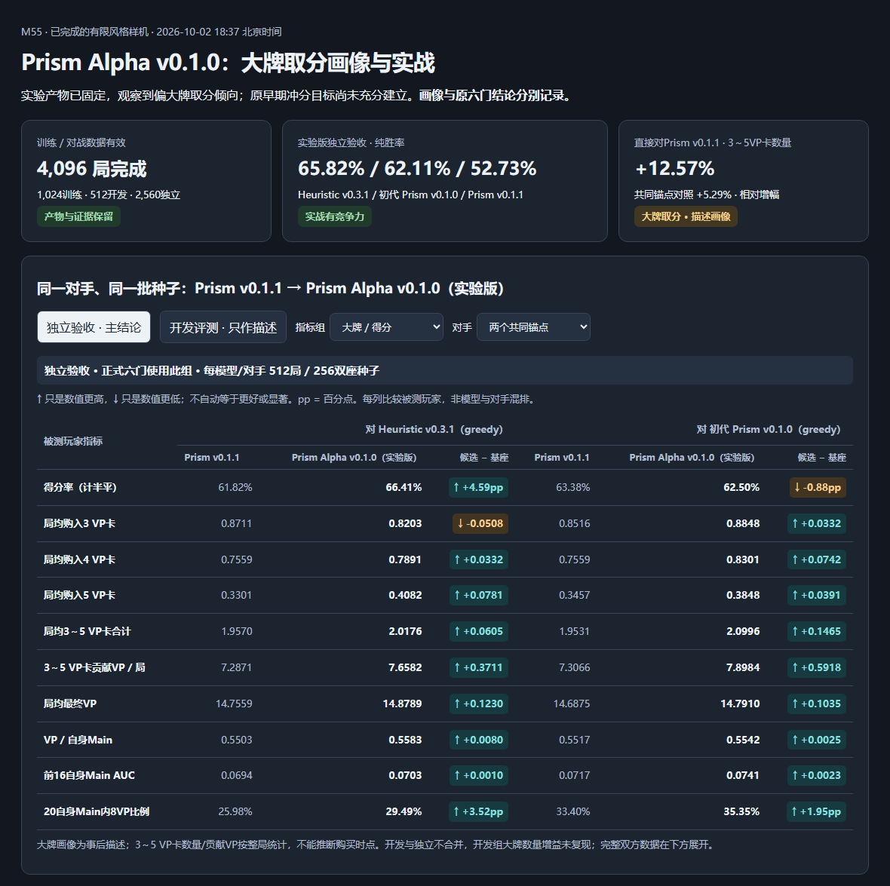

# M55 Prism Alpha v0.1.0：冲分样机与固定实验版本

Status: **NOT_ACCEPTED_RUSH_STYLE**。Baseline: `main@bcdaca7cb33c53cc43d5dcc9e92c07be3c1aaa57`，已有并行改动。Owner/date: 用户“okay 开始吧”，2026-10-02。

当前模型身份：**Prism Alpha v0.1.0 / `prism-alpha-v0.1.0`，REGISTERED_EXPERIMENTAL_MODEL**。本轮最终c4按用户举出的中性Alpha名称登记；与历史“Prism Rush v0.1.0 候选”完全同一权重，不是又训练了一版。[固定身份与完整表格](prism/prism-alpha-v0.1.0-evaluation-summary.md) / [登记记录](../benchmarks/m55-prism-alpha-v0.1.0.model.json) / [当前彩色对照](prism/prism-alpha-v0.1.0-comparison.html)。Alpha名称不宣称已通过冲分或基建风格验收，原六门原判仍保留。

最新画像与方向修正：**偏大牌取分 / 大牌冲分取向**。独立直接对Prism v0.1.1，4VP/5VP卡局均分别多20.33%/23.85%，3～5VP合计多12.57%；同共同锚点对照3～5VP合计多5.29%。这是全局购卡结构的事后描述，早期16Main AUC是另一种测量。此前“先基建锚定”的建议缺少数据依据，已修正为优先当前大牌取分方向的有限PPO；基建/其他风格后置，未启动。原身份/权重与六门不改。

当前事实：**4,096局有限迭代已完成，训练产物和对战证据有效；在本轮测试场有竞争力；预设冲分幅度尚未充分建立。** 原六门3通过/3未通过保留，不把这个综合标签当成训练失败。2026-10-02用户明确锚定风格允许部分指标交换；下方增加六门阈值/失败含义、基座到候选的变化和完整数表。[清晰阅读报告](prism/prism-rush-v0.1.0-evaluation-summary.md) / [彩色可切换对照](prism/prism-rush-v0.1.0-comparison.html)。旧启动快照保留为历史。

## Problem and evidence

Prism v0.1.1 已通过独立强度验收，但风格尚未训练/验收。它是从 trial-v1 第8轮检查点继续八轮所得的 trial-v2 最终 c8；上一批检查点不是当前正式版本。用户要求开始冲分样机，同时纠正文档简称和对战统计对象。

本轮开始时 style head/loss 已存在，真实风格效用与 Arena/coordinator 尚未接通；下方实施与验证节记录后续接线。本轮保留冻结通用模型，完成一个风格闭环与固定预算样机；不把风格不同自动等同于通用棋力提升。

## Initial design

从 Prism v0.1.1 权重建立新风格 run；复用 policy/value 参数，重新初始化训练专用 style head、AdamW 与 RNG。胜负 critic 保持真实结果 BCE；风格 MC 残差加入策略优势，单独学习 style value。导出仅 policy/value，保持 Rust 推理格式与 T=1，不添加推理偏好层。

## Scope and non-goals

一个冲分候选，4×256=1,024 训练局；只最终第4轮进入评测。开发两模型对两锚点共512局；独立新种子验收共2,560局，总预算4,096局，0 retry。无默认替换、共享池变更、其他风格、参数扫描、继续加训或 Git 发布。

## Contracts and invariants

冻结合同：[m55-prism-rush-v0.1.0.config.json](../benchmarks/m55-prism-rush-v0.1.0.config.json)。正式文档写完整版本，机器历史路径保留归档身份。

| 参数/门槛 | 采样前固定值 |
|---|---|
| 冻结基座 | Prism v0.1.1，SHA `a2301f0878f9c342a61b83fd45412f72ba95acfca895dafbe7ceca0360f34a85` |
| 风格效用 | 前16个自身 Main 结束后 `min(自身公开VP,15)/15` 的均值；短局终局分补足固定16分母 |
| ChooseNoble | 计入前一个 Main，不能多算回合或重复奖励 |
| β / style value loss weight | 0.3 / 0.5；LR3e-5，2pass，minibatch256 |
| 训练 / 开发 / holdout seeds | 9480000..9480511 / 9490000..9490063 / 9500000..9500255；互斥，holdout永不训练 |
| 开发 | 只描述，不选 β/检查点；最终 c4 已固定 |
| 风格主门 | pooled rush AUC paired delta 校正下界 >0.015 |
| 非奖励行为门 | 自身20个Main内达到8VP的比例 delta 校正下界 >0.02 |
| 棋力 pooled / 两个锚点 | 相对 Prism v0.1.1 得分率 paired delta 下界分别 ≥−5个百分点 |
| 直接基座棋力 | 对 Prism v0.1.1 得分率校正下界 ≥45% |
| 统计 | 6项单侧门，20,000 paired seed bootstrap，下分位0.05/6；一次分析，六门全过才验收 |
| 训练资源 | ≤4小时墙钟 / 18,000 user CPU秒 / 8GiB / 64GiB存储；2线程本机CPU |

这些样机阈值由执行 agent 在用户授权的有限实验范围内选定并在新采样前冻结；不是从原强度验收继承风格容差，也不是事后调整。样本预算不能保证达到统计精度；不足即保留未通过，不自动加局。

只从玩家投影中的自身公开分数和真实终局分计算效用；不使用暗牌、未来补牌或模型输入元数据。终局效用是训练目标，不作为在线特征。每个自身 Main 的前后分数由下一自身 Main 观察（末次用终局）还原；经典规则下对手动作不会改变自身分数，ChooseNoble归入该自身Main。

## Implementation plan

1. 修复人类文档的完整版本/继承图/整局与个人指标列名。
2. 接入严格版本化风格提取器、run与Arena合同，测试Main计数、短局、coverage、β=0、恢复和导出。
3. 冻结源码/运行资产与种子，启动唯一有限4轮run。
4. 完成最终c4开发与独立双目标验收，回放提纯详细表，记录全部负结果。

## Iteration log

- 2026-10-02：开始本轮；原源码保存到 ignored `local-artifacts/prism/rush-v0.1.0/baseline-source/`，旧已完成 run 不以修改后的 source identity 重开。

- 工程迭代：首轮合成测试出现两处新fixture错误（方法名和旧gate的测试设置），修正后18项PASS，随后完整270+显式3互操作PASS；风格目标/gate未按结果调整。
- 离线预检最初12局无实际贵族选择，追加已存1252号旧回放（不采新局）；共13局通过。种子脚本裸调用使用已consumed的历史S0默认区间，按其接口改为新M55区间与全registry互斥核对；保留裸调用FAIL，未改历史S0状态。
- 正式新采样前冻结β/种子/4轮/最终c4/六门；等待与报告控制器在最终c4和全部评测前冻结，开发不用于调参。启动/源码/归档证据留存在本地产物。
- 2026-10-02终局：1,024训练局/216新更新、512开发局、2,560独立验收局全部完成，0 retry。冻结原判 `NOT_ACCEPTED_RUSH_STYLE`，训练与数据完成不等于六门全过，也不表示模型实战无用。
- 2026-10-02解读修正：用户指出锚定风格允许一定棋力/经济代价。原门已经允许−5pp/45%底线，但每锚点及两项风格全设硬门，对首轮样机偏保守；这是执行agent预先选择的工程政策，不是用户指定所有指标必须提高。保留原政策/负结果，后续拆分产物、总体棋力底线与主风格目标仅为 `PROPOSED`。
- 同日可读性修正：新增只读生成器、基座→候选→变化的Markdown首表及彩色HTML，完整双方详细表继续直接嵌入本轮/M51/演进文档。开发128局/组与独立512局/组分开展示，避免把截图的开发描述当成正式验收。此次0新局、0新更新、0阈值/正式标签变更。
- 同日固定实验身份：用户询问是否固定身份并举Alpha名称，登记为Prism Alpha v0.1.0。policy/value和companion逐字节复制到`local-artifacts/prism/alpha-v0.1.0/`，登记JSON绑定原c4、基座、运行身份、动作模式与原结果SHA；完整评测表仅映射人类名称，机器实验名/原判不改。旧报告和M55/M51/演进/handoff快照存于`alpha-v0.1.0/identity-2026-10-02/before/`。
- 后续选择PROPOSED：先继续当前模型线，定义明确基建锚定后做一次有限PPO，其他风格后置。本轮奖励实际为早期得分，不能把它当成基建奖励；新基建分支继承Alpha policy/value，style critic按新效用初始化。建议4×256训练，接受代价/主风格目标/评测预算/新种子尚未冻结，没有启动新训练或比赛。
- 同日画像修正：用户指出“大牌冲分流”，核对双方直接512局与共同锚点各模型1,024局卡面VP分布，支持大牌取分倾向；同对手增幅比直接对战温和，开发128局/组的3～5VP合计未复现增长。新增事后画像表/机读记录，明确不是购买时点、新正式门或PPO因果证明。上一条基建建议保留为已更正历史；当前下一步改为沿大牌取分方向继续一次有限PPO，先补购入时点与分段得分曲线定义，不立即转基建或开另一风格。

## Final implementation

以下为2026-10-02启动阶段工程快照；后续终局以本文件末段自动生成的最终记录为准。

**IMPLEMENTED / ENGINEERING VERIFIED；正式训练进行中，棋力/风格验收尚未开始。**

- `training/prism/ppo/style.py` 严格提取真实终局的自身公开得分曲线；Main后分数包括贵族结算，短局固定16分母。
- run v3 冻结风格合同；coordinator自动提取MC风格目标，保留真实胜负BCE；Arena只接受与合同绑定的风格标签。旧v1/v2仍拒绝未授权正β。训练专用style head不导出。
- 离线 `prism_rush_metrics` 用规则重演计算双方曲线；`scripts/prism_rush_round.py` 等待既有监督训练c4，验其32张量/Rust输出一致，再跑固定开发与独立holdout；`scripts/prism_rush_report.py` 生成详细可读表，六门失败停止。
- [训练合同](../benchmarks/m55-prism-rush-v0.1.0.train.json)与[评测/源码冻结合同](../benchmarks/m55-prism-rush-v0.1.0.evaluate.json)已落盘。监督训练PID34628；有限评测控制器PID42196，均本机BelowNormal、隐藏运行。无需人工接下一步；任何失败保留并停，不自动重试。

## Validation and evidence

以下记录启动检查与当时进度；终局新增评测证据将直接附在本文件末段，原始快照保留。

训练：**IN PROGRESS**；开发/独立验收：**NOT_RUN**。截至 `2026-10-02T09:55:28.194224+00:00`，已完成 435/1,024 训练局、已提交第1轮（6,869决策、54新更新）；这些为训练轨迹，未当成棋力/风格结论。后续完成后本文件和阅读报告直接包含逐对手/双座、经济/贵族/预留/动作/计时完整表。

| 工程检验（实际执行） | 结果与时钟 | 证据 |
|---|---|---|
| `python -B -m pytest -q -p no:cacheprovider training/prism/tests --basetemp local-artifacts/prism/rush-v0.1.0/pytest-full` | exit0，270 PASS / 3 opt-in SKIP，149.03s | `pytest-full.log` |
| 显式提供冻结旧Rust测试/CLI与旧回放，再执行 `python -B -m pytest -q -p no:cacheprovider training/prism/tests/test_ppo_interop.py --basetemp local-artifacts/prism/rush-v0.1.0/pytest-interop` | exit0，3 PASS，36.15s，0新局；更新后policy/value导出一致 | `pytest-interop.log` 与互操作产物 |
| `python -B -m pytest -q -p no:cacheprovider training/prism/tests/test_rush_round.py` | exit0，11 PASS，最后3.72s | 固定预算/完整grid/六门/边界/报告与未来config预检 |
| `cargo build -p splendor-cli --example prism_rush_metrics --release --target-dir local-artifacts/prism/rush-v0.1.0/build` | exit0，42.25s，隔离构建 | `build.log` |
| Python玩家可见奖励 vs Rust真实规则回放 | PASS：13局旧回放，含1局实际ChooseNoble，曲线/Main/AUC/阈值一致，0新局 | `fixture-validation.json` / `fixture-profiles.json` |
| 基座参数 / 新run | PASS：初始policy/value逐张量一致；AdamW空，step0 | `preflight.json` |
| 新种子/合同/资产 | PASS：registry所有区间不重叠，65个controller/source/asset hash冻结 | `controller-frozen.json` / `controller-contract.json` |

上表本地产物均在 ignored `local-artifacts/prism/rush-v0.1.0/`。完整回归的3项跳过已由显式interop运行补上；新增11项单独运行，共284项不同Python检查实际通过，未声称单次命令输出284。隐含推理/决策延迟仍NOT_MEASURED。

试验合同SHA `8ab3c1557d104f4164121a92d2c8489a4bf8b27d20a389a83b48fa892b86abff`；训练合同SHA `2c5126d01de7d21b3bd6f9d37def3b12048807788a19779501e7196a00c5b8f7`；评测合同SHA `c2c57ea34f343e30c03dcdc8fbdbf0074cc2051ffc5a189839cdb44dbaafbe17`。训练source identity `657b2cbef6d9a168ff353be23512bcbc36883fb4fe8a2a8f69618a854b0472f4`，run identity `584effd11b931979a01a9df5ff0c730fec7fb2fdaad666c58c16df221b9b26cc`。

## Result and decision

启动阶段：AUTHORIZED；训练与有限评测控制器已启动，当时尚未宣称冲分风格成立、强度非劣或候选接受。终局只依据冻结六门，下方最终记录将覆盖这一历史阶段状态。

## Known limitations

有界16步AUC偏好可能损失棋力；六门同时检查可能精度不足。公开得分速度不能证明全盘风格或人类主观感受；学习型风格不改变推理采样规则。

## Next authorized gate

本轮工程、有限训练、唯一固定候选验收、可读解释、Alpha实验身份与大牌画像均已完成。保留Prism Alpha v0.1.0及正式原判，当前没有剩余训练/比赛任务。下一步优先为同模型线的大牌取分PPO设计，状态 `PROPOSED`；先定义购买时点/分段得分诊断，确定主风格目标、可接受代价与有限预算，再讨论新采样。基建建议已更正，不按本轮结果改旧门或自动追加比赛。

### 启动收口核对（2026-10-02）

`python -B -c "import runpy; runpy.run_path('local-artifacts/prism/rush-v0.1.0/validate-start.py',run_name='__main__')"` exit0：70条启动/文档断言与65个冻结source/asset SHA通过；既有M54两个验收合同/结果、原release和5,120局详细指标hash不变。完整版本名称、trial-v1→再8轮→trial-v2继承关系、v0.1.1所在对局表头、全战绩/七动作表、链接与ignored政策均核对。

回执 `local-artifacts/prism/rush-v0.1.0/startup-closeout.json`；HEAD/branch保持基线，暂存区空，`git diff --check` exit0。训练已启动、验收NOT_RUN；这是启动/文档验证，尚非本轮模型终局。后续由有限控制器写最终完整对战数据与结论。

### 终局解读与可读性核对（2026-10-02）

正式原结果SHA仍为 `9093d26aa1b8a31fd3874b4b79f046bf098755587a49f0eea345e03649bcac57`，直接绑定原控制器完成回执；原阈值和六门布尔值不改。原报告与相关文档快照存于 ignored `local-artifacts/prism/rush-v0.1.0/readability-2026-10-02/before/`，`before-ledger.json`记录旧SHA。原 `closeout-validation.json` 的报告SHA `35676649811b7350f1f95cd12adc4a92c5f7d29a56b841886073f139c24ea4ee` 对应这个原报告快照，不能用它冒充修改后的报告核验。

`python -B scripts/prism_rush_readability.py` exit0：原结果/六门阈值比较、开发/独立覆盖和两批PPO训练对手核对通过；只读取旧汇总并生成解释/完整Markdown/HTML。`python -B local-artifacts/prism/rush-v0.1.0/readability-2026-10-02/check-browser.py` exit0：14项显示/交互检查通过，包括上下变化、3PASS/3FAIL、开发与独立切换、VP0..5/折扣/七动作、双方完整数据、手机无页面溢出、无JS错误/网络依赖。首屏PNG已目视核对。`python -B local-artifacts/prism/rush-v0.1.0/readability-2026-10-02/validate-readability.py` exit0：99项解释/文档断言、65项冻结source/asset、14项浏览器检查和8个展示链接通过。最终回执 `readability-validation.json` 绑定当前报告/页面/图片SHA和Git publication检查；这些是解释与展示核验，未开展新竞技测量或独立review。

### 实验版本登记核对（2026-10-02）

`python -B scripts/prism_alpha_identity.py` exit0：65冻结source/asset、原结果SHA、原c4/基座和身份副本hash核对通过；生成中性实验身份、完整双方Markdown和当前名称彩色页，0新局/更新，未改原门。原可读性回执对应身份登记前的文件快照，已保存于`local-artifacts/prism/alpha-v0.1.0/identity-2026-10-02/before/`，不能当作改名后报告的SHA核验。当前身份/链接/原证据与页面检查回执为该目录的`identity-validation.json`，属于登记/文档核验，不是重新开展强度或风格验收。

`python -B local-artifacts/prism/alpha-v0.1.0/identity-2026-10-02/check-browser.py` exit0：当前名称页面14项显示/交互核对通过，PNG目视核对。`python -B local-artifacts/prism/alpha-v0.1.0/identity-2026-10-02/validate-identity.py` exit0：55项身份/文档核对、65项冻结hash与8个展示链接通过；原3PASS/3FAIL、权重/companion副本、基座和全部双方表数值保持一致，HEAD/branch不改、暂存区空、diff-check通过。后续登记展示应使用`scripts/prism_alpha_identity.py`；原Rush生成器用于历史记录，不用于覆盖当前Alpha身份文档。

### 大牌画像与后续方向核对（2026-10-02）

`python -B scripts/prism_alpha_identity.py` exit0：从冻结原结果重算直接双方与同对手对照的大牌数量/卡面VP/得分速度，画像字段与身份登记绑定；完整原双方表保持一致。`python -B local-artifacts/prism/alpha-v0.1.0/profile-2026-10-02/check-browser.py` exit0：14项显示/交互检查，当前页面默认展示大牌/得分，PNG目视核对。`python -B local-artifacts/prism/alpha-v0.1.0/profile-2026-10-02/validate-profile.py` exit0：73项画像/身份/文档核对、65项冻结hash与8个展示链接通过；得分速度用合计VP/合计Main，开发与独立分别计算。回执`profile-validation.json`绑定当前画像/报告/页面/图片与生成器SHA；原权重、原结果SHA与六门原判不改，0新局/更新，未替换默认或部署共享池。

<!-- M55 VERIFIED RESULTS BEGIN -->

## M55固定版本：Prism Alpha v0.1.0：固定身份与完整对战记录

**固定实验版本身份：Prism Alpha v0.1.0；与M55最终c4是同一份权重，没有追加训练。** 原开发名为“Prism Rush v0.1.0 候选”；Alpha是中性模型线名，不声称冲分或基建风格已经验收。原冲分六门判定 `NOT_ACCEPTED_RUSH_STYLE` 完整保留。

| 身份字段 | 固定记录 |
| --- | --- |
| 模型名称 / ID | Prism Alpha v0.1.0 / `prism-alpha-v0.1.0` |
| 身份登记状态 | `REGISTERED_EXPERIMENTAL_MODEL`；可明确引用的实验版本，不是Rush风格已通过 |
| 谱系 | Prism v0.1.1 → M55四轮PPO → M55最终c4 = Prism Alpha v0.1.0 |
| 固定权重 | `local-artifacts/prism/alpha-v0.1.0/weights.json` / `b5e68e008d5d462aff19c67b8eed063139a5c500a020a48031e8938b44618f0a` |
| 训练来源 | 1,024局、216新更新；原目标为前16自身Main得分曲线（冲分），不是基建专用奖励 |
| 身份登记 | `benchmarks/m55-prism-alpha-v0.1.0.model.json` |
| 原验收 / 后续动作 | 原3PASS/3FAIL保留；此次0新局/更新，未替换默认或部署共享池 |

## 大牌取分画像（描述性；2026-10-02更正）

**当前更贴切的工作画像是“大牌取分 / 偏大牌冲分”。** 我上一版建议转向基建锚定缺少数据依据；现先沿已观察到的大牌取分倾向继续迭代，基建分支后置。

**下面是Alpha直接对Prism v0.1.1的512局、256双座种子，比较同一场里的双方个人指标。** 大牌在这里明确指卡面3～5 VP；不是所有大牌类别均同幅上涨，也不能仅凭终局数量断定买牌时点。

| 双方个人指标 | Prism v0.1.1 | Prism Alpha v0.1.0 | Alpha相对变化（%不是pp） |
| --- | --- | --- | --- |
| 局均3 VP卡 | 0.8438 | **0.8750** | **↑ +3.70%** |
| 局均4 VP卡 | 0.5957 | **0.7168** | **↑ +20.33%** |
| 局均5 VP卡 | 0.2539 | **0.3145** | **↑ +23.85%** |
| 局均3～5 VP卡合计 | 1.6934 | **1.9062** | **↑ +12.57%** |
| 局均3～5 VP卡贡献VP | 6.1836 | **7.0645** | **↑ +14.25%** |
| VP / 自身Main | 0.5143 | **0.5304** | **↑ +3.13%** |

同一批共同对手的基座/Alpha对照，各模型1,024独立局：3～5VP卡合计 **1.9551 → 2.0586，↑5.29%**；5VP卡 **0.3379 → 0.3965，↑17.34%**。前者比直接对战的增幅温和；两个对手上的4/5VP卡均值均提高，3VP卡对Heuristic略降，不能写成全项大幅领先。

开发组每模型/对手128局，3～5VP卡合计对Heuristic由1.9766降至1.9453、对初代由2.1094降至2.0000；大牌数量增长未在这组小样本复现。画像主要依据更大的独立组与直接对战，属于事后描述，不作正式新门或已确认泛化的风格结论。

前16自身Main AUC只衡量早期得分；终局高VP购卡分布衡量整局取分结构，两者可以出现不同幅度。原早期AUC幅度未达目标，不抹掉观察到的大牌取分倾向；购卡总数也不能直接证明“中后期买得更早/结束更快”，购买时点与分段得分曲线尚未在本次新增画像中测量。

画像机读证据：`benchmarks/m55-prism-alpha-v0.1.0.style-profile.json`；原结果、身份和完整双方表保留。

## 下一版建议（PROPOSED；未启动）

**优先沿当前大牌取分模型线继续一次有限PPO；基建分支和其他风格后置。** 之前的基建锚定建议作为已更正历史保留于M55迭代日志和登记前快照，不是下一轮当前目标。

从Prism Alpha v0.1.0继承现有policy/value，先补大牌购入时点、卡牌贡献VP与分段得分速度画像，判断下一轮是否继续原冲分奖励或调整其覆盖窗口/效用；目标不是单纯多买大牌，而是更有效地把资源转成得分与胜局。仅奖励买牌数量可能买贵牌却不能取胜。

仍建议一名最终候选、4×256训练；总体棋力保留底线，选择贴合大牌取分的一个主风格目标，其他维度作画像。奖励如改变，style critic应按新效用初始化；若完全相同则按相同合同讨论续训。可接受代价、最低风格幅度、评测预算与新种子均在新采样前冻结。当前没有新训练/比赛进程，`Prism Alpha v0.1.1` 只是后续候选命名建议，尚无权重或结果。

| 方向 | 判断 |
| --- | --- |
| 当前大牌取分模型线继续PPO | 优先：保留已观察到的倾向，改善取分效率和实战表现 |
| 立即开基建或另一个风格 | 后置：先把当前方向的画像与验收目标说明白 |
| 重新从零训练基座 | 当前无此必要证据；本轮已经完成有效导出和对战闭环 |

## 命名与历史证据

下方旧评测的被测玩家名映射到Prism Alpha v0.1.0，数值/种子/阈值/原判全部沿用原M55证据。文件名中的`rush-v0.1.0`与JSON中的`rush`是冻结实验标识，保留原路径/SHA；它们不是另一份模型或再次训练。可切换彩色页使用当前名称；旧Rush页保留为历史。

**本轮产物已完成；竞技表现可用；预设冲分目标尚未充分建立。** 完成时间：2026-10-02 18:37:02（北京时间）。

| 先看什么 | 结论 |
| --- | --- |
| ✅ 训练与数据有效 | 1,024训练局、216新更新；512开发局与2,560独立验收局完成，总4,096局，0 retry |
| ✅ 实战有竞争力 | 独立验收纯胜率：对 Heuristic v0.3.1 **65.82%**、对初代 Prism v0.1.0 **62.11%**、直接对 Prism v0.1.1 **52.73%** |
| 🟡 冲分幅度尚未建立 | 前16自身Main AUC只提高 **0.00164**，原定最小幅度是 **0.015**；20Main内8VP比例有向上信号，增益未被置信下界确认 |
| 🟡 一个棋力容差未确认 | 对初代的得分率实际只比基座低 **0.88pp**；不代表已实测下降7.13pp |

冻结原判仍为 `NOT_ACCEPTED_RUSH_STYLE`：它回答“是否通过预先写定的全部冲分晋级门”，不代表训练失败或模型没有可用价值。权重和完整对战证据保留，未替换默认模型、未向共享池部署；本次只改解读与展示，不改原阈值、结果或标签。

## 先看同条件的变化

**以下是独立验收，每一模型/对手512局、256双座种子块。** 基座与候选对同一对手使用同一组种子/换座条件。每格只比较被测玩家“Prism v0.1.1 → Prism Alpha v0.1.0（实验版）”；对手数据在后方完整表中。

| 被测玩家指标：基座 → 候选；变化 | 对 Heuristic v0.3.1 | 对初代 Prism v0.1.0 |
| --- | --- | --- |
| 得分率（计半平） | 61.82% → 66.41%；**↑ +4.5898pp** | 63.38% → 62.50%；**↓ -0.8789pp** |
| 局均最终VP | 14.7559 → 14.8789；**↑ +0.1230** | 14.6875 → 14.7910；**↑ +0.1035** |
| VP / 自身Main | 0.5503 → 0.5583；**↑ +0.0080** | 0.5517 → 0.5542；**↑ +0.0025** |
| 前16自身Main AUC | 0.0694 → 0.0703；**↑ +0.0010** | 0.0717 → 0.0741；**↑ +0.0023** |
| 20自身Main内8VP比例 | 25.98% → 29.49%；**↑ +3.5156pp** | 33.40% → 35.35%；**↑ +1.9531pp** |
| 局均贵族 | 0.4922 → 0.4902；**↓ -0.0020** | 0.4395 → 0.4199；**↓ -0.0195** |
| 获得贵族的对局比例 | 38.87% → 41.02%；**↑ +2.1484pp** | 38.09% → 36.91%；**↓ -1.1719pp** |
| 预留买回 / 获取 | 40.47% → 38.41%；**↓ -2.0561pp** | 39.53% → 36.98%；**↓ -2.5434pp** |
| 终局未买回预留 | 1.2988 → 1.4219；**↑ +0.1230** | 1.2969 → 1.5176；**↑ +0.2207** |

两个共同锚点的合计得分率：**62.60% → 64.45%，↑1.86pp**。直接对基座512局：270胜 / 4平 / 238负，纯胜率52.73%，计半平得分率53.13%。普通95%得分率区间48.83%..57.32%，因此当前不能确认已强于基座。

**读表图例：↑/↓只是数值增减，不自动等于更好或统计显著。** `pp`=百分点。更多折扣、贵族或更少预留不天然更好；风格可以交换棋力、经济与节奏。🟢只用于原门确认通过，🟡区分幅度未达与证据不足。

彩色对照页：[可切换独立/开发与指标组的对照](prism/prism-alpha-v0.1.0-comparison.html)。下方图为独立数据首屏快照；完整Markdown数表保留在本文件后面。

## 六个门怎么设计，为什么有 FAIL

原设计是**4项棋力保护 + 2项风格目标**。棋力保护允许代价：三项相对基座的得分率差，下界允许到−5pp；直接对基座的得分率下界允许到45%。需要正向增益的是两项冲分目标。**从来不是六个数都必须为正。** 数值阈值是执行agent为这个样机选定的工程要求，不是用户亲自指定的偏好或棋力定律。

| 原门 / 作用 | 实测均值 | 要求：校正下界 | 实际校正下界 | 原结果的正确读法 |
| --- | --- | --- | --- | --- |
| 共同锚点合计 / 棋力容差 | +1.86个百分点 | ≥ -5.00个百分点 | -2.73个百分点 | 🟢 原门通过（原 PASS） |
| 对 Heuristic v0.3.1 / 棋力容差 | +4.59个百分点 | ≥ -5.00个百分点 | -2.05个百分点 | 🟢 原门通过（原 PASS） |
| 对初代 Prism v0.1.0 / 棋力容差 | -0.88个百分点 | ≥ -5.00个百分点 | -7.13个百分点 | 🟡 容差未确认（原 FAIL） |
| 直接对 Prism v0.1.1 / 棋力底线 | 53.12% | ≥ 45.00% | 47.95% | 🟢 原门通过（原 PASS） |
| 前16自身Main得分曲线 / 冲分幅度 | +0.00164 | > +0.01500 | -0.00109 | 🟡 风格幅度未达（原 FAIL） |
| 20自身Main内达到8VP / 第二风格目标 | +2.73个百分点 | > +2.00个百分点 | -1.27个百分点 | 🟡 增益未确认（原 FAIL） |

四项棋力门并不要求每个指标提高。对初代一项实测变化−0.88pp，但下界−7.13pp越过原设−5pp容差：含义是“这批样本没把下降风险压到预定容差以内”，**不是已证明模型明显退化**。直接对基座的53.13%及47.95%下界通过45%底线，也不要求它显著战胜基座。

AUC门的另一层含义：实测+0.001636、普通95%区间[−0.000598,+0.003894]，连普通区间上端也低于原目标+0.015。按15VP归一化还原，窗口内平均截顶VP只提高约**0.0245VP**，原目标相当于**0.225VP**。该主指标上的幅度很小，不能只归因于多重校正。

20Main内8VP比例：**29.69% → 32.42%，+2.73pp**；均值超过原+2pp目标，但普通95%增益区间[−0.59,+6.05]pp、校正下界−1.27pp，所以是“方向向上，增益未确认”。

所有门以256个环境seed块进行配对bootstrap；双座是同一块，不能把每局当成独立种子。20,000次重采样、六项单侧判断，用0.05/6≈0.8333%分位作下界；原表只有0..1数值和PASS/FAIL，缺少阈值、单位和失败类型，容易误读。

## 验收设计与产品意图的修正

用户明确：锚定风格可以接受某些维度稍差。原方案虽允许5pp代价，却又把每个锚点、两项风格指标都设为独立硬门；配合有限样本与六门校正，对首轮风格样机偏保守。计算与原判可复核，产品层面的六门全过要求值得重新设计。

后续方向 **PROPOSED**：把“训练/产物有效”“总体棋力底线”“风格目标”分别评估；用总体与直接基座对照保护实用强度，逐对手和经济细项作为画像/告警，除非产品目标确实要求每个对手都不退化。选择一个贴合所需风格的主指标，把其他行为指标作为诊断；提前定义可接受棋力损失与最低风格幅度，不要求全表变好。

本轮模型是已登记、值得保留的实验产物；冲分标签的充分证据仍缺。此新意图不把旧FAIL事后改成PASS，不自动发布为已验证Rush版本，也不追加训练/比赛。下一次训练或正式验收需要新的固定范围与未使用种子。

## 截图数据与训练对象说明

**用户截图来自开发评测：每模型/对手128局；六个门来自独立验收：每组512局。** 开发组可用来描述，但不能混入独立验收。比如截图中贵族均值上升，独立组候选贵族均值对两个锚点约变化−0.002/−0.020，说明该行为尚不稳定；不要只凭某一屏把它定为贵族或冲分风格。

Prism v0.1.1 来自trial-v2最终c8，其两批PPO并非只针对初代：trial-v1与trial-v2每批各2,048局，其中Heuristic v0.3.1与初代 Prism v0.1.0各1,024局。它们是训练锚点，所以这些胜率表明对该测试场的竞争力，不能扩写成全对手泛化结论。

## 统计原值（保留原冻结判定）

| 测量键 | 均值 | 普通95%区间 | 六门校正下界 | 冻结原门 |
| --- | --- | --- | --- | --- |
| strength_pool | 0.018555 | [-0.019531, 0.055664] | -0.027344 | PASS |
| strength/heuristic-v031 | 0.045898 | [-0.007812, 0.099609] | -0.020508 | PASS |
| strength/prism-v01 | -0.008789 | [-0.059570, 0.042969] | -0.071289 | FAIL |
| direct_base | 0.531250 | [0.488281, 0.573242] | 0.479492 | PASS |
| rush_auc | 0.001636 | [-0.000598, 0.003894] | -0.001091 | FAIL |
| vp8_by_main20 | 0.027344 | [-0.005859, 0.060547] | -0.012695 | FAIL |

## 独立验收：原始双方完整数据

每模型/锚点512局；整批墙钟 470.500s；本机4个BelowNormal进程，0 retry。

### 独立验收：原始双方完整数据

“模型”列是被测玩家；对手列注明动作模式。个人指标每格为“被测模型 / 对手”。节奏是该模型对阵该对手的整局指标。纯胜率=胜/局数，得分率=(胜+0.5平)/局数。

| 模型（T=1） | 对手 | 局数 / 双座种子数 | 胜 / 平 / 负 | 纯胜率 | 得分率 | 描述性配对95%区间 |
| --- | --- | --- | --- | --- | --- | --- |
| Prism v0.1.1 | Heuristic v0.3.1（greedy） | 512 / 256 | 314 / 5 / 193 | 61.3281% | 61.8164% | [57.5195%, 66.1133%] |
| Prism v0.1.1 | 初代 Prism v0.1.0（greedy） | 512 / 256 | 324 / 1 / 187 | 63.2812% | 63.3789% | [59.1797%, 67.5781%] |
| Prism Alpha v0.1.0（实验版） | Prism v0.1.1（T=1） | 512 / 256 | 270 / 4 / 238 | 52.7344% | 53.1250% | [48.9258%, 57.4219%] |
| Prism Alpha v0.1.0（实验版） | Heuristic v0.3.1（greedy） | 512 / 256 | 337 / 6 / 169 | 65.8203% | 66.4062% | [62.2070%, 70.5078%] |
| Prism Alpha v0.1.0（实验版） | 初代 Prism v0.1.0（greedy） | 512 / 256 | 318 / 4 / 190 | 62.1094% | 62.5000% | [58.2031%, 66.6992%] |

#### 双座明细

| 模型 | 对手 | 本模型座位 | 局数 | 胜 / 平 / 负 | 得分率 | 局均VP（模型 / 对手） |
| --- | --- | --- | --- | --- | --- | --- |
| Prism v0.1.1 | Heuristic v0.3.1（greedy） | 先手 P0 | 256 | 167 / 2 / 87 | 65.6250% | 14.859 / 13.402 |
| Prism v0.1.1 | Heuristic v0.3.1（greedy） | 后手 P1 | 256 | 147 / 3 / 106 | 58.0078% | 14.652 / 13.777 |
| Prism v0.1.1 | 初代 Prism v0.1.0（greedy） | 先手 P0 | 256 | 161 / 0 / 95 | 62.8906% | 14.707 / 13.199 |
| Prism v0.1.1 | 初代 Prism v0.1.0（greedy） | 后手 P1 | 256 | 163 / 1 / 92 | 63.8672% | 14.668 / 13.309 |
| Prism Alpha v0.1.0（实验版） | Prism v0.1.1（T=1） | 先手 P0 | 256 | 133 / 3 / 120 | 52.5391% | 14.020 / 13.781 |
| Prism Alpha v0.1.0（实验版） | Prism v0.1.1（T=1） | 后手 P1 | 256 | 137 / 1 / 118 | 53.7109% | 14.266 / 13.645 |
| Prism Alpha v0.1.0（实验版） | Heuristic v0.3.1（greedy） | 先手 P0 | 256 | 168 / 3 / 85 | 66.2109% | 14.859 / 13.148 |
| Prism Alpha v0.1.0（实验版） | Heuristic v0.3.1（greedy） | 后手 P1 | 256 | 169 / 3 / 84 | 66.6016% | 14.898 / 13.223 |
| Prism Alpha v0.1.0（实验版） | 初代 Prism v0.1.0（greedy） | 先手 P0 | 256 | 168 / 3 / 85 | 66.2109% | 14.848 / 13.055 |
| Prism Alpha v0.1.0（实验版） | 初代 Prism v0.1.0（greedy） | 后手 P1 | 256 | 150 / 1 / 105 | 58.7891% | 14.734 / 13.625 |

#### 对局节奏与风格

| 模型 / 对手 | 局均步数 | 决策轮：均值 / 最短 / 中位 / 最长 | 轮标准差 | Main轮均值 | 终局绝对分差 | 分差≤2 | Rush AUC | 20 Main内8VP |
| --- | --- | --- | --- | --- | --- | --- | --- | --- |
| Prism v0.1.1 / Heuristic v0.3.1（greedy） | 53.652 | 26.838 / 22 / 27.0 / 32 | 1.728 | 26.814 | 3.607 | 34.77% | 0.06938 | 25.9766% |
| Prism v0.1.1 / 初代 Prism v0.1.0（greedy） | 53.277 | 26.656 / 20 / 27.0 / 32 | 1.901 | 26.621 | 3.926 | 34.38% | 0.07174 | 33.3984% |
| Prism Alpha v0.1.0（实验版） / Prism v0.1.1（T=1） | 53.338 | 26.676 / 21 / 27.0 / 33 | 1.838 | 26.662 | 3.824 | 32.23% | 0.07087 | 27.3438% |
| Prism Alpha v0.1.0（实验版） / Heuristic v0.3.1（greedy） | 53.324 | 26.674 / 22 / 27.0 / 33 | 1.840 | 26.648 | 3.900 | 31.25% | 0.07034 | 29.4922% |
| Prism Alpha v0.1.0（实验版） / 初代 Prism v0.1.0（greedy） | 53.396 | 26.705 / 21 / 27.0 / 33 | 1.866 | 26.689 | 3.779 | 32.81% | 0.07406 | 35.3516% |

Rush AUC/20 Main列为被测玩家；短于16自身Main的AUC按终局分补足固定窗口。legacy决策轮=ceil(全动作步数/2)，含贵族选择；Main轮排除贵族选择。风格两项之外的经济数据为新增描述性指标。

#### 双方得分、购卡、折扣、贵族与预留

| 个人指标：模型 / 对手 | Prism v0.1.1 对阵 Heuristic v0.3.1（greedy） | Prism v0.1.1 对阵 初代 Prism v0.1.0（greedy） | Prism Alpha v0.1.0（实验版） 对阵 Prism v0.1.1（T=1） | Prism Alpha v0.1.0（实验版） 对阵 Heuristic v0.3.1（greedy） | Prism Alpha v0.1.0（实验版） 对阵 初代 Prism v0.1.0（greedy） |
| --- | --- | --- | --- | --- | --- |
| 局均最终VP | 14.7559 / 13.5898 | 14.6875 / 13.2539 | 14.1426 / 13.7129 | 14.8789 / 13.1855 | 14.7910 / 13.3398 |
| VP / 自身决策（含贵族选择） | 0.5503 / 0.5064 | 0.5516 / 0.4974 | 0.5304 / 0.5141 | 0.5583 / 0.4943 | 0.5541 / 0.4996 |
| VP / 自身Main | 0.5503 / 0.5068 | 0.5517 / 0.4979 | 0.5304 / 0.5143 | 0.5583 / 0.4948 | 0.5542 / 0.4998 |
| VP / 全局步数 | 0.2750 / 0.2533 | 0.2757 / 0.2488 | 0.2652 / 0.2571 | 0.2790 / 0.2473 | 0.2770 / 0.2498 |
| 局均永久折扣 / 购卡 | 12.3789 / 13.3535 | 12.1035 / 13.1758 | 12.0352 / 12.2480 | 12.2480 / 13.1445 | 11.9043 / 13.3672 |
| 局均贵族数 | 0.4922 / 0.7031 | 0.4395 / 0.5762 | 0.4453 / 0.5352 | 0.4902 / 0.6484 | 0.4199 / 0.6387 |
| 局均预留获取 | 2.1816 / 2.3418 | 2.1445 / 1.8691 | 2.6465 / 2.5137 | 2.3086 / 2.2402 | 2.4082 / 1.9004 |
| 局均预留买回 | 0.8828 / 1.2539 | 0.8477 / 0.9980 | 1.0137 / 1.0566 | 0.8867 / 1.1562 | 0.8906 / 0.9902 |
| 终局未买回预留 | 1.2988 / 1.0879 | 1.2969 / 0.8711 | 1.6328 / 1.4570 | 1.4219 / 1.0840 | 1.5176 / 0.9102 |
| 获得贵族的对局比例 | 38.867% / 50.977% | 38.086% / 44.141% | 38.477% / 41.992% | 41.016% / 48.438% | 36.914% / 48.438% |
| 预留买回 / 获取 | 40.466% / 53.545% | 39.526% / 53.396% | 38.303% / 42.036% | 38.409% / 51.613% | 36.983% / 52.107% |
| 局均购入 0 VP卡 | 6.3516 / 7.5254 | 6.1094 / 7.2617 | 6.2500 / 6.4746 | 6.3594 / 7.3750 | 6.0059 / 7.4863 |
| 局均购入 1 VP卡 | 2.1484 / 2.5918 | 2.0195 / 2.6367 | 2.0156 / 2.2363 | 1.9922 / 2.5977 | 1.9648 / 2.5957 |
| 局均购入 2 VP卡 | 1.9219 / 1.7461 | 2.0215 / 1.7891 | 1.8633 / 1.8438 | 1.8789 / 1.7363 | 1.8340 / 1.8594 |
| 局均购入 3 VP卡 | 0.8711 / 0.7852 | 0.8516 / 0.8262 | 0.8750 / 0.8438 | 0.8203 / 0.7676 | 0.8848 / 0.7930 |
| 局均购入 4 VP卡 | 0.7559 / 0.4844 | 0.7559 / 0.4785 | 0.7168 / 0.5957 | 0.7891 / 0.4727 | 0.8301 / 0.4336 |
| 局均购入 5 VP卡 | 0.3301 / 0.2207 | 0.3457 / 0.1836 | 0.3145 / 0.2539 | 0.4082 / 0.1953 | 0.3848 / 0.1992 |
| 局均 白 折扣 | 2.4004 / 2.6465 | 2.3398 / 2.5684 | 2.4199 / 2.3496 | 2.3906 / 2.5918 | 2.3789 / 2.5781 |
| 局均 蓝 折扣 | 2.6289 / 2.5859 | 2.4551 / 2.7109 | 2.3906 / 2.5703 | 2.5938 / 2.5762 | 2.4336 / 2.7910 |
| 局均 绿 折扣 | 2.4551 / 2.7344 | 2.4414 / 2.7363 | 2.3457 / 2.4941 | 2.3809 / 2.7305 | 2.4004 / 2.7031 |
| 局均 红 折扣 | 2.4062 / 2.6367 | 2.4023 / 2.4863 | 2.3809 / 2.3711 | 2.3906 / 2.6211 | 2.3574 / 2.5430 |
| 局均 黑 折扣 | 2.4883 / 2.7500 | 2.4648 / 2.6738 | 2.4980 / 2.4629 | 2.4922 / 2.6250 | 2.3340 / 2.7520 |

#### 全部七类动作

| 个人指标：模型 / 对手 | Prism v0.1.1 对阵 Heuristic v0.3.1（greedy） | Prism v0.1.1 对阵 初代 Prism v0.1.0（greedy） | Prism Alpha v0.1.0（实验版） 对阵 Prism v0.1.1（T=1） | Prism Alpha v0.1.0（实验版） 对阵 Heuristic v0.3.1（greedy） | Prism Alpha v0.1.0（实验版） 对阵 初代 Prism v0.1.0（greedy） |
| --- | --- | --- | --- | --- | --- |
| 买市场 次数 | 5886 / 6195 | 5763 / 6235 | 5643 / 5730 | 5817 / 6138 | 5639 / 6337 |
| 买市场 占自身全部决策 | 42.870% / 45.087% | 42.269% / 45.698% | 41.332% / 41.960% | 42.631% / 44.944% | 41.257% / 46.354% |
| 买预留 次数 | 452 / 642 | 434 / 511 | 519 / 541 | 454 / 592 | 456 / 507 |
| 买预留 占自身全部决策 | 3.292% / 4.672% | 3.183% / 3.745% | 3.801% / 3.962% | 3.327% / 4.335% | 3.336% / 3.709% |
| 取宝石 次数 | 6274 / 5693 | 6335 / 5927 | 6134 / 6093 | 6191 / 5767 | 6337 / 5848 |
| 取宝石 占自身全部决策 | 45.696% / 41.434% | 46.465% / 43.440% | 44.928% / 44.618% | 45.372% / 42.227% | 46.364% / 42.777% |
| 预留市场 次数 | 1115 / 1196 | 1095 / 955 | 1355 / 1285 | 1181 / 1142 | 1232 / 972 |
| 预留市场 占自身全部决策 | 8.121% / 8.705% | 8.031% / 6.999% | 9.925% / 9.410% | 8.655% / 8.362% | 9.014% / 7.110% |
| 预留牌堆 次数 | 2 / 3 | 3 / 2 | 0 / 2 | 1 / 5 | 1 / 1 |
| 预留牌堆 占自身全部决策 | 0.015% / 0.022% | 0.022% / 0.015% | 0.000% / 0.015% | 0.007% / 0.037% | 0.007% / 0.007% |
| 选贵族 次数 | 1 / 11 | 4 / 14 | 2 / 5 | 1 / 13 | 3 / 6 |
| 选贵族 占自身全部决策 | 0.007% / 0.080% | 0.029% / 0.103% | 0.015% / 0.037% | 0.007% / 0.095% | 0.022% / 0.044% |
| 跳过 次数 | 0 / 0 | 0 / 0 | 0 / 0 | 0 / 0 | 0 / 0 |
| 跳过 占自身全部决策 | 0.000% / 0.000% | 0.000% / 0.000% | 0.000% / 0.000% | 0.000% / 0.000% | 0.000% / 0.000% |

#### 实测计时

| 模型 / 对手 | 进程耗时累计s | 单局均值s | 单局P95s | 决策 / 推理延迟 |
| --- | --- | --- | --- | --- |
| Prism v0.1.1 / Heuristic v0.3.1（greedy） | 195.896 | 0.3826 | 0.4685 | NOT_MEASURED / NOT_MEASURED |
| Prism v0.1.1 / 初代 Prism v0.1.0（greedy） | 234.088 | 0.4572 | 0.9220 | NOT_MEASURED / NOT_MEASURED |
| Prism Alpha v0.1.0（实验版） / Prism v0.1.1（T=1） | 221.691 | 0.4330 | 0.6100 | NOT_MEASURED / NOT_MEASURED |
| Prism Alpha v0.1.0（实验版） / Heuristic v0.3.1（greedy） | 201.273 | 0.3931 | 0.5630 | NOT_MEASURED / NOT_MEASURED |
| Prism Alpha v0.1.0（实验版） / 初代 Prism v0.1.0（greedy） | 237.222 | 0.4633 | 0.9220 | NOT_MEASURED / NOT_MEASURED |

单局时钟包括程序启动、比赛、验核和输出；累计单局秒数含并行重叠，不等于整批墙钟。未记录逐决策/推理延迟，不能填0或由单局时间推算。

## 开发评测：描述性完整数据

每模型/锚点128局；整批墙钟 125.172s；本机4个BelowNormal进程，0 retry。

开发组对照（不参与验收；↑/↓是描述性变化）：

| 被测玩家指标：基座 → 候选；变化 | 对 Heuristic v0.3.1 | 对初代 Prism v0.1.0 |
| --- | --- | --- |
| 得分率（计半平） | 57.42% → 67.58%；**↑ +10.1562pp** | 58.20% → 66.80%；**↑ +8.5938pp** |
| 局均最终VP | 14.7578 → 14.9297；**↑ +0.1719** | 14.6328 → 14.8750；**↑ +0.2422** |
| VP / 自身Main | 0.5488 → 0.5609；**↑ +0.0121** | 0.5507 → 0.5626；**↑ +0.0119** |
| 前16自身Main AUC | 0.0692 → 0.0720；**↑ +0.0028** | 0.0704 → 0.0723；**↑ +0.0020** |
| 20自身Main内8VP比例 | 24.22% → 30.47%；**↑ +6.2500pp** | 32.81% → 32.03%；**↓ -0.7812pp** |
| 局均贵族 | 0.4453 → 0.5156；**↑ +0.0703** | 0.3594 → 0.5391；**↑ +0.1797** |
| 获得贵族的对局比例 | 36.72% → 42.19%；**↑ +5.4688pp** | 33.59% → 42.19%；**↑ +8.5938pp** |
| 预留买回 / 获取 | 42.18% → 35.37%；**↓ -6.8027pp** | 36.15% → 36.88%；**↑ +0.7284pp** |
| 终局未买回预留 | 1.3281 → 1.4844；**↑ +0.1562** | 1.4766 → 1.4844；**↑ +0.0078** |

### 开发评测：描述性完整数据

“模型”列是被测玩家；对手列注明动作模式。个人指标每格为“被测模型 / 对手”。节奏是该模型对阵该对手的整局指标。纯胜率=胜/局数，得分率=(胜+0.5平)/局数。

| 模型（T=1） | 对手 | 局数 / 双座种子数 | 胜 / 平 / 负 | 纯胜率 | 得分率 | 描述性配对95%区间 |
| --- | --- | --- | --- | --- | --- | --- |
| Prism v0.1.1 | Heuristic v0.3.1（greedy） | 128 / 64 | 73 / 1 / 54 | 57.0312% | 57.4219% | [49.2188%, 65.6250%] |
| Prism v0.1.1 | 初代 Prism v0.1.0（greedy） | 128 / 64 | 74 / 1 / 53 | 57.8125% | 58.2031% | [49.6094%, 66.7969%] |
| Prism Alpha v0.1.0（实验版） | Heuristic v0.3.1（greedy） | 128 / 64 | 86 / 1 / 41 | 67.1875% | 67.5781% | [59.3750%, 75.3906%] |
| Prism Alpha v0.1.0（实验版） | 初代 Prism v0.1.0（greedy） | 128 / 64 | 85 / 1 / 42 | 66.4062% | 66.7969% | [58.5938%, 74.6094%] |

#### 双座明细

| 模型 | 对手 | 本模型座位 | 局数 | 胜 / 平 / 负 | 得分率 | 局均VP（模型 / 对手） |
| --- | --- | --- | --- | --- | --- | --- |
| Prism v0.1.1 | Heuristic v0.3.1（greedy） | 先手 P0 | 64 | 32 / 1 / 31 | 50.7812% | 14.547 / 14.125 |
| Prism v0.1.1 | Heuristic v0.3.1（greedy） | 后手 P1 | 64 | 41 / 0 / 23 | 64.0625% | 14.969 / 13.422 |
| Prism v0.1.1 | 初代 Prism v0.1.0（greedy） | 先手 P0 | 64 | 40 / 0 / 24 | 62.5000% | 14.844 / 13.250 |
| Prism v0.1.1 | 初代 Prism v0.1.0（greedy） | 后手 P1 | 64 | 34 / 1 / 29 | 53.9062% | 14.422 / 13.688 |
| Prism Alpha v0.1.0（实验版） | Heuristic v0.3.1（greedy） | 先手 P0 | 64 | 45 / 0 / 19 | 70.3125% | 14.812 / 13.047 |
| Prism Alpha v0.1.0（实验版） | Heuristic v0.3.1（greedy） | 后手 P1 | 64 | 41 / 1 / 22 | 64.8438% | 15.047 / 13.484 |
| Prism Alpha v0.1.0（实验版） | 初代 Prism v0.1.0（greedy） | 先手 P0 | 64 | 44 / 0 / 20 | 68.7500% | 14.938 / 13.016 |
| Prism Alpha v0.1.0（实验版） | 初代 Prism v0.1.0（greedy） | 后手 P1 | 64 | 41 / 1 / 22 | 64.8438% | 14.812 / 13.078 |

#### 对局节奏与风格

| 模型 / 对手 | 局均步数 | 决策轮：均值 / 最短 / 中位 / 最长 | 轮标准差 | Main轮均值 | 终局绝对分差 | 分差≤2 | Rush AUC | 20 Main内8VP |
| --- | --- | --- | --- | --- | --- | --- | --- | --- |
| Prism v0.1.1 / Heuristic v0.3.1（greedy） | 53.836 | 26.945 / 22 / 27.0 / 31 | 1.738 | 26.891 | 3.594 | 34.38% | 0.06921 | 24.2188% |
| Prism v0.1.1 / 初代 Prism v0.1.0（greedy） | 53.164 | 26.594 / 21 / 27.0 / 31 | 1.881 | 26.570 | 3.727 | 35.94% | 0.07038 | 32.8125% |
| Prism Alpha v0.1.0（实验版） / Heuristic v0.3.1（greedy） | 53.289 | 26.664 / 22 / 27.0 / 31 | 1.787 | 26.617 | 3.930 | 28.91% | 0.07201 | 30.4688% |
| Prism Alpha v0.1.0（实验版） / 初代 Prism v0.1.0（greedy） | 52.898 | 26.461 / 23 / 27.0 / 31 | 1.667 | 26.438 | 4.297 | 25.78% | 0.07233 | 32.0312% |

Rush AUC/20 Main列为被测玩家；短于16自身Main的AUC按终局分补足固定窗口。legacy决策轮=ceil(全动作步数/2)，含贵族选择；Main轮排除贵族选择。风格两项之外的经济数据为新增描述性指标。

#### 双方得分、购卡、折扣、贵族与预留

| 个人指标：模型 / 对手 | Prism v0.1.1 对阵 Heuristic v0.3.1（greedy） | Prism v0.1.1 对阵 初代 Prism v0.1.0（greedy） | Prism Alpha v0.1.0（实验版） 对阵 Heuristic v0.3.1（greedy） | Prism Alpha v0.1.0（实验版） 对阵 初代 Prism v0.1.0（greedy） |
| --- | --- | --- | --- | --- |
| 局均最终VP | 14.7578 / 13.7734 | 14.6328 / 13.4688 | 14.9297 / 13.2656 | 14.8750 / 13.0469 |
| VP / 自身决策（含贵族选择） | 0.5486 / 0.5113 | 0.5507 / 0.5065 | 0.5602 / 0.4979 | 0.5626 / 0.4931 |
| VP / 自身Main | 0.5488 / 0.5122 | 0.5507 / 0.5069 | 0.5609 / 0.4984 | 0.5626 / 0.4935 |
| VP / 全局步数 | 0.2741 / 0.2558 | 0.2752 / 0.2533 | 0.2802 / 0.2489 | 0.2812 / 0.2466 |
| 局均永久折扣 / 购卡 | 12.3672 / 13.3750 | 12.1562 / 13.6328 | 12.1719 / 13.4141 | 12.1953 / 13.0156 |
| 局均贵族数 | 0.4453 / 0.7812 | 0.3594 / 0.7578 | 0.5156 / 0.6797 | 0.5391 / 0.5938 |
| 局均预留获取 | 2.2969 / 2.1250 | 2.3125 / 1.6484 | 2.2969 / 2.3203 | 2.3516 / 1.8203 |
| 局均预留买回 | 0.9688 / 1.0391 | 0.8359 / 0.8984 | 0.8125 / 1.1562 | 0.8672 / 0.8672 |
| 终局未买回预留 | 1.3281 / 1.0859 | 1.4766 / 0.7500 | 1.4844 / 1.1641 | 1.4844 / 0.9531 |
| 获得贵族的对局比例 | 36.719% / 50.781% | 33.594% / 53.906% | 42.188% / 46.094% | 42.188% / 42.969% |
| 预留买回 / 获取 | 42.177% / 48.897% | 36.149% / 54.502% | 35.374% / 49.832% | 36.877% / 47.639% |
| 局均购入 0 VP卡 | 6.2734 / 7.5000 | 6.1953 / 7.8906 | 6.1250 / 7.6094 | 6.2344 / 7.3438 |
| 局均购入 1 VP卡 | 2.1797 / 2.7969 | 2.1406 / 2.5078 | 2.0781 / 2.7578 | 2.1719 / 2.4766 |
| 局均购入 2 VP卡 | 1.9375 / 1.4844 | 1.7109 / 1.8594 | 2.0234 / 1.6250 | 1.7891 / 1.7422 |
| 局均购入 3 VP卡 | 0.8750 / 0.8516 | 0.8672 / 0.7344 | 0.8750 / 0.6641 | 0.8438 / 0.7422 |
| 局均购入 4 VP卡 | 0.7656 / 0.6016 | 0.8203 / 0.4375 | 0.7188 / 0.5625 | 0.8047 / 0.4766 |
| 局均购入 5 VP卡 | 0.3359 / 0.1406 | 0.4219 / 0.2031 | 0.3516 / 0.1953 | 0.3516 / 0.2344 |
| 局均 白 折扣 | 2.3828 / 2.5781 | 2.3828 / 2.7031 | 2.4219 / 2.6250 | 2.2734 / 2.6641 |
| 局均 蓝 折扣 | 2.5078 / 2.5000 | 2.4375 / 2.6250 | 2.4062 / 2.6016 | 2.4844 / 2.4609 |
| 局均 绿 折扣 | 2.5156 / 2.8203 | 2.6406 / 2.6953 | 2.2578 / 2.9844 | 2.5859 / 2.7031 |
| 局均 红 折扣 | 2.5938 / 2.6875 | 2.4766 / 2.7656 | 2.6250 / 2.6094 | 2.5859 / 2.6094 |
| 局均 黑 折扣 | 2.3672 / 2.7891 | 2.2188 / 2.8438 | 2.4609 / 2.5938 | 2.2656 / 2.5781 |

#### 全部七类动作

| 个人指标：模型 / 对手 | Prism v0.1.1 对阵 Heuristic v0.3.1（greedy） | Prism v0.1.1 对阵 初代 Prism v0.1.0（greedy） | Prism Alpha v0.1.0（实验版） 对阵 Heuristic v0.3.1（greedy） | Prism Alpha v0.1.0（实验版） 对阵 初代 Prism v0.1.0（greedy） |
| --- | --- | --- | --- | --- |
| 买市场 次数 | 1459 / 1579 | 1449 / 1630 | 1454 / 1569 | 1450 / 1555 |
| 买市场 占自身全部决策 | 42.376% / 45.795% | 42.605% / 47.885% | 42.627% / 46.012% | 42.849% / 45.911% |
| 买预留 次数 | 124 / 133 | 107 / 115 | 104 / 148 | 111 / 111 |
| 买预留 占自身全部决策 | 3.602% / 3.857% | 3.146% / 3.378% | 3.049% / 4.340% | 3.280% / 3.277% |
| 取宝石 次数 | 1565 / 1458 | 1549 / 1445 | 1555 / 1393 | 1522 / 1485 |
| 取宝石 占自身全部决策 | 45.455% / 42.285% | 45.545% / 42.450% | 45.588% / 40.850% | 44.976% / 43.844% |
| 预留市场 次数 | 294 / 271 | 296 / 211 | 294 / 294 | 301 / 231 |
| 预留市场 占自身全部决策 | 8.539% / 7.860% | 8.703% / 6.199% | 8.619% / 8.622% | 8.895% / 6.820% |
| 预留牌堆 次数 | 0 / 1 | 0 / 0 | 0 / 3 | 0 / 2 |
| 预留牌堆 占自身全部决策 | 0.000% / 0.029% | 0.000% / 0.000% | 0.000% / 0.088% | 0.000% / 0.059% |
| 选贵族 次数 | 1 / 6 | 0 / 3 | 4 / 3 | 0 / 3 |
| 选贵族 占自身全部决策 | 0.029% / 0.174% | 0.000% / 0.088% | 0.117% / 0.088% | 0.000% / 0.089% |
| 跳过 次数 | 0 / 0 | 0 / 0 | 0 / 0 | 0 / 0 |
| 跳过 占自身全部决策 | 0.000% / 0.000% | 0.000% / 0.000% | 0.000% / 0.000% | 0.000% / 0.000% |

#### 实测计时

| 模型 / 对手 | 进程耗时累计s | 单局均值s | 单局P95s | 决策 / 推理延迟 |
| --- | --- | --- | --- | --- |
| Prism v0.1.1 / Heuristic v0.3.1（greedy） | 31.830 | 0.2487 | 0.2660 | NOT_MEASURED / NOT_MEASURED |
| Prism v0.1.1 / 初代 Prism v0.1.0（greedy） | 38.397 | 0.3000 | 0.3436 | NOT_MEASURED / NOT_MEASURED |
| Prism Alpha v0.1.0（实验版） / Heuristic v0.3.1（greedy） | 33.216 | 0.2595 | 0.2817 | NOT_MEASURED / NOT_MEASURED |
| Prism Alpha v0.1.0（实验版） / 初代 Prism v0.1.0（greedy） | 37.691 | 0.2945 | 0.3280 | NOT_MEASURED / NOT_MEASURED |

单局时钟包括程序启动、比赛、验核和输出；累计单局秒数含并行重叠，不等于整批墙钟。未记录逐决策/推理延迟，不能填0或由单局时间推算。

## 证据与边界

| 证据 | 路径 / SHA256 |
| --- | --- |
| 冻结原结果 | `benchmarks/m55-prism-rush-v0.1.0.result.json` / `9093d26aa1b8a31fd3874b4b79f046bf098755587a49f0eea345e03649bcac57` |
| 冻结原试验合同 | `benchmarks/m55-prism-rush-v0.1.0.config.json` / `8ab3c1557d104f4164121a92d2c8489a4bf8b27d20a389a83b48fa892b86abff` |
| 冻结c4 | `local-artifacts/prism/rush-v0.1.0/campaign/cycle-4-export/weights.json` / `b5e68e008d5d462aff19c67b8eed063139a5c500a020a48031e8938b44618f0a` |
| 冻结基座 | `local-artifacts/prism/v0.1.1/weights.json` / `a2301f0878f9c342a61b83fd45412f72ba95acfca895dafbe7ceca0360f34a85` |
| 解释与展示索引 | `benchmarks/m55-prism-rush-v0.1.0.interpretation.json` |
| 可读生成器 | `scripts/prism_rush_readability.py`（只读取既有数据，不启动比赛） |

开发9490000..9490063、独立9500000..9500255，动作seed55020001；规则重演/逐局hash/握手/完整双座grid验核来自原完成回执与source-ledger。全部3,072开发/验收回放已重验；训练1,024局由固定Arena完成。逐对手描述性95%bootstrap RNG54049999；正式六门RNG55029999，所有原值和原判不变。

时钟包含进程启动/比赛/输出等，并行单局累计不等于整批墙钟。逐决策/推理延迟NOT_MEASURED。无独立reviewer结论、默认替换、共享池/Elo写入或Git发布。本次改读法0新局、0更新；原文与原收口回执作为历史保留。

<!-- M55 VERIFIED RESULTS END -->

### 2026-10-02 后续授权更正

用户已授权沿大牌取分方向继续；[M56](m56-prism-alpha-bigcard-ppo.md)预设一个最终候选、4轮训练和一次独立验收。上文“未启动”是本轮历史启动快照。M55身份/权重、预算与原六门原判不改。

### M56后续结果更正（2026-10-03）

此前的大牌方向续训授权已由[M56](m56-prism-alpha-bigcard-ppo.md)完成。固定新实验身份Prism Alpha v0.1.1：三项保留底线PASS，大牌AUC24有校正下界增强证据，整体棋力尚未证明胜过Prism Alpha v0.1.0。旧M55六门、原负结果与权重保持原记录。下一步建议见M56，当前有限轮停止。
