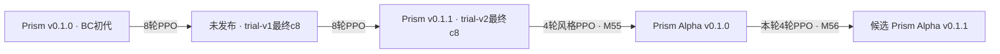

# M56 Prism Alpha v0.1.1：大牌取分方向有限 PPO

Status: **ACCEPTED_BIGCARD_CONTINUATION / VERIFIED**。本有限轮已完成，三门3/3通过；固定实验身份Prism Alpha v0.1.1。
Baseline: `main@bcdaca7cb33c53cc43d5dcc9e92c07be3c1aaa57`，保留现有未提交改动。
Owner/date: 用户“okay 沿着这个方向继续迭代吧”，2026-10-02授权；2026-10-03北京时间收口。

下方启动设计与NOT_RUN表是采样前历史快照；本轮最终结果及完整对战表见后面的M56 VERIFIED RESULTS区块。

## Problem and evidence

用户指出上一版更像大牌冲分，而非此前建议的基建风格。固定实验身份
[Prism Alpha v0.1.0](prism/prism-alpha-v0.1.0-evaluation-summary.md) 是 M55
最终 c4；直接对 Prism v0.1.1 时4/5VP牌和大牌总分领先，同共同锚点也有
大牌分布信号，但开发小样本不全复现。M55原六门3PASS/3FAIL与
`NOT_ACCEPTED_RUSH_STYLE`保留；新方向是明确的目标变更，不追改旧验收。

## Initial design

沿当前Alpha权重做一次有限PPO。延长公开总VP的奖励窗口16→24自身Main，
覆盖更多大牌兑现；另以购入3～5VP牌的印刷VP轨迹保护大牌画像。
这是公开总分代理，包含贵族，不宣称训练损失直接专门奖励大牌。
完整回放另记双方购卡时点和分段得分，以检验代理与行为是否相符。

## Scope and non-goals

一个最终c4候选；4×256=1,024训练局，384开发局，4,096独立验收局，
共5,504物理局，0重试。开发只描述，不调β、不选检查点、不改门。
不扩预算、扫描参数、改默认模型、操作共享池或发布Git；其他风格后置。

父模型是Prism Alpha v0.1.0，不是通用Prism v0.1.1。通用版本是M55
更早的祖先，本轮只增加为固定评测对手。候选全名Prism Alpha v0.1.1；
未评测检查点明确为未发布训练产物。

### 模型谱系与本轮父模型

本轮只从Alpha父权重续训。两份正式名称含v0.1.1，但属于Prism通用模型和Prism Alpha实验模型两个名字；本轮没有重训初代，也没有覆盖通用版本。

## Contracts and invariants

[冻结合同](../benchmarks/m56-prism-alpha-v0.1.1.config.json) /
[Arena训练合同](../benchmarks/m56-prism-alpha-v0.1.1.train.json)。
执行/指标遵循[M54](m54-prism-continuous-ppo-design.md)、
[模型接口](m51-prism-implementation-contract.md)、
[统一详细对战标准](unified-match-metrics-standard.md)。

| 项目 | 新样本前固定值 |
|---|---|
| 父权重 | `local-artifacts/prism/alpha-v0.1.0/weights.json`；SHA `b5e68e008d5d462aff19c67b8eed063139a5c500a020a48031e8938b44618f0a` |
| 续训方式 | policy/value继承；新style head、AdamW、RNG；不是旧优化器的精确恢复 |
| 奖励代理 | 前24自身Main的 `min(自身公开VP,15)/15` 均值；短局按终局分补足24分母 |
| 贵族选择 | 得分归前一个Main；不新增Main或大牌收益 |
| PPO | β0.3，style value weight0.5，LR3e-5，2pass，minibatch256；CPU2线程 |
| 训练锚点 | 各512局：Heuristic v0.3.1 greedy、初代Prism v0.1.0 greedy |
| 共同评测锚点 | 上述两者＋Prism v0.1.1 softmax T=1；父模型/候选均T=1 |
| 训练 / 开发种子 | 9510000..9510511 / 9515000..9515031；互斥 |
| 独立共同锚点 / 直接父模型 | 9520000..9520255 / 9520000..9520511；未用于训练，prefix用于匹配布局 |
| 开发 | 两模型×三对手×32seed×双座=384局，仅最终c4 |
| 独立 | 两模型×三对手×256seed×双座=3,072局；直接父模型512seed×双座=1,024局 |
| 本轮验收底线 | 总体半平得分率Δ校正下界≥−0.05；直接父模型得分率下界≥0.45；大牌印刷VP AUC24 Δ下界≥−0.015 |
| 大牌风格量 | 购入3～5VP卡的累计印刷VP，在自身Main结束计入；排除贵族；截断15VP/固定24；短局终局大牌分补足 |
| 配对统计 | 20,000次seed块bootstrap，RNG56029999；三个门family α0.05，下界分位0.05/3；共同锚点256块、直接父模型512块 |
| 增强与保留 | 同三项校正下界分别>0、>0.5、>0才支持对应增强；通过底线不能写成更强 |
| 其他数据 | 每对手棋力、总VP AUC、时点、折扣、预留等为诊断，无额外硬否决 |
| 资源 | 训练墙钟≤4h、CPU≤18,000s、内存8GiB；评测4个BelowNormal worker，阶段墙钟≤2h；总存储≤64GiB |

容许非零代价来自用户锚定风格目标。−0.015大牌AUC相当于窗口内平均
0.225印刷VP的容忍量；总体−5个百分点和直接父模型45%是保留底线，
并非证明非劣于零差异。本轮不再逐个经济指标和对手全部AND否决。

## Implementation plan

1. 新建独立离线Rust指标程序，先在旧回放验证时点、贵族/Main和短局边界。
2. 冻结新配置、源/引擎/资产hash与预算；保留M55的65项冻结资产。
3. 创建新warm-start run，验证初始继承与零优化状态，启动有资源监督的四轮训练。
4. 验证最终32张量导出与68个固定边界输入Rust/Python一致性；固定开发与一次独立验收。
5. 生成双方完整Markdown表、父模型→候选变化与彩色页；固定身份、两层文档收口，停止本轮。

## Iteration log

- 2026-10-02：用户授权沿大牌取分方向；三门、预算、种子和24Main目标在新样本前预设。
- 新增指标不改变M55源或旧六门。所有新范围与历史85段种子注册范围无重叠，注册脚本不改；新范围单独登记。

## Final implementation

IMPLEMENTED，验证与训练尚待执行：`scripts/prism_alpha_round.py`、
`scripts/prism_alpha_report.py`、`crates/splendor-cli/examples/prism_bigcard_metrics.rs`。
复用已冻结监督/导出和统一经济统计代码；新指标从真实规则回放验证后计算。

## Validation and evidence

NOT_RUN。新产物结果记录将在 `benchmarks/m56-prism-alpha-v0.1.1.result.json`
产生；证据位于 `local-artifacts/prism/alpha-v0.1.1/`。旧M55负结果保留。

| 被测模型 | 对手 / 模式 | 新训练 | 开发对战 | 独立对战 | 完整结果 |
|---|---|---|---|---|---|
| Prism Alpha v0.1.1 未发布候选 | Heuristic v0.3.1 greedy | NOT_RUN | NOT_RUN | NOT_RUN | NOT_RUN |
| Prism Alpha v0.1.1 未发布候选 | 初代Prism v0.1.0 greedy | NOT_RUN | NOT_RUN | NOT_RUN | NOT_RUN |
| Prism Alpha v0.1.1 未发布候选 | Prism v0.1.1 T=1 | 不在训练池 | NOT_RUN | NOT_RUN | NOT_RUN |
| Prism Alpha v0.1.1 未发布候选 | 父模型Prism Alpha v0.1.0 T=1 | 不在训练池 | 不设开发直接组 | NOT_RUN | NOT_RUN |

## Result and decision

NOT_RUN；没有棋力或风格增强结论。完成后追加真实结果与完整详细表，不删除启动快照。

## Known limitations

固定三个锚点不能证明普适强度；仅一个训练seed与候选。24Main总分目标
是大牌兑现代理，可能奖励贵族/小牌。购买时点条件均值须与覆盖率共同阅读；
分段短局补齐会受比赛结束节奏影响，列出实际到达局数。未计逐决策/推理时延。

## Next authorized gate

上述有限训练、固定开发与一次独立验收已获用户授权；完成后停止本轮。
额外训练、重新验收、其他风格或共享池部署不在当前范围。

### 启动核验与真实执行 — 2026-10-02

- `cargo test --locked --release -p splendor-cli --example prism_bigcard_metrics --target-dir local-artifacts/prism/alpha-v0.1.1/build`：exit0，3PASS；`cargo build`同参数exit0。
- `python -B -m pytest -q training/prism/tests/test_alpha_round.py training/prism/tests/test_rush_style.py`：exit0，24PASS。
- `python -B scripts/prism_alpha_preflight.py`：exit0，13旧回放/234核对PASS，含1局真实贵族选择，0新局；76冻结文件。初始policy/value逐张量等于父模型，优化器moments0、global_step0。
- `python -B -m training.prism.ppo.arena --campaign local-artifacts/prism/alpha-v0.1.1/campaign`已启动（本机BelowNormal PID37616，资源树监督）；`python -B scripts/prism_alpha_round.py --watch`已启动PID36140，等待固定c4。此时未做开发/独立测量。
- `report-fixture/`仅占位渲染测试：11项页面检查PASS，不是新模型数据，不登记模型。

种子导航补充：旧 `scripts/s0_seed_registry.py` 为M55冻结资产，未改。本轮新区段已写入tracked M56 config的`seed_reservations`；未来碰撞核验须将这些区段与历史注册范围合并，不能只运行旧注册脚本便认定新区段可用。

阶段更新：前两轮均完成54次优化更新，累计108；截至本次核对768/1,024训练局完赛，第3轮更新中。上述NOT_RUN表为采样前快照，开发和独立验收仍未启动。

阶段更新：前三轮分别54次优化更新，累计162，均按passes_complete结束并导出；最近核对836/1,024局完赛，已进入最后第4轮采样。中间检查点仅为未发布训练产物，未做开发或独立选择。

### 执行性能观察（不改变本轮配置）

观察时刻2026-10-02T15:18:52.8629871Z，外层训练监督器PID37616自身累计CPU（user+kernel）7857.41s。源码`ProcessTree.wait`每次循环都调用`directory_bytes(storage_root)`，之后sleep0.1s；在持续增长的目录上存在扫描开销疑点。尚未做因果profiling，不宣称这是唯一耗时原因。记录`outer-supervisor-observation.json`；worker job的CPU回执与外层监督器是不同计数范围，不能混成推理时延。本轮源/预算/优先级不改。后续先做只读profiling，再决定执行性能优化；不据此追加本轮模型训练。

### 执行续记：训练完成与评测启动（2026-10-02）

- 四轮各256局全部提交，1,024次物理尝试，216次新优化更新，27,377次训练决策；训练监督FINISHED、returncode 0、stop_reason null。
- 最终c4导出SHA `d57ebe2407b5d061ae890f3d2586924754e0d2d8e502e1f3f32d12c1fc9af4ff`；32张量、68固定边界输入的Rust/Torch一致性PASS（联合atol/rtol 1e-4）。
- `local-artifacts/prism/alpha-v0.1.1/training-receipt.json`绑定训练源身份、run身份、全部周期与监督时钟；训练监督墙钟10,728.297秒。开发评测已启动，独立验收尚无结果；此为执行过程快照，不是棋力或增强结论。

### 执行续记：评测监督开销观测（北京时间2026-10-03）

- `2026-10-02T16:03:32.1806141Z`，独立验收进行中，外层评测控制器累计进程CPU为1493.859375秒、WorkingSet 498642944字节、BelowNormal。此CPU不含受监督worker job，未测全机占用率或逐推理时延。原始回执：`local-artifacts/prism/alpha-v0.1.1/evaluation-controller-observation.json`。
- 源码核对：旧冻结`prism_rush_round.py:run_plan`的四个worker线程均在同一ART根目录上执行`ProcessTree.wait(... storage_root=ART ...)`，后者每0.1秒调用全目录计数。该观察与外层CPU偏高相符，但没有因果profiling，不能断言它解释全部耗时。
- 本轮运行源码、资源上限、预算、种子和验收标准保持冻结。下一轮先profile共享目录扫描与监督开销，再决定实现调整；当前没有性能修改或额外比赛。

<!-- M56 VERIFIED RESULTS BEGIN -->

本轮结论：**ACCEPTED_BIGCARD_CONTINUATION**。四轮训练完成；最终c4固定为Prism Alpha v0.1.1实验产物。三项保留底线均通过。

父模型是Prism Alpha v0.1.0（M55最终c4）；Prism v0.1.1是更早的通用模型，本轮作为额外固定对手。Prism Alpha v0.1.1是从Alpha父权重继续四轮所得，命名登记不等于默认模型替换。

本轮可读结论：**大牌取分风格增强，整体棋力保持，尚未证明胜过Alpha父模型。** 三个共同对手的匹配样本中，前24次自身主行动的大牌累计分数曲线面积从0.075194升至0.080653，相对提高**7.26%**；预设配对检验的三门校正下界仍大于0。这是大牌兑现指标的增强证据，不是终局VP或胜率提高同样百分比。总体得分率与直接对父模型的增强均未获得统计确认。

## 独立战绩摘要：Prism Alpha v0.1.1（T=1，被测玩家）

| 对手 / 动作模式 | 局数 / 双座seed块 | 纯胜率 | 含半平得分率 |
| --- | --- | --- | --- |
| Heuristic v0.3.1（greedy） | 512 / 256 | 66.99% | 67.38% |
| 初代 Prism v0.1.0（greedy） | 512 / 256 | 66.60% | 67.09% |
| Prism v0.1.1（T=1） | 512 / 256 | 55.66% | 56.25% |
| 父模型 Prism Alpha v0.1.0（T=1） | 1024 / 512 | 49.12% | 49.76% |

此处便于速读；完整胜/平/负、配对区间、双方个人指标和物理双座表在后文。直接父模型组是同1,024局的双方；共同对手组各模型512局。

## 一眼看变化：相同新种子、相同对手、父模型→新产物

| 同种子共同对手 | 被测模型个人指标 | 父模型 Prism Alpha v0.1.0 | Prism Alpha v0.1.1 | 变化 |
| --- | --- | --- | --- | --- |
| Heuristic v0.3.1（greedy） | 半平得分率 | 66.2109% | 67.3828% | **↑ +1.17个百分点** |
| Heuristic v0.3.1（greedy） | 大牌印刷VP AUC24 | 0.0732 | 0.0808 | **↑ +0.0076** |
| Heuristic v0.3.1（greedy） | 终局大牌印刷VP | 7.5723 | 7.9043 | **↑ +0.3320** |
| Heuristic v0.3.1（greedy） | 购入4VP牌 / 局 | 0.7949 | 0.8613 | **↑ +0.0664** |
| Heuristic v0.3.1（greedy） | 购入5VP牌 / 局 | 0.3828 | 0.4102 | **↑ +0.0273** |
| Heuristic v0.3.1（greedy） | VP / 自身Main | 0.5558 | 0.5581 | **↑ +0.0023** |
| 初代 Prism v0.1.0（greedy） | 半平得分率 | 63.3789% | 67.0898% | **↑ +3.71个百分点** |
| 初代 Prism v0.1.0（greedy） | 大牌印刷VP AUC24 | 0.0771 | 0.0836 | **↑ +0.0064** |
| 初代 Prism v0.1.0（greedy） | 终局大牌印刷VP | 7.7539 | 7.8809 | **↑ +0.1270** |
| 初代 Prism v0.1.0（greedy） | 购入4VP牌 / 局 | 0.8242 | 0.8457 | **↑ +0.0215** |
| 初代 Prism v0.1.0（greedy） | 购入5VP牌 / 局 | 0.3594 | 0.3887 | **↑ +0.0293** |
| 初代 Prism v0.1.0（greedy） | VP / 自身Main | 0.5480 | 0.5515 | **↑ +0.0035** |
| Prism v0.1.1（T=1） | 半平得分率 | 56.5430% | 56.2500% | **↓ -0.29个百分点** |
| Prism v0.1.1（T=1） | 大牌印刷VP AUC24 | 0.0752 | 0.0775 | **↑ +0.0023** |
| Prism v0.1.1（T=1） | 终局大牌印刷VP | 7.2500 | 7.3730 | **↑ +0.1230** |
| Prism v0.1.1（T=1） | 购入4VP牌 / 局 | 0.8086 | 0.7812 | **↓ -0.0273** |
| Prism v0.1.1（T=1） | 购入5VP牌 / 局 | 0.2910 | 0.3164 | **↑ +0.0254** |
| Prism v0.1.1（T=1） | VP / 自身Main | 0.5364 | 0.5391 | **↑ +0.0027** |

箭头只表示数值变化；大牌数更多未必单独更好。共同对手各512局/模型，直接父模型对战另有1,024局，不能混成一张胜率。

## 原定三门及本次结果

| 验收项 | 采样前阈值 | 估计值 | 普通配对95%区间 | 三门校正单侧下界 | 结论 |
| --- | --- | --- | --- | --- | --- |
| strength_pool | 相对父模型总体得分率 Δ下界 ≥ −5个百分点 | 0.015299 | [-0.011393, 0.042643] | -0.013672 | **PASS** |
| direct_parent | 直接对父模型得分率下界 ≥45% | 0.497559 | [0.467773, 0.527832] | 0.465332 | **PASS** |
| bigcard_auc24 | 大牌印刷VP AUC24 Δ下界 ≥−0.015 | 0.005460 | [0.002260, 0.008704] | 0.001988 | **PASS** |

三项是容许代价的保留门，不要求所有数据上涨。20,000次双座seed块bootstrap，RNG56029999，family α=0.05，单侧下界分位0.05/3；共同锚点按256个匹配seed块，直接父模型按512块。各对手、早期总VP、预留/折扣等为诊断，不额外否决。本轮一次分析，无挑种子、加局、挑中间检查点。

## 训练与实测时间

| 项目 | 实测/合同 |
| --- | --- |
| 训练 | 4×256 = 1024局；216次新优化更新；27377次训练决策 |
| 奖励代理 | 前24自身Main的公开总VP归一化AUC；β0.3；新style head、AdamW和RNG；策略/胜负value权重从父模型继承 |
| 训练监督进程墙钟s | 10728.297 |
| 开发整批墙钟s | 294.516 |
| 独立验收整批墙钟s | 1427.109 |
| 设备/负载 | 本机CPU；训练2线程；评测4个BelowNormal工作进程。此为当前负载观测 |
| 决策 / 推理时延 | NOT_MEASURED / NOT_MEASURED |

训练总VP代理含贵族，能鼓励兑现分数；大牌专属AUC由完整回放另测。窗口16→24是本轮预设改变，并非从新结果挑出。保留不等于机制已证实。总计5,504物理局，0重试；其中训练1,024、开发384、独立验收4,096。

## 完整开发对战数据

### 开发对照：32双座种子 / 每模型每对手64局，仅描述

“模型”列是被测玩家；对手列注明动作模式。个人指标每格为“被测模型 / 对手”。节奏是该模型对阵该对手的整局指标。纯胜率=胜/局数，得分率=(胜+0.5平)/局数。

| 模型（T=1） | 对手 | 局数 / 双座种子数 | 胜 / 平 / 负 | 纯胜率 | 得分率 | 描述性配对95%区间 |
| --- | --- | --- | --- | --- | --- | --- |
| Prism Alpha v0.1.0 | Heuristic v0.3.1（greedy） | 64 / 32 | 44 / 1 / 19 | 68.7500% | 69.5312% | [57.8125%, 80.4688%] |
| Prism Alpha v0.1.0 | Prism v0.1.1（T=1） | 64 / 32 | 34 / 1 / 29 | 53.1250% | 53.9062% | [40.6250%, 66.4062%] |
| Prism Alpha v0.1.0 | 初代 Prism v0.1.0（greedy） | 64 / 32 | 43 / 0 / 21 | 67.1875% | 67.1875% | [56.2500%, 78.1250%] |
| Prism Alpha v0.1.1 | Heuristic v0.3.1（greedy） | 64 / 32 | 39 / 1 / 24 | 60.9375% | 61.7188% | [50.7812%, 71.8750%] |
| Prism Alpha v0.1.1 | Prism v0.1.1（T=1） | 64 / 32 | 30 / 0 / 34 | 46.8750% | 46.8750% | [34.3750%, 59.3750%] |
| Prism Alpha v0.1.1 | 初代 Prism v0.1.0（greedy） | 64 / 32 | 46 / 0 / 18 | 71.8750% | 71.8750% | [60.9375%, 82.8125%] |

#### 双座明细

| 模型 | 对手 | 本模型座位 | 局数 | 胜 / 平 / 负 | 得分率 | 局均VP（模型 / 对手） |
| --- | --- | --- | --- | --- | --- | --- |
| Prism Alpha v0.1.0 | Heuristic v0.3.1（greedy） | 先手 P0 | 32 | 22 / 1 / 9 | 70.3125% | 14.312 / 13.219 |
| Prism Alpha v0.1.0 | Heuristic v0.3.1（greedy） | 后手 P1 | 32 | 22 / 0 / 10 | 68.7500% | 15.250 / 13.219 |
| Prism Alpha v0.1.0 | Prism v0.1.1（T=1） | 先手 P0 | 32 | 15 / 0 / 17 | 46.8750% | 13.094 / 14.281 |
| Prism Alpha v0.1.0 | Prism v0.1.1（T=1） | 后手 P1 | 32 | 19 / 1 / 12 | 60.9375% | 14.750 / 13.094 |
| Prism Alpha v0.1.0 | 初代 Prism v0.1.0（greedy） | 先手 P0 | 32 | 23 / 0 / 9 | 71.8750% | 14.812 / 13.469 |
| Prism Alpha v0.1.0 | 初代 Prism v0.1.0（greedy） | 后手 P1 | 32 | 20 / 0 / 12 | 62.5000% | 14.062 / 12.750 |
| Prism Alpha v0.1.1 | Heuristic v0.3.1（greedy） | 先手 P0 | 32 | 17 / 0 / 15 | 53.1250% | 14.188 / 13.562 |
| Prism Alpha v0.1.1 | Heuristic v0.3.1（greedy） | 后手 P1 | 32 | 22 / 1 / 9 | 70.3125% | 15.156 / 12.344 |
| Prism Alpha v0.1.1 | Prism v0.1.1（T=1） | 先手 P0 | 32 | 17 / 0 / 15 | 53.1250% | 13.281 / 14.438 |
| Prism Alpha v0.1.1 | Prism v0.1.1（T=1） | 后手 P1 | 32 | 13 / 0 / 19 | 40.6250% | 14.188 / 14.312 |
| Prism Alpha v0.1.1 | 初代 Prism v0.1.0（greedy） | 先手 P0 | 32 | 22 / 0 / 10 | 68.7500% | 14.906 / 12.719 |
| Prism Alpha v0.1.1 | 初代 Prism v0.1.0（greedy） | 后手 P1 | 32 | 24 / 0 / 8 | 75.0000% | 14.938 / 12.219 |

#### 对局节奏与风格

| 模型 / 对手 | 局均步数 | 决策轮：均值 / 最短 / 中位 / 最长 | 轮标准差 | Main轮均值 | 终局绝对分差 | 分差≤2 | 总VP AUC24 | 20 Main内8VP |
| --- | --- | --- | --- | --- | --- | --- | --- | --- |
| Prism Alpha v0.1.0 / Heuristic v0.3.1（greedy） | 53.078 | 26.547 / 22 / 26.5 / 31 | 1.499 | 26.531 | 4.031 | 32.81% | 0.21050 | 26.5625% |
| Prism Alpha v0.1.0 / Prism v0.1.1（T=1） | 52.688 | 26.344 / 23 / 26.0 / 32 | 1.930 | 26.344 | 4.297 | 26.56% | 0.19635 | 18.7500% |
| Prism Alpha v0.1.0 / 初代 Prism v0.1.0（greedy） | 52.938 | 26.469 / 22 / 26.0 / 31 | 1.895 | 26.469 | 3.797 | 32.81% | 0.20408 | 28.1250% |
| Prism Alpha v0.1.1 / Heuristic v0.3.1（greedy） | 53.094 | 26.547 / 23 / 26.0 / 31 | 1.740 | 26.547 | 4.500 | 23.44% | 0.21280 | 34.3750% |
| Prism Alpha v0.1.1 / Prism v0.1.1（T=1） | 53.312 | 26.656 / 23 / 27.0 / 30 | 1.553 | 26.656 | 3.734 | 37.50% | 0.19744 | 26.5625% |
| Prism Alpha v0.1.1 / 初代 Prism v0.1.0（greedy） | 52.688 | 26.344 / 20 / 26.0 / 30 | 1.796 | 26.344 | 4.328 | 32.81% | 0.21211 | 37.5000% |

总VP AUC24/20 Main列为被测玩家；短于24自身Main的AUC按终局分补足固定窗口。legacy决策轮=ceil(全动作步数/2)，含贵族选择；Main轮排除贵族选择。此表的总VP AUC24/20Main阈值与经济量均为诊断；正式三门是总体棋力、直接父模型和大牌专属AUC24，见原定三门表。

#### 双方得分、购卡、折扣、贵族与预留

| 个人指标：模型 / 对手 | Prism Alpha v0.1.0 对阵 Heuristic v0.3.1（greedy） | Prism Alpha v0.1.0 对阵 Prism v0.1.1（T=1） | Prism Alpha v0.1.0 对阵 初代 Prism v0.1.0（greedy） | Prism Alpha v0.1.1 对阵 Heuristic v0.3.1（greedy） | Prism Alpha v0.1.1 对阵 Prism v0.1.1（T=1） | Prism Alpha v0.1.1 对阵 初代 Prism v0.1.0（greedy） |
| --- | --- | --- | --- | --- | --- | --- |
| 局均最终VP | 14.7812 / 13.2188 | 13.9219 / 13.6875 | 14.4375 / 13.1094 | 14.6719 / 12.9531 | 13.7344 / 14.3750 | 14.9219 / 12.4688 |
| VP / 自身决策（含贵族选择） | 0.5571 / 0.4979 | 0.5285 / 0.5196 | 0.5455 / 0.4953 | 0.5527 / 0.4879 | 0.5152 / 0.5393 | 0.5664 / 0.4733 |
| VP / 自身Main | 0.5571 / 0.4982 | 0.5285 / 0.5196 | 0.5455 / 0.4953 | 0.5527 / 0.4879 | 0.5152 / 0.5393 | 0.5664 / 0.4733 |
| VP / 全局步数 | 0.2785 / 0.2490 | 0.2642 / 0.2598 | 0.2727 / 0.2476 | 0.2763 / 0.2440 | 0.2576 / 0.2696 | 0.2832 / 0.2367 |
| 局均永久折扣 / 购卡 | 12.4375 / 13.6094 | 12.0625 / 12.4375 | 11.7812 / 13.2969 | 12.0156 / 13.2031 | 12.0781 / 12.4375 | 11.8594 / 12.9375 |
| 局均贵族数 | 0.5469 / 0.7344 | 0.5156 / 0.6094 | 0.5000 / 0.6094 | 0.4688 / 0.6406 | 0.5156 / 0.5625 | 0.5312 / 0.5156 |
| 局均预留获取 | 2.1250 / 2.0469 | 2.5312 / 2.2812 | 2.5625 / 1.9219 | 2.1719 / 2.2656 | 2.5938 / 2.3594 | 2.3125 / 2.0312 |
| 局均预留买回 | 0.8438 / 0.9844 | 0.8438 / 0.8281 | 0.9062 / 0.9219 | 0.7344 / 1.1094 | 0.8438 / 0.9375 | 0.8594 / 1.0000 |
| 终局未买回预留 | 1.2812 / 1.0625 | 1.6875 / 1.4531 | 1.6562 / 1.0000 | 1.4375 / 1.1562 | 1.7500 / 1.4219 | 1.4531 / 1.0312 |
| 获得贵族的对局比例 | 46.875% / 54.688% | 42.188% / 51.562% | 37.500% / 40.625% | 31.250% / 53.125% | 40.625% / 43.750% | 42.188% / 39.062% |
| 预留买回 / 获取 | 39.706% / 48.092% | 33.333% / 36.301% | 35.366% / 47.967% | 33.813% / 48.966% | 32.530% / 39.735% | 37.162% / 49.231% |
| 局均购入 0 VP卡 | 6.3594 / 7.7344 | 6.4844 / 6.7500 | 6.2969 / 7.1875 | 6.0469 / 7.5469 | 6.4531 / 6.3281 | 6.1562 / 7.1250 |
| 局均购入 1 VP卡 | 2.3125 / 2.8281 | 2.2188 / 2.3906 | 1.8125 / 3.0000 | 2.2188 / 2.6406 | 2.1094 / 2.5156 | 1.9375 / 2.7344 |
| 局均购入 2 VP卡 | 1.9062 / 1.7344 | 1.4531 / 1.6719 | 1.5625 / 1.7812 | 1.7656 / 1.5938 | 1.7031 / 1.8438 | 1.7344 / 1.7031 |
| 局均购入 3 VP卡 | 0.7812 / 0.6875 | 0.7188 / 0.7344 | 0.8281 / 0.7031 | 0.8281 / 0.6719 | 0.8594 / 0.8281 | 0.7344 / 0.8125 |
| 局均购入 4 VP卡 | 0.7188 / 0.4688 | 0.8438 / 0.5312 | 0.8906 / 0.5156 | 0.7500 / 0.5625 | 0.6719 / 0.6094 | 0.7656 / 0.4688 |
| 局均购入 5 VP卡 | 0.3594 / 0.1562 | 0.3438 / 0.3594 | 0.3906 / 0.1094 | 0.4062 / 0.1875 | 0.2812 / 0.3125 | 0.5312 / 0.0938 |
| 局均 白 折扣 | 2.3594 / 2.3125 | 2.3125 / 2.2500 | 2.0625 / 2.3438 | 2.3125 / 2.3281 | 2.1250 / 2.2812 | 2.0938 / 2.5469 |
| 局均 蓝 折扣 | 2.7344 / 2.6094 | 2.5469 / 2.4062 | 2.2969 / 2.8125 | 2.3906 / 2.7969 | 2.5000 / 2.6719 | 2.3906 / 2.7031 |
| 局均 绿 折扣 | 2.4062 / 2.9531 | 2.3594 / 2.4062 | 2.4531 / 2.7031 | 2.2969 / 2.9062 | 2.3281 / 2.5469 | 2.5781 / 2.5000 |
| 局均 红 折扣 | 2.4688 / 2.9375 | 2.3750 / 2.7969 | 2.5625 / 2.7500 | 2.5156 / 2.5469 | 2.5781 / 2.5312 | 2.2969 / 2.5938 |
| 局均 黑 折扣 | 2.4688 / 2.7969 | 2.4688 / 2.5781 | 2.4062 / 2.6875 | 2.5000 / 2.6250 | 2.5469 / 2.4062 | 2.5000 / 2.5938 |

#### 全部七类动作

| 个人指标：模型 / 对手 | Prism Alpha v0.1.0 对阵 Heuristic v0.3.1（greedy） | Prism Alpha v0.1.0 对阵 Prism v0.1.1（T=1） | Prism Alpha v0.1.0 对阵 初代 Prism v0.1.0（greedy） | Prism Alpha v0.1.1 对阵 Heuristic v0.3.1（greedy） | Prism Alpha v0.1.1 对阵 Prism v0.1.1（T=1） | Prism Alpha v0.1.1 对阵 初代 Prism v0.1.0（greedy） |
| --- | --- | --- | --- | --- | --- | --- |
| 买市场 次数 | 742 / 808 | 718 / 743 | 696 / 792 | 722 / 774 | 719 / 736 | 704 / 764 |
| 买市场 占自身全部决策 | 43.698% / 47.557% | 42.586% / 44.069% | 41.086% / 46.753% | 42.496% / 45.556% | 42.145% / 43.142% | 41.756% / 45.314% |
| 买预留 次数 | 54 / 63 | 54 / 53 | 58 / 59 | 47 / 71 | 54 / 60 | 55 / 64 |
| 买预留 占自身全部决策 | 3.180% / 3.708% | 3.203% / 3.144% | 3.424% / 3.483% | 2.766% / 4.179% | 3.165% / 3.517% | 3.262% / 3.796% |
| 取宝石 次数 | 766 / 696 | 752 / 744 | 776 / 720 | 791 / 709 | 767 / 759 | 779 / 728 |
| 取宝石 占自身全部决策 | 45.112% / 40.965% | 44.603% / 44.128% | 45.809% / 42.503% | 46.557% / 41.730% | 44.959% / 44.490% | 46.204% / 43.179% |
| 预留市场 次数 | 136 / 128 | 162 / 146 | 164 / 123 | 139 / 144 | 166 / 151 | 148 / 130 |
| 预留市场 占自身全部决策 | 8.009% / 7.534% | 9.609% / 8.660% | 9.681% / 7.261% | 8.181% / 8.476% | 9.730% / 8.851% | 8.778% / 7.711% |
| 预留牌堆 次数 | 0 / 3 | 0 / 0 | 0 / 0 | 0 / 1 | 0 / 0 | 0 / 0 |
| 预留牌堆 占自身全部决策 | 0.000% / 0.177% | 0.000% / 0.000% | 0.000% / 0.000% | 0.000% / 0.059% | 0.000% / 0.000% | 0.000% / 0.000% |
| 选贵族 次数 | 0 / 1 | 0 / 0 | 0 / 0 | 0 / 0 | 0 / 0 | 0 / 0 |
| 选贵族 占自身全部决策 | 0.000% / 0.059% | 0.000% / 0.000% | 0.000% / 0.000% | 0.000% / 0.000% | 0.000% / 0.000% | 0.000% / 0.000% |
| 跳过 次数 | 0 / 0 | 0 / 0 | 0 / 0 | 0 / 0 | 0 / 0 | 0 / 0 |
| 跳过 占自身全部决策 | 0.000% / 0.000% | 0.000% / 0.000% | 0.000% / 0.000% | 0.000% / 0.000% | 0.000% / 0.000% | 0.000% / 0.000% |

#### 实测计时

| 模型 / 对手 | 进程耗时累计s | 单局均值s | 单局P95s | 决策 / 推理延迟 |
| --- | --- | --- | --- | --- |
| Prism Alpha v0.1.0 / Heuristic v0.3.1（greedy） | 21.939 | 0.3428 | 0.4976 | NOT_MEASURED / NOT_MEASURED |
| Prism Alpha v0.1.0 / Prism v0.1.1（T=1） | 26.016 | 0.4065 | 0.5780 | NOT_MEASURED / NOT_MEASURED |
| Prism Alpha v0.1.0 / 初代 Prism v0.1.0（greedy） | 24.746 | 0.3867 | 0.4978 | NOT_MEASURED / NOT_MEASURED |
| Prism Alpha v0.1.1 / Heuristic v0.3.1（greedy） | 22.766 | 0.3557 | 0.4197 | NOT_MEASURED / NOT_MEASURED |
| Prism Alpha v0.1.1 / Prism v0.1.1（T=1） | 22.832 | 0.3568 | 0.4037 | NOT_MEASURED / NOT_MEASURED |
| Prism Alpha v0.1.1 / 初代 Prism v0.1.0（greedy） | 21.794 | 0.3405 | 0.3750 | NOT_MEASURED / NOT_MEASURED |

单局时钟包括程序启动、比赛、验核和输出；累计单局秒数含并行重叠，不等于整批墙钟。未记录逐决策/推理延迟，不能填0或由单局时间推算。

### 大牌购入时点与分段得分（双方个人指标）

| 个人指标：模型 / 对手 | Prism Alpha v0.1.0 对阵 Heuristic v0.3.1（greedy） | Prism Alpha v0.1.0 对阵 Prism v0.1.1（T=1） | Prism Alpha v0.1.0 对阵 初代 Prism v0.1.0（greedy） | Prism Alpha v0.1.1 对阵 Heuristic v0.3.1（greedy） | Prism Alpha v0.1.1 对阵 Prism v0.1.1（T=1） | Prism Alpha v0.1.1 对阵 初代 Prism v0.1.0（greedy） |
| --- | --- | --- | --- | --- | --- | --- |
| 24 Main 总VP AUC（训练效用） | 0.2105 / 0.1716 | 0.1964 / 0.1919 | 0.2041 / 0.1808 | 0.2128 / 0.1745 | 0.1974 / 0.1991 | 0.2121 / 0.1809 |
| 24 Main 大牌印刷VP AUC（风格底线） | 0.0735 / 0.0537 | 0.0760 / 0.0711 | 0.0966 / 0.0491 | 0.0786 / 0.0564 | 0.0776 / 0.0659 | 0.0924 / 0.0577 |
| 终局3～5VP牌印刷分合计 | 7.0156 / 4.7188 | 7.2500 / 6.1250 | 8.0000 / 4.7188 | 7.5156 / 5.2031 | 6.6719 / 6.4844 | 7.9219 / 4.7812 |
| 前24自身Main购入3～5VP牌数 | 1.2969 / 0.9531 | 1.4375 / 1.2031 | 1.5469 / 0.9531 | 1.3438 / 0.9375 | 1.3438 / 1.1562 | 1.5156 / 0.9062 |
| 首张3～5VP牌 自身Main（仅买到的局） | 19.0000 / 19.8929 | 19.3594 / 19.4237 | 17.4915 / 20.2830 | 18.6230 / 19.5088 | 19.0484 / 19.8387 | 18.0806 / 18.9444 |
| 首张3～5VP牌 覆盖局数 / 总局数（双方） | 61/64 ; 56/64 | 64/64 ; 59/64 | 59/64 ; 53/64 | 61/64 ; 57/64 | 62/64 ; 62/64 | 62/64 ; 54/64 |
| 首张4～5VP牌 自身Main（仅买到的局） | 20.5600 / 20.5882 | 20.2830 / 20.3696 | 20.2500 / 21.0882 | 20.1923 / 21.0000 | 19.9556 / 21.0000 | 20.1228 / 19.2333 |
| 首张4～5VP牌 覆盖局数 / 总局数（双方） | 50/64 ; 34/64 | 53/64 ; 46/64 | 52/64 ; 34/64 | 52/64 ; 38/64 | 45/64 ; 43/64 | 57/64 ; 30/64 |
| 自身Main 8 后局均总VP | 0.7031 / 0.4062 | 0.5938 / 0.5938 | 0.6562 / 0.4844 | 0.6719 / 0.4062 | 0.5000 / 0.6406 | 0.6094 / 0.4219 |
| 自身Main 8 后局均大牌印刷VP | 0.0469 / 0.0938 | 0.0000 / 0.0000 | 0.0938 / 0.0625 | 0.0469 / 0.0469 | 0.0000 / 0.0000 | 0.0938 / 0.0625 |
| 自身Main 8 实际达到局数（双方） | 64 / 64 | 64 / 64 | 64 / 64 | 64 / 64 | 64 / 64 | 64 / 64 |
| 自身Main 12 后局均总VP | 1.6406 / 1.5156 | 1.8438 / 1.2656 | 1.8438 / 1.6094 | 1.9844 / 1.6250 | 1.7188 / 1.6094 | 1.7656 / 1.5938 |
| 自身Main 12 后局均大牌印刷VP | 0.1406 / 0.3906 | 0.3750 / 0.0469 | 0.5156 / 0.2188 | 0.4219 / 0.3594 | 0.3438 / 0.0469 | 0.3594 / 0.4219 |
| 自身Main 12 实际达到局数（双方） | 64 / 64 | 64 / 64 | 64 / 64 | 64 / 64 | 64 / 64 | 64 / 64 |
| 自身Main 16 后局均总VP | 3.5469 / 2.7188 | 3.3906 / 2.9531 | 3.3594 / 2.9219 | 3.7031 / 3.0156 | 3.3281 / 3.2031 | 3.5156 / 3.0781 |
| 自身Main 16 后局均大牌印刷VP | 1.0312 / 0.6094 | 1.0156 / 0.8281 | 1.3125 / 0.5781 | 1.1094 / 0.8906 | 0.9844 / 0.8125 | 1.1719 / 0.8594 |
| 自身Main 16 实际达到局数（双方） | 64 / 64 | 64 / 64 | 64 / 64 | 64 / 64 | 64 / 64 | 64 / 64 |
| 自身Main 20 后局均总VP | 6.5781 / 5.2656 | 5.9375 / 6.2969 | 6.5312 / 5.4375 | 6.6094 / 5.4531 | 6.2656 / 6.0625 | 6.8281 / 5.5469 |
| 自身Main 20 后局均大牌印刷VP | 2.6562 / 1.7500 | 2.5312 / 2.6719 | 3.5312 / 1.5469 | 2.7500 / 1.9688 | 2.8594 / 2.2344 | 3.3281 / 1.8906 |
| 自身Main 20 实际达到局数（双方） | 64 / 64 | 64 / 64 | 64 / 64 | 64 / 64 | 64 / 64 | 64 / 64 |
| 自身Main 24 后局均总VP | 11.1250 / 9.2031 | 10.5156 / 10.3594 | 10.5312 / 9.7969 | 10.8906 / 8.9844 | 10.0156 / 10.1875 | 11.0781 / 9.1875 |
| 自身Main 24 后局均大牌印刷VP | 4.9219 / 3.4531 | 5.5469 / 4.5625 | 5.7969 / 3.4219 | 5.1406 / 3.4062 | 4.9375 / 4.3281 | 5.9375 / 3.2188 |
| 自身Main 24 实际达到局数（双方） | 63 / 63 | 61 / 61 | 61 / 61 | 61 / 61 | 62 / 62 | 61 / 61 |

每格为模型 / 对手。自身Main含购卡/取宝石/预留/跳过，不含贵族选择；贵族分计入前一个Main。短局在后续固定检查点用其终局分补足，并列实际达到该Main的局数。大牌仅含购入3～5VP卡的印刷VP，排除贵族；AUC按15VP截断、固定24分母。首牌时点只对买到的局取均值，必须连同覆盖率解读，不能单凭均值认定更快。

## 完整独立对战数据

### 独立验收：共同对手256双座种子 / 每组512局；直接父模型512种子 / 1,024局

“模型”列是被测玩家；对手列注明动作模式。个人指标每格为“被测模型 / 对手”。节奏是该模型对阵该对手的整局指标。纯胜率=胜/局数，得分率=(胜+0.5平)/局数。

| 模型（T=1） | 对手 | 局数 / 双座种子数 | 胜 / 平 / 负 | 纯胜率 | 得分率 | 描述性配对95%区间 |
| --- | --- | --- | --- | --- | --- | --- |
| Prism Alpha v0.1.0 | Heuristic v0.3.1（greedy） | 512 / 256 | 338 / 2 / 172 | 66.0156% | 66.2109% | [62.3047%, 70.0195%] |
| Prism Alpha v0.1.0 | Prism v0.1.1（T=1） | 512 / 256 | 287 / 5 / 220 | 56.0547% | 56.5430% | [52.3438%, 60.7422%] |
| Prism Alpha v0.1.0 | 初代 Prism v0.1.0（greedy） | 512 / 256 | 324 / 1 / 187 | 63.2812% | 63.3789% | [59.4727%, 67.1875%] |
| Prism Alpha v0.1.1 | Prism Alpha v0.1.0（T=1） | 1024 / 512 | 503 / 13 / 508 | 49.1211% | 49.7559% | [46.7285%, 52.7344%] |
| Prism Alpha v0.1.1 | Heuristic v0.3.1（greedy） | 512 / 256 | 343 / 4 / 165 | 66.9922% | 67.3828% | [63.4766%, 71.2891%] |
| Prism Alpha v0.1.1 | Prism v0.1.1（T=1） | 512 / 256 | 285 / 6 / 221 | 55.6641% | 56.2500% | [51.8555%, 60.6445%] |
| Prism Alpha v0.1.1 | 初代 Prism v0.1.0（greedy） | 512 / 256 | 341 / 5 / 166 | 66.6016% | 67.0898% | [62.9883%, 71.1914%] |

#### 双座明细

| 模型 | 对手 | 本模型座位 | 局数 | 胜 / 平 / 负 | 得分率 | 局均VP（模型 / 对手） |
| --- | --- | --- | --- | --- | --- | --- |
| Prism Alpha v0.1.0 | Heuristic v0.3.1（greedy） | 先手 P0 | 256 | 177 / 1 / 78 | 69.3359% | 14.930 / 13.254 |
| Prism Alpha v0.1.0 | Heuristic v0.3.1（greedy） | 后手 P1 | 256 | 161 / 1 / 94 | 63.0859% | 14.793 / 13.367 |
| Prism Alpha v0.1.0 | Prism v0.1.1（T=1） | 先手 P0 | 256 | 145 / 3 / 108 | 57.2266% | 14.488 / 13.848 |
| Prism Alpha v0.1.0 | Prism v0.1.1（T=1） | 后手 P1 | 256 | 142 / 2 / 112 | 55.8594% | 14.543 / 13.719 |
| Prism Alpha v0.1.0 | 初代 Prism v0.1.0（greedy） | 先手 P0 | 256 | 167 / 1 / 88 | 65.4297% | 14.895 / 13.520 |
| Prism Alpha v0.1.0 | 初代 Prism v0.1.0（greedy） | 后手 P1 | 256 | 157 / 0 / 99 | 61.3281% | 14.609 / 13.441 |
| Prism Alpha v0.1.1 | Prism Alpha v0.1.0（T=1） | 先手 P0 | 512 | 266 / 7 / 239 | 52.6367% | 14.248 / 14.107 |
| Prism Alpha v0.1.1 | Prism Alpha v0.1.0（T=1） | 后手 P1 | 512 | 237 / 6 / 269 | 46.8750% | 14.053 / 14.277 |
| Prism Alpha v0.1.1 | Heuristic v0.3.1（greedy） | 先手 P0 | 256 | 181 / 2 / 73 | 71.0938% | 15.016 / 13.176 |
| Prism Alpha v0.1.1 | Heuristic v0.3.1（greedy） | 后手 P1 | 256 | 162 / 2 / 92 | 63.6719% | 14.926 / 13.488 |
| Prism Alpha v0.1.1 | Prism v0.1.1（T=1） | 先手 P0 | 256 | 146 / 3 / 107 | 57.6172% | 14.523 / 13.699 |
| Prism Alpha v0.1.1 | Prism v0.1.1（T=1） | 后手 P1 | 256 | 139 / 3 / 114 | 54.8828% | 14.547 / 13.773 |
| Prism Alpha v0.1.1 | 初代 Prism v0.1.0（greedy） | 先手 P0 | 256 | 165 / 3 / 88 | 65.0391% | 14.621 / 13.371 |
| Prism Alpha v0.1.1 | 初代 Prism v0.1.0（greedy） | 后手 P1 | 256 | 176 / 2 / 78 | 69.1406% | 14.918 / 13.141 |

#### 对局节奏与风格

| 模型 / 对手 | 局均步数 | 决策轮：均值 / 最短 / 中位 / 最长 | 轮标准差 | Main轮均值 | 终局绝对分差 | 分差≤2 | 总VP AUC24 | 20 Main内8VP |
| --- | --- | --- | --- | --- | --- | --- | --- | --- |
| Prism Alpha v0.1.0 / Heuristic v0.3.1（greedy） | 53.498 | 26.762 / 21 / 27.0 / 32 | 1.799 | 26.736 | 3.859 | 30.66% | 0.19923 | 26.3672% |
| Prism Alpha v0.1.0 / Prism v0.1.1（T=1） | 54.141 | 27.078 / 21 / 27.0 / 32 | 1.763 | 27.062 | 3.674 | 34.57% | 0.19733 | 27.5391% |
| Prism Alpha v0.1.0 / 初代 Prism v0.1.0（greedy） | 53.852 | 26.932 / 21 / 27.0 / 32 | 1.847 | 26.918 | 3.744 | 36.13% | 0.20304 | 26.5625% |
| Prism Alpha v0.1.1 / Prism Alpha v0.1.0（T=1） | 54.300 | 27.158 / 21 / 27.0 / 33 | 1.921 | 27.142 | 3.509 | 37.21% | 0.19128 | 24.4141% |
| Prism Alpha v0.1.1 / Heuristic v0.3.1（greedy） | 53.658 | 26.836 / 21 / 27.0 / 33 | 1.788 | 26.822 | 3.736 | 35.55% | 0.20196 | 28.3203% |
| Prism Alpha v0.1.1 / Prism v0.1.1（T=1） | 53.936 | 26.971 / 20 / 27.0 / 32 | 1.790 | 26.963 | 3.775 | 34.57% | 0.20161 | 26.5625% |
| Prism Alpha v0.1.1 / 初代 Prism v0.1.0（greedy） | 53.578 | 26.797 / 19 / 27.0 / 32 | 1.850 | 26.781 | 3.916 | 35.35% | 0.20467 | 28.1250% |

总VP AUC24/20 Main列为被测玩家；短于24自身Main的AUC按终局分补足固定窗口。legacy决策轮=ceil(全动作步数/2)，含贵族选择；Main轮排除贵族选择。此表的总VP AUC24/20Main阈值与经济量均为诊断；正式三门是总体棋力、直接父模型和大牌专属AUC24，见原定三门表。

#### 双方得分、购卡、折扣、贵族与预留

| 个人指标：模型 / 对手 | Prism Alpha v0.1.0 对阵 Heuristic v0.3.1（greedy） | Prism Alpha v0.1.0 对阵 Prism v0.1.1（T=1） | Prism Alpha v0.1.0 对阵 初代 Prism v0.1.0（greedy） | Prism Alpha v0.1.1 对阵 Prism Alpha v0.1.0（T=1） | Prism Alpha v0.1.1 对阵 Heuristic v0.3.1（greedy） | Prism Alpha v0.1.1 对阵 Prism v0.1.1（T=1） | Prism Alpha v0.1.1 对阵 初代 Prism v0.1.0（greedy） |
| --- | --- | --- | --- | --- | --- | --- | --- |
| 局均最终VP | 14.8613 / 13.3105 | 14.5156 / 13.7832 | 14.7520 / 13.4805 | 14.1504 / 14.1924 | 14.9707 / 13.3320 | 14.5352 / 13.7363 | 14.7695 / 13.2559 |
| VP / 自身决策（含贵族选择） | 0.5557 / 0.4975 | 0.5363 / 0.5091 | 0.5479 / 0.5006 | 0.5212 / 0.5228 | 0.5581 / 0.4968 | 0.5390 / 0.5093 | 0.5514 / 0.4948 |
| VP / 自身Main | 0.5558 / 0.4978 | 0.5364 / 0.5093 | 0.5480 / 0.5008 | 0.5214 / 0.5229 | 0.5581 / 0.4971 | 0.5391 / 0.5095 | 0.5515 / 0.4950 |
| VP / 全局步数 | 0.2778 / 0.2488 | 0.2681 / 0.2546 | 0.2739 / 0.2503 | 0.2606 / 0.2614 | 0.2790 / 0.2485 | 0.2695 / 0.2547 | 0.2757 / 0.2474 |
| 局均永久折扣 / 购卡 | 12.3164 / 13.2031 | 12.1426 / 12.2910 | 12.0098 / 13.4863 | 12.2480 / 12.4141 | 12.2324 / 13.2773 | 12.0703 / 12.2344 | 11.9141 / 13.3066 |
| 局均贵族数 | 0.5000 / 0.6699 | 0.4844 / 0.4551 | 0.4180 / 0.6797 | 0.5098 / 0.5342 | 0.4473 / 0.6855 | 0.5059 / 0.4980 | 0.4648 / 0.6367 |
| 局均预留获取 | 2.2480 / 2.3789 | 2.8262 / 2.7441 | 2.4492 / 1.8730 | 2.9355 / 2.7305 | 2.4023 / 2.3496 | 2.8242 / 2.7520 | 2.6309 / 1.9297 |
| 局均预留买回 | 0.8457 / 1.2207 | 1.0840 / 1.1543 | 0.9922 / 1.0020 | 1.1689 / 1.0488 | 0.8867 / 1.2246 | 1.1504 / 1.0918 | 1.0449 / 0.9688 |
| 终局未买回预留 | 1.4023 / 1.1582 | 1.7422 / 1.5898 | 1.4570 / 0.8711 | 1.7666 / 1.6816 | 1.5156 / 1.1250 | 1.6738 / 1.6602 | 1.5859 / 0.9609 |
| 获得贵族的对局比例 | 41.602% / 50.586% | 39.453% / 35.938% | 34.375% / 49.805% | 40.234% / 42.773% | 39.062% / 50.391% | 41.406% / 41.016% | 38.672% / 46.484% |
| 预留买回 / 获取 | 37.619% / 51.314% | 38.355% / 42.064% | 40.510% / 53.493% | 39.820% / 38.412% | 36.911% / 52.120% | 40.733% / 39.674% | 39.718% / 50.202% |
| 局均购入 0 VP卡 | 6.4238 / 7.3555 | 6.2227 / 6.4746 | 6.1055 / 7.5645 | 6.4424 / 6.5713 | 6.3320 / 7.4980 | 6.2461 / 6.4492 | 6.1523 / 7.4277 |
| 局均购入 1 VP卡 | 1.9883 / 2.6367 | 2.1211 / 2.1836 | 1.9238 / 2.6582 | 2.1455 / 2.1348 | 1.9277 / 2.6152 | 2.0312 / 2.2422 | 1.8574 / 2.6523 |
| 局均购入 2 VP卡 | 1.9004 / 1.7676 | 1.8457 / 1.8613 | 1.9102 / 1.8281 | 1.8115 / 1.8936 | 1.8984 / 1.6992 | 1.8066 / 1.8496 | 1.8184 / 1.8008 |
| 局均购入 3 VP卡 | 0.8262 / 0.8105 | 0.8535 / 0.8477 | 0.8867 / 0.7852 | 0.8604 / 0.8682 | 0.8027 / 0.7852 | 0.8887 / 0.7441 | 0.8516 / 0.7949 |
| 局均购入 4 VP卡 | 0.7949 / 0.4668 | 0.8086 / 0.6504 | 0.8242 / 0.4805 | 0.6699 / 0.6680 | 0.8613 / 0.4922 | 0.7812 / 0.6777 | 0.8457 / 0.4473 |
| 局均购入 5 VP卡 | 0.3828 / 0.1660 | 0.2910 / 0.2734 | 0.3594 / 0.1699 | 0.3184 / 0.2783 | 0.4102 / 0.1875 | 0.3164 / 0.2715 | 0.3887 / 0.1836 |
| 局均 白 折扣 | 2.5391 / 2.6074 | 2.5176 / 2.4043 | 2.3672 / 2.7363 | 2.4922 / 2.5469 | 2.4980 / 2.7324 | 2.4199 / 2.5059 | 2.3789 / 2.7422 |
| 局均 蓝 折扣 | 2.5586 / 2.6426 | 2.3633 / 2.5586 | 2.3711 / 2.7793 | 2.4092 / 2.4824 | 2.4121 / 2.6445 | 2.3730 / 2.5625 | 2.3438 / 2.7578 |
| 局均 绿 折扣 | 2.3457 / 2.7051 | 2.3574 / 2.4609 | 2.2930 / 2.6836 | 2.4863 / 2.3604 | 2.3359 / 2.6816 | 2.4453 / 2.3359 | 2.3672 / 2.6348 |
| 局均 红 折扣 | 2.3926 / 2.5645 | 2.4492 / 2.3828 | 2.4844 / 2.5391 | 2.3574 / 2.4951 | 2.3711 / 2.5996 | 2.3594 / 2.3926 | 2.3496 / 2.5059 |
| 局均 黑 折扣 | 2.4805 / 2.6836 | 2.4551 / 2.4844 | 2.4941 / 2.7480 | 2.5029 / 2.5293 | 2.6152 / 2.6191 | 2.4727 / 2.4375 | 2.4746 / 2.6660 |

#### 全部七类动作

| 个人指标：模型 / 对手 | Prism Alpha v0.1.0 对阵 Heuristic v0.3.1（greedy） | Prism Alpha v0.1.0 对阵 Prism v0.1.1（T=1） | Prism Alpha v0.1.0 对阵 初代 Prism v0.1.0（greedy） | Prism Alpha v0.1.1 对阵 Prism Alpha v0.1.0（T=1） | Prism Alpha v0.1.1 对阵 Heuristic v0.3.1（greedy） | Prism Alpha v0.1.1 对阵 Prism v0.1.1（T=1） | Prism Alpha v0.1.1 对阵 初代 Prism v0.1.0（greedy） |
| --- | --- | --- | --- | --- | --- | --- | --- |
| 买市场 次数 | 5873 / 6135 | 5662 / 5702 | 5641 / 6392 | 11345 / 11638 | 5809 / 6171 | 5591 / 5705 | 5565 / 6317 |
| 买市场 占自身全部决策 | 42.894% / 44.784% | 40.854% / 41.137% | 40.921% / 46.363% | 40.805% / 41.863% | 42.296% / 44.916% | 40.497% / 41.314% | 40.576% / 46.052% |
| 买预留 次数 | 433 / 625 | 555 / 591 | 508 / 513 | 1197 / 1074 | 454 / 627 | 589 / 559 | 535 / 496 |
| 买预留 占自身全部决策 | 3.162% / 4.562% | 4.005% / 4.264% | 3.685% / 3.721% | 4.305% / 3.863% | 3.306% / 4.564% | 4.266% / 4.048% | 3.901% / 3.616% |
| 取宝石 次数 | 6232 / 5711 | 6192 / 6158 | 6379 / 5918 | 12245 / 12285 | 6240 / 5732 | 6179 / 6132 | 6265 / 5911 |
| 取宝石 占自身全部决策 | 45.516% / 41.689% | 44.679% / 44.427% | 46.275% / 42.924% | 44.042% / 44.191% | 45.435% / 41.721% | 44.756% / 44.406% | 45.680% / 43.093% |
| 预留市场 次数 | 1151 / 1212 | 1446 / 1405 | 1254 / 958 | 3005 / 2794 | 1228 / 1198 | 1444 / 1408 | 1345 / 986 |
| 预留市场 占自身全部决策 | 8.406% / 8.847% | 10.434% / 10.136% | 9.097% / 6.949% | 10.808% / 10.050% | 8.941% / 8.720% | 10.459% / 10.196% | 9.807% / 7.188% |
| 预留牌堆 次数 | 0 / 6 | 1 / 0 | 0 / 1 | 1 / 2 | 2 / 5 | 2 / 1 | 2 / 2 |
| 预留牌堆 占自身全部决策 | 0.000% / 0.044% | 0.007% / 0.000% | 0.000% / 0.007% | 0.004% / 0.007% | 0.015% / 0.036% | 0.014% / 0.007% | 0.015% / 0.015% |
| 选贵族 次数 | 3 / 10 | 3 / 5 | 3 / 5 | 10 / 7 | 1 / 6 | 1 / 4 | 3 / 5 |
| 选贵族 占自身全部决策 | 0.022% / 0.073% | 0.022% / 0.036% | 0.022% / 0.036% | 0.036% / 0.025% | 0.007% / 0.044% | 0.007% / 0.029% | 0.022% / 0.036% |
| 跳过 次数 | 0 / 0 | 0 / 0 | 0 / 0 | 0 / 0 | 0 / 0 | 0 / 0 | 0 / 0 |
| 跳过 占自身全部决策 | 0.000% / 0.000% | 0.000% / 0.000% | 0.000% / 0.000% | 0.000% / 0.000% | 0.000% / 0.000% | 0.000% / 0.000% | 0.000% / 0.000% |

#### 实测计时

| 模型 / 对手 | 进程耗时累计s | 单局均值s | 单局P95s | 决策 / 推理延迟 |
| --- | --- | --- | --- | --- |
| Prism Alpha v0.1.0 / Heuristic v0.3.1（greedy） | 261.415 | 0.5106 | 0.7030 | NOT_MEASURED / NOT_MEASURED |
| Prism Alpha v0.1.0 / Prism v0.1.1（T=1） | 311.390 | 0.6082 | 0.8900 | NOT_MEASURED / NOT_MEASURED |
| Prism Alpha v0.1.0 / 初代 Prism v0.1.0（greedy） | 365.131 | 0.7131 | 1.1287 | NOT_MEASURED / NOT_MEASURED |
| Prism Alpha v0.1.1 / Prism Alpha v0.1.0（T=1） | 688.231 | 0.6721 | 0.9840 | NOT_MEASURED / NOT_MEASURED |
| Prism Alpha v0.1.1 / Heuristic v0.3.1（greedy） | 317.593 | 0.6203 | 0.8817 | NOT_MEASURED / NOT_MEASURED |
| Prism Alpha v0.1.1 / Prism v0.1.1（T=1） | 366.174 | 0.7152 | 1.3093 | NOT_MEASURED / NOT_MEASURED |
| Prism Alpha v0.1.1 / 初代 Prism v0.1.0（greedy） | 470.619 | 0.9192 | 2.2593 | NOT_MEASURED / NOT_MEASURED |

单局时钟包括程序启动、比赛、验核和输出；累计单局秒数含并行重叠，不等于整批墙钟。未记录逐决策/推理延迟，不能填0或由单局时间推算。

### 大牌购入时点与分段得分（双方个人指标）

| 个人指标：模型 / 对手 | Prism Alpha v0.1.0 对阵 Heuristic v0.3.1（greedy） | Prism Alpha v0.1.0 对阵 Prism v0.1.1（T=1） | Prism Alpha v0.1.0 对阵 初代 Prism v0.1.0（greedy） | Prism Alpha v0.1.1 对阵 Prism Alpha v0.1.0（T=1） | Prism Alpha v0.1.1 对阵 Heuristic v0.3.1（greedy） | Prism Alpha v0.1.1 对阵 Prism v0.1.1（T=1） | Prism Alpha v0.1.1 对阵 初代 Prism v0.1.0（greedy） |
| --- | --- | --- | --- | --- | --- | --- | --- |
| 24 Main 总VP AUC（训练效用） | 0.1992 / 0.1769 | 0.1973 / 0.1855 | 0.2030 / 0.1736 | 0.1913 / 0.1871 | 0.2020 / 0.1766 | 0.2016 / 0.1858 | 0.2047 / 0.1717 |
| 24 Main 大牌印刷VP AUC（风格底线） | 0.0732 / 0.0552 | 0.0752 / 0.0650 | 0.0771 / 0.0526 | 0.0713 / 0.0654 | 0.0808 / 0.0567 | 0.0775 / 0.0628 | 0.0836 / 0.0509 |
| 终局3～5VP牌印刷分合计 | 7.5723 / 5.1289 | 7.2500 / 6.5117 | 7.7539 / 5.1270 | 6.8525 / 6.6680 | 7.9043 / 5.2617 | 7.3730 / 6.3008 | 7.8809 / 5.0918 |
| 前24自身Main购入3～5VP牌数 | 1.3613 / 1.0312 | 1.3301 / 1.1562 | 1.3730 / 0.9590 | 1.2207 / 1.1875 | 1.4121 / 1.0000 | 1.3633 / 1.1230 | 1.4355 / 0.9746 |
| 首张3～5VP牌 自身Main（仅买到的局） | 19.2733 / 19.6256 | 18.8024 / 19.3277 | 18.9197 / 20.0296 | 19.1692 / 19.5396 | 18.8279 / 19.5415 | 18.6714 / 19.5325 | 18.5402 / 20.0350 |
| 首张3～5VP牌 覆盖局数 / 总局数（双方） | 494/512 ; 438/512 | 491/512 ; 476/512 | 498/512 ; 439/512 | 975/1024 ; 960/1024 | 494/512 ; 434/512 | 490/512 ; 477/512 | 498/512 ; 429/512 |
| 首张4～5VP牌 自身Main（仅买到的局） | 21.0344 / 20.7368 | 20.5051 / 20.7853 | 20.5572 / 20.8242 | 20.7944 / 21.2865 | 20.5704 / 20.8763 | 20.6272 / 21.0227 | 20.2908 / 21.3630 |
| 首张4～5VP牌 覆盖局数 / 总局数（双方） | 407/512 ; 266/512 | 394/512 ; 340/512 | 411/512 ; 273/512 | 749/1024 ; 726/1024 | 433/512 ; 283/512 | 397/512 ; 352/512 | 423/512 ; 270/512 |
| 自身Main 8 后局均总VP | 0.5664 / 0.5332 | 0.5820 / 0.5410 | 0.6055 / 0.4980 | 0.5488 / 0.5186 | 0.5527 / 0.5352 | 0.6406 / 0.5273 | 0.6094 / 0.4492 |
| 自身Main 8 后局均大牌印刷VP | 0.0312 / 0.0176 | 0.0234 / 0.0176 | 0.0293 / 0.0195 | 0.0273 / 0.0312 | 0.0273 / 0.0352 | 0.0527 / 0.0059 | 0.0254 / 0.0117 |
| 自身Main 8 实际达到局数（双方） | 512 / 512 | 512 / 512 | 512 / 512 | 1024 / 1024 | 512 / 512 | 512 / 512 | 512 / 512 |
| 自身Main 12 后局均总VP | 1.5801 / 1.4883 | 1.6094 / 1.4531 | 1.7461 / 1.4141 | 1.5312 / 1.5039 | 1.5742 / 1.4648 | 1.6562 / 1.5430 | 1.7305 / 1.3418 |
| 自身Main 12 后局均大牌印刷VP | 0.2051 / 0.2148 | 0.2715 / 0.1875 | 0.3262 / 0.1738 | 0.2607 / 0.2041 | 0.2363 / 0.2070 | 0.3105 / 0.2285 | 0.3203 / 0.1230 |
| 自身Main 12 实际达到局数（双方） | 512 / 512 | 512 / 512 | 512 / 512 | 1024 / 1024 | 512 / 512 | 512 / 512 | 512 / 512 |
| 自身Main 16 后局均总VP | 3.1973 / 2.9160 | 3.2891 / 3.1191 | 3.4414 / 2.7891 | 3.2080 / 3.1045 | 3.3691 / 2.8848 | 3.4023 / 3.0918 | 3.4609 / 2.8477 |
| 自身Main 16 后局均大牌印刷VP | 0.8105 / 0.7344 | 0.9746 / 0.8672 | 0.9902 / 0.6035 | 0.9277 / 0.7871 | 1.0703 / 0.6680 | 1.0039 / 0.7988 | 1.1133 / 0.6367 |
| 自身Main 16 实际达到局数（双方） | 512 / 512 | 512 / 512 | 512 / 512 | 1024 / 1024 | 512 / 512 | 512 / 512 | 512 / 512 |
| 自身Main 20 后局均总VP | 6.2285 / 5.4434 | 6.2227 / 5.8711 | 6.2832 / 5.4336 | 5.9951 / 5.8262 | 6.4336 / 5.5156 | 6.1875 / 5.8047 | 6.3516 / 5.4121 |
| 自身Main 20 后局均大牌印刷VP | 2.5000 / 1.9180 | 2.6758 / 2.3086 | 2.6367 / 1.9023 | 2.5000 / 2.2441 | 2.8477 / 2.1191 | 2.6172 / 2.1777 | 2.8613 / 1.8359 |
| 自身Main 20 实际达到局数（双方） | 512 / 512 | 512 / 512 | 512 / 512 | 1024 / 1024 | 512 / 512 | 512 / 512 | 511 / 511 |
| 自身Main 24 后局均总VP | 10.6738 / 9.4707 | 10.2578 / 9.5879 | 10.4863 / 9.2910 | 9.8457 / 9.8311 | 10.6875 / 9.1660 | 10.3750 / 9.5879 | 10.5195 / 9.3789 |
| 自身Main 24 后局均大牌印刷VP | 5.1289 / 3.6426 | 4.9375 / 4.2422 | 5.1953 / 3.4629 | 4.5420 / 4.3750 | 5.3516 / 3.5820 | 5.0410 / 4.1543 | 5.4297 / 3.4883 |
| 自身Main 24 实际达到局数（双方） | 498 / 498 | 503 / 503 | 494 / 494 | 990 / 990 | 494 / 494 | 503 / 503 | 494 / 494 |

每格为模型 / 对手。自身Main含购卡/取宝石/预留/跳过，不含贵族选择；贵族分计入前一个Main。短局在后续固定检查点用其终局分补足，并列实际达到该Main的局数。大牌仅含购入3～5VP卡的印刷VP，排除贵族；AUC按15VP截断、固定24分母。首牌时点只对买到的局取均值，必须连同覆盖率解读，不能单凭均值认定更快。

## 来源与身份

| 证据 | 路径 / SHA256 |
| --- | --- |
| 采样前冻结合同 | `benchmarks\m56-prism-alpha-v0.1.1.config.json` / `81579f01aae5f0d74871bf61ef4a7827b8ba23f50a897a7a5d5d071f9769eda7` |
| 真实Arena训练合同 | `benchmarks\m56-prism-alpha-v0.1.1.train.json` / `4c4afd6cd1b84ae12af3277d35c02d3a7c3b80caaef84f877e6a6536c56a013d` |
| 固定父模型 | `local-artifacts/prism/alpha-v0.1.0/weights.json` / `b5e68e008d5d462aff19c67b8eed063139a5c500a020a48031e8938b44618f0a` |
| 最终c4策略 | `local-artifacts/prism/alpha-v0.1.1/campaign/cycle-4-export/weights.json` / `d57ebe2407b5d061ae890f3d2586924754e0d2d8e502e1f3f32d12c1fc9af4ff` |
| 结果 | `benchmarks\m56-prism-alpha-v0.1.1.result.json` / `3e0059c627feace99eaaeb9ea5380b591ef1e5927569d33ce4e3be981ec5c37c` |
| 冻结源/引擎/规则/运行身份 | `benchmarks/m56-prism-alpha-v0.1.1.evaluate.json` 与 `local-artifacts/prism/alpha-v0.1.1/controller-contract.json` |
| 逐局回放、握手、配置和hash | `local-artifacts/prism/alpha-v0.1.1/{development,acceptance}/source-ledger.json`、plan/configs/runs |
| Rust/Python导出一致 | 68个固定边界输入，32张量；atol/rtol均1e-4，PASS |

训练环境种子9510000..9510511；开发9515000..9515031；独立共同锚点9520000..9520255，直接父模型9520000..9520511。独立seed prefix共享用于匹配布局，未用于训练。训练动作seed56010001，评测候选/T=1对手动作seed56020001；greedy锚点沿用其冻结命令seed。逐对手得分率区间为描述性配对95%区间，RNG54049999；正式三门采用上述M56分位。

## 限制与下一步

结果只覆盖三个固定锚点及直接父模型，单一训练seed与最终检查点。没有独立人工review、跨架构/跨机器棋力确认或普适风格机制结论。M55原六门与原NOT_ACCEPTED_RUSH_STYLE不变。新产物保留固定实验身份；未改默认模型、共享池或Git远端。

本有限轮到此停止。下一步建议仍沿大牌取分方向：先profile目录扫描及外层监督开销，降低每轮实验成本；再以Prism Alpha v0.1.1为起点设计一次有限PPO，优先把更强对手加入预设训练配比，争取棋力增益并保留大牌兑现优势。训练对手配比应是一个主要变化，暂不加大风格奖励或另开基建/其他风格。上述为PROPOSED；性能实现、新训练、种子与预算尚未执行。

计时负载补充：4是评测worker池上限。开发32个seed块被排成1个384局shard，实际只用1个worker；独立验收24个shard使用最多4个并发worker。整批墙钟均按真实运行回执列出，不由并行累计单局时间推算。未记录全机CPU占用率或逐决策/推理延迟。训练CPU回执计数范围是受监督worker job，外层Python监督器CPU另计；外层高CPU与目录每0.1s扫描的观察见`outer-supervisor-observation.json`及M56，尚无因果profiling结论。

源码工作区口径补充：收口首次严格比较构建后305文件快照时FAIL；现时303份一致，人机审阅入口`crates/splendor-cli/src/human_play_command.rs`和测试`crates/splendor-cli/tests/studio_registry.rs`在运行期间变化（不属于M56冻结输入）。本轮76项冻结输入、实际比赛程序、离线回放指标程序与权重hash均一致，因此本轮竞技结果仍绑定原冻结运行身份；不能声称当前整仓源码未变，也没有对当前Studio界面/审阅入口重新编译或验收。本轮固定身份是权重与模型登记记录；界面是否正确加载Prism Alpha v0.1.1尚未验证。失败检查与漂移证据保留在`local-artifacts/prism/alpha-v0.1.1/{closeout-audit-attempt-1,post-build-source-drift}.json`；没有回退这两份外部改动、重跑比赛或重算原验收。

<!-- M56 VERIFIED RESULTS END -->

计时负载补充：4是评测worker池上限。开发32个seed块被排成1个384局shard，实际只用1个worker；独立验收24个shard使用最多4个并发worker。整批墙钟均按真实运行回执列出，不由并行累计单局时间推算。未记录全机CPU占用率或逐决策/推理延迟。训练CPU回执计数范围是受监督worker job，外层Python监督器CPU另计；外层高CPU与目录每0.1s扫描的观察见`outer-supervisor-observation.json`及M56，尚无因果profiling结论。

### 最终收口核验（2026-10-03 北京时间）

| 实际运行命令 / 范围 | 退出与结果 |
| --- | --- |
| `python -B scripts/prism_alpha_readable_closeout.py` | exit 0；版本、谱系、完整双方表与时钟范围收口 |
| `python -B scripts/prism_alpha_readability_revision.py` | exit 0；新增可读结论与真实胜率摘要，HTML原结果payload不变 |
| `python -B scripts/prism_alpha_browser_closeout.py`（显示修正后重验） | exit 0；775项PASS，28种真实视图、双方数值、桌面/手机、无JS错误；截图已查看 |
| `python -B scripts/prism_alpha_closeout.py`（首次） | exit 1；305构建快照严格匹配FAIL，失败记录保留 |
| `python -B scripts/prism_alpha_source_drift_closeout.py` | exit 0；303/305现时源码一致，2个非冻结文件漂移单列；76冻结输入不变 |
| `python -B scripts/prism_alpha_closeout.py`（范围澄清后） | exit 0；23,455项竞技来源/合同/表格一致性PASS，严格现时整仓快照漂移仍明确记录 |

- `local-artifacts/prism/alpha-v0.1.1/final-validation.json`绑定正式结果、身份、报告与漂移证据；4,480评测回放全部规则验证，训练1,024物理尝试，全轮5,504局、0retry。前置3Rust/24Python检查及13旧回放234校验见前述执行记录。
- 正式结果SHA `3e0059c627feace99eaaeb9ea5380b591ef1e5927569d33ce4e3be981ec5c37c`；权重SHA `d57ebe2407b5d061ae890f3d2586924754e0d2d8e502e1f3f32d12c1fc9af4ff`；主报告SHA `f055409c400a460c5a5b9a048da738e9d1cfb932b4ff9be59413b027bdc572d7`。
- 页面/显示修正保存原版本与回执；未改变种子、三门、权重或任何结果数字，未追加比赛/优化更新或新的统计抽样。23,455项审计与775项浏览器检查属于工程与来源核验，不是额外棋力比赛。
- 结论为本轮预设三门全部PASS且`bigcard_auc24`具有校正下界增强证据；`strength_pool`与`direct_parent`尚未确认增强。版本是Prism Alpha v0.1.1，父模型Prism Alpha v0.1.0。当前Studio加载未验收，未将这项结果替代界面或默认模型验收。
- 本有限轮已停止；下一步PROPOSED：先profile监督/目录扫描成本，再设计强对手训练配比这一主要变化，继续大牌方向有限PPO并保留风格底线。新性能实现、训练预算与seed尚未执行。

### 本机与云端夜间接续评审（2026-10-03 北京时间）

状态：**REVIEWED（只读资源与代码评审）**；基线`main@bcdaca7cb33c53cc43d5dcc9e92c07be3c1aaa57`，工作区含既有并行改动。本节不追加M56比赛或更新；Prism Alpha v0.1.1原结果、固定权重与完整双方表保持。云端PPO为`NOT_RUN`，跨机恢复为`NOT_VERIFIED`。原收口回执继续证明其当时文件快照，本节是其后追加的可行性评审。

| 执行环境 | 本次直接读取的配置 | 已有耗时 / 当前用途判断 |
| --- | --- | --- |
| 本机Windows x86_64 | i7-12700H，20逻辑CPU，15.64 GiB物理内存 | M56四轮1,024训练局、216次新更新墙钟10,728.297s，约2小时59分钟；已验证的白天主力 |
| cloud1 Linux ARM64 | 2逻辑CPU，亲和性2，11.65 GiB内存；读取时可用10.81 GiB，load 0.01/0.04/0.06 | PPO `NOT_RUN`；优先夜间候选，先补Linux/ARM环境与实际校准 |
| cloud2 Linux x86_64 | EPYC 7551宿主型号，但本虚机只暴露2逻辑CPU；0.93 GiB内存，读取时可用0.52 GiB，load 0.23/0.11/0.09 | PPO `NOT_RUN`；以当前内存不推荐承担完整训练，保留既有轻量对战/共享池用途 |

cloud1/2只读SSH资源探测均exit 0；系统Python未发现Torch，探测未发现NVIDIA设备，不据此宣称所有项目虚拟环境均无Torch。可用内存与load只是读取时快照；未发现的根cgroup限制文件不等于资源无限。M56使用CPU与2个Torch线程，不能用本机20逻辑CPU/cloud端2逻辑CPU的比值推算加速。

旧M54相同32局单worker原生对战的产物时窗：本机15.8309s、cloud2 61.9840s，本机约快3.915倍。证据`local-artifacts/prism/acceptance-v1/speed-comparison.json`，SHA `8c1243af42ad7bd0e2d919d197001b65d4d85cd5e1c5e62f08e3f29ae2d9bbe2`。时窗从首份配置到最后完成记录，含启动、验核、输出，排除构建与SSH传输；cloud2保留共享池并发负载。这是既有对战测量，不能外推完整PPO耗时或cloud1速度，本评审未新跑这些比赛。

**当前接续障碍**：`training/prism/ppo/processes.py:54-56`的真局进程监督器明确拒绝非Windows运行。`coordinator.py`把配置、源码与运行环境绑定进身份，恢复时核对runtime/identity；因此仅复制目录到Linux/ARM不能称为已支持接续。需要Linux进程/资源监督、原生Rust与CPU Torch环境、导出推理一致性，以及显式、可审计的跨环境检查点导入合同；不得删除原身份核验来绕过限制。

**接续方案仅PROPOSED**：在一轮完整提交后停止原主机写入，打包完整检查点和依赖对象，校验hash后交给cloud1；次日再反向交接。检查点包含策略/value/style模型、AdamW状态、RNG、训练步数及已消费任务/种子与预算。仅`weights.json`导出可作为新段warm start，不能冒充完整训练恢复。每条训练线同时只有一个主机写入；两个复制目录上的本地文件锁不能提供跨机互斥。新主机二进制/路径/运行库身份要明确记录，跨架构逐位复现尚无保证。

用户澄清的Muse环境是云端对话agent附带的执行环境，其实际产品、CPU/RAM、后台持续时间及磁盘保留方式尚未验证。可以作为有限批次候选，不能因agent能对话便认定具备整夜常驻训练资源。

Railway可列为有足够配额时的CPU容器备选，实际账户配额与速度尚未验证。[官方计费](https://docs.railway.com/pricing)按CPU/内存等实际资源用量计费，订阅费抵用量；检查点需使用[持久卷](https://docs.railway.com/volumes)或其他持久存储。训练服务应关闭按网络出站活动判空闲的[Serverless休眠](https://docs.railway.com/deployments/serverless)，计算繁忙不能代替该检测条件。官方[用途文档](https://docs.railway.com/platform/use-cases)仍将GPU/机器学习计算列入尚不适配的用途，这不证明所有CPU训练都被禁止，也不构成此项目的吞吐测量。

下一步顺序修正为**PROPOSED**：先profile已有监督开销，并补便携执行/完整检查点接续；验证后在相同有限采样与更新预算下校准本机/cloud1，分开记录采样、优化、检查点耗时和峰值内存，再估算每夜可完成轮数。随后才冻结新模型有限PPO合同与更强对手配比。夜间云端即使每小时较慢，也可增加本机关机后的有效训练时数；目前不承诺具体倍率或每夜轮数。

本节机器证据、代码位置、修改前SHA及平台来源：`local-artifacts/prism/alpha-v0.1.1/cloud-feasibility-2026-10-03/review.json`；文档/证据一致性与不可变模型文件复核见同目录`validation.json`。没有新训练、云端安装、付费部署、检查点传输、调度或共享池状态变更。
