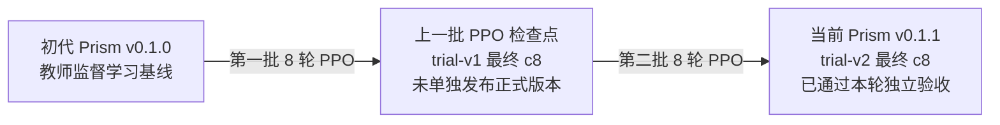

# Prism v0.1.1：完整对战数据与迭代结论

日期：2026-10-02。状态：**ACCEPTED_MODEL_ITERATION**；详细回放指标 **VERIFIED**。

**Prism v0.1.1 是本轮正式验收产物。** 新 5,120 局全部正常结束，0 重赛、0 新训练更新；对父代直接 1,024 局得分率 **59.9121%**，对共同锚点提升 **8.7158 个百分点**，四项严格门槛全通过。

2026-10-02 用户命名更正：本轮统一为 **Prism v0.1.1**，不另开 0.2 模型线。原名文档已保存到 ignored `local-artifacts/prism/011-docs/legacy-naming/`；冻结实验仍保留原 `v02` 文件名、内容/hash 和失败门槛。更正不改变权重、runtime 0.1.0 或权重格式；当前权重入口为 `local-artifacts/prism/v0.1.1/weights.json`。

## 模型继承关系：当前版本是哪一份权重

**Prism v0.1.1 是 trial-v2 最终 c8，不是 trial-v1 最终 c8。** `c8` 只表示某一批训练的第 8 轮检查点，必须连同 trial 批次一起看；两批 c8 是两份不同权重。



| 文档称谓 | 实际权重来源 | 权重 SHA256 前缀 | 在本次对战中的用途 |
|---|---|---|---|
| 初代 Prism v0.1.0 | M51 教师监督训练导出（原机器标识 prism-v0.1） | `5db70b77…` | 固定 greedy 基准对手 |
| 上一批 PPO 检查点 | trial-v1 第 8 轮最终 c8 | `cb7c4fb3…` | 第二批训练的起点，以及本次进步对照；不是当前正式版本 |
| **Prism v0.1.1** | **从上行继续训练八轮得到的 trial-v2 最终 c8** | `a2301f08…` | **本次正式验收和发布登记的模型** |

战绩表的“模型”列指出该行胜/平/负属于谁。节奏和耗时是**整场对局的共同指标**，不是某个对手独有的指标；每列现在写明“Prism v0.1.1 对阵某对手”。购卡/贵族/动作等个人指标则每格明确为“Prism v0.1.1 / 对手”。

## 身份、训练与评测协议

| 项目 | 固定身份与范围 |
|---|---|
| 正式模型 | **Prism v0.1.1**，trial-v2 最终 c8 |
| 基座沿革 | 初代 Prism v0.1（Prism v0.1.0，教师 BC）→ trial-v1 八轮 PPO → trial-v2 八轮 PPO |
| 上一批 PPO 检查点 | trial-v1 最终 c8；**不是**初代 Prism v0.1.0 |
| 本次训练 | trial-v2：8×256 = 2,048 局，434 新更新，AdamW 累计 870 |
| 独立验收 | 2 人经典规则，512 个新 seed `9470000..9470511`，双方换座 |
| Prism v0.1.1 / 上一批检查点动作 | 学得 categorical softmax 抽样 T=1，动作 seed `54030001` |
| 两个共同锚点 | 冻结 Heuristic v0.3.1、初代 Prism v0.1.0，均 greedy |
| 物理局数 | 4,096 共同锚点 + 1,024 直接对上一批检查点 = 5,120 |
| 校正 | 双座 seed 块 bootstrap 20,000 次，2 次验收 ×4 项，正式下分位 0.625% |
| 当前使用范围 | 模型迭代验收通过；默认模型、Studio 列表、共享池尚未接入 |
| 风格 / 独立审查 | 风格 NOT_RUN；同一执行 agent 核验，未声称独立 reviewer 审查 |

通用 `prism-sample` 握手仍为 0.1.0，与模型版本分开。Heuristic 的冻结模型身份是 v0.3.1，其通用程序握手报告 0.2.9；身份以合同 executable/weights SHA 为准。

| 身份与模式 | 证据文件 | SHA256 |
|---|---|---|
| 上一批 PPO 检查点，T=1 | `local-artifacts/prism/ppo-trial-v1/campaign/cycle-8-export/weights.json` | `cb7c4fb33ac7666706213ca4138f80104dacc5151b2385b9532bfebbe82025ac` |
| 初代 Prism v0.1.0，greedy | `local-artifacts/prism/v01/run/weights.json` | `5db70b773083858b83c6e679d5641f1b78d4c5fbe34c48950cc906064f821b54` |
| Prism v0.1.1 / 上一批 PPO 检查点通用抽样 runtime 0.1.0 | `local-artifacts/prism/acceptance-v1/build/release/splendor.exe` | `0dd5259123f0bd8c12b3672153a6a001b3026489c14abbbd4a919fcde9665f43` |
| Heuristic v0.3.1 冻结程序，握手 0.2.9 | `local-artifacts/prism/v01/bin/teacher-v031.exe` | `6a02b2ab1553e925162778c75763e82981c1f2a02c47fb11003becbda217d7db` |
| 初代 Prism greedy 程序 | `local-artifacts/prism/v01/bin/splendor-prism.exe` | `ec4024d61d8f87d838c6622367414b622118fa0c73e1e9028fe1a4bd828ad104` |

规则/catalog 指纹：`1c43f598b23017fab5e9d8b0083942ad1a921d1df804f90d16cd0b4753961afb`。导出 sidecar 的 `not_promoted` 保留训练导出时的历史状态；当前正式判定以 Prism v0.1.1 release/验收结果为准。

## 本轮详细对战表

### 各对手完整战绩

每项对照为 512 个新环境种子、双换座共 1,024 局；总计 5,120 局。纯胜率 = 胜 / 局数，得分率 =（胜 + 0.5 × 平）/ 局数。

| 模型 | 对手 | 局数 | 胜 / 平 / 负 | 纯胜率 | 计半平得分率 | 普通 95% 配对区间 |
| --- | --- | --- | --- | --- | --- | --- |
| Prism v0.1.1 | Heuristic v0.3.1 | 1024 | 633 / 4 / 387 | 61.8164% | 62.0117% | [59.0332%, 64.9902%] |
| Prism v0.1.1 | 初代 Prism v0.1.0 | 1024 | 631 / 6 / 387 | 61.6211% | 61.9141% | [58.9844%, 64.7949%] |
| Prism v0.1.1 | 上一批 PPO 检查点（trial-v1 c8） | 1024 | 609 / 9 / 406 | 59.4727% | 59.9121% | [56.8848%, 62.9395%] |
| 上一批 PPO 检查点 | Heuristic v0.3.1 | 1024 | 545 / 4 / 475 | 53.2227% | 53.4180% | [50.4871%, 56.3477%] |
| 上一批 PPO 检查点 | 初代 Prism v0.1.0 | 1024 | 542 / 3 / 479 | 52.9297% | 53.0762% | [50.1953%, 55.9082%] |

直接对上一批检查点的对战区间沿用原冻结验收；其余逐对手区间是新增描述性 bootstrap（20,000 次，按双座 seed 组），不新增晋级门槛，也不代替四项严格校正下界。

### 先后手明细

| 模型 | 对手 | 本模型座位 | 局数 | 胜 / 平 / 负 | 纯胜率 | 得分率 | 局均 VP（本模型 / 对手） |
| --- | --- | --- | --- | --- | --- | --- | --- |
| Prism v0.1.1 | Heuristic v0.3.1 | 先手 P0 | 512 | 336 / 3 / 173 | 65.6250% | 65.9180% | 14.811 / 13.295 |
| Prism v0.1.1 | Heuristic v0.3.1 | 后手 P1 | 512 | 297 / 1 / 214 | 58.0078% | 58.1055% | 14.631 / 13.744 |
| Prism v0.1.1 | 初代 Prism v0.1.0 | 先手 P0 | 512 | 320 / 2 / 190 | 62.5000% | 62.6953% | 14.600 / 13.348 |
| Prism v0.1.1 | 初代 Prism v0.1.0 | 后手 P1 | 512 | 311 / 4 / 197 | 60.7422% | 61.1328% | 14.527 / 13.281 |
| Prism v0.1.1 | 上一批 PPO 检查点（trial-v1 c8） | 先手 P0 | 512 | 306 / 7 / 199 | 59.7656% | 60.4492% | 14.545 / 13.637 |
| Prism v0.1.1 | 上一批 PPO 检查点（trial-v1 c8） | 后手 P1 | 512 | 303 / 2 / 207 | 59.1797% | 59.3750% | 14.648 / 13.602 |
| 上一批 PPO 检查点 | Heuristic v0.3.1 | 先手 P0 | 512 | 273 / 4 / 235 | 53.3203% | 53.7109% | 14.363 / 13.975 |
| 上一批 PPO 检查点 | Heuristic v0.3.1 | 后手 P1 | 512 | 272 / 0 / 240 | 53.1250% | 53.1250% | 14.307 / 13.990 |
| 上一批 PPO 检查点 | 初代 Prism v0.1.0 | 先手 P0 | 512 | 281 / 0 / 231 | 54.8828% | 54.8828% | 14.230 / 13.721 |
| 上一批 PPO 检查点 | 初代 Prism v0.1.0 | 后手 P1 | 512 | 261 / 3 / 248 | 50.9766% | 51.2695% | 14.092 / 14.037 |

### Prism v0.1.1 所在对局的节奏

每列均包含 Prism v0.1.1。局均步数/轮数/终局分差属于双方共同完成的对局；个人得分速度见下一张双方指标表。

| Prism v0.1.1 所在对局的指标 | Prism v0.1.1 对阵 Heuristic v0.3.1 | Prism v0.1.1 对阵初代 Prism v0.1.0 | Prism v0.1.1 对阵上一批 PPO 检查点 |
| --- | --- | --- | --- |
| 总执行步数 | 54919 | 54596 | 55224 |
| 局均执行步数 | 53.632 | 53.316 | 53.930 |
| 平均决策轮（legacy） | 26.829 | 26.671 | 26.976 |
| 最短 / 中位 / 最长决策轮 | 21 / 27.0 / 34 | 21 / 27.0 / 33 | 21 / 27.0 / 34 |
| 决策轮总体标准差 | 1.765 | 1.807 | 1.821 |
| 平均 Main 行动轮 | 26.802 | 26.646 | 26.954 |
| 终局绝对分差均值 | 3.775 | 3.981 | 3.700 |
| 终局分差 ≤2 的比例 | 35.64% | 32.52% | 34.67% |

legacy 决策轮为 `ceil(全部执行步/2)`，本玩家决策包含 `choose_noble`；它不是额外 Main 回合。Main 行动/轮另行统计。

### 购卡、折扣、贵族与预留

| 两方指标（每格：Prism v0.1.1 / 对手） | Heuristic v0.3.1 | 初代 Prism v0.1.0 | 上一批 PPO 检查点（trial-v1 c8） |
| --- | --- | --- | --- |
| 局均最终 VP | 14.721 / 13.520 | 14.563 / 13.314 | 14.597 / 13.619 |
| VP / 本玩家决策 | 0.5492 / 0.5040 | 0.5464 / 0.4993 | 0.5413 / 0.5051 |
| VP / 本玩家 Main 行动 | 0.5492 / 0.5044 | 0.5466 / 0.4997 | 0.5415 / 0.5053 |
| VP / 全局执行步 | 0.2745 / 0.2521 | 0.2732 / 0.2497 | 0.2707 / 0.2525 |
| 局均购卡数 / 永久折扣 | 12.195 / 13.337 | 12.208 / 13.294 | 12.427 / 12.591 |
| 局均贵族数 | 0.457 / 0.693 | 0.443 / 0.658 | 0.521 / 0.516 |
| 获得至少一贵族的对局比例（%） | 37.89 / 49.90 | 36.52 / 48.34 | 42.29 / 40.04 |
| 局均预留取得 | 2.170 / 2.372 | 2.232 / 1.830 | 2.513 / 2.400 |
| 局均预留买回 | 0.853 / 1.249 | 0.873 / 0.896 | 1.026 / 0.996 |
| 局均终局未买回预留 | 1.317 / 1.123 | 1.359 / 0.935 | 1.486 / 1.404 |
| 预留兑现率（%） | 39.29 / 52.66 | 39.11 / 48.93 | 40.85 / 41.50 |
| 局均 0 VP 卡 | 6.259 / 7.509 | 6.275 / 7.419 | 6.465 / 6.853 |
| 局均 1 VP 卡 | 2.082 / 2.604 | 2.036 / 2.642 | 2.180 / 2.275 |
| 局均 2 VP 卡 | 1.841 / 1.721 | 1.929 / 1.807 | 1.842 / 1.726 |
| 局均 3 VP 卡 | 0.841 / 0.794 | 0.890 / 0.778 | 0.897 / 0.867 |
| 局均 4 VP 卡 | 0.801 / 0.537 | 0.720 / 0.492 | 0.738 / 0.606 |
| 局均 5 VP 卡 | 0.372 / 0.173 | 0.358 / 0.156 | 0.305 / 0.264 |
| 局均白色永久折扣 | 2.346 / 2.667 | 2.415 / 2.610 | 2.420 / 2.545 |
| 局均蓝色永久折扣 | 2.507 / 2.581 | 2.471 / 2.648 | 2.528 / 2.499 |
| 局均绿色永久折扣 | 2.451 / 2.645 | 2.452 / 2.660 | 2.531 / 2.418 |
| 局均红色永久折扣 | 2.479 / 2.656 | 2.491 / 2.574 | 2.459 / 2.529 |
| 局均黑色永久折扣 | 2.413 / 2.788 | 2.379 / 2.801 | 2.488 / 2.600 |

兑现率使用累计买回数 / 累计预留数；终局未买回只描述保留牌，不直接等于无效预留或成功干扰。

### 七类动作的完整分布

| 动作次数及占比（每格：Prism v0.1.1 / 对手） | Heuristic v0.3.1 | 初代 Prism v0.1.0 | 上一批 PPO 检查点（trial-v1 c8） |
| --- | --- | --- | --- |
| 购市场卡 `buy_market` | 11615 (42.31%) / 12378 (45.06%) | 11607 (42.53%) / 12696 (46.50%) | 11674 (42.28%) / 11873 (43.00%) |
| 购预留卡 `buy_reserved` | 873 (3.18%) / 1279 (4.66%) | 894 (3.28%) / 917 (3.36%) | 1051 (3.81%) / 1020 (3.69%) |
| 拿筹码 `take_tokens` | 12735 (46.40%) / 11359 (41.35%) | 12498 (45.80%) / 11798 (43.21%) | 12303 (44.55%) / 12250 (44.37%) |
| 预留市场卡 `reserve_market` | 2219 (8.08%) / 2420 (8.81%) | 2283 (8.37%) / 1870 (6.85%) | 2573 (9.32%) / 2451 (8.88%) |
| 盲预留牌堆 `reserve_deck` | 3 (0.01%) / 9 (0.03%) | 3 (0.01%) / 4 (0.01%) | 0 (0.00%) / 7 (0.03%) |
| 选择贵族 `choose_noble` | 4 (0.01%) / 25 (0.09%) | 6 (0.02%) / 20 (0.07%) | 13 (0.05%) / 9 (0.03%) |
| Pass `pass` | 0 (0.00%) / 0 (0.00%) | 0 (0.00%) / 0 (0.00%) | 0 (0.00%) / 0 (0.00%) |
| 全部决策步数 | 27449 / 27470 | 27291 / 27305 | 27614 / 27610 |
| Main 行动步数 | 27445 / 27445 | 27285 / 27285 | 27601 / 27601 |

占比分母为该模型全部决策步（含 `choose_noble`）；换座后按模型身份合并，P0 不固定代表 Prism v0.1.1。零动作明确显示为 0。

### 实测耗时与缺失项

| Prism v0.1.1 所在对局的指标 | Prism v0.1.1 对阵 Heuristic v0.3.1 | Prism v0.1.1 对阵初代 Prism v0.1.0 | Prism v0.1.1 对阵上一批 PPO 检查点 |
| --- | --- | --- | --- |
| 逐局游戏进程耗时之和（秒） | 400.079 | 475.484 | 386.225 |
| 单局游戏进程均值（秒） | 0.3907 | 0.4643 | 0.3772 |
| 单局游戏进程 p95（秒） | 0.4850 | 0.6408 | 0.4379 |
| 决策 / 网络推理延迟 | NOT_MEASURED | NOT_MEASURED | NOT_MEASURED |

以上来自各局 `process-result.json.wall_seconds`，包含游戏进程内双方推理/规则执行/读写；为 4 个并发低优先级进程下的耗时。逐局耗时之和含并发重叠，不能当作整轮墙钟。整轮 5,120 局实际墙钟为 **1036.600 秒（17 分 17 秒）**，包含父代锚点局与运行调度。Arena 未保存逐决策/网络推理延迟，故显式标 NOT_MEASURED。


## 正式晋级依据与旧负结果

| 冻结验收项目 | 事先要求 | 严格校正下界 | 判定 |
| --- | --- | --- | --- |
| 共同锚点相对父代提升 | 严格 >0 pp | +5.3465 pp | PASS |
| Prism v0.1.1 直接对父代 | 严格 >50% | 56.0059% | PASS |
| Heuristic 锚点保护 | 提升 ≥−5 pp | +3.5645 pp | PASS |
| 初代 Prism 锚点保护 | 提升 ≥−5 pp | +3.9062 pp | PASS |

共同锚点父代 1087 / 7 / 954，得分率 53.2471%；Prism v0.1.1 为 1264 / 10 / 774，得分率 61.9629%。配对提升普通 95% 区间为 [+6.0547, +11.3770] pp；直接父代为 [56.8848%, 62.9395%]。普通区间用于解释不确定性，严格校正下界决定晋级；bootstrap 覆盖属于近似统计估计。

第一次 2,560 局仍是 **NOT_ACCEPTED**：直接对战校正下界恰 50%，没达到 >50%。第二次固定新 512 双座 seed 和更严格校正；旧对局未合并、模型权重未改变。补算行为表不会回改冻结门槛或否定旧失败。

## 本机与 cloud2 的速度

| 主机 | 相同任务数 | 串行耗时 | 当时环境 |
|---|---|---:|---|
| 本机 | 32 个 Rust Prism 对战任务 | 15.8309 秒 | i7-12700H |
| cloud2 | 同样 32 个任务 | 61.9840 秒 | EPYC 7551，暴露 2 vCPU，共享池仍运行 |

**这类固定 Rust Prism 对战优先本机，实测约快 3.92 倍。** 两边 32 局结果/VP/rank/步数一致；计时从首个配置到最后完成记录，含启动/核验/I/O，不含编译/SSH。这是当时工作负载下的结论，不能外推 GPU 或所有训练。本次补表未再次测速。

## 后续文档要求与下一轮方向

已把“每份后续模型结果/版本/演进文档直接包含详细表格”写进 AGENTS.md §7、项目文档规范和统一指标标准。各对手/双座战绩、VP/节奏、卡牌/折扣、贵族、预留、七类动作与耗时必须展示；缺项显式标 NOT_MEASURED，不能只贴 JSON。

### 同锚点下的 Prism v0.1.1 与父代行为对照

| 同锚点行为指标（Prism v0.1.1 / 父代） | Heuristic v0.3.1 | 初代 Prism v0.1.0 |
|---|---|---|
| 局均最终 VP | 14.721 / 14.335 | 14.563 / 14.161 |
| VP / 本玩家 Main 行动 | 0.5492 / 0.5337 | 0.5466 / 0.5276 |
| 局均购卡 / 永久折扣 | 12.195 / 12.453 | 12.208 / 12.447 |
| 局均 0 VP 卡 | 6.259 / 6.603 | 6.275 / 6.608 |
| 局均 3–5 VP 卡 | 2.014 / 1.963 | 1.968 / 1.881 |
| 局均贵族 | 0.457 / 0.469 | 0.443 / 0.464 |
| 贵族覆盖率（%） | 37.89 / 37.70 | 36.52 / 37.21 |
| 局均预留取得 | 2.170 / 2.026 | 2.232 / 2.212 |
| 局均预留买回 | 0.853 / 0.884 | 0.873 / 0.902 |
| 局均终局未买回预留 | 1.317 / 1.143 | 1.359 / 1.310 |
| 预留兑现率（%） | 39.29 / 43.61 | 39.11 / 40.79 |

两模型使用同锚点/seed/座位与相同 T=1，表格是本次固定对照的描述统计；未对这些行为差异增加正式检验门槛，也不据此认定某种风格或机制。

### 下一轮方向判断：先做一个初代风格样机，继续复用 PPO

状态：**历史方向建议；后续 M55 已授权启动**。当时未采样、未选定参数；用户后来“okay 开始吧”授权一个有限冲分样机，当前参数与状态见 M55。

建议把已验收的 **Prism v0.1.1 冻结为通用基座和棋力参照**，从同一权重派生一个“冲分”初代风格模型，使用既有 PPO 闭环学习。PPO 是训练方法，风格模型是产物目标，两者可以结合。初代 Prism v0.1.0 保留作对照，不因“初代”称呼而退回较弱的训练起点；若指从零重训通用基座，当前还缺少必须重建表示的证据。

| 选项 | 现有证据与成本 | 建议 |
|---|---|---|
| 再做一批仅胜负奖励 PPO | Prism v0.1.1 的独立新 seed 验收支持有效迭代；没有证据说明继续训练无效或已到上限，但同两个对手更多训练未必增加广度 | 放在风格样机之后；若下一目标只要更强，先做有界对手广度诊断，再冻结续训方案 |
| 从 Prism v0.1.1 派生初代风格模型 | 风格目标还未落地；已有更强参照，可以分别判风格差异和棋力损失 | **优先：只做一个冲分样机**，暂不同时三风格或大规模候选扫描 |
| 从初代 Prism v0.1.0 / 随机初始化重做通用基座 | 可作研究对照，当前没有受控证据证明重训比沿用 Prism v0.1.1 更合算 | 暂缓；以具体表示缺陷、合法信息缺口或跨对手失败为重开条件 |
| 先部署、GPU/PyO3 或扩大混池 | 可改善使用或效率，不能补出可测风格；本机固定评测速度已可用 | 作为独立工程目标，暂不替代下一研究问题 |

建议形成时的源码核实：`training/prism/ppo/model.py` 已有独立训练用 style head，`learner.py` 支持胜负优势加 β×风格残差及独立 style loss；但当时 `execution.py::validate_spec` 明确拒绝 `style_beta != 0`，当时真实风格奖励提取器尚未接入。M55 已接通 run v3 的冻结奖励合同；下述原建议是决策历史。原建议为下一轮先补齐这个闭环，不能只改 β 就声称可进行风格训练。

先选冲分，因为公开得分在固定自身 Main 行动窗口中的实现速度容易定义和复核。目标可沿用 M54 原提案的固定 K 窗口归一化得分 AUC；K、归一化上限、β、训练预算、可接受棋力损失 δ 和最小风格差异须在采样前冻结；形成此建议时未预填数值，后来实际冻结值见 M55。保留真实胜负 critic；不加入推理 logit 偏置、隐藏牌/未来信息或同局未来结果作在线输入。额外风格效用改变策略权衡，需要单独验证；[奖励塑形的策略不变性原论文](https://people.eecs.berkeley.edu/~russell/papers/icml99-shaping.pdf) 的保证只适用于特定形式与假设，不能直接套到该风格目标。

建议顺序：①奖励提取/coverage/恢复和 β=0 一致性工程验证；②有限开发训练，只做一个风格、少量预先限定候选；③冻结唯一候选，用新独立 seed 同时验风格差异和相对 Prism v0.1.1 棋力约束。至少加入一个不与奖励公式重复的行为指标，并监测预留兑现/持牌占用等代价，避免只练高奖励。这轮 945/947 开头的验收 seed 已消费，不能用于训练、候选挑选或下一轮新 holdout。

本次画像仅作描述：Prism v0.1.1 对 Heuristic 的预留兑现率 39.29%，上一批 PPO 检查点 43.61%；终局未买回均值 1.317 vs 1.143。这提示后续需监测预留代价，不能证明有效干扰或 PPO 缺陷。Prism v0.1.1 也尚未通过“均衡风格”的独立验收，只是当前通用棋力参照。


## 核验命令、来源与限制

此次离线命令：

```powershell
python -B -u scripts/prism_match_details.py --plan local-artifacts/prism/acceptance-v2/plan.json --acceptance-result benchmarks/m54-prism-v02-acceptance-v2.result.json --metrics-program local-artifacts/prism/v01/bin/s4_batch_metrics.exe --work-dir local-artifacts/prism/011-docs/match-details --output benchmarks/m54-prism-011.match-details.json
```

**exit0，10 个模型/对手/座位批次，全 5,120 回放通过 Rust 规则轨迹重验。** Python 同时核对 report/replay/config hash、完整 seed/双座网格、模型归属、原 W/D/L、购卡/折扣/VP/贵族/预留守恒和动作次数。逐局 source ledger、10 份 manifest/metrics/receipt 和总分析回执在 ignored `local-artifacts/prism/011-docs/`。使用既存 metrics binary 并记录 SHA，没有宣称它是当前源码新编译产物。

| 证据 | SHA256 |
| --- | --- |
| `benchmarks/m54-prism-v0.1.1.release.json` | `f9b95b8d86a59d06b0954e02cf875eb1743c352bc664753fe0c77fc8455b0fd9` |
| `benchmarks/m54-prism-v0.1.1.result.json` | `07b7cdc7af2bcb67f8e51b46c04c41e06f9b133123f705a6e9700afabec7ba7a` |
| `benchmarks/m54-prism-011.match-details.json` | `24c1fbed8cd254a13f6bbb40153b15106576f9436520d4a540a9efc4916510dc` |
| `benchmarks/m54-prism-v02-acceptance-v2.config.json` | `8b8045da8e1f4e57e9d3d1c986e58722b8ecaafea603cc14ef61b14bb77ca154` |
| `benchmarks/m54-prism-v02-acceptance-v2.result.json` | `827c621a8e1771849088624cff385fe818c149c0f8374fe5863bb70cebfa82a5` |
| `scripts/prism_match_details.py` | `0f7fb79de0a65e60dfcb914716c99562fa44dd7673e6c1c0ea5ee4916ba11bc4` |
| `local-artifacts/prism/v0.1.1/weights.json` | `a2301f0878f9c342a61b83fd45412f72ba95acfca895dafbe7ceca0360f34a85` |

完整历史：[M54](../m54-prism-continuous-ppo-design.md)；模型线：[M51](../m51-prism-model-line.md)；[模型演进表](prism-model-evolution-matrix.md)；[统一指标](../unified-match-metrics-standard.md)。owner 已说明历史解除 pause 是本人操作，原共享池边界失败保留。生成资产 local-only，本轮未提交/推送。


### 文档收口验证

```powershell
python -B local-artifacts/prism/011-docs/validate-closeout.py
```

**exit0 / PASS**：冻结 config/result 和原名文档档案 hash 一致；Prism v0.1.1 同权重、release/result/detail 索引绑定一致；各文档完整表格/数字/链接、下一轮 PROPOSED 状态、`git diff --check` 和 local-only 规则通过。回执 `local-artifacts/prism/011-docs/closeout-validation.json` 保存断言与文件 hash。此项是文档/产物一致性检查，不是新增棋力比赛；main/HEAD 未变，staging 空，未提交/推送。

## 当前后续轮次

用户已授权并启动 [M55 冲分样机](../m55-prism-rush-style-model.md)：从冻结的 Prism v0.1.1 新建风格 run，四轮训练，只检验最终 c4。先前“下一轮 PROPOSED”的方向分析保留为决策历史，M55状态以其活文档为准。
